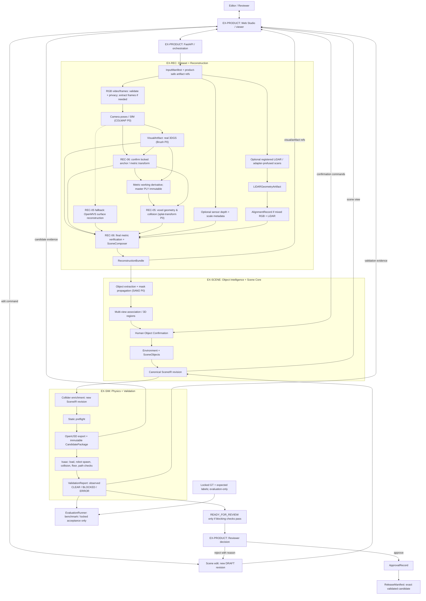
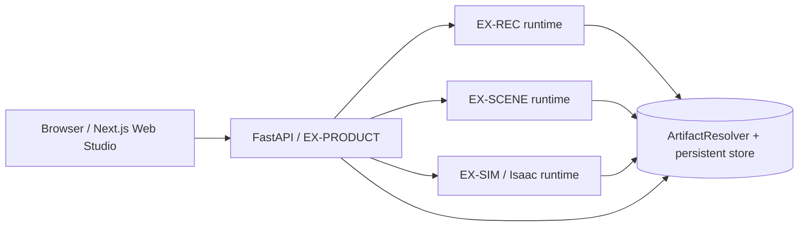

# Architecture Document

## System Overview

Real2Sim Studio là modular monolith + isolated heavy workers. FastAPI/Next.js
orchestrate EX-REC → `ReconstructionBundle` → EX-SCENE → `SceneIR` → EX-SIM →
`CandidatePackage`/`ValidationReport`; cross-track handoff chỉ qua typed contracts
và immutable artifacts, không import implementation nội bộ.

## Repository Structure and Module Ownership

Repository giữ nguyên scaffold do ban tổ chức cung cấp và chỉ mở rộng theo chính sách **additive-only**:

```text
KEEP existing organizer scaffold
+
ADD minimal Real2Sim modules
```

Không rename, move, delete hoặc archive file/thư mục do ban tổ chức cung cấp. Module scaffold hiện có nhưng chưa được Real2Sim sử dụng vẫn được giữ nguyên. `Dockerfile`, `docker-compose.yml`, `src/api/`, `src/agents/`, `src/llm/`, `src/models/schemas.py`, top-level `eval/` và `eval/results/report.md` là các path ổn định.

Canonical Real2Sim module structure (placement mục tiêu, không khẳng định mọi
thư mục đã được implement ở checkout hiện tại):

```text
src/
├── api/                              # Organizer scaffold; EX-PRODUCT
│   ├── routes.py                     # Organizer scaffold; include các router
│   ├── routes_product.py             # Project/job/artifact/scene/review API
│   └── studio/                       # Studio MVP: uploads, scenes, processing, samples (+ deps)
├── agents/                           # Organizer scaffold; giữ nguyên
├── llm/                              # Organizer scaffold; giữ nguyên
├── models/
│   ├── schemas.py                    # Organizer scaffold; giữ nguyên
│   └── contracts/                    # Shared artifact contracts
│       ├── artifacts.py
│       ├── coordinates.py
│       ├── identity.py               # Canonical content/package checksums
│       ├── manifests.py
│       ├── reconstruction.py
│       ├── scene.py
│       ├── validation.py
│       └── release.py
└── services/
    ├── reconstruction/               # EX-REC
    │   ├── adapters/                 # COLMAP/Brush/splat-transform (+ cầu nối Node .mjs)
    │   ├── rgb/                      # Chia theo stage:
    │   │   ├── preflight/            #   REC-02 chất lượng video, privacy gate, report
    │   │   ├── frames/               #   REC-02A frame set
    │   │   ├── pose/                 #   REC-03 camera pose
    │   │   ├── splat/                #   REC-04 visual 3DGS
    │   │   ├── geometry/             #   REC-05 voxel/geometry
    │   │   └── canonical/            #   REC-06 metric/world canonicalization
    │   ├── lidar/
    │   ├── alignment/
    │   └── prepare_cli.py, preview_cli.py  # Entrypoint ổn định worker gọi qua process
    ├── scene/                        # EX-SCENE
    │   ├── extraction/
    │   ├── association/
    │   ├── candidates/
    │   ├── decomposition/
    │   └── editing/
    ├── simulation/                   # EX-SIM
    │   ├── colliders/
    │   ├── preflight/
    │   ├── usd/
    │   ├── isaac/
    │   └── validation/
    └── orchestration/                # EX-PRODUCT
        ├── jobs/                     # lifecycle, runtime DB, runner, worker_cli, progress
        ├── artifacts/
        ├── projects/                 # project registry, privacy policy
        ├── uploads/                  # video upload (stream vào artifact store)
        ├── processing/               # thông số xử lý theo configs/product, đo máy worker
        ├── samples/                  # thư viện video mẫu đã xử lý sẵn
        ├── scene/                    # SceneIR revision cho viewer (PRODUCT-06)
        ├── review/
        └── release/

frontend/                             # EX-PRODUCT; Next.js Web Studio
├── src/
│   ├── app/                          # routes, layouts, page composition
│   │   ├── (studio)/                 # Studio MVP (mặc định)
│   │   └── (legacy)/                 # UI P0 đầy đủ; redirect về Studio trừ khi LEGACY_UI=1
│   ├── components/                   # shared presentational components (`studio/` = primitives MVP)
│   ├── features/
│   │   ├── studio/                   # luồng Studio MVP: Scenes, Scene mới + video mẫu, editor
│   │   ├── projects/
│   │   ├── jobs/
│   │   ├── viewer/
│   │   ├── scene/
│   │   ├── validation/
│   │   └── review/
│   └── lib/
│       ├── api/                      # typed FastAPI client
│       └── contracts/                # frontend projections of API schemas
├── public/                           # `editor/` = SuperSplat build (npm run build:editor)
├── vendor/supersplat/                # SuperSplat editor vendored (MIT)
├── tests/                            # frontend unit/component/browser tests
└── package.json

configs/product/                      # EX-PRODUCT; file cấu hình chung (thông số xử lý, upload quality)
scripts/torwic/                       # EX-REC; offline dataset preparation only (`migrations/` = chạy một lần)
scripts/gpu/, scripts/demo/           # Chạy stack trên máy GPU; export bundle video mẫu
fixtures/                             # Shared contract-shaped development fixtures
├── artifact_store/                   # Resolvable synthetic payload bytes
├── reconstruction_bundle/
├── scene_ir/
├── validation_report/
├── mock_job/
└── invalid/                          # Negative contract fixtures

tests/                                # Existing tests remain; track suites are additive
├── test_contracts/
├── test_api/                          # Organizer API/scaffold tests
├── test_reconstruction/              # `support/` fixture dùng chung, `smoke/` smoke chạy tay với tool thật
├── test_scene/
├── test_simulation/
├── test_orchestration/
├── integration/
└── e2e/

eval/                                 # Top-level name is stable
├── visual/
├── geometry/
├── pose/
├── object/
├── path/
├── protocols/
└── results/report.md                 # Existing acceptance report; giữ nguyên
```

Ownership:

| Boundary | Owner |
|---|---|
| `src/services/reconstruction/`, `scripts/torwic/` | `EX-REC` — `@awun0105` |
| `src/services/scene/` | `EX-SCENE` — Đức |
| `src/services/simulation/`, evaluation implementations under `eval/` | `EX-SIM` — Đạt |
| `src/api/`, `src/services/orchestration/`, `frontend/` | `EX-PRODUCT` — Cường |
| `src/models/contracts/`, `fixtures/` | Shared; producer và consumer cùng review |

### Placement rules

| Loại code | Vị trí chuẩn |
|---|---|
| Shared Pydantic/data contracts | `src/models/contracts/` |
| RGB, LiDAR, camera pose, reconstruction, alignment và reconstruction adapters | `src/services/reconstruction/` |
| Segmentation, object association, candidate, decomposition và SceneIR editing | `src/services/scene/` |
| Collider, physics, OpenUSD, Isaac, preflight và runtime validation | `src/services/simulation/` |
| Jobs, artifact lifecycle/storage, review, release và pipeline orchestration | `src/services/orchestration/` |
| HTTP routes | `src/api/` |
| Next.js Web Studio, PlayCanvas viewer và frontend tests | `frontend/` |
| TorWIC offline preparation | `scripts/torwic/` |
| Benchmark metrics và evaluation protocols | `eval/` |
| Shared development/test artifacts | `fixtures/` |
| Track unit tests | `tests/test_<track>/` |
| Cross-track integration tests | `tests/integration/` |
| Full workflow tests | `tests/e2e/` |

`src/models/contracts/` chỉ định nghĩa **dữ liệu trông như thế nào**; `src/services/` chứa **logic xử lý dữ liệu đó**. Ví dụ, `SceneIR` nằm trong `src/models/contracts/scene.py`, còn logic move/rotate/add/delete object nằm trong `src/services/scene/editing/`.

Utility chỉ dùng cho một track phải nằm bên trong track đó. Không tạo `src/utils/`, `src/pipelines/`, `src/workers/` hoặc top-level folder mới nếu chưa có quyết định kiến trúc chung. Nếu chưa rõ vị trí của một file, hỏi owner/Tech Lead trước khi tạo.

Các track không import implementation nội bộ của nhau. Giao tiếp cross-track chỉ qua shared contracts và published artifacts. `scripts/torwic/` là offline tooling; runtime API chỉ consume output đã chuẩn hóa, không gọi trực tiếp dataset-preparation scripts.

`src/models/contracts/` là shared boundary duy nhất cho Real2Sim artifacts. Import contract theo dạng `from src.models.contracts... import ...`. Downstream track chỉ phụ thuộc shared contracts và published artifacts; không import implementation nội bộ của upstream track. Fixtures phải có cùng schema với artifact thật để `EX-SCENE`, `EX-SIM` và `EX-PRODUCT` phát triển song song mà không chờ upstream hoàn tất.

`frontend/` tại repository root là canonical frontend boundary và do `EX-PRODUCT`
sở hữu. `EX-PRODUCT` được phép tạo scaffold Next.js/TypeScript trong thư mục này,
bao gồm Web Studio, PlayCanvas 3D viewer, job/progress UI, SceneObject editing,
validation, review và release UI.

P0 browser viewer dùng `PlayCanvas Engine` (v2.22.4) kết hợp `@playcanvas/supersplat-viewer`
(v1.35.2) với WebGL2/WebGPU fallback tại `frontend/src/features/viewer/` cho real 3DGS
`VisualArtifact` (định dạng SOG và compressed PLY), geometry mesh, point cloud,
SceneObject, collider proxy, transform controls (Translate/Rotate Gizmos) và view/layer
toggles. Các view dùng chung một Single Scene Graph (`pc.Entity`), chia sẻ chung GPU
Render Pass và Depth Buffer, gắn chặt với canonical SceneIR/SceneObject transforms;
không có scene truth riêng trong browser. Gaussian renderer P0 nạp output SOG từ
`splat-transform` (sinh từ Brush PLY) qua artifact refs/checksums và được qualification
về format, license, browser capability và GPU lifecycle. WebGPU được ưu tiên khi khả dụng
và tự động fallback WebGL2; synthetic fixture hoặc mesh/point cloud không phải Brush
compatibility proof.

Frontend giao tiếp với backend qua FastAPI tại `src/api/` và typed API contracts.
Không import Python implementation, không gọi trực tiếp worker internals và không
tạo business-state source of truth cạnh tranh trong Next.js API routes hoặc local
React state. Persisted job, artifact, scene revision, validation, review và
release state vẫn thuộc backend/shared artifacts. Frontend-only unit/component
tests nằm trong `frontend/tests/`; cross-stack workflow tests nằm trong
top-level `tests/e2e/`.

Không thêm worker-specific Dockerfile trước khi runtime requirements của
Reconstruction, SAM2 và Isaac được khóa.

## Canonical Coordinate And Artifact Storage

Mọi shared contract dùng meter, Z-up, right-handed, world frame `world`.
Transform có semantics `parent_from_local`, quaternion `xyzw`, angle `radian`:

```text
p_parent = T_parent_from_local * p_local
```

COLMAP, PlayCanvas, splat-transform, OpenUSD và Isaac convert convention ở adapter boundary.
Artifact persistence do `src/services/orchestration/artifacts/` sở hữu:

```text
ARTIFACT_ROOT=<deployment-configured-absolute-path>
artifact://jobs/<job_id>/<artifact-path>
```

Development default có thể là `./data/artifacts/`; absolute local path không nằm
trong contracts. Publication phải atomic, immutable và SHA-256-verifiable.

## Architecture Diagram

Sơ đồ dưới đây được chuẩn hóa từ [bản trình bày mentor](docs/mentor-duty-report/buoi-2/script/script-buoi-2.md)
thành **logical pipeline**; các tool ghi trong ngoặc là P0
implementation của track, không phải field hoặc dependency bắt buộc của shared
contracts. `EX-PRODUCT` điều phối và hiển thị xuyên suốt, không chỉ xuất hiện ở
bước cuối. RGB-only, RGB-D và RGB+LiDAR là các configuration khác nhau;
alignment chỉ bắt buộc khi bundle mixed RGB+LiDAR.



Mọi mũi tên qua ranh giới track là typed contract + published artifact
URI/checksum, không phải import nội bộ hoặc cùng một process. Sơ đồ không hàm ý
`traj_gt.txt` hay `groundtruth_map.ply` là product input: raw GT thuộc evaluation;
GT-assisted offline preprocessing, nếu được khai báo, phải giữ dependency trong
provenance và không được claim trajectory/geometry độc lập với GT. Evaluation chỉ
so sánh với locked reference **sau khi prediction đã cố định**; Isaac chỉ report
observation. Một edit sau validation luôn tạo `DRAFT` revision mới và invalidates
candidate/report/approval cũ. `SceneIR` vẫn là source of truth; OpenUSD là export
để validate, không phải scene state cạnh tranh. Browser P0 phải xem được real
3DGS `VisualArtifact` cùng các technical views, không chỉ mesh/point cloud.

### Pipeline glossary

- **SfM (Structure from Motion):** ước lượng camera poses và cấu trúc thưa từ
  nhiều ảnh; output backend được adapter chuẩn hóa trước khi publish.
- **RGB–LiDAR alignment:** xác nhận transform giữa RGB geometry và registered
  LiDAR geometry cho mixed bundle, lưu `AlignmentRecord`; declared transform
  chưa phải confirmed alignment.
- **Canonicalize:** chuyển unit/axes/frame/transform về meter, Z-up,
  right-handed, `parent_from_local`; metric scale phải có evidence phù hợp.
- **SceneComposer:** tổng hợp các representation/ref đã chuẩn hóa thành
  `ReconstructionBundle` theo modality rules; Visual, Geometry và Physics vẫn
  tách biệt.
- **Object extraction/segmentation:** xác định vùng ảnh thuộc candidate object;
  SAM2 là P0 implementation, không phải field của `SceneIR`.
- **Mask propagation:** theo dõi/lan truyền mask qua các frame để hỗ trợ
  association, không tự động xác nhận object identity.
- **Multi-view association:** nối các quan sát ở nhiều view vào cùng candidate
  object/3D region; human confirmation vẫn là gate trước decomposition.
- **AABB / OBB / convex hull / simplified mesh:** các lựa chọn collider theo
  độ chính xác/chi phí khác nhau; collider là representation physics gắn với
  logical object, không lấy visual 3DGS làm collider.
- **Static preflight:** kiểm metric, transform, bounds, artifact/collider,
  object confirmation và cấu hình cần thiết **trước candidate build**. Việc USD
  load và robot spawn thuộc bước Isaac validation sau export.
- **Robot spawn / floor / collision checks:** kiểm candidate có load và khởi
  tạo robot hợp lệ, mặt sàn/collider có dùng được, không có penetration không
  hợp lệ; lỗi runtime được report là `ERROR`, không suy thành `PASS`.
- **Start–Goal path validation:** quan sát `CLEAR`, `BLOCKED` hoặc `ERROR`
  cho từng cặp; hidden expected label chỉ được `EvaluationRunner` đọc, còn
  required route trong product config dùng rule riêng.
- **Artifact handoff:** bàn giao typed artifact bằng logical URI, SHA-256 và
  provenance qua các track; fixture proof không phải real GPU/Isaac acceptance.
- **Seal exact validated candidate:** `ApprovalRecord` và `ReleaseManifest`
  phải bind đúng checksum của candidate đã được validate; không rebuild sau
  approval rồi coi là cùng release.

## Organizer Template Appendix (Non-Normative)

Các mục của organizer scaffold được giữ nhưng diễn giải theo Real2Sim. Appendix
này mô tả **kiến trúc mục tiêu** và **trạng thái triển khai quan sát được**, không
thay thế PRD, shared Contract hoặc quyết định runtime chưa được khóa. Ở checkout
hiện tại (2026-09-29), typed contracts, synthetic fixtures và filesystem artifact
store đã có; FastAPI có API product + Studio và queue worker chạy REC thật qua
process boundary; `frontend/` có Studio MVP (upload → 3DGS → editor) và UI P0 ẩn;
`docker-compose.yml` mới khai báo backend. Fixture/integration proof không phải
real Brush, browser hoặc Isaac acceptance.

### Components

### 1. Frontend (React/Next.js)

- **Purpose:** Web Studio cho Editor/Reviewer; `EX-PRODUCT` tạo tại root
  `frontend/`, với viewer ở `frontend/src/features/viewer/`.
- **Key Features (P0 target):** project/job/upload/progress, SceneIR inspection
  và editing, chuyển/bật 3DGS Visual, Geometry mesh, point cloud và Collider
  views, xem validation evidence, review và release. Real 3DGS phải được
  qualification bằng `VisualArtifact` do Brush tạo; mesh/point cloud không thay
  thế proof này.
- **State Management:** UI chỉ giữ camera, selection, visible layers và thao tác
  tạm thời. Job, artifact, SceneIR revision, validation, review và release được
  lưu ở backend/artifact store; edit gửi command qua typed FastAPI boundary rồi
  render lại canonical state. Chưa khóa thư viện quản lý client state.

### 2. Backend (FastAPI)

- **Purpose:** `EX-PRODUCT` sở hữu project/job API, orchestration, artifact
  lifecycle, scene edit commands, validation presentation, review và release.
  Worker chuyên môn xử lý trong boundary của track tương ứng; API không import
  internals của các track.
- **API Design:** typed request/response qua `src/api/` và shared contracts;
  published artifacts được tham chiếu bằng logical URI/checksum, không bằng
  local filesystem path. Endpoint product cụ thể thuộc `PRODUCT-*` tasks, chưa
  được coi là đã implement chỉ vì API scaffold tồn tại.
- **Authentication/authorization:** PRD/Contract yêu cầu tách quyền Editor và
  Reviewer, audit review decision và chỉ release candidate đã validate/approve.
  Cơ chế đăng nhập/token/session cụ thể chưa được khóa; không mặc định JWT hoặc
  bỏ auth. `src/api/routes.py` giữ chat/status scaffold và include
  `routes_product.py` + `studio/`.

### 3. AI Agent (LangGraph)

`src/agents/` và `src/llm/` là organizer scaffold được giữ nguyên. Agent chat
LangGraph hiện có không phải orchestration engine hay một handoff của Real2Sim
P0. Không đưa LLM/agent vào đường bắt buộc
`ReconstructionBundle → SceneIR → CandidatePackage → ValidationReport`.

- **Agent Type:** chưa chọn agent type cho Real2Sim P0.
- **State/Nodes/Tools:** `src/agents/state.py`, `graph.py` và example modules
  thuộc scaffold chat hiện tại; không định nghĩa SceneIR, job lifecycle hay
  review policy. Nếu có agent task sau này, scope và I/O phải được khóa riêng.
- **Flow:** product pipeline dùng typed stage/artifact contracts ở phần Data Flow
  dưới, không đi qua chat LLM.

### 4. Database

- **Type:** runtime PRODUCT dùng SQLite file cho local và adapter PostgreSQL
  cho deployment qua `Settings.database_url`. PostgreSQL cần driver psycopg 3;
  chưa có cloud/database acceptance chỉ từ việc adapter tồn tại.
- **Tables:** schema v1 giữ projects, con trỏ immutable JobManifest và journal
  events/attempts. Con trỏ + event commit cùng transaction; stale writers bị CAS
  từ chối. Binary vẫn ở artifact store, không lưu trong DB.
- **Migrations:** bootstrap chỉ tạo schema v1 còn thiếu; version lạ bị từ chối,
  không tự drop/reset. Chưa chọn Alembic. Scene/review/release chưa được coi là
  đã migrate chỉ vì project/job có persistence.
- **P0 durable boundary hiện có:** logical artifact URI qua
  `ArtifactResolver`/`FilesystemArtifactStore`; exact storage/runtime wiring của
  product workflow thuộc EX-PRODUCT tasks.

### 5. Vector Store

Không có vector store hoặc embedding model bắt buộc cho Real2Sim P0 handoff.
`chroma_persist_dir` trong `src/config.py` là organizer scaffold, không phải
quyết định chọn ChromaDB cho scene understanding, retrieval hay product API.
Chỉ bổ sung vector store khi một approved task có consumer và acceptance rõ.

## Data Flow

1. Editor gửi input/config qua Web Studio → FastAPI; API tạo job và tham chiếu
   `InputManifest`/published input artifacts. Input/GT được phân loại theo typed
   data class, không suy từ tên file hoặc URI.
2. `EX-REC` chuẩn hóa sensor inputs và publish `ReconstructionBundle`;
   `EX-SCENE` đọc contract đó để publish canonical, editable `SceneIR`.
3. `EX-SIM` làm collider/preflight, xuất candidate OpenUSD **từ SceneIR** rồi
   chạy Isaac validation để publish `CandidatePackage` và `ValidationReport`.
   OpenUSD không trở thành nguồn sự thật cạnh tranh với SceneIR.
4. `EX-PRODUCT` hiển thị scene/views và validation evidence cho Reviewer. Khi
   edit, tạo SceneIR revision mới và invalidate validation/approval cũ.
5. Reviewer approve/reject; release chỉ tham chiếu **exact validated candidate**
   cùng approval/report identity, không rebuild rồi gọi là cùng candidate.
   `EvaluationReport`/GT thuộc evaluation boundary riêng, không feed vào runtime
   prediction/validation.

Durable cross-stage/worker handoff đi qua contract + immutable artifact URI/SHA-256.
Tính toán nội bộ một worker có thể dùng memory; không yêu cầu ghi file giữa mỗi
function. `VisualArtifact` (3DGS), geometry và physics/collider là các
representation tách biệt nhưng dùng cùng `SceneObject.transform`.

## Deployment Architecture

Logical target, không phải mô tả `docker-compose.yml` hiện tại:



Reconstruction, scene-intelligence, simulation và platform có thể cần runtime
riêng; invocation/status và artifact contracts là interface, không phải Python
cross-import. Target deployment là cloud NVIDIA GPU + Isaac Sim. GPU model,
driver/CUDA, Isaac/OpenUSD và tool versions phải ghi vào runtime manifest sau
provisioning; hiện vẫn `UNVERIFIED/TBD`. Không suy ra đã có frontend/worker
containers từ sơ đồ.

## Security

- Secret qua environment/`Settings`, không commit `.env` hay log credential.
- FastAPI I/O và shared artifacts được validate bằng typed Pydantic contracts;
  artifact resolution kiểm URI, existence, immutable publication và SHA-256.
- Product-facing boundary từ chối raw GT/evaluation-only data bằng typed
  classification; GT-assisted derived artifact giữ provenance cho evaluation.
- Editor/Reviewer actions và exact candidate approval/release cần authorization
  cùng audit evidence. Cơ chế identity/login cụ thể chưa được chốt.
- `src/main.py` hiện cấu hình CORS từ `Settings.cors_origins`; allowed origins
  của Web Studio phải được cấu hình khi deploy. Rate limiting và production
  perimeter chưa được khóa/kiểm chứng, không claim đã triển khai.

## Design Decisions

| Decision | Choice | Reason |
|----------|--------|--------|
| Backend boundary | FastAPI tại `src/api/` | Product API và typed worker/artifact orchestration |
| Frontend boundary | Next.js/TypeScript tại root `frontend/` | Web Studio và client-side 3D viewer; Studio MVP đã có |
| Viewer P0 | PlayCanvas Engine + @playcanvas/supersplat-viewer (WebGL2/WebGPU) | Real 3DGS Visual (SOG) và kỹ thuật Geometry/Point Cloud/Collider trên cùng SceneIR. **Hiện trạng 2026-09-27: Visual + collider environment ở cùng `pc.AppContext`; ba view kỹ thuật còn lại dựng bằng Three.js ở renderer riêng — xem `ex_product/TRACK.md` §Technology And Strategy** |
| Shared state | `SceneIR` + immutable artifact contracts | Một canonical scene/object transform; không dùng USD/browser state làm truth |
| Artifact storage P0 | Resolver + filesystem store | Logical URI/SHA-256, atomic immutable handoff; có synthetic Foundation proof |
| Worker boundary | Isolated runtimes + published artifacts | Tránh import internals/coupling GPU dependencies giữa tracks |
| Agent / vector store | Không thuộc required P0 pipeline | Organizer scaffold được giữ; chưa có consumer được khóa |
| Product database/auth mechanism | Chưa khóa | Không suy từ SQLite/JWT/Alembic template thành product decision |
