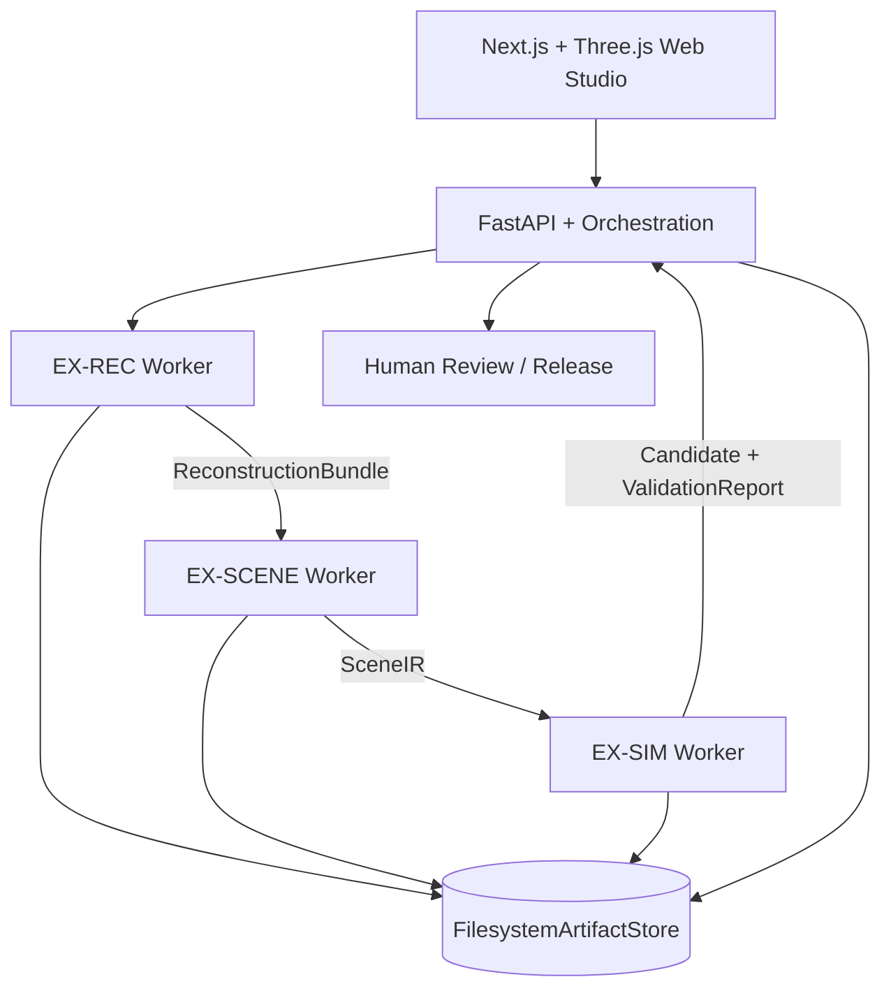
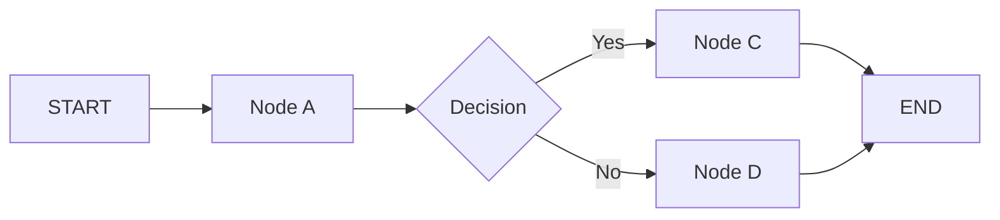
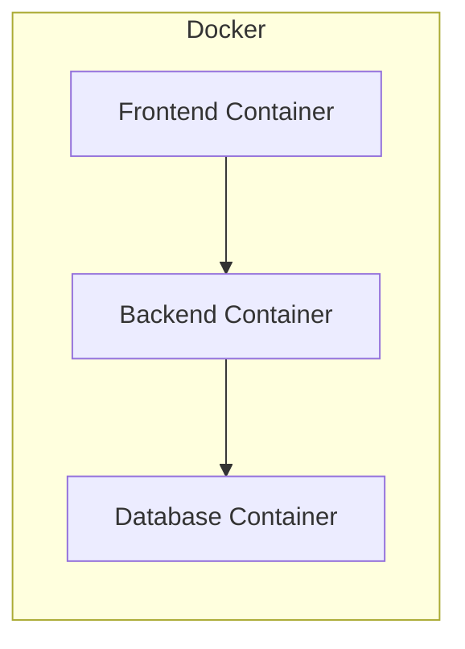

# Architecture Document

## System Overview

Real2Sim Studio là modular monolith + isolated heavy workers. FastAPI/Next.js
orchestrate EX-REC → `ReconstructionBundle` → EX-SCENE → `SceneIR` → EX-SIM →
`CandidatePackage`/`ValidationReport`; cross-track handoff chỉ qua typed contracts
và immutable artifacts, không import implementation nội bộ.

## Repository Structure and Module Ownership

Repository giữ nguyên scaffold do ban tổ chức cung cấp và chỉ mở rộng theo chính sách **additive-only**:

```text
KEEP existing organizer scaffold
+
ADD minimal Real2Sim modules
```

Không rename, move, delete hoặc archive file/thư mục do ban tổ chức cung cấp. Module scaffold hiện có nhưng chưa được Real2Sim sử dụng vẫn được giữ nguyên. `Dockerfile`, `docker-compose.yml`, `src/api/`, `src/agents/`, `src/llm/`, `src/models/schemas.py`, top-level `eval/` và `eval/results/report.md` là các path ổn định.

Canonical Real2Sim module structure:

```text
src/
├── api/                              # Organizer scaffold; EX-PRODUCT
├── agents/                           # Organizer scaffold; giữ nguyên
├── llm/                              # Organizer scaffold; giữ nguyên
├── models/
│   ├── schemas.py                    # Organizer scaffold; giữ nguyên
│   └── contracts/                    # Shared artifact contracts
│       ├── artifacts.py
│       ├── coordinates.py
│       ├── manifests.py
│       ├── reconstruction.py
│       ├── scene.py
│       ├── validation.py
│       └── release.py
└── services/
    ├── reconstruction/               # EX-REC
    │   ├── adapters/
    │   ├── rgb/
    │   ├── lidar/
    │   └── alignment/
    ├── scene/                        # EX-SCENE
    │   ├── extraction/
    │   ├── association/
    │   ├── candidates/
    │   ├── decomposition/
    │   └── editing/
    ├── simulation/                   # EX-SIM
    │   ├── colliders/
    │   ├── preflight/
    │   ├── usd/
    │   ├── isaac/
    │   └── validation/
    └── orchestration/                # EX-PRODUCT
        ├── jobs/
        ├── artifacts/
        ├── review/
        └── release/

frontend/                             # EX-PRODUCT; Next.js Web Studio
├── src/
│   ├── app/                          # routes, layouts, page composition
│   ├── components/                   # shared presentational components
│   ├── features/
│   │   ├── projects/
│   │   ├── jobs/
│   │   ├── viewer/
│   │   ├── scene/
│   │   ├── validation/
│   │   └── review/
│   └── lib/
│       ├── api/                      # typed FastAPI client
│       └── contracts/                # frontend projections of API schemas
├── public/
├── tests/                            # frontend unit/component/browser tests
└── package.json

scripts/torwic/                       # EX-REC; offline dataset preparation only
fixtures/                             # Shared contract-shaped development fixtures
├── artifact_store/                   # Resolvable synthetic payload bytes
├── reconstruction_bundle/
├── scene_ir/
├── validation_report/
├── mock_job/
└── invalid/                          # Negative contract fixtures

tests/                                # Existing tests remain; track suites are additive
├── test_contracts/
├── test_reconstruction/
├── test_scene/
├── test_simulation/
├── test_orchestration/
├── integration/
└── e2e/

eval/                                 # Top-level name is stable
├── visual/
├── geometry/
├── pose/
├── object/
├── path/
├── protocols/
└── results/report.md                 # Existing acceptance report; giữ nguyên
```

Ownership:

| Boundary | Owner |
|---|---|
| `src/services/reconstruction/`, `scripts/torwic/` | `EX-REC` — `@awun0105` |
| `src/services/scene/` | `EX-SCENE` — Đức |
| `src/services/simulation/`, evaluation implementations under `eval/` | `EX-SIM` — Đạt |
| `src/api/`, `src/services/orchestration/`, `frontend/` | `EX-PRODUCT` — Cường |
| `src/models/contracts/`, `fixtures/` | Shared; producer và consumer cùng review |

### Placement rules

| Loại code | Vị trí chuẩn |
|---|---|
| Shared Pydantic/data contracts | `src/models/contracts/` |
| RGB, LiDAR, camera pose, reconstruction, alignment và reconstruction adapters | `src/services/reconstruction/` |
| Segmentation, object association, candidate, decomposition và SceneIR editing | `src/services/scene/` |
| Collider, physics, OpenUSD, Isaac, preflight và runtime validation | `src/services/simulation/` |
| Jobs, artifact lifecycle/storage, review, release và pipeline orchestration | `src/services/orchestration/` |
| HTTP routes | `src/api/` |
| Next.js Web Studio, Three.js viewer và frontend tests | `frontend/` |
| TorWIC offline preparation | `scripts/torwic/` |
| Benchmark metrics và evaluation protocols | `eval/` |
| Shared development/test artifacts | `fixtures/` |
| Track unit tests | `tests/test_<track>/` |
| Cross-track integration tests | `tests/integration/` |
| Full workflow tests | `tests/e2e/` |

`src/models/contracts/` chỉ định nghĩa **dữ liệu trông như thế nào**; `src/services/` chứa **logic xử lý dữ liệu đó**. Ví dụ, `SceneIR` nằm trong `src/models/contracts/scene.py`, còn logic move/rotate/add/delete object nằm trong `src/services/scene/editing/`.

Utility chỉ dùng cho một track phải nằm bên trong track đó. Không tạo `src/utils/`, `src/pipelines/`, `src/workers/` hoặc top-level folder mới nếu chưa có quyết định kiến trúc chung. Nếu chưa rõ vị trí của một file, hỏi owner/Tech Lead trước khi tạo.

Các track không import implementation nội bộ của nhau. Giao tiếp cross-track chỉ qua shared contracts và published artifacts. `scripts/torwic/` là offline tooling; runtime API chỉ consume output đã chuẩn hóa, không gọi trực tiếp dataset-preparation scripts.

`src/models/contracts/` là shared boundary duy nhất cho Real2Sim artifacts. Import contract theo dạng `from src.models.contracts... import ...`. Downstream track chỉ phụ thuộc shared contracts và published artifacts; không import implementation nội bộ của upstream track. Fixtures phải có cùng schema với artifact thật để `EX-SCENE`, `EX-SIM` và `EX-PRODUCT` phát triển song song mà không chờ upstream hoàn tất.

`frontend/` tại repository root là canonical frontend boundary và do `EX-PRODUCT`
sở hữu. `EX-PRODUCT` được phép tạo scaffold Next.js/TypeScript trong thư mục này,
bao gồm Web Studio, Three.js viewer, job/progress UI, SceneObject editing,
validation, review và release UI.

P0 browser viewer dùng `Three.js` + WebGL/WebGL2 tại
`frontend/src/features/viewer/` cho geometry mesh, point cloud, SceneObject,
collider proxy, transform controls và layer toggles. Direct browser Gaussian
splat/WebGPU rendering là stretch/non-blocking. Nếu được triển khai sau, renderer
phải load real producer output, audit license/runtime và không trình bày synthetic
visual fixture như Brush compatibility proof.

Frontend giao tiếp với backend qua FastAPI tại `src/api/` và typed API contracts.
Không import Python implementation, không gọi trực tiếp worker internals và không
tạo business-state source of truth cạnh tranh trong Next.js API routes hoặc local
React state. Persisted job, artifact, scene revision, validation, review và
release state vẫn thuộc backend/shared artifacts. Frontend-only unit/component
tests nằm trong `frontend/tests/`; cross-stack workflow tests nằm trong
top-level `tests/e2e/`.

Không thêm worker-specific Dockerfile trước khi runtime requirements của
Reconstruction, SAM2 và Isaac được khóa.

## Canonical Coordinate And Artifact Storage

Mọi shared contract dùng meter, Z-up, right-handed, world frame `world`.
Transform có semantics `parent_from_local`, quaternion `xyzw`, angle `radian`:

```text
p_parent = T_parent_from_local * p_local
```

COLMAP, Three.js, OpenUSD và Isaac convert convention ở adapter boundary.
Artifact persistence do `src/services/orchestration/artifacts/` sở hữu:

```text
ARTIFACT_ROOT=<deployment-configured-absolute-path>
artifact://jobs/<job_id>/<artifact-path>
```

Development default có thể là `./data/artifacts/`; absolute local path không nằm
trong contracts. Publication phải atomic, immutable và SHA-256-verifiable.

## Architecture Diagram



## Organizer Template Appendix (Non-Normative)

Phần template bên dưới được giữ để không xóa organizer scaffold, nhưng không mô
tả Real2Sim Foundation và không tạo authority về LangGraph, database, vector
store, authentication hoặc deployment. Các quyết định chưa được khóa vẫn là
placeholder; PostgreSQL/production database nằm ngoài Foundation scope.

### Components

### 1. Frontend (React/Next.js)
- **Purpose:** [mô tả]
- **Key Features:** [danh sách]
- **State Management:** [approach]

### 2. Backend (FastAPI)
- **Purpose:** [mô tả]
- **API Design:** RESTful
- **Authentication:** [JWT/None]

### 3. AI Agent (LangGraph)
- **Agent Type:** [ReAct / Plan-and-Execute / Custom]
- **State:** [mô tả state schema]
- **Nodes:** [danh sách nodes]
- **Tools:** [danh sách tools]
- **Flow:**



### 4. Database
- **Type:** [PostgreSQL / SQLite]
- **Tables:** [danh sách]
- **Migrations:** Alembic

### 5. Vector Store
- **Type:** [ChromaDB / FAISS / Pinecone]
- **Embeddings:** [model]
- **Purpose:** [RAG / similarity search]

## Data Flow

1. User gửi request từ Frontend
2. API route nhận và validate input
3. Agent xử lý qua LangGraph pipeline
4. LLM generate response
5. Tools thực thi actions (nếu cần)
6. Response trả về Frontend

## Deployment Architecture



## Security

- API keys stored in `.env` (never commit)
- Input validation via Pydantic
- Rate limiting on API endpoints
- CORS configured for frontend domain

## Design Decisions

| Decision | Choice | Reason |
|----------|--------|--------|
| Framework | FastAPI | Async, auto-docs, type-safe |
| Agent | LangGraph | Flexible state management |
| Database | [choice] | [reason] |
| Frontend | Next.js | [reason] |
