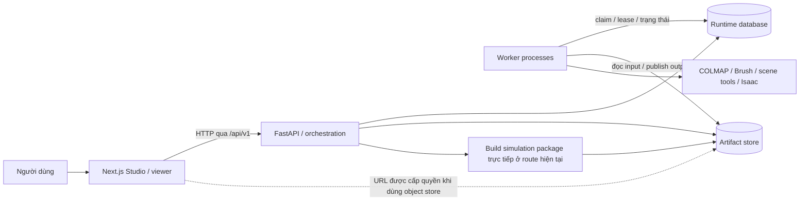
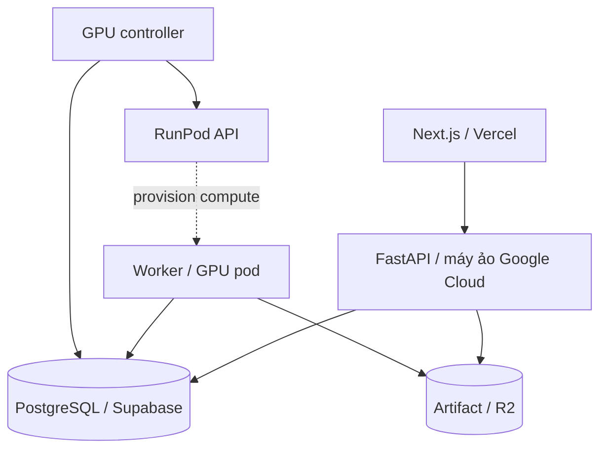

# Kiến trúc Real2Sim Studio

## 0. Phạm vi tài liệu

| Thuộc tính | Nội dung |
| --- | --- |
| Ngày đối chiếu | 20/10/2026 |
| Snapshot source | `develop`, HEAD `ac0be875`, có thay đổi chưa commit |
| Vai trò | Mô tả thành phần, ranh giới module/process, dữ liệu bền vững và các mô hình triển khai có trong repository |
| Trạng thái | Bản chuẩn hóa để rà soát; không phải chứng nhận hệ thống production đã nghiệm thu |
| Định hướng sản phẩm | Chuẩn bị và chỉnh sửa môi trường thử nghiệm robot trong nhà, theo [PRD](docs/PRD.md) |

Tài liệu mô tả code và cấu hình hiện hành. Việc một thành phần xuất hiện trong source, Dockerfile hoặc sơ đồ không chứng minh nó đã chạy thành công trên một deployment cụ thể. Evidence browser, GPU, cloud và Isaac phải được xác nhận riêng.

### 0.1 Ranh giới nội dung

| Câu hỏi | Nơi trả lời chính |
| --- | --- |
| Sản phẩm phục vụ ai, phạm vi và điều kiện nghiệm thu? | [PRD](docs/PRD.md); định vị gốc ở [MASTER_PITCH](docs/MASTER_PITCH.md) và [BRAINSTORM](docs/BRAINSTORM.md) |
| Thành phần nào chịu trách nhiệm gì, trạng thái nằm đâu, kết nối thế nào? | Tài liệu này |
| Mỗi stage dùng thuật toán nào, nhánh input và điểm chờ cụ thể? | [PIPELINE](docs/PIPELINE.md) |
| Schema/field, validator và quy tắc bàn giao chi tiết? | [CONTRACTS](docs/CONTRACTS.md), [model trong source](src/models/contracts/) |
| Cài, chạy lại, cấu hình dịch vụ và xử lý sự cố? | [OPERATIONS](docs/OPERATIONS.md) |
| Một năng lực đã được kiểm chứng tới đâu? | [STATUS](docs/STATUS.md); bằng chứng gốc trong `.ai/`, `docs/plans/`, `eval/` |

Không sao chép yêu cầu sản phẩm, toàn bộ thuật toán, schema, danh mục tham số hay số liệu benchmark vào kiến trúc. Những tài liệu kỹ thuật cũ được dẫn ở đây chưa đồng nghĩa đã được chuẩn hóa.

## 1. Tổng quan hệ thống

Real2Sim Studio có giao diện Next.js và backend Python/FastAPI dùng chung các module nghiệp vụ. API tiếp nhận lệnh, kiểm quyền, đọc/ghi metadata và trả trạng thái. Worker thực hiện các công việc được xếp hàng; công cụ reconstruction, scene và Isaac chạy qua runtime/process phù hợp. API và worker có thể chạy cùng máy hoặc trên các host khác nhau.

Dữ liệu được chia thành hai phần: database giữ metadata, hàng đợi và các con trỏ hiện hành; artifact store giữ nội dung đã publish với URI/checksum. Các thành phần dùng chung hợp đồng dữ liệu để hiểu output của nhau.



Sơ đồ thể hiện quan hệ logic. Một node không bắt buộc là một container hay service riêng. Backend hiện là **modular monolith**: orchestration gọi trực tiếp các module Python của reconstruction, scene và simulation. Việc tách process/runtime cho công cụ không có nghĩa code giữa các miền đã độc lập hoàn toàn ở mức import.

## 2. Bản đồ module và trách nhiệm

### 2.1 Backend

| Đường dẫn | Trách nhiệm hiện tại |
| --- | --- |
| `src/main.py`, `src/config.py` | Khởi tạo app, middleware, lifespan, health/readiness và Settings |
| `src/api/` | HTTP DTO/route, auth và kiểm quyền ở boundary |
| `src/models/contracts/` | Model dùng chung cho input, artifact, scene, job, validation và release |
| `src/services/reconstruction/` | Input detection/resolution, RGB/LiDAR, pose, metric/canonicalization, geometry và adapter công cụ |
| `src/services/scene/` | Thuật toán/logic vật thể, membership, shell/surface, representation, collision và editing |
| `src/services/simulation/` | Collider/physics enrichment, preflight, OpenUSD và Isaac execution/validation |
| `src/services/orchestration/` | Use case, trạng thái bền vững, điều phối, storage và kết nối API/worker với các miền trên |

Trong orchestration, các nhóm chức năng được đặt theo use case:

- `inputs/`, `uploads/`, `projects/`: dữ liệu tiếp nhận, input assembly, import và project registry.
- `jobs/`, `processing/`, `pipeline/`: job/queue/lease, tài nguyên/telemetry và mô hình tiến trình dành cho UI.
- `scene/`: SceneIR head/revision, lệnh sửa vật, objectify và hàng đợi dựng geometry.
- `review/`, `release/`: simulation package, validation/review và các phần xử lý release.
- `artifacts/`, `auth/`, `samples/`: lưu trữ nội dung, tài khoản và thư viện/phiên demo.
- `gpu/`, `evaluation/`, `value/`: quản lý compute, tổng hợp đánh giá và sự kiện/số đo giá trị công việc.

Không có yêu cầu mỗi package phải chạy thành service riêng. Đặc biệt, nhiều use case scene hiện nằm ở `orchestration/scene/`, không chỉ ở `services/scene/`. Tài liệu này không di chuyển code để làm cây thư mục khớp một sơ đồ mục tiêu.

### 2.2 Frontend và các phần hỗ trợ

| Đường dẫn | Trách nhiệm |
| --- | --- |
| `frontend/src/app/` | Route/layout của Studio, landing trong app và demo workspace |
| `frontend/src/features/studio/` | Màn nghiệp vụ, các tab scene, kiểm tra từng bước và lệnh người dùng |
| `frontend/src/features/viewer/` | Viewer PlayCanvas, lớp phủ vật, camera, đo đạc và kết nối Walk/collision |
| `frontend/src/components/`, `frontend/src/lib/` | Component dùng chung, API client, kiểu dữ liệu và xử lý media |
| `frontend/vendor/supersplat/` | Editor bên thứ ba; build asset riêng ra `frontend/public/editor/` |
| `landing/` | Source trang giới thiệu độc lập dùng trong mô hình triển khai cloud |
| `configs/`, `scripts/` | Processing/runtime configuration, cài công cụ, khởi động, đóng gói và vận hành |
| `tests/`, `frontend/tests/`, `fixtures/` | Kiểm tra backend/frontend và dữ liệu fixture có contract |
| `eval/` | Protocol, công cụ đối chứng và kết quả đánh giá; không là nguồn ground truth mặc định cho prediction |

### 2.3 Ownership và quy tắc đặt code

Phân công theo [AGENTS.md](AGENTS.md): reconstruction thuộc EX-REC, scene thuộc EX-SCENE, simulation thuộc EX-SIM; API/orchestration/frontend thuộc EX-PRODUCT; contracts là ranh giới dùng chung. Phân công nhân sự chi tiết tiếp tục theo hồ sơ dự án, không suy từ Git author.

Contract mô tả dữ liệu bàn giao; thuật toán xử lý thuộc service; handler HTTP giữ vai trò adapter vào use case. Module điều phối có thể gọi producer/consumer để hoàn tất workflow, nhưng dữ liệu đã bàn giao bền vững phải truy vết qua contract và artifact. Không yêu cầu serialize mọi lời gọi hàm nội bộ thành file.

Giữ nguyên scaffold/source và các quy định repository. Không tạo một tầng `utils`, worker hoặc pipeline song song chỉ để thay vị trí của logic đã có. Thay đổi placement/shared contract phải kiểm caller và tác động producer/consumer trước khi thực hiện.

## 3. Ranh giới thực thi

### 3.1 FastAPI và HTTP

[App entrypoint](src/main.py) gắn router tại `/api/v1`. [Router tổng](src/api/routes.py) nối product, Studio, auth và demo sessions. Nhóm product/Studio cung cấp API làm việc với project, input, job, scene, artifact, simulation và review; chúng dùng chung registry và storage được cấu hình.

API có cả lệnh nhanh và lời gọi có chi phí tính toán. Reconstruction dài hạn không được chạy trong một request. Tuy nhiên, [route simulation-package](src/api/studio/simulation.py) hiện gọi `build_simulation_package()` trực tiếp; hàm build có thể gọi runtime OpenUSD. Vì vậy không thể mô tả toàn bộ xử lý nặng đã được đưa ra khỏi HTTP.

### 3.2 Worker, queue và admission

[Worker CLI](src/services/orchestration/jobs/worker_cli.py) đọc công việc bền vững từ DB, chọn việc phù hợp runtime rồi gọi runner. Các thao tác như import, registration, objectify/geometry và validation có hàng đợi/worker tương ứng; đây không chỉ là một background thread của FastAPI.

Trước công việc cần tài nguyên, admission kiểm khả năng xử lý. Lease/heartbeat và identity của attempt ngăn hai worker cùng nhận kết quả hợp lệ cho một lượt công việc. Khi hủy, mất lease hoặc revision đã đổi, caller phải dừng/không commit output cũ. Vòng poll có cơ chế lùi sau lỗi; recovery xử lý job bị gián đoạn và lease hết hạn.

Các thao tác không có cùng một state machine. Job reconstruction, operation chỉnh scene, import và validation có bản ghi riêng; UI phải tổng hợp chúng thay vì coi tất cả là trạng thái của một job.

### 3.3 Runtime của công cụ

Runner/adapters chuẩn bị request, chạy process con và kiểm output trước publication. Môi trường của app, scene tools, ObjectGS, LiDAR odometry và Isaac có thể dùng interpreter/dependency khác nhau. Native có thể gọi COLMAP qua Docker launcher; image GPU mang COLMAP binary và gọi trực tiếp trong container.

Biên tách process giúp kiểm timeout, log, cancel và dependency. Nó không bảo đảm công cụ đã sẵn sàng trên mọi máy; cần preflight đúng môi trường và capability trước dispatch. Thuật toán cùng trình tự stage thuộc tài liệu pipeline.

### 3.4 Điều khiển compute và CPU lane

[GPU controller](src/services/orchestration/gpu/controller.py) đọc workload/release catalog và state quản lý để provision, theo dõi, drain hoặc thu hồi compute. [Provider adapter](src/services/orchestration/gpu/provider.py) hiện có RunPod. Controller dùng ownership/leader state và identity pod để tránh nhận hoặc dọn nhầm tài nguyên không thuộc lượt quản lý.

[Container entrypoint](scripts/studio/container_entrypoint.py) có thể bật supervisor theo cấu hình. Supervisor quản lý API cùng process controller/CPU lane; worker GPU trên pod là process khác. [CPU lane](src/services/orchestration/gpu/cpu_worker.py) là tùy chọn, có preflight tài nguyên/dependency và chỉ xử lý các workload được hỗ trợ. Nó không thay thế mặc định pipeline GPU.

API và worker trao đổi trạng thái công việc qua DB, nội dung qua artifact store. Controller còn gọi API nhà cung cấp để quản lý máy; đó là đường quản trị compute, không phải cơ chế truyền toàn bộ input/output job.

## 4. Dữ liệu bền vững và bộ đệm

### 4.1 Database giữ gì

[RuntimeDatabase](src/services/orchestration/jobs/database.py) hỗ trợ SQLite cho local và PostgreSQL cho triển khai dùng chung. DB giữ project/account/session, con trỏ manifest/revision, journal/attempt, queue/lease, operation, runtime worker và số đo. Một số metadata/payload có dạng JSON trong DB; file nhị phân lớn nằm ở artifact store.

Schema được nâng qua chuỗi migration có thứ tự và bảng `r2s_schema`; phiên bản hiện hành lấy từ source, không cố định ở schema v1. Khởi tạo chạy migration còn thiếu trong transaction; code từ chối DB có version mới hơn khả năng hỗ trợ. Đây là cơ chế migration của ứng dụng, không dùng Alembic.

API và worker cần cùng deployment DB/scope và chính sách runtime phù hợp. Không thể chỉ chép database mà bỏ các artifact được nó tham chiếu rồi coi dữ liệu đã được khôi phục đầy đủ.

### 4.2 Artifact store và identity

Artifact được tham chiếu bằng logical URI, thường theo dạng `artifact://jobs/<job_id>/<path>`, cùng checksum và metadata contract. [ArtifactResolver/FilesystemArtifactStore](src/services/orchestration/artifacts/store.py) ánh xạ URI về kho cục bộ, kiểm nội dung và publish file bất biến theo cách atomic.

`ARTIFACT_ROOT` là vị trí vật lý do deployment đặt; contract không chứa đường dẫn tuyệt đối của máy. Hash bytes của file và canonical checksum của model/package có vai trò khác nhau; consumer phải dùng đúng quy tắc identity, không coi mọi hash là cùng một loại.

Publication file và cập nhật DB không phải một transaction chung bao trùm filesystem/S3. Trình tự commit và fencing cần bảo đảm chỉ con trỏ hợp lệ được chọn làm trạng thái hiện hành. File đã tạo nhưng publication/commit chưa hoàn tất không tự trở thành scene hoặc kết quả được chấp nhận.

### 4.3 S3-compatible và cache cục bộ

[Storage factory](src/services/orchestration/storage.py) chọn filesystem-only khi không cấu hình bucket; khi có object store, [ArtifactRemote](src/services/orchestration/artifacts/remote.py) kết nối S3-compatible, bao gồm cấu hình R2. Resolver có thể tải file còn thiếu về local cache, kiểm checksum và đồng bộ output theo publication path.

Browser có thể nhận presigned URL cho upload/download phù hợp. Các request này đi trực tiếp tới object store, nên quyền ký URL và CORS bucket là boundary riêng với proxy Next.js. Không mặc định mọi tệp đều đi trực tiếp hoặc mọi tệp đều qua API.

Local artifact cache khác worker scratch và derived cache. Scratch giữ input làm việc/checkpoint theo attempt; derived cache có thể chứa mesh Walk hoặc thumbnail có thể dựng lại. Bản release và artifact gốc không được coi là cache tạm chỉ vì cùng nằm dưới `data/`.

### 4.4 Trạng thái hiện hành và cache đọc

SceneIR revision và JobManifest được publish với identity. DB giữ con trỏ/head được commit; cache trong process chỉ giúp đọc nhanh, không được tự trở thành nguồn quyết định revision mới nhất.

Có các tối ưu checksum theo phiên bản file, cache model đã parse, metadata remote, ETag/304 và gzip. Một số đường đọc phục vụ UI dùng xác minh “file không đổi”; đường cần kiểm nghiêm vẫn băm/xác minh theo contract. Không suy từ việc có cache rằng mọi consumer đã bỏ kiểm checksum hoặc dữ liệu trở thành mutable.

## 5. Liên kết input, job và runtime

### 5.1 Tiếp nhận và khóa lựa chọn xử lý

Input assembly lưu nhóm file cùng revision và facts; resolver chọn recipe theo nội dung, metadata và runtime đủ điều kiện. Gaussian nhập sẵn có lineage khác video được reconstruction. Các nhánh cảm biến chỉ chạy khi dữ kiện quan hệ giữa file và capability tương ứng hợp lệ.

Khi chấp nhận một run, hệ thống khóa các identity cần thiết: input/recipe, config, runtime và accepted request để xử lý idempotency/quota. Không chọn công cụ chỉ theo extension hoặc bù ảnh/pose/provenance không tồn tại. Chi tiết nhánh nằm ở [input resolver](src/services/reconstruction/inputs/input_resolver.py).

### 5.2 Runtime profile và công bố của worker

[ExecutionProfile](src/services/orchestration/jobs/profile.py) gắn processing config, RuntimeManifest và seed. Code phân biệt checksum manifest đầy đủ với checksum phần mềm sau khi loại các thành phần hardware đã quy định. Điều này cho phép nhận diện runtime phần mềm khi máy/GPU thay đổi, nhưng không chứng minh hai máy có cùng khả năng tài nguyên.

API có thể dùng manifest ghim hoặc profile do worker công bố vào DB. [Worker runtime registry](src/services/orchestration/jobs/worker_runtimes.py) lưu heartbeat cùng thông tin phần mềm/máy; lựa chọn profile và kiểm có worker còn sống là hai phép kiểm khác nhau. Khi chưa có worker sống, profile hoặc release catalog có thể vẫn tồn tại để hệ thống biểu diễn trạng thái chờ/provision compute.

Registry qualification của **input recipe** cũng khác danh sách worker heartbeat. API/worker phải có bản registry đúng capability/checksum; không suy việc có RuntimeManifest là đã tự công bố đầy đủ mọi loại input có thể chạy.

### 5.3 Bàn giao giữa các miền

Luồng RGB bàn giao `ReconstructionBundle`; luồng scene tạo các revision `SceneIR`; simulation tạo `CandidatePackage` và validation evidence. Consumer kiểm refs/checksum và lineage trước khi sử dụng, còn thao tác trong cùng process có thể truyền model trực tiếp.

Preview, derivative phục vụ browser, geometry trung gian và kết quả cuối có identity riêng. Input bên ngoài hoặc stage được reuse phải được biểu diễn đúng nguồn, không tạo dấu vết giả rằng COLMAP/Brush hay một phép kiểm chưa chạy đã thành công.

## 6. Scene, hình học và chỉnh sửa

### 6.1 Hệ tọa độ chuẩn

[Coordinate contracts](src/models/contracts/coordinates.py) dùng mét, Z-up, right-handed, world frame `world`; transform có nghĩa `parent_from_local`, quaternion theo thứ tự `xyzw`, góc tính bằng radian:

```text
p_parent = T_parent_from_local × p_local
```

Adapter đổi convention của COLMAP, renderer, công cụ geometry và OpenUSD/Isaac tại boundary. Render engine có convention riêng không được tạo một transform nghiệp vụ thứ hai trong browser.

### 6.2 Các biểu diễn của cùng một vật

| Biểu diễn | Mục đích và giới hạn |
| --- | --- |
| Gaussian visual / SOG delivery | Ngoại hình để xem; không tự là mặt va chạm |
| Membership và source binding | Xác định phần dữ liệu nguồn thuộc vật/nền, phục vụ correction và dựng lại |
| Shell preview | Giúp duyệt phần Gaussian được tách; có thể chưa là geometry/collider cuối |
| Surface/geometry và collider | Mô tả bề mặt hoặc representation dùng cho physics theo capability |
| SceneObject trong SceneIR | Identity, transform, trạng thái và các tham chiếu liên kết các biểu diễn |

[Representation composition](src/services/scene/representation_composition.py) phân biệt vật đã xác nhận, candidate, ignored/deleted/merged và active state. Visibility tạm để inspection không đồng nhất với xóa khỏi physics. Candidate/ignored có thể còn được biểu diễn như phần nguồn; không thể suy mọi object không active đều được loại khỏi background theo cùng một cách.

### 6.3 Geometry readiness và chỉnh nguồn

Code có bước duyệt membership/vùng ở Draft rồi mới build geometry. [Geometry state](src/services/scene/geometry_state.py) cung cấp gate cho thao tác cần hình học sẵn sàng; preset hiện tại chọn shell với geometry review required. ObjectGS là nhánh có runtime riêng, không phải mặc định của mọi scene.

Correction gắn với source/revision. Khi sửa vùng ở scene đã có geometry, hàng đợi có thể dựng lại phần bị ảnh hưởng rồi publish revision mới. Source Gaussian, source pose và artifact bất biến không bị sửa trực tiếp để khớp trạng thái editor.

### 6.4 Collision sau thay đổi bố trí

[Effective collision](src/services/orchestration/scene/effective_collision.py) tạo collision môi trường theo nguồn/ownership của scene, còn collider từng vật theo transform và trạng thái hiện tại. Nguồn geometry và pose lúc tách là provenance, khác pose người dùng đang chỉnh.

Cần giữ đúng ownership để move/delete không để collision vật ở chỗ cũ hoặc khoét mất sàn/tường. Scene cũ thiếu binding chỉ được phục hồi khi có lineage đủ tin cậy; không suy source pose từ vị trí hiện tại. Các nhánh legacy/object-aware và quality gate cần được kiểm theo dữ liệu thực, không chỉ sự tồn tại của mesh.

### 6.5 Commit SceneIR

[SceneEditor](src/services/orchestration/scene/editor.py) publish revision; [SceneHeadRepository](src/services/orchestration/scene/heads.py) giữ committed head và thông tin publication/recovery trong DB. Lệnh sửa nhận identity của revision kỳ vọng; thay đổi cạnh tranh phải được từ chối hoặc xử lý recovery theo chính sách, không ghi đè âm thầm.

Worker có thể tạo output trước khi CAS/head commit hoàn tất. Nếu lease hoặc base revision không còn hợp lệ, output đó không được attach thành scene hiện hành. Mất cache hay khởi động process khác không được làm con trỏ head quay về một file revision tình cờ được tìm thấy.

## 7. Giao diện và viewer

### 7.1 API boundary của trình duyệt

[Next configuration](frontend/next.config.ts) chuyển `/api/v1/*` sang backend bằng `REAL2SIM_API_URL`. Browser làm việc cùng origin với Next cho các API này; route/layout/UI không giữ database nghiệp vụ riêng trong Next. API client và kiểu dữ liệu nằm ở `frontend/src/lib/`.

Backend trả canonical state và capability để UI biết thao tác nào được phép. UI giữ selection, camera, draft thao tác và trạng thái render; việc lưu thành công cần được backend xác nhận. Cookie và quyền object store vẫn phải được xử lý ở boundary tương ứng, không chỉ nhờ proxy.

### 7.2 Tổng hợp tiến trình

[Pipeline view](src/services/orchestration/pipeline/view.py) kết hợp stage receipts/step marks, operation, geometry state và việc đang chờ. [Next action](src/services/orchestration/pipeline/next_action.py) cung cấp hành động tiếp theo; [ScenePage](frontend/src/features/studio/ScenePage.tsx) dùng dữ liệu hợp nhất với polling/ETag để cập nhật trang.

Đây là projection đọc cho UI, không là state machine thay thế job/scene/validation. Số đo còn thiếu hoặc stage không thực hiện phải giữ đúng trạng thái; giao diện không tự cộng thời gian hoặc tạo phần trăm giả để hoàn thiện timeline.

### 7.3 Render và vòng đời GPU

Viewer chính dùng [PlayCanvasScene](frontend/src/features/viewer/PlayCanvasScene.tsx) và các lớp overlay/camera/collision. Editor SuperSplat là asset build riêng. Các preview chuyên biệt có thành phần render riêng; không mô tả toàn bộ inspection UI như một canvas và render pass duy nhất.

Visual delivery có thể dùng SOG/LOD; dữ liệu phục vụ xem không thay source master cho correction hoặc export. Walk tải dữ liệu collision/physics theo nhu cầu và gate readiness. Viewer cần giữ instance khi đổi trạng thái UI không liên quan, nghỉ khi ẩn, và dọn listener/frame callback/tài nguyên GPU khi kết thúc vòng đời. Những cơ chế trong code vẫn cần browser acceptance trên scene thực.

## 8. Export, validation và release

### 8.1 Tạo candidate

[Simulation package builder](src/services/orchestration/review/simulation_package.py) lấy SceneIR hiện hành, kiểm geometry readiness, physics enrichment, preflight và exporter capability. Chỉ khi đúng requirements/runtime mới tạo package cùng inventory/checksum. Profile có Gaussian hoặc physics/asset phức tạp cần runtime hỗ trợ; không tự bỏ các thành phần đó để tạo gói có vẻ thành công.

OpenUSD là output của scene revision, không thay SceneIR làm dữ liệu chỉnh sửa chuẩn. Candidate đã publish là bất biến; cache package chỉ được reuse khi revision, cấu hình, capability và nguồn collision còn khớp.

### 8.2 Thực thi Isaac

Isaac dùng hàng đợi/run record và [process boundary](src/services/simulation/isaac/process.py) qua launcher được deployment cấu hình. Worker materialize đúng package, kiểm identity/config/runtime, chạy evaluator rồi xác minh observations trước khi publish report/evidence.

Cài thư viện OpenUSD hoặc build được USD không đồng nghĩa có runtime Isaac. Image reconstruction mặc định không cài Isaac; Dockerfile có target Isaac riêng. Kết quả path/check là điều quan sát được; ground truth/expected labels thuộc evaluator đối chứng, không được dùng để quyết định kết quả của run sản phẩm.

### 8.3 Review và đóng dấu

[Validation gate](src/services/orchestration/review/validation_gate.py) kiểm run được chọn, candidate/revision/config/report/runtime và policy check/path. [Review workflow](src/services/orchestration/review/workflow.py) gắn approval/rejection và release với đúng identity này.

Reviewer duyệt candidate đã kiểm định, không duyệt mọi phiên bản của project. Edit sau đó làm kết quả cũ không còn áp cho revision mới. Media/log là evidence gắn với run; thiếu capture phải hiện thành giới hạn riêng. Điều kiện nghiệm thu và quyền quyết định nằm ở PRD, không lặp thành policy khác trong kiến trúc.

## 9. Bảo mật và demo session

### 9.1 Auth, quyền và dữ liệu riêng tư

[Auth API](src/api/auth.py) dùng session cookie; role guard kết hợp [ownership guard](src/api/ownership.py) để giới hạn thao tác. `AUTH_REQUIRED=false` phục vụ development/test; Settings từ chối cấu hình staging/production tắt auth. Ma trận hành vi Guest/Editor/Reviewer nằm ở PRD; API phải thực thi, không dựa vào việc UI ẩn nút.

Settings/environment cấp secret; manifest và log công khai không phải nơi lưu credential. Upload, giải nén, artifact URI và dependency package cần được giới hạn về đường dẫn/định dạng/dung lượng tại consumer tương ứng.

Privacy mode, sanitization và bản ghi chấp nhận đúng frame set là boundary của input processing. Lời khai hay zero detections không tự chứng minh đã xác minh ẩn danh. Source/bản che và output dẫn xuất giữ lineage, policy truy cập và retention tương ứng.

### 9.2 Thư viện mẫu và phiên làm việc tạm

Thư viện demo là bundle được kiểm checksum, có thể bootstrap từ archive được ghim. [Demo session API](src/api/demo_sessions.py) tạo phiên giới hạn theo mẫu, project/job và các thao tác cho phép. [Session context](src/services/orchestration/samples/session_context.py) chọn Settings/registry/actor của phiên khi xử lý request.

Local session dùng workspace/DB làm việc riêng; [distributed demo](src/services/orchestration/samples/distributed.py) dùng schema PostgreSQL và prefix output riêng theo session, với nguồn baseline được bảo vệ. Thay đổi trong phiên không được sửa thư viện gốc. Session ID là capability cần bảo vệ; route/header dùng `no-store` và `no-referrer` cho bề mặt demo tương ứng.

Heartbeat, expiry, janitor và operation worker quản lý vòng đời phiên. Mẫu được mở hoặc thay đổi trong demo session không tự trở thành job video mới, tài khoản Guest hay release được Reviewer duyệt.

## 10. Các mô hình triển khai

### 10.1 Một máy native

[Makefile.studio](Makefile.studio) và [run_stack.sh](scripts/gpu/run_stack.sh) khởi động API, worker và Next.js. Chúng dùng DB/artifact/runtime trên máy hoặc các dịch vụ đã cấu hình. Runtime nặng nằm ở môi trường/công cụ được cài riêng, không được đưa vào dependency của API chỉ vì cùng một host.

Port/path/env cụ thể thuộc README/runbook. Source checkout không chứa database scene, model weights hoặc runtime đã cài của máy khác.

### 10.2 Compose với dữ liệu nhóm

| Cấu hình | Thành phần và quan hệ |
| --- | --- |
| [docker-compose.yml](docker-compose.yml) | `data-init` chuẩn bị volume; `data-restore` khôi phục gói nếu cần; API và Web chạy với data mount dùng chung của stack |
| [docker-compose.gpu.yml](docker-compose.gpu.yml) | Thêm `gpu-runtime-init`, worker NVIDIA và cấu hình runtime cho API; API/worker chia sẻ dữ liệu host |
| [Dockerfile](Dockerfile) | Image API/control plane và entrypoint kiểm/chuẩn bị dữ liệu |
| [frontend/Dockerfile](frontend/Dockerfile) | Build Next.js cùng editor asset, rồi chạy Web |
| [Dockerfile.gpu](Dockerfile.gpu) | Cài runtime pipeline; target Isaac là tùy chọn riêng, không bật trong image mặc định |

Compose CPU cơ bản không tự có worker reconstruction GPU. Restore data không cài driver/runtime của máy nguồn và không thay thế việc kiểm môi trường đích.

### 10.3 API/Web thường trực, worker từ xa

Mẫu env trong `deploy/studio/` mô tả Web trên Vercel, API thường trực, PostgreSQL trên Supabase, artifact ở R2 và compute worker trên pod GPU. Từ 20/10/2026, API production chạy trên một máy ảo Google Cloud cùng vùng Seoul với Supabase, triển khai bằng [`deploy-api.yml`](.github/workflows/deploy-api.yml); `deploy/studio/railway-api.json` là cấu hình của nơi chạy cũ. `landing/` có triển khai giới thiệu độc lập. Trạng thái các dịch vụ sống ghi ở [STATUS](docs/STATUS.md).



API và worker không cần chia sẻ local filesystem trong mô hình này; chúng cần cùng logical artifact namespace, DB và runtime/config tương thích. Local cache có thể khác nhau. Runtime heartbeat và release catalog hỗ trợ biết đang có worker hay cần cấp compute, không phải proof một job đã chạy hết.

### 10.4 Health và readiness

`GET /health` kiểm app cùng truy vấn DB; không kiểm pipeline hoặc simulator. `GET /ready` xét profile và worker runtime còn sống **hoặc** release catalog tương thích, cùng thư viện mẫu khi được yêu cầu. Vì catalog có thể cho phép scale từ zero, ready không luôn đồng nghĩa một pod GPU đang chạy.

Startup cũng có thể bootstrap/kiểm demo library theo Settings. Một healthcheck xanh chỉ xác nhận đúng điều kiện của endpoint đó. Không dùng nó để kết luận input qualification, chất lượng geometry, browser hoặc Isaac đã nghiệm thu.

## 11. Cấu hình, dependency và giới hạn xác minh

### 11.1 Nguồn cấu hình

[Settings](src/config.py) là điểm đọc cấu hình app. Processing presets nằm trong `configs/product/`; runtime pins và công thức cài nằm ở `configs/runtime/`, `scripts/gpu/install.sh` và các script thành phần. Những revision/model đặc thù có nguồn ghim riêng trong script/source; không chép số phiên bản sang nhiều tài liệu.

Dependency app/dev/offline dùng các cặp `requirements*.in`/`requirements*.lock.txt`; LiDAR odometry và runtime scene/ObjectGS/Isaac có môi trường riêng. Node dependency theo package/lockfile tương ứng. [runtime_env](src/runtime_env.py) giữ ánh xạ tên `R2S_*` và các alias legacy; không coi biến tên cũ là một runtime khác.

[production.env.example](deploy/studio/production.env.example) cùng công cụ render/check sinh cấu hình API/worker/web. Manifest runtime mô tả công cụ đã được probe; secret chỉ ở environment/secret store. Không dùng env hoặc manifest của máy khác làm bằng chứng máy mới đã đủ capability.

### 11.2 Scaffold và khả năng tùy chọn

LLM factory còn trong `src/llm/`; nó không làm pipeline Real2Sim trở thành chat agent hay LangGraph workflow. Settings hiện vẫn kiểm credential của provider được chọn lúc khởi tạo. Các khai báo scaffold như Chroma không chứng minh có vector retrieval trong luồng scene. Không đưa agent/vector store vào sơ đồ thực thi khi chưa có consumer tương ứng.

### 11.3 Phạm vi kiểm chứng

Kiến trúc được đối chiếu bằng source, cấu hình và các kiểm tra tài liệu/contract của lượt chuẩn hóa. Không có chạy lại dịch vụ, thay đổi DB, provision GPU hoặc nghiệm thu browser/Isaac trong lượt này.

Các quyết định kiến trúc còn giữ gồm: SceneIR là dữ liệu scene chuẩn; artifact bất biến có identity; DB chọn trạng thái bền vững; công cụ nặng có runtime/process boundary; export/validation/review giữ đúng candidate; UI và demo session không tạo nguồn dữ liệu nghiệp vụ cạnh tranh. Lịch sử lý do và thay đổi được giữ trong [ADR](docs/decisions/README.md), task và bằng chứng gốc; không dùng lịch sử đó như bảng trạng thái production hiện tại.
