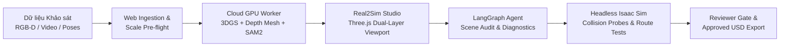

# Project Brief: RAV-01 — Real2Sim Workspace

**Mã đề tài:** RAV-01 (Khối Robot & Xe Tự Hành — VinFast)  
**Tên dự án:** Real2Sim Workspace — Nền Tảng Dựng & Kiểm Thử Môi Trường Mô Phỏng Tự Hành (AMR) Từ Dữ Liệu Quan Sát  
**Đội ngũ thực hiện:** Team P-087 — VinUni AI20K Build Phase (Cohort 4)  
**Thời gian phát triển:** 6 tuần (Tháng 9 – Tháng 10/2026)  
**Tài liệu tham chiếu:** [`RAV01_Real2Sim_Problem_Deep_Dive_Report.md`](file:///d:/AI/P-087/docs/RAV01_Real2Sim_Problem_Deep_Dive_Report.md), [`PRD.md`](file:///d:/AI/P-087/docs/PRD.md)

---

## 1. Bối cảnh & Vấn đề Cốt lõi (The Real2Sim Problem)

Trong quá trình triển khai robot di động tự hành (Autonomous Mobile Robots - AMR) tại các nhà kho thông minh hoặc phân xưởng sản xuất:
1. **Nghẽn dựng môi trường mô phỏng (Simulation Bottleneck):** Để kiểm thử chính sách điều hướng (navigation policy) và an toàn va chạm trước khi chạy robot thật, kỹ sư cần môi trường mô phỏng 3D trung thực. Tuy nhiên, việc mô hình hóa CAD thủ công một góc kho mất hàng ngày đến hàng tuần.
2. **"Khoảng trống" Real2Sim (The Real2Sim Gap):** Dữ liệu quay chụp thực tế (video RGB, LiDAR, RGB-D) tuy tái hiện được hình ảnh trực quan nhưng **không thể tương tác trực tiếp trong simulator**:
   * Không có ranh giới va chạm vật lý (physics collision boundaries).
   * Không phân tách thành các vật thể độc lập (objects) để kỹ sư di chuyển hay tạo kịch bản chướng ngại vật mới.
   * Thiếu neo đơn vị chuẩn mét (metric scale ground truth), dẫn đến việc đưa vào simulator robot đi xuyên qua kệ hàng hoặc bị kẹt sai thực tế.
3. **Chi phí sửa chữa & đối soát phân tán:** Mỗi lần layout kho thay đổi (di chuyển kiện hàng, thêm pallet), kỹ sư phải làm lại toàn bộ quy trình import, căn chỉnh thủ công và chạy lại kiểm thử, gây lãng phí lớn về thời gian nhân lực.

---

## 2. Giải pháp Đề xuất: Real2Sim Workspace

**Real2Sim Workspace** là một nền tảng lai (Split-Tier Web & Cloud GPU Platform) giúp kỹ sư chuyển đổi nhanh chóng dữ liệu khảo sát khu vực trong nhà thành **scene mô phỏng sẵn sàng sử dụng (simulation-ready USD stage)** cho NVIDIA Isaac Sim, được kiểm định chất lượng và hỗ trợ tự động bởi **AI Agent**:



### Điểm đột phá kiến trúc:
1. **Biểu diễn kép đồng bộ (Dual-Representation):**
   * *Lớp thị giác (Visual Layer):* Dùng **3D Gaussian Splatting (3DGS)** để hiển thị trực quan siêu thực trên nền Web (Three.js WebGL).
   * *Lớp vật lý (Physics/Collision Layer):* Dùng **TSDF Depth Fusion & Bounding Proxies** để xác định sàn, tường và khối va chạm cho robot.
   * *Đồng bộ hóa 100%:* Khi kỹ sư di chuyển một kiện hàng trong Scene Graph, cả đám mây Gaussian trực quan và khối va chạm vật lý đều di chuyển đồng thời.
2. **LangGraph Scene Audit & Diagnostic Agent:**
   * Thay vì chỉ là chatbot thông thường, Agent đóng vai trò **chuyên gia kiểm định an toàn mô phỏng**.
   * Tự động quét kiểm tra dung sai lối đi (clearance check), tỷ lệ mét (metric scale), phát hiện khối va chạm bị thiếu, và gợi ý phương án hiệu chỉnh một cú nhấp chuột (1-click remediation).
3. **Kiến trúc Split-Tier tối ưu chi phí (Cloud GPU + Web Host):**
   * **Web Tier:** Next.js + FastAPI + LangGraph Agent chạy 24/7 ổn định trên cloud tiêu chuẩn (Render / Vercel), đáp ứng trọn vẹn Deliverable #5 (Live URL).
   * **Worker Tier:** Tận dụng **RunPod Cloud GPU (RTX 3090/4090)** theo mô hình on-demand chỉ khi cần huấn luyện 3DGS hoặc chạy kiểm thử Isaac Sim, giữ tổng chi phí điện toán cả khóa dưới $15.

---

## 3. Chân Dung Người Dùng (Target Personas)

| Persona | Vai trò | Nhu cầu chính & Nỗi đau |
|:---|:---|:---|
| **Simulation Engineer** | Người dùng chính (Primary) | Nhận dữ liệu site, dựng nhanh scene, chỉnh sửa vị trí chướng ngại vật và xuất file USD sang Isaac Sim mà không bị lỗi xuyên sàn/va chạm. |
| **AMR Integration Engineer** | Người dùng kiểm thử (Collaborator) | Định nghĩa đường đi (routes) của robot, kiểm tra vùng mù (dead zones) và khoảng cách an toàn (footprint clearance). |
| **Tech Lead / Simulation Reviewer** | Người duyệt (Approver) | Xem xét báo cáo sai số (PSNR, Chamfer Distance, Collision Pass Rate), đối soát với dữ liệu gốc và ký duyệt bản phát hành chính thức (Human-in-the-Loop). |

---

## 4. Phạm vi Dự án & Ranh giới Rõ ràng (Scope & Non-Goals)

### Trong phạm vi (In-Scope — MVP 6 tuần):
* Một khu vực trong nhà tĩnh (static indoor area, 1 tầng, ví dụ: góc kho hàng hoặc phòng thử nghiệm AMR).
* Dữ liệu khảo sát chuẩn có chiều sâu/poses: Kết hợp **Synthetic Warehouse Corner** (độ chính xác ground-truth 100%) và dữ liệu công khai **TUM RGB-D** (`freiburg1_room`).
* Phân loại 3 nhóm đối tượng chính: Mặt sàn (Floor), Tường biên (Wall), và Vật cản/Kiện hàng (Obstacles).
* Công cụ chỉnh sửa: Chọn vật thể, bật/tắt (hide/show), di chuyển vị trí (translate), tự động cập nhật bounding collider.
* Tích hợp kiểm thử mô phỏng: Xuất USD Stage, chạy bài kiểm tra va chạm tĩnh (collision probes) và điều hướng robot mẫu (Nav2 waypoints) trên NVIDIA Isaac Sim headless.
* LangGraph Agent: Kiểm định dung sai, chẩn đoán lỗi simulation crash/stuck, tra cứu tiêu chuẩn an toàn kho.

### Không thuộc phạm vi (Out-of-Scope — Deferred):
* Không điều khiển robot vật lý ngoài đời thực (100% simulation-only).
* Không dựng cảnh giao thông ngoài trời có xe chuyển động hoặc người đi bộ động (dynamic agents).
* Không thay đổi thời tiết phức tạp (mưa, bão, tuyết).
* Không tự động inpainting hoàn hảo phần sàn/tường bị che khuất khi xóa vật thể lớn (hệ thống sẽ đánh dấu là "vùng chưa quan sát / unobserved area").

---

## 5. Mục Tiêu Nghiệm Thu (Success Metrics)

1. **Năng suất người dùng (Productivity):** Giảm ít nhất **50% tổng thời gian thao tác** chuẩn bị và kiểm thử scene so với quy trình dựng thủ công truyền thống.
2. **Độ trung thực hình ảnh (Visual Fidelity):** Đạt **PSNR $\ge 25$ dB**, **SSIM $\ge 0.85$** trên tập góc nhìn giữ lại (held-out views).
3. **Độ chính xác hình học (Geometric Accuracy):** Khoảng cách Chamfer đối xứng trung bình $\le 0.05$ m, sai số tỷ lệ mét $\le 2\%$.
4. **Độ tin cậy mô phỏng (Simulation Fidelity):**
   * Tỷ lệ hoàn thành đường đi (Route Completion) của robot mẫu $\ge 90\%$.
   * **0 lỗi bỏ sót vật cản nghiêm trọng** (không để robot đi xuyên qua kệ hàng).
5. **Đảm bảo chuẩn đầu ra AI20K (PLO1–PLO8):**
   * LangGraph Agent có state machine, tool-calling minh bạch và lưu trace đầy đủ trên LangSmith.
   * Triển khai Web live trên cloud (Vercel / Render).
   * 100% prompt và commit được ghi nhận qua hệ thống AI Logging Phoenix.

---

## 6. Lộ Trình 6 Tuần (Roadmap Overview)

```
[Tuần 1] Setup hạ tầng, cài AI Log Hook, Ingestion Pre-flight & Synthetic Stage Spike
[Tuần 2] Pipeline 3DGS & Depth Mesh trên RunPod GPU; Benchmark baseline metric
[Tuần 3] Trình xem 3D Next.js/Three.js + Scene Graph Tree + Đồng bộ hóa Bounding Collider
[Tuần 4] Xuất USD Stage + Headless Isaac Sim Probes Runner + Luồng Reviewer HITL
[Tuần 5] Hoàn thiện LangGraph Scene Audit & Diagnostic Agent + Thử nghiệm người dùng thực tế
[Tuần 6] Đóng băng tính năng, tối ưu hóa latency/chi phí, kiểm thử eval tự động, Video & Slide Demo Day
```

