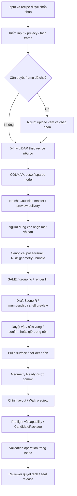

# Pipeline Real2Sim Studio

## 0. Phạm vi và cách đọc

| Thuộc tính | Nội dung |
| --- | --- |
| Ngày đối chiếu | 20/10/2026 |
| Snapshot source | `develop`, HEAD `ac0be875`, có thay đổi chưa commit |
| Vai trò | Giải thích cách input được xử lý, output từng chặng, nhánh điều kiện, điểm chờ và cách tiếp tục |
| Trạng thái | Tài liệu đối chiếu source; không phải kết quả chạy lại pipeline/GPU/browser/Isaac |
| Mặc định job mới | Các preset hiện có dùng `scene.geometry_method=shell`, `scene.geometry_review=required`, `scene.refinement=multiview_v1` |

Tài liệu này trình bày **cơ chế đang có trong code**. Phạm vi sản phẩm và nghiệm thu thuộc [PRD](PRD.md); ranh giới module/process, DB/artifact và deployment thuộc [ARCHITECTURE](ARCHITECTURE.md). Schema chi tiết vẫn lấy từ model/API; công thức đánh giá nằm ở [EVALUATION](EVALUATION.md), lệnh cài/chạy ở [OPERATIONS](OPERATIONS.md).

### 0.1 Ba khái niệm cần phân biệt

- **Job reconstruction** chuẩn bị RGB, pose, 3DGS và bundle. `SUCCEEDED` của job không tự xác nhận geometry từng vật hay kiểm định Isaac đã đạt.
- **Operation** là lượt làm việc riêng như import, registration, tách lại vật, tạo geometry hoặc validation. Operation có tiến trình, lỗi và điều kiện commit riêng.
- **Scene revision** là kết quả scene đã lưu. Draft/Ready về geometry, trạng thái confirm vật và approval/release là các chiều trạng thái khác nhau.

Trong mỗi chặng dưới đây, “output” là dữ liệu/code có thể tạo khi chặng thành công; deployment vẫn cần runtime và input đúng điều kiện.

## 1. Từ file người dùng tới một run được chấp nhận

### 1.1 Chuẩn bị video trên thiết bị

[Video normalization](../frontend/src/lib/media/video-normalization-core.ts) dùng Mediabunny/WebCodecs để chuẩn bị media trước upload. Người dùng chọn 1080p/720p/480p, mặc định 720p. Profile giới hạn tối đa 30 FPS theo presentation timeline; giữ hướng, tỷ lệ và mapping về frame/time nguồn thay vì tạo frame lặp để ép CFR.

Hashing, probing, encoding và verifying là các pha trên thiết bị, chưa phải COLMAP hoặc Brush. Codec/HDR/audio/storage không phù hợp phải trả lỗi/remediation. Tải bản gốc là lựa chọn có điều kiện của người dùng, không phải fallback âm thầm. Server chỉ xác minh bytes và metadata đã nhận; file gốc còn trên thiết bị không tự là server artifact.

### 1.2 Nhận dạng và ghép input

[InputAssemblyService](../src/services/orchestration/inputs/assembly.py) lưu nhóm file, bindings, declarations và revision. [Input resolver](../src/services/reconstruction/inputs/input_resolver.py) kết hợp nội dung được probe, dữ kiện người dùng và runtime qualification để tạo các phương án xử lý.

Resolution phân biệt `ready`, `needs_input`, `pending_verification`, `unsupported`, `invalid`. Nó giải thích thiếu file, đơn vị, frame, quan hệ đồng hồ, calibration hoặc capability nào. Cùng một tên file hoặc extension không đủ để quyết định đường chạy.

Khi có một route phù hợp nhất, resolver có thể tự chọn. Nếu route mạnh hơn còn thiếu dữ kiện và việc chọn route thấp hơn làm bỏ file của route đó, cần quyết định rõ thay vì hạ ngầm. Nếu route mạnh hơn không có runtime, route thấp hơn có thể được chọn kèm cảnh báo file/khả năng không được dùng. Diagnostic của resolution là một phần cần đọc trước khi chạy.

### 1.3 Khóa lựa chọn và dispatch

API chấp nhận run với input assembly/resolution, recipe, config và runtime registry tương ứng. Identity của request được giữ để yêu cầu lặp không tạo thêm công việc/tính quota sai. Worker kiểm lại các tham chiếu, phiên bản resolver/runtime và bytes nguồn trước khi nhận xử lý; không chỉ tin kết quả từng được UI hiển thị.

Các lựa chọn và giới hạn xử lý lấy từ [processing presets](../configs/product/processing_presets_v1.json) cùng cấu hình đã khóa cho job. Thay preset mặc định về sau không tự thay cấu hình của job đang tồn tại.

## 2. Các nhánh đầu vào

### 2.1 Recipe RGB và LiDAR

Các nhóm dưới đây theo [RecipeGroup](../src/models/contracts/input_assembly.py). **R1–R6 đều thuộc workflow video reconstruction và có RGB video**; không phải sáu bước chạy lần lượt hay một cam kết LiDAR-only.

| Nhóm | Nguồn chính | Khác biệt trong xử lý |
| --- | --- | --- |
| R1 — `RGB_ONLY` | Video RGB | Dựng pose/visual từ ảnh, xác nhận mét rồi finalize |
| R2 — `REGISTERED_MAP` | RGB và map LiDAR đã đăng ký | Manifest worker reconstruction vẫn đi RGB; map được giữ đúng nguồn để registration/geometry selection có điều kiện |
| R3 — `SINGLE_STATIC_CLOUD` | RGB và một cloud tĩnh | Cloud không cung cấp trajectory; cần registration thích hợp trước khi dùng chung hệ tọa độ |
| R4 — `SUPPLIED_TRAJECTORY` | RGB, scan và trajectory được cung cấp | Adapter hiện yêu cầu calibration và RGB frame times phù hợp; chuẩn bị gói LiDAR, ghép/kiểm nguồn rồi hỗ trợ preview |
| R5 — `ESTIMATED_TRAJECTORY` | RGB, scan có thứ tự và scan times | Chạy odometry, publish trajectory/map ước lượng; không tự có calibration/RGB synchronization của R6 |
| R6 — `SENSOR_GUIDED` | RGB, dữ liệu LiDAR cùng calibration/time relation | Dùng sensor evidence để hỗ trợ camera; worker hiện kiểm nhánh estimated scan trajectory và runtime R5/R6 tương ứng |

Adapter R4/R5/R6 hiện có ràng buộc PCD cho các scan được nhận qua những nhánh này. R5/R6 cần scan hệ mét, tên frame sensor và timestamp; R6 còn cần calibration, thời điểm RGB và quan hệ đồng hồ. Danh sách facts cụ thể do resolver/worker kiểm, không suy rằng có đủ file trong bảng là mọi dữ liệu đều chạy được.

Contract R6 có thể biểu diễn trajectory supplied hoặc estimated; điều đó rộng hơn điều kiện mà worker hiện kiểm trong `_validate_project_input_recipe`. Không lấy khả năng biểu diễn của schema làm bằng chứng mọi biến thể đã chạy end-to-end.

### 2.2 Gaussian nhập sẵn

Gaussian PLY/SOG đi qua [ImportService](../src/services/orchestration/uploads/scene_imports.py): nhận input, xếp operation packaging, kiểm định dạng/giới hạn, tạo hoặc tái sử dụng delivery rồi cho mở viewer. Import có retry/cancel riêng và không tự chạy COLMAP/Brush.

[UnifiedInputFlow](../frontend/src/features/studio/UnifiedInputFlow.tsx) hiện ghi rõ: import chỉ đưa scene vào viewer, **chưa có luồng xử lý tiếp scene đã import**. Vì vậy không mô tả file nhập sẵn tự trở thành Draft SceneIR có vật/collider hoặc đi hết pipeline bên dưới. Hướng continuation trong kế hoạch/ADR cần được phân biệt với chức năng đang được UI cung cấp.

### 2.3 Frame set và video mẫu

`run_prepared_job()` nhận một `NormalizedRGBFrameSet` đã publish, nằm trong output hợp lệ của JobManifest và đúng profile. Nó bắt đầu từ preview thay vì tự coi mọi thư mục ảnh là input hợp lệ. Dataset tooling và script vận hành có thể dùng đường này; không suy thành UI hỗ trợ upload mọi bộ ảnh.

Mẫu đã xử lý dùng artifact/stage receipts của run gốc. Mở hoặc sửa trong demo workspace có operation/session riêng; không có nghĩa video vừa được dựng lại. Chi tiết cách ly phiên nằm trong kiến trúc, còn cách xuất/cài thư viện nằm ở runbook.

## 3. Sơ đồ luồng RGB mặc định

Sơ đồ là đường thành công của preset hiện tại, không thể hiện mọi nhánh lỗi/legacy. Finalize hoàn tất phần reconstruction trước operation geometry; validation/release không nằm trong lượt chạy của pipeline.

Từ T-073 worker nhận **từng bước** chứ không nhận cả job một mạch ([steps.py](../src/services/orchestration/jobs/steps.py)). Mỗi bước khai loại tài nguyên và chỉ giữ chỗ tài nguyên trong lúc chạy, nên bước CPU của job này chạy song song với bước GPU của job khác:

| Bước | Tài nguyên | Gồm | Job dừng ở đâu sau bước |
|---|---|---|---|
| `prepare` | CPU | kiểm video, che (nếu bật), tách frame | RUNNING ở `ST-FRAME-EXTRACT` |
| `anonymization_review` | người dùng | chỉ khi có frame bị che | như trên, đến khi chấp nhận |
| `pose_visual` | GPU | LiDAR (nếu có), COLMAP, Brush, đề xuất tỉ lệ | RUNNING ở `ST-METRIC-CANONICALIZE` |
| `metric_confirm` | người dùng | xác nhận tỉ lệ | như trên, có bản xác nhận |
| `canonical_geometry` | CPU (GPU nếu máy đặt `product_geometry_gpu_index`) | `finalize_cli`: REC-06, REC-05, REC-10 bundle | RUNNING ở `ST-RGB-GEOMETRY` có bundle |
| `scene_extract` | GPU | tách vật (ADR 0006) | SUCCEEDED |
| `view_lod` | GPU, ưu tiên thấp | bộ LOD cho SOG lớn | (job đã xong) |

Danh sách bước suy tất định từ JobManifest và được ghi vào `r2s_job_steps` trong cùng transaction với mỗi revision; worker nhận bước bằng CAS `ready → claimed` rồi giữ lease của job như trước. `run_video_job()`/`run_finalize_job()` vẫn còn làm đường chạy một mạch cho chạy tay và test.

## 4. Chuẩn bị input và sensor

### 4.1 Kiểm video, quyền dữ liệu và lấy frame

[VideoInputPreparer](../src/services/reconstruction/prepare_cli.py) xác minh InputManifest, kiểm video theo quality profile, rồi chạy privacy gate và trích frame. Công cụ decode dùng FFmpeg/ffprobe; số frame/stride dựa vào timeline, sample rate, quality và giới hạn của cấu hình.

Output gồm quality/privacy report và `NormalizedRGBFrameSet` với source/timestamp mapping. Không trả frame set thành công nếu các bước bắt buộc thất bại. Frame đã được chuẩn bị trên browser cần mapping nguồn để các bước sau không ghép sai calibration/trajectory.

Bước `prepare` (hoặc `run_video_job()` khi chạy một mạch) gọi prepare rồi lấy frame reference thành công đã ghi trong job; job dừng ở bước tách frame để một worker có GPU nhận bước dựng camera. Khi bắt đầu từ frame set chuẩn bị sẵn, runner vẫn kiểm allow-list/identity; không bỏ qua nguồn dữ liệu chỉ vì file ảnh đã tồn tại trên đĩa.

### 4.2 Che dữ liệu và chờ chấp nhận

Nếu policy/job yêu cầu che, [sanitization](../src/services/reconstruction/rgb/frames/frame_sanitization.py) gọi EgoBlur qua runtime scene, tạo frame set dẫn xuất và manifest. Stage frame extraction của job chuyển sang tham chiếu bản đã che cho downstream. Yêu cầu che mà worker thiếu runtime/trọng số là lỗi, không được bỏ qua để chạy tiếp như đã che.

Có frame bị che thì job giữ trạng thái đang chờ `anonymization_review`; COLMAP/Brush chưa chạy. Người upload chấp nhận đúng frame set rồi `run_reviewed_preview_job()` tiếp tục cùng job. Nếu không có frame bị che, code có thể ghi acceptance tự động và đi tiếp, phân biệt với người đã xem/duyệt.

[Anonymization review](../src/services/orchestration/jobs/anonymization_review.py) bind việc chấp nhận với artifact. Zero detections hay lời khai không chứng minh detector tìm hết thông tin nhận dạng. Chính sách privacy chi tiết thuộc PRD và cấu hình deployment.

### 4.3 Ingest LiDAR có trajectory được cung cấp

Với đường gói LiDAR, `_execute_lidar_ingest()` kiểm đúng nguồn trong manifest, đọc/ghép scan nếu cần rồi publish `LiDARGeometryArtifact` và `LidarPackageRecord`. Các scan, quỹ đạo và calibration phải cùng binding/đơn vị đã khai, không chọn lại theo tên file.

Sau ingest có `ST-LIDAR-CALIBRATION-QA`: kiểm quan hệ cấu trúc, calibration, timestamp và projection phù hợp. QA `FAIL` dừng trước COLMAP với lỗi yêu cầu sửa nguồn. Stage receipt thành công không tự có nghĩa mọi đánh giá sâu đều PASS; report có thể mang kết quả thiếu bằng chứng/inconclusive cần được đọc riêng.

Nguồn thực thi: [runner](../src/services/orchestration/jobs/runner.py), [LiDAR package](../src/services/reconstruction/lidar/package.py).

### 4.4 Odometry và sensor guidance

Nhánh R5/R6 được chấp nhận dùng `_execute_lidar_odometry()` gọi KISS-ICP qua [LiDAR odometry worker](../src/services/reconstruction/lidar/odometry.py). Nó xuất trajectory/map và evidence bind recipe, runtime qualification, profile và nguồn scan. Pose có origin `estimated`, không được gọi là ground truth.

R6 bổ sung calibration và thời điểm RGB để consumer tạo camera guidance. Không phải toàn bộ nhánh có LiDAR đều có guidance: R2/R3 vẫn dựng preview RGB riêng, R5 không tự được nâng thành R6. Output odometry cũ chỉ được reuse khi còn khớp chuỗi accepted input và checksum.

## 5. Dựng preview RGB

### 5.1 Camera pose bằng COLMAP

[PreparedPreviewWorker](../src/services/reconstruction/preview_worker.py) kiểm frame set/source, materialize ảnh rồi chạy COLMAP trước Brush. Adapter tạo/kiểm intrinsics, camera poses, sparse reconstruction và mức đăng ký frame theo cấu hình. Matching/model/guidance được chọn theo profile, không cố định một cách matching cho mọi job.

Khi có gói/guidance phù hợp, camera priors phải ghép đúng source-frame IDs và calibration sau chuẩn bị video. Partial hoặc sai frame map bị từ chối; không lấy frame thứ tự sau nén làm frame nguồn một cách mặc định.

Nếu pose stage thất bại, không tiếp tục train như đã có camera hợp lệ. Thông tin lỗi/receipt phải được ghi theo stage; giới hạn chất lượng lấy từ cấu hình chứ không viết lại trong UI.

### 5.2 Gaussian master và delivery

Brush nhận poses cùng ảnh để train 3D Gaussian Splatting. [Brush adapter](../src/services/reconstruction/adapters/brush.py) publish visual artifact và delivery phục vụ preview; splat-transform tham gia đóng gói SOG. `ReconstructionPreview` liên kết source visual, camera pose và delivery của lượt đó.

Master PLY phục vụ các phép xử lý tiếp, khác bản delivery nhẹ/nén để xem. Image-quality metrics hoặc held-out render là kết quả đánh giá của profile được chạy, không phải proof có collider. Đến đây scene có hình ảnh 3D nhưng chưa mặc nhiên đúng đơn vị mét.

### 5.3 Đề xuất mét và dừng chờ

Trước khi ghi preview ready, runner thử tạo đề xuất metric: nguồn trajectory LiDAR khi có điều kiện, hoặc MoGe khi được cấu hình. Đây là trợ giúp; lỗi bước đề xuất không nhất thiết làm hỏng preview đã dựng. Người dùng vẫn có thể nhập tham chiếu đo tay.

Preview thành công được ghi để UI xem và job chờ `metric_confirmation`. Không dùng nút xem preview hay nhãn stage visual thành công làm bằng chứng job đã đi qua finalize.

## 6. Xác nhận mét và finalize

### 6.1 Quyết định của người dùng

[MetricConfirmationService](../src/services/orchestration/jobs/metric.py) tạo preview phép đo rồi xác nhận theo checksum người dùng đã xem. Luồng đo tay có đoạn tham chiếu, đoạn kiểm tra và điểm sàn; luồng trajectory LiDAR có thông tin căn chỉnh tương ứng. Số đo/đề xuất không tự biến thành quyết định người dùng.

Trước khi tiếp tục, `_authorized_decision()` kiểm job, preview, artifact và người quyết định khi auth bật. Confirmation của preview cũ hoặc thiếu identity không được dùng để finalize dữ liệu khác.

### 6.2 Chuẩn hóa và geometry của cảnh tái dựng

`run_finalize_job()` claim job chờ finalize và gọi [FinalizeWorker](../src/services/reconstruction/finalize.py). Thứ tự chính:

1. Kiểm confirmation, tạo camera pose canonical và visual canonical theo mét/sàn.
2. Tính vùng làm việc cùng navigation seed từ camera theo geometry profile.
3. Gọi geometry service với source visual và confirmation để tạo geometry/voxel collision trong hệ canonical.
4. Kiểm metric/bundle và publish `ReconstructionBundle` cùng các refs/evidence liên quan.

[RGB geometry service](../src/services/reconstruction/rgb/geometry/geometry_publication.py) dùng [voxel adapter](../src/services/reconstruction/adapters/voxel.py). Geometry này là đầu vào của scene extraction, không phải mesh/collider riêng từng vật đã hoàn tất.

Với gói LiDAR có trajectory, finalize chỉ bind alignment tương ứng khi confirmation có nguồn `lidar_trajectory`. Người dùng nhập số đo tay không tự xác nhận căn chỉnh LiDAR; bundle khi đó không được suy thành đã fusion LiDAR chỉ vì project từng có gói cloud.

### 6.3 R2/R3 registration là operation riêng

Map/cloud R2/R3 được giữ làm nguồn đã khóa, không tự thay geometry RGB trong finalize. [Registration worker](../src/services/orchestration/jobs/registration_worker.py) xử lý proposal/QA căn chỉnh với scene, còn bước commit và chọn collision source là quyết định riêng gắn revision/evidence.

Đã có transform ước lượng hoặc overlay khớp bằng mắt chưa tự trở thành nguồn collision đã xác nhận. Nếu scene/source thay đổi, proposal cần được kiểm lại; không dùng output registration của revision khác để vượt gate.

## 7. Tách vật và publish Draft

### 7.1 Grouping: các quan sát nào thuộc cùng vật

Sau bundle, [scene extraction](../src/services/orchestration/scene/extraction.py) gọi [objectify](../src/services/orchestration/scene/objectify.py) khi đủ runtime/config. Pipeline đọc Gaussian master canonical, camera/frame và floor model. SAMPro3D dùng prompt từ không gian scene để chạy SAM2 trên nhiều view.

[Consolidation](../src/services/scene/sampro3d/consolidate.py) gộp các quan sát/mask có bằng chứng đa góc phù hợp thành nhóm ứng viên, lọc nhiễu và cụm không phù hợp. Preset hiện tại chọn refinement `multiview_v1`; class default legacy không được dùng để kết luận đó là lựa chọn mặc định của job mới.

Grouping xác định identity/seed của vật. Nó chưa tạo surface mesh hay một vật thể vật lý hoàn chỉnh.

### 7.2 Lifting: Gaussian nguồn nào thuộc vật

Render-lift dùng đóng góp Gaussian qua các mask/view và seed để gán nhãn cho **Gaussian đã có**, không train lại toàn bộ reconstruction để sinh chúng. Membership map gắn source rows với label/object ID; phần không đủ bằng chứng ở background/unknown.

Pipeline bảo vệ sàn bằng floor model/refinement, tách Gaussian thành background và các phần vật, đồng thời lưu conservation/source binding. Label ID và row order phải khớp source master; không áp membership lên một PLY/SOG khác chỉ vì hình nhìn giống nhau.

### 7.3 Draft cho người dùng kiểm tra

Với `geometry_review=required` và phương pháp shell/ObjectGS, `_publish_draft()` publish Gaussian từng vật, membership, floor evidence và shell preview rồi tạo SceneIR có `object_geometry=awaiting_review`.

Shell preview có thể dùng placeholder box khi chưa dựng được vỏ; metadata phải ghi rõ. Box hiển thị không phải collider thay thế. Walk, move/export và các thao tác cần geometry phải qua gate tương ứng trước khi dùng scene Draft như một scene Ready.

Nếu chọn `auto`, extraction vẫn tạo Draft rồi yêu cầu geometry operation. Điều kiện kiểm vật/chất lượng của builder vẫn áp dụng; không coi “đã xếp hàng tự động” là đã build thành công hoặc đã cấp approval.

### 7.4 Extraction lỗi không đồng nghĩa job reconstruction thất bại

Ở preset strict shell/ObjectGS, thiếu runtime hoặc lỗi objectify không được âm thầm lùi về đường legacy. `_extract_scene_stage()` có boundary ghi lỗi extraction nhưng phần reconstruction vẫn có thể được commit `SUCCEEDED` với bundle đã tạo.

Đường legacy có thể publish scene môi trường chờ người dùng chọn lại phương pháp/hộp ứng viên theo điều kiện của nó. Vì vậy phải đọc SceneIR, extraction provenance và operation riêng; chỉ nhìn job status không đủ xác nhận có vật, membership hay collider dùng tiếp.

## 8. Duyệt vùng và tạo geometry từng vật

### 8.1 Duyệt vật và sửa region

Người dùng chọn vật, xem Gaussian/vỏ, confirm hoặc giữ vật trong nền cố định. Trước lần tạo geometry toàn scene, builder chặn nếu còn candidate chưa duyệt ngoài các trạng thái bỏ qua/xóa/gộp được quy định. Confirm vật và duyệt release là hai hành động khác nhau.

[Region service](../src/services/orchestration/scene/object_region.py) cho box cộng/trừ, preview số Gaussian thay đổi và ảnh hưởng tới donor. Apply trên Draft cập nhật membership/visual/shell của vật bị ảnh hưởng trong revision mới. Thu box làm một vật không còn đủ dữ liệu bị chặn; muốn bỏ vật phải dùng thao tác xóa, không làm biến mất vật qua một correction không rõ nghĩa.

Với scene Ready, region edit đi qua queue để rebuild những vật bị ảnh hưởng, giữ pose và source binding. Đổi base revision, mất lease hoặc hủy khiến kết quả cũ không được commit vào head mới.

### 8.2 Tạo shell/surface và kiểm chất lượng

[Geometry builder](../src/services/orchestration/scene/object_geometry_build.py) kiểm revision, membership, các vật đã duyệt và collision-source state trước khi dựng. Nó resolve source master/labels đúng checksum rồi chọn vật cần build.

Đường mặc định tạo shell từ Gaussian thuộc vật. [Gaussian shell](../src/services/scene/gaussian_shell.py) dùng occupancy, đóng khe/fill vùng kín, xử lý thành phần và tạo surface theo tham số. Quality checks kiểm hình học/topology và các giới hạn đã cấu hình; không dùng box placeholder để làm strict geometry thành công.

Bề mặt kín của dữ liệu được quan sát chưa chứng minh đầy đủ mặt sau hay thể tích thật của vật. `watertight=True` không đủ kết luận collision đúng, và thể tích shell không tự là ground truth khối lượng.

### 8.3 ObjectGS tùy chọn và CoACD

Với lượt build toàn bộ chọn ObjectGS và đủ runtime/observations, builder chạy nhánh dựng surface có provenance riêng. Lỗi toàn cục của runtime/receipt phải báo lỗi. Với một surface ObjectGS không đạt QA, code có lựa chọn giữ Gaussian shell cho vật đó và ghi `objectgs_quality_failed`; không báo surface ObjectGS đó đã đạt.

Partial rebuild hiện có đường dùng shell và ghi `partial_rebuild_uses_shell` dù phương pháp của scene là ObjectGS. Vì vậy cần đọc surface được chọn cùng provenance của lượt build, không chỉ đọc tên phương pháp trên cấu hình ban đầu.

CoACD nhận surface được chọn để tạo collider convex parts. Giữ local/source transforms đúng khi gắn collider vào SceneObject. Đây là representation phục vụ physics, khác surface để xem và khác khung selection của UI. Tham số collider lấy từ cấu hình job/operation, không lặp danh mục đầy đủ ở tài liệu này.

### 8.4 Vá visual nền và tạo collision môi trường

Sau collider, builder xử lý background. LaMa/Telea và seed Gaussian inpaint phục vụ visual; [object geometry steps](../src/services/orchestration/scene/object_geometry_steps.py) tạo collision object-aware từ source points/membership và support được khai nguồn.

Không lấy các Gaussian được vá làm bằng chứng đã quan sát thấy bề mặt. Nhánh collision này ghi `inpaint_used_for_physics=False`; phần floor support suy từ plane được ghi là inferred. Điều đó không có nghĩa mọi vùng nền bị che đã có physics đúng.

### 8.5 Publish kết quả Ready

Chỉ sau khi build/kiểm các phần cần thiết, builder tạo SceneIR mới với `object_geometry=ready` rồi `publish_next()` theo expected revision và commit guard. Operation cập nhật kết quả riêng; nó không chạy lại toàn bộ COLMAP/Brush.

Đồ thị/visual trên UI chỉ nên đổi sang kết quả đã commit. Artifact đã tạo trước một lần hủy hoặc CAS thất bại không tự là geometry hiện hành. Với partial rebuild, phần không bị ảnh hưởng phải giữ liên kết và identity phù hợp.

## 9. Chỉnh layout, đóng gói và kiểm định

### 9.1 Chỉnh scene và Walk

Lệnh rename/confirm/move/rotate/add/delete tạo revision và cập nhật biểu diễn theo policy. Effective collision dùng nguồn/membership bất biến và trạng thái/pose hiện tại để ghép collider; cần loại phần collision vật ở vị trí cũ mà không xóa sàn/tường dùng chung.

Viewer PlayCanvas tải visual cùng các overlay/collider phù hợp. Walk dùng Ammo/Bullet phía browser để preview tương tác. Nó kiểm một đường trải nghiệm riêng, không thay robot model/controller và evaluator của Isaac.

### 9.2 Preflight và candidate

[Simulation package builder](../src/services/orchestration/review/simulation_package.py) đọc revision hiện hành, kiểm geometry readiness, bổ sung physics và đánh giá preflight/capability. Sau khi đủ điều kiện, nó xuất OpenUSD cùng manifest/dependency và đóng package bất biến.

Hybrid Gaussian/physics và profile đơn giản có capability khác nhau. Scene cần collider/asset/physics mà runtime không xuất đúng phải bị block; không tự bỏ representation hoặc thay collider để báo tạo ZIP thành công. Route build package hiện là lời gọi trực tiếp từ HTTP, không mặc định cùng queue reconstruction.

### 9.3 Isaac validation và release

[IsaacValidationWorker](../src/services/orchestration/review/validation_worker.py) nhận validation run đã xếp hàng, kiểm candidate/config/runtime và admission, rồi gọi launcher/process Isaac. Nó publish observations, report, runtime/log và media evidence theo khả năng của run. Thiếu launcher/tài nguyên là lỗi hoặc không khả dụng, không phải PASS giả.

[Validation gate](../src/services/orchestration/review/validation_gate.py) đọc run được chọn và policy check/path của đúng candidate. [Review workflow](../src/services/orchestration/review/workflow.py) chỉ duyệt/phát hành khi đủ evidence và quyền. Sửa revision sau đó không được kế thừa validation/approval cũ; release giữ đúng candidate đã kiểm thay vì dựng lại sau duyệt.

Điều kiện nghiệm thu robot/path/media nằm trong PRD. Có package, preflight PASS hoặc mở USD bằng thư viện chưa chứng minh validation trong Isaac đã chạy thành công.

## 10. Tiến trình, điểm chờ và LOD

### 10.1 Các mã stage không phải danh sách process

[StageId](../src/models/contracts/manifests.py) là registry identifier; một số mã là stage có artifact, một số phục vụ mốc bước. Ví dụ `ST-ANONYMIZATION-REVIEW` và `ST-VIEW-LOD` được dùng cho step marks/UI, không phải StageArtifact mới trong JobManifest theo comment của registry hiện tại.

| Chặng | Identifier hoặc dữ liệu quan sát |
| --- | --- |
| Chuẩn bị | `ST-INPUT-VALIDATE`, `ST-PRIVACY-GATE`, `ST-FRAME-EXTRACT` |
| Sensor có điều kiện | `ST-LIDAR-INGEST`, `ST-LIDAR-CALIBRATION-QA`, `ST-LIDAR-ODOMETRY`, alignment evidence |
| Preview | `ST-CAMERA-POSE`, `ST-VISUAL-RECON`, ReconstructionPreview |
| Chờ mét và finalize | `metric_confirmation`, `ST-METRIC-CANONICALIZE`, `ST-RGB-GEOMETRY`, ReconstructionBundle |
| Vật thể/geometry | `ST-OBJECT-EXTRACT` và operation phases; SceneIR/membership/shell/collider artifacts |
| Package/validation/release | Preflight/capability, candidate và các run/review records riêng |

Không thêm một stage “bundle” hoặc thời gian tool giả chỉ để sơ đồ trông đủ bước. Object substeps cũng không bắt buộc có một subprocess riêng cho mỗi mã registry.

### 10.2 Ai cần hành động tiếp

[Pipeline projection](../src/services/orchestration/pipeline/view.py) ghép receipts, marks, scene operation và geometry state. [Next action](../src/services/orchestration/pipeline/next_action.py) quyết định theo thứ tự ưu tiên, giúp các bề mặt UI dùng cùng một kết luận.

| Tình huống | Hành động phản ánh đúng trạng thái |
| --- | --- |
| Queue/running, chờ resource/runtime | `wait_system`: máy đang xử lý hoặc chờ; không yêu cầu người dùng xác nhận giả |
| Có frame đã che cần chấp nhận | `review_anonymization` |
| Preview chờ xác nhận kích thước | `confirm_metric` |
| Job failed/cancelled | `retry_job`, `job_failed` hoặc `job_cancelled` theo lỗi/quyền |
| Draft chưa có geometry | `review_objects`; operation build lỗi trên revision hiện tại có thể là `retry_geometry` |
| Cần lựa chọn extraction/candidate | `choose_object_method` hoặc `confirm_objects` theo scene/provenance |
| Scene/package/review | `scene_ready`, `create_package`, `fix_preflight`, `review_package`, `await_review`, `released` theo facts |

Đây là projection đọc; không thay các state machine gốc. Một giá trị `ready` về geometry không cấp approval release, và một nhãn `scene_ready` không thay thế báo cáo chất lượng/Isaac.

### 10.3 LOD phục vụ xem

Sau reconstruction thành công, runner có thể tạo bộ LOD cho SOG lớn và ghi bước `ST-VIEW-LOD`. Worker GPU cũng có đường tạo bù khi rảnh. Lỗi LOD không làm biến scene gốc thành reconstruction failed; nếu chưa có LOD, viewer có thể dùng delivery gốc.

LOD không thay Gaussian master cho membership/correction hoặc làm bằng chứng tăng chất lượng geometry. Timeline/telemetry cần ghi rõ đây là xử lý dẫn xuất, có thể diễn ra sau job chính đã `SUCCEEDED`.

## 11. Thất bại, tiếp tục và giới hạn bằng chứng

### 11.1 Chọn đúng đường tiếp tục

| Nơi dừng | Cách tiếp tục phù hợp |
| --- | --- |
| Input/recipe không hợp lệ | Bổ sung/sửa input hoặc declarations; không retry GPU để thay một file sai |
| Chờ privacy acceptance | Chấp nhận/hủy đúng frame set; dùng reviewed-preview path, không tự re-extract tất cả frame |
| Chờ metric | Xác nhận preview hiện tại; finalize nhận confirmation đã được kiểm |
| COLMAP/Brush lỗi có thể thử lại | Tạo attempt hợp lệ; chỉ reuse sparse model/checkpoint khi cache key và nguồn tương thích |
| Finalize lỗi retryable | Có thể tiếp tục từ bước geometry/finalize với preview/confirmation hợp lệ, không mặc định train lại |
| Extraction/geometry lỗi | Đọc scene operation, nguồn/revision và lỗi chất lượng; sửa vùng/runtime hoặc chọn phương pháp được hỗ trợ |
| Revision đổi hoặc lease mất | Không attach output stale; tải state mới rồi thực hiện lại lệnh phù hợp |
| Validation lỗi/thiếu runtime | Xử lý run/profile/runtime riêng; không thay report để cho review đi tiếp |

Retry là quyết định của policy và quyền, không phải mọi error đều được chạy lại. Việc tạo attempt mới, reuse output và tiếp tục một operation đang chờ là ba tình huống khác nhau.

### 11.2 Giới hạn thời gian và phục hồi worker

Công cụ có cơ chế phát hiện không tăng tiến độ, deadline theo khối lượng/số đo khi đủ dữ liệu và giới hạn cứng. Job có thể có trần GPU-hours nếu cấu hình. Ngưỡng cụ thể lấy từ runtime/settings; không coi một con số timeout dùng chung cho mọi tool.

[Worker CLI](../src/services/orchestration/jobs/worker_cli.py) kết hợp lease/heartbeat, recovery khi shutdown/mất worker và backoff cho queue lỗi. Dữ liệu đầu vào, output publish và logs cần được giữ đúng policy; dọn scratch sau success không đồng nghĩa xóa artifact nguồn/release. Cách cấu hình hoặc vận hành lại stack thuộc runbook.

### 11.3 Điều gì được tính là bằng chứng

Để kiểm một run, đọc cùng job/attempt, accepted input/config, stage receipts, scene revision, operation record và artifact checksum. Media/UI chỉ là phần quan sát, không thay manifest hoặc report. Thuật toán có trong code, runtime qualification, test fixture và scene thật hoàn thành là các mức bằng chứng riêng.

Tài liệu này không chạy lại pipeline, không đo thời gian xử lý và không xác nhận live cloud/browser/GPU/Isaac. Các phép đánh giá định lượng và tiêu chí đạt/rớt theo PRD và protocol đánh giá; phần chưa có dữ liệu phải được ghi thiếu thay vì suy từ kiến trúc hoặc task status.
