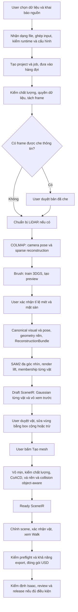

# Pipeline hiện tại, công nghệ và luồng sử dụng Real2Sim Studio

Ngày đọc code: **17/10/2026**. Branch: `mvp-pipeline-v2`. HEAD: `ec23f0520c52dc8ae80e6931c1e73323f87ee1ac`.

Tài liệu mô tả code và cấu hình đang có trong checkout. Không chạy lại pipeline, không kiểm thử trình duyệt, GPU hay Isaac trong lần khảo sát này. Các nhánh phụ thuộc runtime được mô tả là khả năng của code, không phải xác nhận deployment hiện tại đã chạy thành công.

“Pipeline cũ” trong bảng đối chiếu chính là `objectify_v1` ở commit `5e9cc11b` ngày 01/10/2026, không phải pipeline đầu tiên của hệ thống. Phần lịch sử bên dưới bổ sung luồng trước `objectify_v1`, đồng thời phân biệt giai đoạn ObjectGS làm mặc định ngày 15/10 với mặc định `shell` hiện tại.

## 1. Hệ thống hiện tại làm gì?

Luồng chính biến dữ liệu RGB thành scene 3D có tỉ lệ mét, tách các vật để người dùng duyệt, dựng hình học và collider, chỉnh scene, rồi xuất gói mô phỏng cho Isaac. LiDAR có thể hỗ trợ quỹ đạo, tỉ lệ, căn chỉnh và nguồn collision, tùy loại dữ liệu đầu vào.

Scene có ba phần liên kết nhưng khác vai trò:

| Thành phần | Vai trò | Công nghệ / dữ liệu |
| --- | --- | --- |
| Visual | Hình ảnh 3D để xem | 3D Gaussian Splatting; Gaussian PLY và SOG |
| Geometry / collider | Bề mặt và hình va chạm | Mesh GLB, Gaussian shell, các khối lồi CoACD, collision nền |
| Scene / physics | Vật nào đang tồn tại, ở đâu, nhãn và thông số vật lý | `SceneIR`, transform, membership, collider, physics, revision |

Ảnh Gaussian đẹp không tự chứng minh collision chính xác. Job tái dựng thành công cũng không đồng nghĩa hình học từng vật đã Ready hoặc physics đã qua kiểm định Isaac.

Nguồn: [SceneIR và SceneObject](../src/models/contracts/scene.py), [objectify](../src/services/orchestration/scene/objectify.py), [trạng thái hình học](../src/services/scene/geometry_state.py), [đóng gói mô phỏng](../src/services/orchestration/review/simulation_package.py).

## 2. Sơ đồ luồng mặc định cho job mới



Hai điểm dừng mặc định là **xác nhận hệ mét** và **duyệt tách vật trước Tạo mesh**. Duyệt bản che thông tin là điểm dừng có điều kiện. Nếu chọn `scene.geometry_review=auto`, hệ thống vẫn tạo Draft nhưng tự xếp hàng dựng hình học tiếp.

Nguồn điều phối: [runner.py — run_video_job, run_reviewed_preview_job, run_finalize_job](../src/services/orchestration/jobs/runner.py), [extract_scene](../src/services/orchestration/scene/extraction.py), [GeometryReviewBanner](../frontend/src/features/studio/GeometryReviewBanner.tsx).

## 3. Các bước xử lý và công nghệ

### Bước 1 — Nhận dữ liệu và xác định cách xử lý

User chọn file, loại dữ liệu, các khai báo cần thiết và tên scene. Với video, frontend có bước chuẩn bị video bằng thư viện media trên trình duyệt; mặc định chọn giới hạn 720p, có lựa chọn 1080p và 480p. Chuẩn bị video không được thì UI cho user chọn phương án tải bản gốc khi phù hợp.

Backend nhận dạng nội dung, lưu input assembly có revision, tạo resolution report và đề xuất recipe. Nó kiểm quan hệ giữa file, đơn vị, hệ tọa độ, timestamp, calibration, trajectory và runtime. Thiếu dữ kiện hoặc runtime không phù hợp thì không tạo job chạy tùy tiện.

Khi user xác nhận, hệ thống khóa recipe, input, cấu hình và runtime bằng checksum; tạo project/job có bản ghi chấp nhận để xử lý yêu cầu lặp một cách idempotent.

**Công nghệ:** Next.js, React, TypeScript; Mediabunny và media API của browser; FastAPI, Pydantic; input probe/resolver nội bộ; SHA-256.

Nguồn: [UnifiedInputFlow — submitReadyRoute](../frontend/src/features/studio/UnifiedInputFlow.tsx), [package frontend](../frontend/package.json), [InputAssemblyService](../src/services/orchestration/inputs/assembly.py), [input resolver](../src/services/reconstruction/inputs/input_resolver.py), [registry — tiếp nhận recipe](../src/services/orchestration/projects/registry.py), [bản ghi input run](../src/services/orchestration/inputs/runs.py).

### Bước 2 — Xếp hàng và phân công worker

Job không chạy toàn bộ trong HTTP request. Worker lấy việc từ hàng đợi bền vững, kiểm execution profile và nhận lease. Các tool nặng chạy qua subprocess/runtime riêng. Runner ghi tiến độ, log, tài nguyên và kết quả theo attempt.

Khi job bị hủy, revision đổi hoặc mất lease, runner dừng process con. Có giới hạn thời gian và kiểm ngân sách GPU nếu deployment cấu hình. Một số output hoàn tất như sparse model COLMAP và checkpoint Brush có cơ chế dùng lại khi identity tương ứng phù hợp.

**Công nghệ:** Python worker/CLI, subprocess, SQL transaction, lease, heartbeat, compare-and-swap; SQLite hoặc PostgreSQL. Artifact nằm trên filesystem và có thể đồng bộ kho S3-compatible khi cấu hình.

Nguồn: [runner — _run_tool](../src/services/orchestration/jobs/runner.py), [queue](../src/services/orchestration/jobs/queue.py), [worker CLI](../src/services/orchestration/jobs/worker_cli.py), [database](../src/services/orchestration/jobs/database.py), [storage](../src/services/orchestration/storage.py), [preview worker](../src/services/reconstruction/preview_worker.py).

### Bước 3 — Kiểm đầu vào, quyền sử dụng và tách frame

Chuỗi chuẩn bị kiểm metadata/chất lượng RGB, khai báo quyền sử dụng và chính sách dữ liệu. Video được decode, lấy mẫu frame theo cấu hình và ưu tiên frame nét trong cửa sổ lấy mẫu. Đầu ra là `NormalizedRGBFrameSet` cùng tham chiếu nguồn và timestamp.

Nếu bật che khuôn mặt/biển số và worker có runtime, hệ thống chạy EgoBlur. Nếu có frame bị che, job dừng để user duyệt rồi mới dựng 3D. Nếu không có vùng nào bị che, code tự ghi nhận và đi tiếp. Yêu cầu che nhưng thiếu runtime thì báo lỗi.

**Công nghệ:** FFmpeg/ffprobe, kiểm blur/quality, EgoBlur trong runtime scene. Ảnh bị che được dùng làm đầu vào tái dựng, nên vùng đó có thể xuất hiện thành mảng đen trong scene.

Nguồn: [prepare_cli — PrepareInputWorker](../src/services/reconstruction/prepare_cli.py), [frame_extraction](../src/services/reconstruction/rgb/frames/frame_extraction.py), [frame_sanitization](../src/services/reconstruction/rgb/frames/frame_sanitization.py), [anonymization review](../src/services/orchestration/jobs/anonymization_review.py).

### Bước 4 — Chuẩn bị LiDAR nếu recipe yêu cầu

Nhánh RGB thuần bỏ qua bước này. Gói LiDAR có trajectory được kiểm và ingest; scan thô có thể được ghép bằng pose cung cấp. Nhánh cần ước lượng trajectory chạy KISS-ICP rồi xuất trajectory và map cloud. Các dữ liệu đồng bộ/calibration được kiểm trước khi dùng để hướng dẫn camera reconstruction.

**Công nghệ:** parser PLY/PCD, ghép scan theo transform, KISS-ICP `1.3.0`, kiểm calibration/timestamp. R5/R6 hiện có ràng buộc scan PCD trong adapter tiếp nhận, không nên hiểu là mọi định dạng LiDAR đều chạy được.

Nguồn: [runner — _execute_lidar_ingest, _execute_lidar_odometry](../src/services/orchestration/jobs/runner.py), [LiDAR package](../src/services/reconstruction/lidar/package.py), [LiDAR odometry](../src/services/reconstruction/lidar/odometry.py), [registry](../src/services/orchestration/projects/registry.py).

### Bước 5 — Tính camera pose và dựng hình Gaussian

1. **COLMAP** nhận frame, trích đặc trưng, matching và dựng sparse model; lựa chọn model và kiểm số lượng/tỉ lệ frame đăng ký. Chế độ matching do cấu hình quyết định, không phải mọi job đều dùng cùng một chế độ.
2. **Brush** nhận camera pose và ảnh để train 3D Gaussian Splatting.
3. **splat-transform** xử lý/nén visual để xem trên web. Master Gaussian PLY được giữ cho các bước xử lý tiếp; SOG phục vụ delivery.

Đến đây user có thể xem preview, nhưng scene chưa mặc nhiên có đúng kích thước thật.

Nguồn: [preview_worker — _PreviewExecution.run](../src/services/reconstruction/preview_worker.py), [COLMAP adapter](../src/services/reconstruction/adapters/colmap.py), [Brush adapter](../src/services/reconstruction/adapters/brush.py), [canonical visual](../src/services/reconstruction/rgb/canonical/canonical_visual.py).

### Bước 6 — User xác nhận tỉ lệ mét và mặt sàn

Với luồng nhập số đo, user chọn hai đoạn A–B, C–D và ba điểm sàn; nhập khoảng cách thật, xem kết quả rồi xác nhận. Có đề xuất ước lượng tự động hoặc trợ giúp LiDAR khi đủ dữ liệu. Đề xuất không tự trở thành xác nhận của user.

Với trajectory LiDAR phù hợp, màn xác nhận riêng cho user xem căn chỉnh trajectory và thông tin sai lệch. Code chỉ gắn LiDAR vào bundle qua nhánh trajectory khi quyết định xác nhận tương ứng đã có; nhập số đo tay không tự xác nhận căn chỉnh LiDAR.

Sau xác nhận, pipeline biến đổi visual và camera pose về hệ canonical theo mét, Z-up và mặt sàn. Cùng transform phải được áp dụng cho các representation liên quan.

**Công nghệ:** metric confirmation nội bộ, phép biến đổi similarity, căn chỉnh trajectory/camera centers; splat-transform cho Gaussian canonical.

Nguồn: [MetricConfirmView](../frontend/src/features/studio/MetricConfirmView.tsx), [LidarMetricConfirm](../frontend/src/features/studio/LidarMetricConfirm.tsx), [MetricConfirmationService](../src/services/orchestration/jobs/metric.py), [FinalizeWorker — _execute, _lidar_alignment](../src/services/reconstruction/finalize.py).

### Bước 7 — Dựng geometry nền và phát hành ReconstructionBundle

Finalize tạo visual/pose canonical, tính vùng làm việc và seed từ camera, dựng geometry RGB bằng pipeline voxel và carve khoảng trống cho robot. Sau đó nó kiểm và phát hành `ReconstructionBundle` chứa các tham chiếu visual, geometry, camera và bằng chứng metric/alignment phù hợp.

**Công nghệ:** splat-transform voxel pipeline, occupancy/collision mesh và manifest có checksum. Đây là geometry của scene tái dựng, khác với vỏ/collider của từng vật sẽ được dựng sau.

Nguồn: [FinalizeWorker](../src/services/reconstruction/finalize.py), [RgbGeometryService](../src/services/reconstruction/rgb/geometry/geometry_publication.py), [voxel adapter](../src/services/reconstruction/adapters/voxel.py), [bundle validation](../src/services/reconstruction/bundle_validation.py).

### Bước 8 — Tách vật và tạo Draft để duyệt

Pipeline đọc Gaussian nguồn đã canonical, ước lượng sàn và lấy các góc camera. SAMPro3D dùng SAM2 với prompt từ điểm 3D chiếu lên ảnh để tìm ứng viên qua nhiều góc nhìn. Bước render lift dùng `gsplat` và SAM2 để gán Gaussian cho từng vật theo bằng chứng render; không chỉ dùng hộp bao không gian.

Với mặc định `multiview_v1`, code dùng tinh chỉnh đa góc nhìn và bảo vệ phần sàn. Đầu ra membership gắn mỗi source row Gaussian với nhãn vật; `-1` là nền. Pipeline tách Gaussian theo vật, lưu pose nguồn và dựng vỏ thô để user xem.

Draft được publish với `provenance.object_geometry = "awaiting_review"`. Vật chưa có collider cuối. Nhánh Draft chưa chạy CoACD, ObjectGS training hoặc vá nền.

**Công nghệ:** SAM2, SAMPro3D orchestration, PyTorch/gsplat, NumPy/SciPy, Gaussian PLY, `ObjectMembershipArtifact`, GLB shell preview.

Nguồn: [objectify — objectify, _publish_draft](../src/services/orchestration/scene/objectify.py), [SAMPro3D](../src/services/scene/sampro3d/pipeline.py), [lift_runner](../src/services/scene/association/lift_runner.py), [gaussian_split](../src/services/scene/decomposition/gaussian_split.py), [membership contract](../src/models/contracts/object_membership.py).

### Bước 9 — User sửa vùng vật bằng box

User chọn vật, thêm box hoặc trừ box, điều chỉnh kích thước/vị trí/hướng và xem preview Gaussian cùng vỏ. Box dùng tọa độ local của vật trong khung nguồn; việc đã Move vật không được làm thay đổi cách hiểu membership nguồn.

Preview chưa ghi scene. Apply trên Draft cập nhật membership và representation của các vật bị ảnh hưởng, rồi publish revision mới. Bước này không train lại Brush hoặc ObjectGS. Có kiểm revision, checksum, số Gaussian còn lại và các vật bị lấy bớt Gaussian.

Nếu sửa vùng trên scene đã Ready, hệ thống đưa công việc dựng lại các vật bị ảnh hưởng vào hàng đợi; không retrain cả scene. Nhánh rebuild từng vật dùng shell kể cả job chọn ObjectGS.

Nguồn: [RegionEditor](../frontend/src/features/studio/region/RegionEditor.tsx), [object_region — preview_region, apply_region_draft](../src/services/orchestration/scene/object_region.py), [object_geometry_build — object_ids, membership_override](../src/services/orchestration/scene/object_geometry_build.py), [scene API](../src/api/product/scene.py).

### Bước 10 — Tạo mesh, collider và nền object-aware

Khi user bấm **Tạo mesh**, backend xếp hàng operation `geometry` gắn với revision hiện tại:

1. Dựng vỏ mịn từ Gaussian của từng vật. Shell lọc opacity/outlier, voxel hóa, morphology, lọc component, sửa tiếp xúc chéo, tạo surface và kiểm chất lượng. Độ phân giải danh định là 0,02 m; code có thể tăng voxel cho vật lớn để giữ giới hạn tài nguyên.
2. Nếu job chọn ObjectGS, chạy ObjectGS để thử lấy surface tốt hơn. Vật qua QA dùng surface ObjectGS; vật không qua QA giữ shell và ghi lý do. Lỗi runtime/toàn bộ lượt ObjectGS làm bước build thất bại, không được coi như đã hoàn tất bằng shell.
3. Phân rã surface được chọn bằng **CoACD** thành các khối lồi. Nhánh strict surface kiểm checksum, object-local, đơn vị mét, chất lượng và budget. Không âm thầm đổi thành hộp OBB để báo thành công.
4. Tách nền theo membership, render phần thiếu và inpaint màu bằng **LaMa** nếu có checkpoint; nếu không có thì **OpenCV Telea**. Gieo Gaussian nền bổ sung theo depth rồi đóng gói visual. Đây là hình suy đoán ở vùng camera chưa quan sát.
5. Dựng collision môi trường object-aware từ Gaussian nguồn và membership, có xử lý hỗ trợ mặt sàn theo bằng chứng. Collision nền và visual nền được tạo bằng các bước riêng.
6. Chỉ sau khi các bước thành công mới publish revision với `object_geometry = "ready"`. Operation bị hủy, stale hoặc lỗi không được thay head bằng kết quả dở.

Shell là bề mặt kín quanh occupancy quan sát được; nó có thể rỗng ở phía thiếu quan sát. Code không khẳng định đã tái tạo đủ hình dạng thật hay thể tích vật thật. Không dùng trực tiếp thể tích shell để suy khối lượng.

Nguồn: [build_object_geometry](../src/services/orchestration/scene/object_geometry_build.py), [gaussian_shell](../src/services/scene/gaussian_shell.py), [surface QA](../src/services/scene/surface_mesh.py), [convex_runner](../src/services/simulation/colliders/convex_runner.py), [inpaint_runner](../src/services/reconstruction/rgb/inpaint/inpaint_runner.py), [object-aware background](../src/services/orchestration/scene/object_geometry_steps.py), [objectify queue](../src/services/orchestration/scene/objectify_queue.py).

### Bước 11 — Chỉnh scene, Walk và xuất mô phỏng

Khi có hình học phù hợp, user xác nhận/bỏ qua vật, đặt tên/nhãn, điều chỉnh pose, ẩn/xóa/khôi phục hoặc thêm vật theo các thao tác được hỗ trợ. SceneIR lưu revision và liên kết nguồn, visual, geometry, collider và physics.

Frontend dùng **PlayCanvas / SuperSplat Viewer** để xem Gaussian. Walk/physics phía trình duyệt dùng **Ammo.js/Bullet**; collider động có đường compound convex parts. Đây là mô phỏng phía browser, không phải bằng chứng physics Isaac.

Tạo gói mô phỏng kiểm geometry Ready, metric, collider, transform, object confirmation, artifact và khả năng exporter/runtime. Sau đó hệ thống bổ sung physics, dựng candidate và đóng ZIP theo revision. Nhánh hybrid dùng **OpenUSD** và `UsdVol ParticleField3DGaussianSplat` để giữ hình Gaussian cùng collision/physics; nhánh collision-only có phạm vi visual khác. Code kiểm capability, không mặc nhiên coi mọi scene đều xuất được.

Kiểm định Isaac là operation riêng. Review/release sử dụng validation, approval và manifest gắn checksum của candidate. Export ZIP hoặc static preflight PASS chưa chứng minh candidate đã chạy đạt trong Isaac.

Nguồn: [object actions](../src/services/orchestration/scene/objects.py), [ScenePage](../frontend/src/features/studio/ScenePage.tsx), [scene-physics](../frontend/src/features/viewer/scene-physics.ts), [SimulationPackagePanel](../frontend/src/features/studio/SimulationPackagePanel.tsx), [simulation_package](../src/services/orchestration/review/simulation_package.py), [validation worker](../src/services/orchestration/review/validation_worker.py), [review workflow](../src/services/orchestration/review/workflow.py).

## 4. Các nhánh đầu vào không đi giống nhau

| Nhánh | Dữ liệu / cách xử lý | Điểm cần phân biệt |
| --- | --- | --- |
| R1 — RGB only | Video RGB → COLMAP → Brush → xác nhận mét → bundle và scene | Luồng RGB chính |
| R2 — Registered map | RGB + map LiDAR đã ghép | Worker vẫn dựng preview RGB; map được giữ làm nguồn cho luồng registration, không tự trở thành collision đã xác nhận |
| R3 — Single static cloud | RGB + một point cloud LiDAR tĩnh | Cũng cần xử lý căn chỉnh phù hợp; một cloud tĩnh không tự cung cấp trajectory |
| R4 — Supplied trajectory | RGB + LiDAR, trajectory cung cấp, calibration và timestamp | Ingest/ghép theo trajectory; có đường hỗ trợ pose và metric; phải giữ provenance của trajectory |
| R5 — Estimated trajectory | RGB + scan sequence, thứ tự/thời gian và khai báo hệ mét | KISS-ICP ước lượng trajectory và map; nguồn pose là estimated |
| R6 — Sensor guided | RGB + dữ liệu LiDAR và trajectory/calibration/đồng bộ theo recipe | Dùng guidance cho camera reconstruction; có thể cần bước odometry trước |
| Gaussian view/import | Gaussian PLY hoặc SOG có sẵn | Đi vào `/imports/...`; không tự chạy lại COLMAP/Brush hay tạo scene vật thể có collider |
| Ảnh dataset đã chuẩn bị | Frame set do công cụ dataset chuẩn bị rồi gọi prepared-job | Có đường chạy bằng code; không suy ra UI upload video hỗ trợ mọi thư mục ảnh |

R2/R3 có luồng registration riêng với source plane hypotheses bằng RANSAC và floor-constrained point-to-plane ICP, proposal/QA và bước commit. Chọn LiDAR làm collision source là quyết định riêng; việc upload thêm cloud không tự đổi geometry nguồn của scene.

Các nhánh R1–R6 trong resolver là recipe của workflow RGB reconstruction. Không nên từ tên “LiDAR” suy ra có một pipeline LiDAR-only hoàn chỉnh tương đương trong Studio này.

File qualification hiện đánh dấu R1–R6 là `qualified`, nhưng bằng chứng R2–R6 ghi `owner_decision`, không phải held-out qualification. Deployment còn phải khớp runtime identity; file cấu hình không chứng minh kết quả trên mọi dữ liệu thật.

Nguồn: [RecipeGroup và workflow intent](../src/models/contracts/input_assembly.py), [input resolver](../src/services/reconstruction/inputs/input_resolver.py), [registry](../src/services/orchestration/projects/registry.py), [runner — _validate_project_input_recipe](../src/services/orchestration/jobs/runner.py), [registration worker](../src/services/orchestration/jobs/registration_worker.py), [registration UI](../frontend/src/features/studio/scene/RegistrationPanel.tsx), [qualification config](../configs/product/input_runtime_qualification_v1.json).

## 5. Một user sử dụng từ đầu đến cuối

Ví dụ user có video quay một phòng và muốn đưa scene sang Isaac:

| Bước user | Hệ thống làm gì | User thấy / quyết định |
| --- | --- | --- |
| 1. Vào Studio bằng tài khoản có quyền chạy job | Xác thực, kiểm quyền/quota | Danh sách scene và luồng tạo scene |
| 2. Chọn video; thêm LiDAR nếu có | Chuẩn bị/upload, nhận dạng, phân tích tổ hợp file | File hợp lệ, thông tin còn thiếu và route được đề xuất |
| 3. Nhập tên, nguồn/quyền dữ liệu; chọn preset | Kiểm cấu hình, tài nguyên và recipe | Mặc định shell, tinh chỉnh đa góc nhìn, có duyệt trước mesh |
| 4. Tạo scene | Lưu project/job và xếp hàng | Trang scene, tab tiến trình, trạng thái chờ/chạy/lỗi |
| 5. Duyệt ảnh đã che nếu hệ thống yêu cầu | Sau khi chấp nhận mới chạy preview | Quyết định tiếp tục với dữ liệu đã che |
| 6. Chờ camera reconstruction và train Gaussian | COLMAP + Brush | Preview Gaussian và các artifact/tiến độ tương ứng |
| 7. Chọn điểm và xác nhận mét/sàn | Chuẩn hóa pose/visual, dựng geometry và bundle | Kích thước và mặt sàn để kiểm lại trước khi xác nhận |
| 8. Mở Studio khi tách vật xong | Publish Draft, Gaussian từng vật và vỏ thô | Banner duyệt tách vật; chưa coi là scene có collider hoàn tất |
| 9. Duyệt từng vật, sửa vùng bằng box nếu cần | Preview; Apply tạo revision mới | Gaussian/vỏ của vật thay đổi theo vùng |
| 10. Bấm Tạo mesh | Build shell → QA → CoACD → nền và collision → Ready | Tiến độ build; lỗi thì sửa/thử lại, thành công mới mở các thao tác cần Ready |
| 11. Chỉnh scene và hoàn tất xác nhận vật | Cập nhật SceneIR/revision | Di chuyển/xoay, nhãn, vật lý và trạng thái vật |
| 12. Vào Walk để kiểm tra tương tác | Dùng collision hiệu lực theo revision trong browser | Quan sát đường đi/va chạm; chưa thay cho kiểm định Isaac |
| 13. Tạo và tải gói USD | Preflight, capability check, physics/candidate, ZIP | Báo cáo đạt/lỗi và link tải khi tạo được |
| 14. Chạy kiểm định Isaac; người có quyền review/release | Ghi bằng chứng runtime và quyết định gắn candidate | Kết quả kiểm định, phê duyệt và release có điều kiện |

UI scene có các tab tiến trình, Studio, review và kết quả. Editor chỉnh Gaussian tự do có cờ `GAUSSIAN_EDIT_ENABLED = false`; công cụ chỉnh vùng membership bằng box là luồng riêng đang có code, không nên mô tả editor SuperSplat tự do như một bước user bắt buộc.

Nguồn: [UnifiedInputFlow](../frontend/src/features/studio/UnifiedInputFlow.tsx), [ScenePage](../frontend/src/features/studio/ScenePage.tsx), [NextAction](../frontend/src/features/studio/scene/NextAction.tsx), [GeometryReviewBanner](../frontend/src/features/studio/GeometryReviewBanner.tsx), [state.ts](../frontend/src/features/studio/scene/state.ts).

## 6. Khác gì pipeline cũ?

### Luồng trước objectify_v1

Trước `objectify_v1`, hệ thống đã có luồng tái dựng:

```text
RGB → COLMAP → Brush → user xác nhận mét → voxel collision → ReconstructionBundle
    → tách ứng viên bằng SAMPro3D/SAM2 hoặc hình học → hộp ứng viên → SceneIR để user duyệt
```

COLMAP tính camera pose; Brush dựng visual Gaussian; bước xác nhận mét chuẩn hóa kích thước và mặt sàn. Voxel pipeline tạo collision của môi trường, rồi bundle bàn giao visual, geometry và camera pose cho bước tạo scene.

Ở bước tách ứng viên, code ưu tiên SAMPro3D/SAM2 khi có runtime. Nếu runtime thiếu hoặc nhánh này lỗi, code chuyển sang phân tích hình học từ collision mesh. Các ứng viên được biểu diễn bằng hộp để user xác nhận; nếu cả hai cách đều lỗi, code vẫn có thể publish scene chỉ có môi trường để user thêm vật bằng tay.

Luồng này chưa có chuỗi cắt Gaussian riêng từng vật, collider CoACD và vá visual nền của `objectify_v1`. User chủ yếu duyệt hộp ứng viên trên scene tái dựng; chưa có bước Draft với vỏ Gaussian và box cộng/trừ membership như hiện tại.

Nguồn lịch sử: `git show 5e9cc11b^:src/services/orchestration/scene_extraction.py`, đặc biệt `extract_scene()`, lời gọi `extract()`, `objects_from_candidates()` và nhánh fallback hình học. Đây là luồng có trước `objectify_v1` được xác nhận trong Git; không khẳng định mọi bước đã chạy đạt end-to-end ở thời điểm đó.

### 6.1. Mốc so sánh đã kiểm trong Git

| Mốc | Hành vi liên quan |
| --- | --- |
| Trước `5e9cc11b` | COLMAP → Brush → xác nhận mét → voxel collision → bundle → SAMPro3D/SAM2 hoặc hình học → hộp ứng viên; không phải `objectify_v1` |
| `5e9cc11b` — 01/10 | `objectify_v1(sampro3d_sam2+render_lift+coacd+seed_inpaint)`. File lịch sử là `src/services/orchestration/scene_objectify.py`. Không có ObjectGS trong chuỗi này |
| `253ed34f` — 15/10 02:38 +07 | Nối ObjectGS thành nhánh tùy chọn cho strict surface collider và background occupancy |
| `3d487da1` — 15/10 18:34 +07 | Đặt ObjectGS và `multiview_v1` làm mặc định preset cho job mới |
| `07ecbfcd` — 15/10 22:34 +07 | Đổi preset sang shell, `geometry_review=required`; giữ class default legacy cho tương thích |
| HEAD khảo sát | Cả 8 preset dùng `shell` + `required` + `multiview_v1`; ObjectGS còn là lựa chọn |

Nguồn lịch sử là nội dung Git, không chỉ commit message. Có thể xem lại bằng `git show 5e9cc11b:src/services/orchestration/scene_objectify.py` và `git show 07ecbfcd -- configs/product/processing_presets_v1.json`. Cấu hình hiện tại: [processing_presets_v1.json](../configs/product/processing_presets_v1.json).

### 6.2. So sánh xử lý và trải nghiệm

| Nội dung | Pipeline cũ `objectify_v1` | Pipeline mặc định hiện tại |
| --- | --- | --- |
| Phần RGB phía trước | COLMAP/Brush, metric và reconstruction artifacts | Vẫn dùng các công nghệ đó; thay đổi chính được đối chiếu ở khâu object/geometry |
| Tổ chức tách vật | SAM2 → render lift → cắt Gaussian → collider → vá nền → publish kết quả | SAM2/lift → membership + vỏ preview → publish Draft; sau duyệt mới build geometry |
| Tinh chỉnh segmentation | Luồng lịch sử chưa có cấu hình refinement hiện tại | Preset chọn `multiview_v1` |
| Thời điểm user xem/sửa vùng | Thấy kết quả sau khi chuỗi objectify chạy xong | Có điểm dừng trước khi dựng collider và vá nền |
| Dựng mặt vật | Đi trực tiếp từ điểm Gaussian qua occupancy, closing/fill và marching cubes trong collider runner | Có shell artifact riêng: lọc outlier/opacity, occupancy surface, QA; dùng làm surface đầu vào collider |
| Collider lỗi/ít điểm | Có nhánh dùng bounding box OBB thay collider phân rã | Nhánh strict shell/surface báo lỗi nếu không đạt; không âm thầm coi hộp thay thế là build thành công |
| ObjectGS | Không có trong mốc 01/10 | Tùy chọn; surface tốt thì dùng, QA từng vật fail thì giữ shell và ghi lý do |
| Vá nền | Nằm trong cùng lượt objectify trước khi publish scene | Dời tới geometry build sau duyệt; vẫn có LaMa/Telea và Gaussian seed inpaint |
| Sửa vùng trực quan | Không có workflow Draft + region box hiện tại | Box cộng/trừ, preview và Apply; dùng membership nguồn để giữ nhất quán |
| Sửa sau Ready | Không có luồng partial shell rebuild hiện tại | Dựng lại vật bị ảnh hưởng; không retrain toàn bộ ObjectGS |
| Walk và USD | Dựa trên scene/collider được xuất từ chuỗi cũ | Bị chặn khi Draft chưa Ready; dùng collision/source identity và revision phù hợp |
| Tự động hóa | Objectify chạy liền trong khâu extraction | Mặc định có duyệt; `geometry_review=auto` dùng cùng Draft/build nhưng tự nối tiếp |

So với giai đoạn ObjectGS làm mặc định vào chiều 15/10, hiện tại job mới dùng shell làm đường dựng hình học mặc định. Không phải mọi lần Tạo mesh đều train ObjectGS. Dù chọn ObjectGS, bước build hiện vẫn chuẩn bị shell trước để có surface đối chiếu/thay thế theo QA từng vật.

Class `SceneObjectifyConfig` vẫn có default `geometry_method="legacy"`, `geometry_review="legacy"`, `refinement="legacy"`. Giá trị preset khóa vào từng job mới mới quyết định mặc định trên Studio. Job/scene cũ không tự chuyển thành shell/Draft chỉ vì file preset đã đổi.

Nguồn hiện tại: [SceneObjectifyConfig và nhánh Draft](../src/services/orchestration/scene/objectify.py), [extract_scene và auto build](../src/services/orchestration/scene/extraction.py), [geometry build và lựa chọn surface](../src/services/orchestration/scene/object_geometry_build.py), [strict collider](../src/services/simulation/colliders/convex_runner.py), [dispatch tương thích cấu hình cũ](../src/services/orchestration/jobs/dispatch.py).

## 7. Cách đọc trạng thái và giới hạn bằng chứng

| Trạng thái / artifact | Kết luận được | Chưa đủ để kết luận |
| --- | --- | --- |
| Preview Gaussian có thể xem | RGB reconstruction đã tạo visual preview | Đúng hệ mét, tách vật đúng hoặc collision đúng |
| Job `SUCCEEDED` / có ReconstructionBundle | Phần finalize đã có kết quả theo contract | Geometry từng vật Ready; `_extract_scene_stage` có biên lỗi riêng |
| Draft `awaiting_review` | Có scene để duyệt membership và vùng vật | Có collider cuối hoặc được phép xuất USD |
| Ready `object_geometry=ready` | Lượt build đã publish bộ hình học theo revision | Chất lượng vật lý ngoài thực tế hay Isaac acceptance |
| Preflight / export PASS | Các kiểm tra tĩnh và khả năng export tương ứng đã đạt | Physics đã chạy thành công trong Isaac |
| Validation runtime, approval, release hợp lệ | Có bằng chứng và quyết định cho candidate/checksum tương ứng | Các revision sửa về sau cũng được duyệt |

### 7.1 Đọc tiến trình trên giao diện (Sprint 8, 2026-10-20)

Trang scene hỏi **một** route `GET /jobs/{id}/pipeline` (có ETag, không đổi thì trả 304). Route trả:

- `steps`: danh sách bước do backend dựng, mỗi bước có `owner` là **máy** (system) hoặc **người** (user) và trạng thái
  `pending / running / waiting / succeeded / failed / skipped`. Ba bước mới hiện rõ trên dòng thời gian: xem bản đã che
  (`ANONYMIZATION_REVIEW`, người), LiDAR odometry (máy, khi job có LiDAR), duyệt vật (`OBJECT-CONFIRM`, người).
- `next_action`: việc tiếp theo, tính bằng một hàm duy nhất ở backend và dùng chung cho chuông, nhãn đầu trang, danh sách
  scene, thông báo trong Studio:

| `next_action` | Ai làm | Nghĩa |
| --- | --- | --- |
| `wait_system` | máy | Máy đang chạy, đang xếp hàng, chờ tài nguyên hoặc đang bật máy GPU |
| `review_anonymization` | người | Xem bản đã che mặt/biển số rồi xác nhận |
| `confirm_metric` | người | Chọn điểm và nhập kích thước thật để có tỉ lệ mét |
| `retry_job` / `job_failed` | người | Job lỗi; có thể chạy lại / phải sửa nguyên nhân trước |
| `job_cancelled` | — | Đã huỷ, kết quả đã có vẫn giữ |
| `choose_object_method` | người | Tách theo vật chưa thành công: chạy lại hoặc dùng hộp ứng viên |
| `confirm_objects` | người | Còn ứng viên vật chưa xác nhận |
| `review_objects` | người | Duyệt vật rồi bấm Tạo mesh |
| `retry_geometry` | người | Tạo mesh lỗi; chỉnh vùng rồi thử lại |
| `scene_ready` / `create_package` / `fix_preflight` | người | Scene đã dựng; tạo gói mô phỏng / sửa theo preflight |
| `review_package` / `await_review` / `released` | người | Có gói; chờ Reviewer; đã phát hành |

- `wait`: lý do máy đang chờ (`queue`, `resources`, `runtime`, `scene_operation`); `gpu`: trạng thái bật máy GPU.

Nhịp hỏi lại: máy đang chạy 3 giây, chờ người 15 giây, xong việc 60 giây; tab trình duyệt ẩn thì không hỏi.

**Mốc thời gian từng bước** (bảng `r2s_step_marks`, migration v26): mỗi bước ghi lúc bắt đầu và kết thúc, kể cả bước của
người (xem bản đã che, duyệt vật) và các lượt chạy lại trong Studio (Tạo mesh, chỉnh vùng). Đây là nền để tính tổng thời gian
máy + người cho một scene; báo cáo tổng hợp chưa làm trong Sprint 8.

Khảo sát này chỉ đọc source/cấu hình và Git history. Không dùng kết quả test cũ để tuyên bố runtime hiện tại đạt. Không đo thời gian xử lý; các mô tả như “nhanh hơn” chỉ nên kiểm bằng benchmark riêng, không suy ra số giây từ kiến trúc.

Kiểm tra tài liệu: đối chiếu call path bằng CodeGraph và graphify; đọc các nhánh thực thi liên quan; kiểm cấu hình preset và source lịch sử. Chỉ thêm file Markdown này, không sửa source/config, không chạy dịch vụ và không commit.
