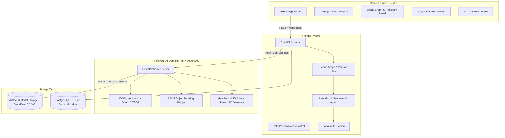

# Product Requirements Document (PRD)
## RAV-01: Real2Sim Workspace

| Metadata | Giá trị |
|:---|:---|
| **Dự án** | Real2Sim Workspace (Nền tảng chuẩn bị môi trường mô phỏng AMR từ dữ liệu khảo sát) |
| **Mã đề tài** | RAV-01 (Robot & Xe tự hành — VinFast) |
| **Đội ngũ** | Team P-087 — VinUni AI20K Build Phase (Cohort 4) |
| **Trạng thái** | Version 1.0 (Chính thức — Hoàn thiện Phase 2 Planning) |
| **Ngày ban hành** | 19/09/2026 |
| **Tài liệu liên quan** | [`BRIEF.md`](file:///d:/AI/P-087/docs/BRIEF.md), [`WIREFRAME_AND_UI_FLOW.md`](file:///d:/AI/P-087/docs/WIREFRAME_AND_UI_FLOW.md), [`AI_LOG_SETUP.md`](file:///d:/AI/P-087/docs/AI_LOG_SETUP.md) |

---

## 1. Executive Summary & Mục Tiêu Dự Án

### 1.1 Vấn đề nghiệp vụ (Problem Statement)
Kỹ sư triển khai robot di động tự hành (AMR) trong kho bãi và nhà xưởng đối mặt với sự đánh đổi lớn:
* Dựng cảnh 3D thủ công bằng CAD tốn nhiều ngày công và khó phản ánh sự lộn xộn, góc khuất của hiện trường thực tế.
* Dữ liệu quay chụp thật (video RGB, LiDAR, RGB-D) tuy tái tạo được hình ảnh trực quan nhưng **không có physics**, không có phân tách vật thể để chỉnh sửa kịch bản, và thường bị sai lệch đơn vị kích thước mét.
* Khi đưa cảnh vào simulator (như NVIDIA Isaac Sim), robot thường xuyên rơi xuyên sàn, va chạm ảo với chướng ngại vật tàng hình, hoặc đi xuyên qua kiện hàng thực tế.

### 1.2 Tuyên bố sứ mệnh (Mission Statement)
Xây dựng **Real2Sim Workspace** — nền tảng web tích hợp AI Agent giúp kỹ sư chuyển đổi nhanh dữ liệu khảo sát khu vực trong nhà thành **scene mô phỏng USD chuẩn hóa, đồng bộ giữa hình ảnh 3D và khối va chạm vật lý, có kiểm định tự động và người duyệt trước khi phát hành**, giúp cắt giảm ít nhất **50% thời gian chuẩn bị và đối soát hiện trường**.

---

## 2. Chân Dung Người Dùng & Hành Trình Trải Nghiệm (User Personas & Journeys)

### 2.1 Personas
1. **Persona 1: Kỹ sư Mô phỏng (Simulation Engineer — Alex)**
   * *Nhiệm vụ:* Tiếp nhận dữ liệu quay hiện trường từ đội khảo sát, đưa vào hệ thống dựng 3D, căn chỉnh kích thước sàn/tường, gán vật cản và xuất gói scene cho đội robot.
   * *Nỗi đau:* Mất hàng giờ căn chỉnh đơn vị mét giữa các phần mềm, phải tự vẽ hộp va chạm thủ công, và hay bị trả lại file do lỗi xuyên vật cản trong Isaac Sim.
2. **Persona 2: Kỹ sư Tích hợp Robot (AMR Integration Engineer — Linh)**
   * *Nhiệm vụ:* Nạp scene vào Isaac Sim, cấu hình robot mẫu (footprint, cảm biến LiDAR), chạy thử các tuyến đường di chuyển từ điểm A đến điểm B khi bố trí kho thay đổi.
   * *Nỗi đau:* Cảnh nhìn rất đẹp nhưng robot không di chuyển được vì lối đi bị khối va chạm vô hình chặn nghẽn.
3. **Persona 3: Trưởng nhóm / Người Kiểm Duyệt (Tech Lead / Simulation Reviewer — David)**
   * *Nhiệm vụ:* Kiểm tra báo cáo sai số kỹ thuật, đối soát vùng mù dữ liệu, ký duyệt phiên bản scene trước khi đội ngũ chính thức sử dụng cho huấn luyện và kiểm thử an toàn.
   * *Nỗi đau:* Thiếu bằng chứng kiểm định tập trung; không thể phân biệt được bản sửa nào đã được kiểm tra vật lý hay chỉ là chỉnh sửa hình ảnh bên ngoài.

### 2.2 End-to-End User Journey (Hành trình chuẩn)
```text
[Alex: Tải dữ liệu RGB-D] 
       ↓
[Hệ thống: Pre-flight Check kích thước & độ phủ camera] 
       ↓
[RunPod Cloud GPU: Dựng 3DGS + Depth Surface Mesh] 
       ↓
[Alex: Mở 3D Studio, chọn kiện hàng, di chuyển sang vị trí mới] 
       ↓
[Hệ thống: Đồng bộ di chuyển cả Visual Splat và Bounding Collider] 
       ↓
[LangGraph Agent: Tự động chạy Scene Audit, phát hiện lối đi bị hẹp dưới 0.9m] 
       ↓
[Alex: Áp dụng gợi ý nới rộng lối đi của Agent] 
       ↓
[RunPod Cloud GPU: Chạy Headless Isaac Sim Collision Probes & Route Nav2] 
       ↓
[David: Mở Reviewer Gate, xem báo cáo PSNR/Chamfer/Pass Rate, ký duyệt Release] 
       ↓
[Tải gói USD Stage đã kiểm định hoàn chỉnh]
```

---

## 3. Kiến Trúc Hệ Thống & Ranh Giới Kỹ Thuật (Architecture & Boundaries)

Nhóm áp dụng mô hình **Split-Tier Architecture** kết hợp **GPU Cloud on-demand**:



### Ranh giới hệ thống (Scope Boundaries):
* **In-Scope (MVP):**
  * Không gian trong nhà tĩnh, 1 tầng, diện tích $\le 100\text{ m}^2$.
  * Phân tách 3 lớp đối tượng: Floor, Walls, Bounding Obstacles.
  * Xuất file định dạng OpenUSD (`.usd`/`.usda`) kèm thuộc tính `PhysicsCollisionAPI` và `PhysicsRigidBodyAPI`.
  * LangGraph Agent kiểm tra quy chuẩn kích thước, dung sai và chẩn đoán lỗi mô phỏng.
  * Tối đa 2 vai trò: Simulation Engineer (Chỉnh sửa) và Lead Reviewer (Phê duyệt).
* **Out-of-Scope (Bảo lưu cho các bản nâng cấp sau):**
  * Không hỗ trợ nhiều tầng hoặc khu vực ngoài trời rộng lớn.
  * Không chèn người đi bộ hoặc xe cộ chuyển động trong thời gian thực.
  * Không điều khiển robot thật ngoài môi trường vật lý.

---

## 4. Yêu Cầu Chức Năng (Functional Requirements)

### FR-1: Tiếp Nhận & Tiền Kiểm Tra Dữ Liệu (Data Ingestion & Pre-flight Validator)
* **FR-1.1:** Hỗ trợ tải lên bộ dữ liệu khảo sát bao gồm: Thư mục ảnh màu RGB, ảnh chiều sâu Depth (16-bit PNG hoặc NumPy), và file camera trajectory (`transforms.json` hoặc ma trận pose).
* **FR-1.2:** Pre-flight Check tự động:
  * Kiểm tra tính toàn vẹn của tệp và số lượng khung hình ($\ge 50$ ảnh).
  * Kiểm tra sự hiện diện của thông số nội suy camera (Camera Intrinsics $f_x, f_y, c_x, c_y$).
  * Kiểm tra tham chiếu kích thước mét (Metric scale anchor): cảnh báo ngay lập tức nếu dữ liệu chỉ là video RGB đơn thuần thiếu thông tin scale.
* **FR-1.3:** Hiển thị bản đồ nhiệt độ phủ quan sát (Camera Coverage Map) để cảnh báo trước các "vùng mù" (unobserved regions).

### FR-2: Tái Tạo Hình Ảnh & Hình Học Trên GPU Cloud (Cloud Reconstruction)
* **FR-2.1:** Kích hoạt job bất đồng bộ (async job) sang RunPod GPU Worker khi có yêu cầu xử lý từ Web UI.
* **FR-2.2 (Lớp Visual):** Huấn luyện mô hình 3D Gaussian Splatting (3DGS) rút gọn (tối đa 15–20 phút trên GPU RTX 3090) để xuất file `.splat` / `.ply` dung lượng nhẹ cho trình duyệt web.
* **FR-2.3 (Lớp Physics):** Chạy thuật toán tích hợp đám mây điểm chiều sâu (Open3D TSDF Volume Integration) để trích xuất mặt phẳng sàn (Floor Plane RANSAC), tường biên và lưới bề mặt hình học (Surface Mesh).
* **FR-2.4:** Tính toán tự động các chỉ số chất lượng cơ sở trên tập ảnh kiểm tra giữ lại (held-out views): PSNR, SSIM, Chamfer Distance.

### FR-3: Cây Đối Tượng & Chỉnh Sửa Đồng Bộ (Scene Graph & Synchronized Editing)
* **FR-3.1:** Quản lý cấu trúc Scene Graph phân cấp rõ ràng:
  * `Root` $\rightarrow$ `Environment (Floor, Walls)` $\rightarrow$ `Obstacle_001 (Visual Splat + Collision Box)`.
* **FR-3.2 (Hỗ trợ tách vật thể):** Người dùng có thể nhấp chuột vào một vật cản trên ảnh 2D hoặc không gian 3D, hệ thống gọi cầu nối SAM2 để trích xuất mặt nạ và nhóm các điểm Gaussian tương ứng thành một Object ID riêng.
* **FR-3.3 (Đồng bộ hóa chỉnh sửa):** Khi người dùng thay đổi Transform (vị trí X, Y, Z hoặc góc xoay yaw) của một vật thể:
  * Tọa độ hiển thị 3D Gaussian di chuyển tương ứng.
  * Khối hộp va chạm bao quanh (Oriented Bounding Box - OBB collider) di chuyển chính xác cùng một ma trận chuyển vị.
* **FR-3.4:** Lưu lịch sử thao tác theo cơ chế **Scene Versioning** (phiên bản v1.0, v1.1...). Mỗi chỉnh sửa làm vô hiệu hóa tem duyệt an toàn cũ.

### FR-4: Xuất Gói USD & Kiểm Thử Isaac Sim Headless (Simulator Probes Runner)
* **FR-4.1:** Bộ sinh file OpenUSD (`usd_generator`):
  * Tạo stage `.usd` chuẩn theo chuẩn Omniverse Isaac Sim.
  * Gán sàn là static collider phẳng.
  * Gán các vật cản là rigid body collider dạng bounding box hoặc convex hull.
* **FR-4.2:** Tự động kích hoạt kiểm thử Headless trên GPU Worker:
  * **Collision Probes:** Bắn các tia raycast và thả robot mẫu tại các tọa độ quy định để kiểm tra không bị rơi xuyên sàn và không bị kẹt va chạm khởi tạo.
  * **Route Verification:** Kiểm tra đường đi mẫu từ điểm xuất phát đến đích bằng thuật toán Nav2/Grid-A*. Nếu đường đi bị vật cản chặn, báo trạng thái `BLOCKED` kèm tọa độ va chạm; nếu thông thoáng, báo `CLEAR`.

### FR-5: LangGraph Scene Audit & Diagnostic Agent
* **FR-5.1 (Kiến trúc State Graph):** Xây dựng Agent bằng LangGraph chạy trên nền model `gpt-4o-mini` (hoặc tương đương) với trạng thái `SceneAuditState`:
  ```python
  class SceneAuditState(TypedDict):
      scene_id: str
      version: str
      scene_graph: dict
      probe_results: list[dict]
      audit_logs: list[str]
      identified_issues: list[dict]
      suggested_fixes: list[dict]
      status: Literal["auditing", "diagnosing", "remediating", "passed", "escalated"]
  ```
* **FR-5.2 (Công cụ của Agent — Tools):**
  * `check_aisle_clearance(min_width_meters: float)`: Quét khoảng cách giữa các khối vật cản và tường. So sánh với chiều rộng robot mẫu cộng biên an toàn (ví dụ: $0.6\text{ m} + 0.3\text{ m} = 0.9\text{ m}$).
  * `verify_metric_scale()`: So sánh kích thước các vật thể đã biết (ví dụ pallet chuẩn $1.2\text{ m} \times 0.8\text{ m}$) với kích thước mesh tái tạo để phát hiện sai lệch tỷ lệ.
  * `diagnose_simulation_failure(probe_log)`: Phân tích log lỗi khi robot bị kẹt hoặc xuyên vật thể, chỉ ra nguyên nhân gốc (do thiếu collider hay do collider quá lớn).
  * `suggest_proxy_adjustment(object_id, action, params)`: Tạo đề xuất chỉnh sửa vị trí hoặc kích thước hộp va chạm.
* **FR-5.3 (Human-in-the-Loop):** Agent không được tự ý ghi đè cảnh; Agent tạo ra các "Đề xuất khắc phục" (Remediation Cards) trên giao diện. Người dùng bấm "Chấp nhận" thì thao tác mới được áp dụng vào Scene Graph.
* **FR-5.4 (LangSmith Tracing):** Tích hợp đầy đủ theo dõi trace (Run ID, Prompt, Tool Calls, Latency, Token Usage) phục vụ chấm điểm Deliverable #4.

### FR-6: Cổng Phê Duyệt Của Reviewer & Đóng Gói Phát Hành (HITL Release Gate)
* **FR-6.1:** Màn hình thẩm định dành cho vai trò Reviewer hiển thị:
  * Ảnh chụp đối chiếu Held-out vs Rendered.
  * Bảng chỉ số kỹ thuật: PSNR, SSIM, Chamfer, Route Pass Rate.
  * Danh sách các cảnh báo và vùng chưa quan sát (Unobserved Areas).
  * Toàn bộ nhật ký audit của LangGraph Agent.
* **FR-6.2:** Cơ chế ký duyệt: Chỉ khi Reviewer bấm "Approve & Seal", bản phát hành mới được gắn mã băm SHA-256 xác thực tính toàn vẹn.
* **FR-6.3:** Xuất gói tải về gồm: File `.usd` chính, file textures/materials, file cấu hình robot mẫu, và báo cáo kiểm định chất lượng định dạng JSON/PDF.

---

## 5. Yêu Cầu Phi Chức Năng (Non-Functional Requirements)

* **NFR-1 (Hiệu năng hiển thị Web):** Trình xem 3D trên nền Web (Next.js + Three.js) phải đạt tốc độ khung hình $\ge 30\text{ FPS}$ ở độ phân giải 1080p trên laptop thông thường (không cần GPU rời của client).
* **NFR-2 (Chi phí & Tài nguyên Cloud GPU):** 
  * GPU Worker trên RunPod được cấu hình tự động ngắt kết nối (auto-stop / spot pricing) khi không có job xử lý quá 15 phút.
  * Tổng ngân sách điện toán đám mây cho toàn bộ giai đoạn thử nghiệm của đội không vượt quá **$15 USD**.
* **NFR-3 (Khả năng phục hồi & Fallback):**
  * Nếu job huấn luyện 3DGS gặp lỗi CUDA Out-Of-Memory, hệ thống tự động fallback sang chế độ giảm kích thước ảnh đầu vào (downsample 50%) và kích hoạt lại.
  * Nếu kết nối mạng đến GPU Cloud bị gián đoạn, Web Tier hiển thị trạng thái chờ và cho phép kiểm tra lại trạng thái mà không làm mất phiên làm việc.
* **NFR-4 (Bảo mật & Ẩn danh):** Hệ thống có cơ chế kiểm tra tự động phát hiện và làm mờ khuôn mặt người và biển số xe trong tập ảnh đầu vào trước khi lưu trữ lâu dài.

---

## 6. Tiêu Chí Nghiệm Thu & Đánh Giá Chất Lượng (Acceptance Criteria & Metrics)

| Hạng mục | Chỉ số mục tiêu | Phương pháp đo kiểm | Ngưỡng đạt (Pass Gate) |
|:---|:---|:---|:---|
| **Năng suất người dùng** | Giảm tổng thời gian thao tác | Đo thời gian (Task Timer) trên 3 bài thử: Dựng scene, Sửa 1 vật cản, Sửa lỗi va chạm | **Giảm $\ge 50\%$ thời gian** so với quy trình thủ công |
| **Chất lượng hình ảnh** | PSNR, SSIM, LPIPS | Đánh giá trên tập góc nhìn giữ lại (10% held-out views) | **PSNR $\ge 25\text{ dB}$, SSIM $\ge 0.85$** |
| **Độ chính xác hình học** | Chamfer Distance đối xứng | So sánh bề mặt tái tạo với CAD Ground-Truth của Synthetic Warehouse | **Trung bình $\le 0.05\text{ m}$**; 95% sai số $\le 0.10\text{ m}$ |
| **Kiểm định mô phỏng** | Tỷ lệ thành công đường đi | Chạy 20 lượt thử nghiệm route Nav2 trên Isaac Sim headless | **Tỷ lệ tới đích $\ge 90\%$**, 0 lỗi xuyên vật thể |
| **Độ tin cậy của Agent** | Tỷ lệ chẩn đoán đúng | Chạy bộ 15 ca lỗi cài sẵn (Clearance, Scale, Missing Collider) | **$\ge 90\%$ phát hiện đúng nguyên nhân** và gợi ý giải pháp hợp lệ |
| **AI20K Deliverables** | Hoàn thành 10 sản phẩm | Kiểm tra theo checklist của BTC | Đầy đủ mã nguồn, Live URL, AI logs, Eval evidence, Slide & Video |

---

## 7. Phân Công & Kế Hoạch 6 Tuần (Roadmap & Team Responsibilities)

### Phân vai 4 thành viên (Team P-087):
* **Thành viên A (CV & Reconstruction Lead):** Quản lý RunPod GPU, pipeline 3DGS (nerfstudio), xử lý camera poses và tích hợp dữ liệu RGB-D.
* **Thành viên B (Geometry & Robotics Lead):** Xử lý Open3D TSDF, trích xuất mặt sàn/vật cản, tạo bounding collision proxies và script xuất định dạng USD cho Isaac Sim.
* **Thành viên C (Backend & Agent Lead):** Xây dựng FastAPI backend, thiết kế LangGraph Scene Audit Agent, cấu hình LangSmith và CI/CD.
* **Thành viên D (Frontend & Product Lead):** Phát triển giao diện Next.js, tích hợp Three.js viewport, thiết kế luồng HITL review và chuẩn bị bài pitch/video Demo Day.

### Tiến độ tuần:
* **Tuần 1:** Hoàn thiện PRD, Wireframe, cài đặt AI Log Hook, chạy thử nghiệm smoke-test nạp synthetic scene vào Isaac Sim và tạo worker RunPod.
* **Tuần 2:** Chạy trọn vẹn pipeline tái tạo 3DGS và tính toán chỉ số PSNR/Chamfer trên Synthetic Stage.
* **Tuần 3:** Hoàn thiện giao diện 3D Web Studio, cho phép chọn và di chuyển vật thể đồng bộ giữa hình ảnh và khối va chạm.
* **Tuần 4:** Hoàn thành module xuất OpenUSD, chạy tự động các phép thử Headless Isaac Sim Probes trên GPU Worker.
* **Tuần 5:** Tích hợp LangGraph Audit & Diagnostic Agent; tổ chức kiểm thử người dùng thực tế để đo lường mức độ tiết kiệm thời gian.
* **Tuần 6:** Đóng băng mã nguồn, tối ưu hóa chi phí, hoàn thiện video demo, slide thuyết trình và triển khai web live cho Demo Day.

