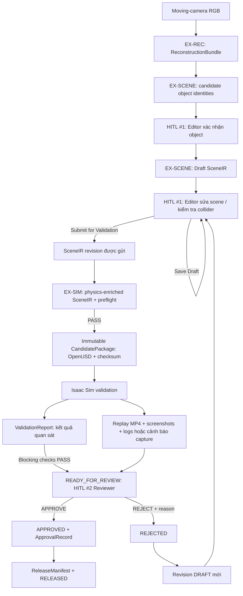

# PRD — Real2Sim Studio: Warehouse / Indoor AMR MVP

## 0. Thông tin tài liệu (Document Control)

| Trường | Giá trị |
|---|---|
| Mã dự án | RAV-01 |
| Tên sản phẩm | Real2Sim Studio |
| Phạm vi bản phát hành | Warehouse MVP |
| Phiên bản tài liệu | v1.14 |
| Trạng thái | Foundation Baseline; benchmark/runtime acceptance inputs pending |
| Ngày cập nhật | 25/09/2026 |
| Thời gian thực hiện dự kiến | 4 tuần |
| Người dùng chính | Kỹ sư mô phỏng (Simulation Engineer) |
| Miền ứng dụng | Kho trong nhà, robot di động tự hành (Indoor Warehouse AMR) |
| Trình mô phỏng mục tiêu | NVIDIA Isaac Sim |
| Tài liệu tiền nhiệm | PRD v1.13 |
| Tài liệu liên quan | [BRIEF](./BRIEF.md), [DATASET_PLAYBOOK](./DATASET_PLAYBOOK.md), [WIREFRAME](./WIREFRAME_AND_UI_FLOW.md), [Execution Contract](./execution/TEAM_EXECUTION_CONTRACT.md), [Execution Plan](./execution/TEAM_EXECUTION_PLAN.md), [Track Guide](./execution/TRACK_IMPLEMENTATION_GUIDE.md), [Integration Playbook](./execution/INTEGRATION_PLAYBOOK.md) |

### 0.1 Lịch sử thay đổi (Change Log)

| Phiên bản | Ngày | Thay đổi chính |
|---|---|---|
| v1.4 | Trước 21/09/2026 | Bản mô tả đầy đủ các luồng RGB, LiDAR, chỉnh sửa scene và Isaac Sim |
| v1.5 | 21/09/2026 | Chuẩn hóa thành PRD; bổ sung goals, acceptance, NFR, risk và traceability |
| v1.7 | 21/09/2026 | Clarify reconstructed SceneObject deletion; separate deletion from background completion; align candidate lifecycle |
| v1.8 | 22/09/2026 | Clarify P0 Minimal Correction, Candidate checksum lifecycle, Privacy Gate, LiDAR scope, evaluation/runtime boundary và advanced queue scope |
| v1.9 | 22/09/2026 | Clarify reusable LiDAR branch, P0 LiDAR Contribution Evidence qua RGB + Registered LiDAR integration và P1 LiDAR-only product configuration |
| v1.10 | 23/09/2026 | Khóa direct browser rendering của real 3DGS VisualArtifact là P0; renderer backend có thể dùng WebGL/WebGL2 hoặc WebGPU, còn mesh/point-cloud preview chỉ là development/recovery fallback |
| v1.11 | 23/09/2026 | Foundation override: P0 viewer dùng Next.js + Three.js + WebGL/WebGL2 cho geometry/point-cloud/collider/transforms; direct Gaussian browser rendering chuyển thành stretch/non-blocking; khóa owners và TorWIC bring-up archive |
| v1.12 | 23/09/2026 | Product decision: khôi phục direct browser rendering của real 3DGS `VisualArtifact` thành yêu cầu P0; mesh, point cloud và collider là các view kỹ thuật ngang hàng, không phải fallback. Giữ Next.js + Three.js/WebGL2 baseline; renderer cụ thể phải qualification bằng output producer thật. |
| v1.13 | 24/09/2026 | Làm rõ hai điểm HITL, Save Draft/Submit for Validation, candidate bất biến và validation evidence (report, replay, screenshots, logs) trước final review. Lỗi capture replay không đổi kết quả validation; Primary Demo vẫn phải có replay để đạt acceptance. |
| v1.14 | 25/09/2026 | Đồng bộ viewer P0 với PlayCanvas Engine 2.22.4 + supersplat-viewer 1.35.2; WebGL2 baseline, WebGPU ưu tiên khi khả dụng. Giữ nguyên real Brush/browser proof và AC-11; không coi thay đổi thư viện là runtime acceptance. |

### 0.2 Chủ sở hữu và người phê duyệt (Owners and Approvers)

| Vai trò | Trách nhiệm | Người phụ trách |
|---|---|---|
| Chủ sở hữu sản phẩm (Product Owner) | Chốt phạm vi, mức ưu tiên và tiêu chí thành công | Cường |
| Chủ trì kỹ thuật / Integration Owner | Xác nhận tính khả thi và các phụ thuộc kỹ thuật | `@awun0105` |
| Chủ trì kiểm thử (QA/Validation Lead) | Chốt bộ dữ liệu đánh giá và bằng chứng nghiệm thu | Đạt |
| Người phê duyệt phát hành (Release Approver) | Duyệt scene và bản phát hành MVP | Đức |

### 0.3 Quy ước mức độ yêu cầu (Requirement Language)

- **Bắt buộc (MUST):** điều kiện chặn phát hành (release blocker). Thiếu điều kiện này thì MVP không được coi là hoàn thành.
- **Nên có (SHOULD):** quan trọng nhưng có thể hoãn nếu Chủ sở hữu sản phẩm (Product Owner) ghi nhận quyết định và lý do.
- **Tùy chọn (MAY):** chỉ thực hiện khi còn đủ thời gian và nguồn lực.
- **Ngoài phạm vi (OUT):** không được dùng để đánh giá hoàn thành MVP này.

Các thuật ngữ tiếng Anh được đặt trong ngoặc ở lần xuất hiện đầu tiên. Tên lớp, tên trạng thái, định dạng tệp và thuật ngữ đã trở thành chuẩn kỹ thuật có thể được giữ nguyên bằng tiếng Anh.

### 0.4 Document Role and Cross-document Coordination

Bộ tài liệu của project có thể được mở rộng theo thời gian.
Mỗi tài liệu phải khai báo rõ phạm vi mà nó chịu trách nhiệm và các contract upstream mà nó phải tuân thủ.

Phân công hiện tại:

- [PRD](./PRD.md):
  định nghĩa product scope, P0/P1/P2, MUST/SHOULD/MAY, user-visible behavior và acceptance criteria.
- [DATASET_PLAYBOOK](./DATASET_PLAYBOOK.md):
  định nghĩa dataset preparation, dataset-specific preprocessing, leakage control và evaluation methodology.
- [INTEGRATION_PLAYBOOK](./execution/INTEGRATION_PLAYBOOK.md):
  định nghĩa technical baseline, stage implementation, artifact boundary và lựa chọn công cụ/repository.
- [BRIEF](./BRIEF.md):
  giải thích problem, persona, value proposition và high-level product flow.

Quy tắc xử lý khác biệt:

1. Một tài liệu không được thay đổi contract nằm ngoài phạm vi mà nó sở hữu.
2. Technical implementation không được hạ hoặc mở rộng product requirement mà không cập nhật PRD.
3. Dataset/evaluation protocol không được âm thầm thay đổi Product Input Contract.
4. High-level shorthand trong BRIEF không được dùng để suy ra thêm P0 requirement khi PRD đã quy định cụ thể hơn.
5. Nếu hai tài liệu có nội dung thực sự mâu thuẫn, phải sửa tài liệu; coding agent không được tự chọn một bên và tiếp tục implementation.
6. Document mới trong tương lai phải khai báo tối thiểu: Document Role, Scope, Upstream Constraints, Status và Related Documents.

---

## 1. Tổng quan sản phẩm (Product Overview)

### 1.1 Vấn đề cần giải quyết (Problem Statement)

Để đưa một môi trường kho thực vào trình mô phỏng, kỹ sư thường phải thực hiện nhiều bước thủ công:

1. nhận và kiểm tra dữ liệu khảo sát;
2. tái dựng không gian ba chiều (3D reconstruction);
3. làm sạch hình học (geometry);
4. xác định các vật thể có ý nghĩa đối với mô phỏng;
5. chỉnh đúng tỉ lệ theo đơn vị mét (metric scale);
6. tạo hình học va chạm (collision geometry);
7. đồng bộ vị trí và góc xoay của vật thể;
8. xuất scene sang trình mô phỏng;
9. kiểm tra lỗi xuyên sàn, thiếu collider và đường đi bị chặn;
10. làm lại các bước trên khi scene thay đổi.

Nút thắt chính không chỉ là tạo ra một scene nhìn giống môi trường thật. Nút thắt là biến dữ liệu tái dựng thành một scene:

- có cấu trúc (structured);
- chỉnh sửa được (editable);
- có tỉ lệ theo đơn vị thật (metric);
- sẵn sàng cho tính toán vật lý (physics-ready);
- có thể kiểm tra và truy vết trước khi phát hành (reviewable and traceable).

### 1.2 Tuyên bố sản phẩm (Product Statement)

Real2Sim Studio là Web App có người tham gia kiểm duyệt (Human-in-the-Loop), giúp kỹ sư chuyển dữ liệu quan sát của một kho trong nhà thành scene có thể xem và chỉnh sửa trên browser, có collider và có thể kiểm tra trong NVIDIA Isaac Sim.

Trong P0, full product/release workflow được chứng minh bằng moving-camera RGB. Registered/fused LiDAR có thể tham gia như geometry input trong RGB + Registered LiDAR Contribution Evidence. Full standalone LiDAR-only product configuration thuộc P1.

Hệ thống duy trì ba lớp biểu diễn có liên kết với nhau:

1. **Biểu diễn hình ảnh (Visual Representation):** vật thể và scene trông như thế nào.
2. **Biểu diễn hình học (Geometry Representation):** các bề mặt vật lý nằm ở đâu.
3. **Biểu diễn vật lý (Physics Representation):** trình mô phỏng dùng hình dạng nào để tính va chạm.

Giá trị chính của sản phẩm là giảm công việc lặp lại trong chuỗi:

```text
Môi trường thật
    → Tái dựng
    → Có cấu trúc
    → Chỉnh sửa được
    → Sẵn sàng cho vật lý
    → Sẵn sàng cho mô phỏng
```

### 1.3 Tầm nhìn dài hạn (Product Vision)

Về dài hạn, Real2Sim Studio có thể phát triển theo hướng **Universal Real2Sim Core** dùng cho nhiều miền ứng dụng và nhiều trình mô phỏng. Kiến trúc hướng tới các ranh giới `DomainAdapter` và `SimulatorAdapter` để tránh khóa lõi scene vào riêng Warehouse hoặc Isaac Sim. Đây chỉ là tầm nhìn mở rộng kiến trúc; sản phẩm được cam kết trong tài liệu này vẫn chỉ là Warehouse / Indoor AMR MVP trên NVIDIA Isaac Sim.

---

## 2. Mục tiêu và thước đo thành công (Goals and Success Metrics)

### 2.1 Mục tiêu của MVP (MVP Goals)

| Mã | Mục tiêu |
|---|---|
| G-01 | Chứng minh được một luồng RGB chạy xuyên suốt từ video camera di chuyển đến scene được kiểm tra trong Isaac Sim. |
| G-02 | Giảm số thao tác thủ công khi tạo geometry, collider, chỉnh scene và kiểm tra scene so với quy trình làm hoàn toàn bằng tay. |
| G-03 | Bảo đảm các lớp Visual, Geometry và Physics giữ cùng hệ tọa độ và transform khi người dùng chỉnh sửa. |
| G-04 | Chứng minh LiDAR đã đăng ký có thể thực sự đóng góp vào geometry của ít nhất một scene, thay vì chỉ được tải lên rồi bỏ qua. |
| G-05 | Bảo đảm con người là người quyết định cuối cùng trước khi scene được phát hành. |
| G-06 | Lưu đủ dữ liệu và cấu hình để tái tạo lại một bản phát hành đã được duyệt. |
| G-07 | Cung cấp Web App có 3DGS Visual view từ `VisualArtifact` thật và các view Geometry mesh, point cloud, Collider có thể chuyển/bật lớp; xem/chỉnh SceneObject transforms mà không cần công cụ dựng 3D desktop. |

### 2.2 Chỉ số thành công (Success Metrics)

Mỗi metric phải có một trong các trạng thái sau:

- `MEASURE`: bắt buộc đo và báo cáo, chưa dùng làm cổng đạt/rớt;
- `BASELINE`: đã có kết quả đường cơ sở trên bộ đánh giá đã khóa;
- `PROPOSED_TARGET`: mục tiêu đề xuất cần được xác nhận;
- `LOCKED_ACCEPTANCE_THRESHOLD`: ngưỡng nghiệm thu đã được Chủ sở hữu sản phẩm và Chủ trì kiểm thử khóa trước khi xem kết quả cuối.

Trong tuần 1, nhóm phải đo baseline rồi ghi lại mọi quyết định chuyển trạng thái metric. Không được đặt hoặc thay đổi ngưỡng nghiệm thu sau khi đã xem kết quả cuối.

| Mã | Chỉ số | Cách đo | Tiêu chí hoặc trạng thái ban đầu | Loại cổng |
|---|---|---|---|---|
| SM-01 | Hoàn thành luồng RGB đầu-cuối | Chạy scene đánh giá đã khóa trên môi trường đã khóa | Scene bắt buộc hoàn thành đầu-cuối và tạo đủ artifact. Tỷ lệ thành công khi chạy lặp lại là metric `MEASURE` riêng, không thay thế kết quả đạt/rớt của scene chính | Bắt buộc đối với scene đánh giá chính |
| SM-02 | Khả năng tải scene | Mở gói scene phát hành bằng phiên bản Isaac Sim đã khóa | 1/1 scene demo chính tải thành công, đúng đơn vị mét, không thiếu asset bắt buộc | Bắt buộc |
| SM-03 | Đồng bộ transform | Di chuyển và xoay các SceneObject đã chọn trong bộ test | Visual, Geometry và Physics phải dùng cùng canonical transform. Sai khác chỉ được nằm trong epsilon số học được khóa trong cấu hình test | Bắt buộc |
| SM-04 | Kiểm tra va chạm và đường đi | Chạy bộ 5 cặp Điểm bắt đầu–Điểm đích (Start–Goal) đã khóa | Kết quả `CLEAR/BLOCKED` được tạo cho 5/5 cặp; các cặp được gán nhãn kỳ vọng phải khớp 5/5 | Bắt buộc |
| SM-05 | Độ phủ candidate object | So sánh candidate với danh sách obstacle mục tiêu được gán nhãn trước | `MEASURE`; baseline và target được khóa sau benchmark tuần 1. Candidate bị thiếu phải có luồng sửa thủ công | Không chặn phát hành cho đến khi có `LOCKED_ACCEPTANCE_THRESHOLD` |
| SM-06 | Giảm thời gian thao tác trực tiếp (hands-on time) | Cùng một người thực hiện quy trình thủ công và quy trình có công cụ trên cùng một scene nhỏ | Giả thuyết: thời gian với Real2Sim Studio thấp hơn manual baseline; target được khóa sau baseline tuần 1 | KPI sản phẩm; không chặn demo kỹ thuật |
| SM-07 | Truy vết bản phát hành | Kiểm tra manifest của scene đã duyệt | 100% artifact bắt buộc có nguồn input, cấu hình, phiên bản phần mềm và kết quả validation | Bắt buộc |

Các chỉ số PSNR, SSIM và LPIPS dùng để mô tả chất lượng hình ảnh, không tự động quyết định scene có an toàn về vật lý hay không. Khoảng cách Chamfer (Chamfer Distance) chỉ được dùng làm cổng khi có geometry tham chiếu độc lập.

### 2.3 Không phải mục tiêu của MVP (Non-goals)

MVP không nhằm:

- thay thế hoàn toàn kỹ sư mô phỏng hoặc kỹ sư robot;
- tái dựng mọi loại môi trường;
- tạo semantic label hoàn hảo cho mọi vật thể;
- điều khiển robot thật;
- triển khai đầy đủ hệ thống tự hành ROS2/Nav2;
- đạt chất lượng photorealistic cho mọi bề mặt phản chiếu hoặc trong suốt;
- hỗ trợ nhiều tầng, cảnh động hoặc môi trường ngoài trời lớn;
- cung cấp dịch vụ production-ready cho nhiều tổ chức;
- tự xây một subsystem nhận diện và làm mờ khuôn mặt/biển số trong P0; dữ liệu phải được chuẩn bị hợp lệ hoặc bị quarantine/reject.

---

## 3. Người dùng và vai trò (Users and Roles)

### 3.1 Người dùng chính — Kỹ sư mô phỏng (Simulation Engineer)

**Mục tiêu:** tạo, chỉnh sửa và xuất scene mô phỏng từ dữ liệu khảo sát mà không phải tự dựng lại toàn bộ môi trường.

**Công việc chính:**

- trong P0, tạo Primary RGB Job và bổ sung registered/fused LiDAR cho contribution evidence trên cùng scene/traversal; standalone LiDAR-only job thuộc P1;
- xem trạng thái reconstruction;
- xác nhận tỉ lệ mét;
- đặt tên, gộp, bỏ qua hoặc sửa candidate object;
- chỉnh transform và collider;
- gửi scene sang bước duyệt.

**Vấn đề hiện tại:** mất nhiều thời gian làm sạch geometry, tạo collider và sửa lỗi sau khi import vào simulator.

### 3.2 Người dùng thứ cấp — Kỹ sư tích hợp AMR (AMR Integration Engineer)

**Mục tiêu:** xác nhận robot có thể xuất hiện và đi qua các lối cần thiết trong scene.

**Công việc chính:**

- cung cấp footprint của robot;
- chọn Điểm bắt đầu–Điểm đích (Start–Goal);
- xem kết quả kiểm tra collision và path feasibility;
- phản hồi các collider hoặc khoảng trống không hợp lệ.

### 3.3 Người kiểm duyệt — Kỹ sư QA/Validation hoặc Trưởng nhóm (Reviewer)

**Mục tiêu:** chỉ phát hành scene có đủ bằng chứng về nguồn dữ liệu, tỉ lệ, collider và validation.

**Công việc chính:**

- kiểm tra cảnh báo và metric;
- xem geometry và collider;
- xem kết quả Isaac Sim;
- duyệt hoặc từ chối scene kèm lý do.

### 3.4 Quyền tối thiểu (Minimum Permissions)

| Hành động | Editor | Reviewer |
|---|---:|---:|
| Tạo job và xem artifact | Có | Có |
| Chỉnh object, transform và collider | Có | Có, nhưng thay đổi phải tạo revision mới |
| Gửi yêu cầu duyệt | Có | Có, đối với revision mới sau khi validation lại |
| Duyệt hoặc từ chối bản phát hành | Không | Có |
| Chỉnh scene đã duyệt | Có, nhưng phải tạo version mới | Có, nhưng phải tạo version mới |

Nếu Reviewer chỉnh sửa scene, thay đổi đó phải tạo một revision mới ở trạng thái `DRAFT`; revision phải được validation lại và quay về `READY_FOR_REVIEW` trước khi có thể approve. Một người có thể giữ nhiều vai trò trong bản demo nội bộ, nhưng hệ thống vẫn phải ghi lại hành động chỉnh sửa và hành động phê duyệt riêng biệt. Việc có Reviewer độc lập được khuyến nghị cho evaluation và release, nhưng cơ chế bắt buộc hai tài khoản khác nhau không phải yêu cầu của MVP.

### 3.5 User Stories

**US-01 — Tiếp nhận video RGB**
Là một Kỹ sư mô phỏng, tôi muốn tải lên video RGB quay bằng camera di chuyển để có thể tái dựng một môi trường kho hiện có.

**US-02 — Đề xuất đối tượng ứng viên**
Là một Kỹ sư mô phỏng, tôi muốn hệ thống đề xuất các Candidate Object Identities để không phải phân đoạn thủ công mọi vật thể.

**US-03 — Chỉnh sửa đồng bộ**
Là một Kỹ sư mô phỏng, tôi muốn di chuyển một object trong khi Visual, Geometry và Collider giữ cùng transform để có thể tạo một kịch bản mô phỏng đã thay đổi.

**US-04 — Kiểm tra đường đi của AMR**
Là một Kỹ sư tích hợp AMR, tôi muốn xác định Start, Goal và robot footprint để kiểm tra liệu layout có cho phép một đường đi không va chạm hay không.

**US-05 — Kiểm duyệt scene ứng viên**
Là một Reviewer, tôi muốn xem reconstruction, metric scale, collider và kết quả validation để có thể approve hoặc reject một candidate scene dựa trên bằng chứng.

**US-06 — Bản phát hành bất biến và truy vết được**
Là một Reviewer, tôi muốn bản phát hành đã duyệt được đóng dấu, không bị thay đổi và có thể truy vết để biết chính xác scene nào đã được validation.

**US-07 — Kiểm tra và chỉnh sửa trên trình duyệt**
Là một Kỹ sư mô phỏng, tôi muốn mở scene trong browser 3D Viewer để có thể xem và chỉnh sửa mà không cần dùng công cụ dựng 3D trên desktop.

---

## 4. Phạm vi và mức ưu tiên (Scope and Priority)

### 4.1 Lát cắt MVP bắt buộc (Required Vertical Slice)

```text
Video RGB từ camera di chuyển
    → Kiểm tra đầu vào
    → Trích xuất frame và ước lượng camera pose
    → Tái dựng Visual và Geometry
    → Xác nhận tỉ lệ mét
    → Tạo candidate object tự động
    → Người dùng xác nhận và chỉnh sửa
    → Tạo collider
    → Xuất candidate OpenUSD
    → Tải và kiểm tra candidate trong NVIDIA Isaac Sim
    → Báo cáo collision và path feasibility
    → Người kiểm duyệt phê duyệt hoặc từ chối
    → Đóng dấu bản phát hành đã duyệt
```

Đây là luồng P0 và là cổng phát hành chính.

### 4.2 Bằng chứng đóng góp của LiDAR (LiDAR Contribution Evidence)

MVP phải chứng minh trên ít nhất một scene RGB + Registered LiDAR, hoặc một khu vực con của scene, rằng point cloud LiDAR đã đăng ký hoặc hợp nhất được hệ thống sử dụng thực sự trong pipeline.

```text
Registered/Fused LiDAR
    → Kiểm tra format, đơn vị và hệ tọa độ
    → Tạo LiDARGeometryArtifact có nguồn gốc LiDAR
    → Căn chỉnh với RGB artifacts của cùng scene/traversal
    → Đưa vào canonical/unified scene
    → Dùng geometry đó trong ít nhất một collider,
      scene geometry hoặc simulator validation
    → Ghi artifact, checksum, transform và downstream consumer trong manifest
```

RGB Visual, camera pose hoặc RGB-derived Geometry dùng cho evidence run có thể được reuse từ Primary RGB Product Path mà không cần chạy lại toàn bộ RGB reconstruction. Các artifact được reuse bắt buộc phải thuộc cùng scene/traversal với LiDAR, đã immutable/checksummed và truy vết được qua manifest; không được ghép RGB artifact của một scene với LiDAR của scene khác.

Yêu cầu này chứng minh LiDAR là một geometry source thực sự, không phải chỉ được upload rồi bỏ qua. Evidence run không bắt buộc đạt full object correction, editing, review hoặc release parity với Primary RGB Product Path và không tạo ra một P0 LiDAR-only product path riêng. Căn chỉnh RGB–LiDAR tự động không thuộc MVP.

Full LiDAR-only product configuration thuộc P1.

### 4.3 Mức ưu tiên (Priorities)

#### P0 — Bắt buộc để phát hành (Release Blockers)

- Web App có PlayCanvas browser viewer cho geometry mesh, point cloud, collider và SceneObject transforms, hỗ trợ orbit, pan, zoom, chọn object và bật/tắt lớp;
- luồng RGB đầu-cuối tại mục 4.1;
- xác nhận metric scale;
- candidate object được tạo tự động trước khi người dùng sửa;
- luồng sửa thủ công tối thiểu cho candidate bị thiếu hoặc sai;
- SceneObject giữ đồng bộ Visual, Geometry và Physics;
- collider có thể xem và chỉnh;
- versioning và cổng duyệt của con người;
- thêm primitive/asset cơ bản;
- xóa user-added object;
- xóa/vô hiệu hóa confirmed reconstructed SceneObject;
- Geometry + Collider của object bị xóa không còn tham gia active scene/simulation;
- Visual segment bị hide/remove khi đã tách được;
- xuất candidate OpenUSD, tải và validation thành công trong Isaac Sim trước khi review;
- chỉ đóng dấu bản phát hành chính thức sau khi validation đạt và Reviewer approve;
- kiểm tra collision và Start–Goal path feasibility;
- bằng chứng đóng góp của LiDAR thông qua RGB + Registered LiDAR integration theo mục 4.2;
- manifest và báo cáo validation của bản phát hành.

#### P1 — Nên có (Important Enhancements)

- background recovery từ các multiview observation khác;
- simple plane/surface completion;
- optional visual inpainting sau Delete;
- cảnh báo che khuất vật lý/hình học;
- multi-job batch submission;
- advanced queue scheduling;
- configurable worker concurrency;
- priority scheduling;
- full LiDAR-only geometry-first product configuration từ registered/fused LiDAR, bao gồm scene workflow, collider, editing và OpenUSD/Isaac integration phù hợp với use case LiDAR-only;
- tích hợp pipeline tự động (API trigger).

#### P2 — Tương lai (Future Work)

- đặt tên semantic tự động;
- phân loại có hỗ trợ mô hình thị giác-ngôn ngữ (VLM-assisted classification);
- xử lý chuỗi LiDAR thô, LiDAR odometry hoặc LiDAR SLAM;
- căn chỉnh cảm biến tự động;
- RGB-D như một input contract riêng;
- tái dựng scene động;
- xóa vật thể kèm điền vùng bị che (3D inpainting/scene completion);
- thay vật thể bằng CAD asset tự động;
- nhiều tầng;
- miền đường bộ và CARLA;
- các trình mô phỏng khác.

---

## 5. Hợp đồng dữ liệu đầu vào (Input Contract)

### 5.1 Luồng RGB chính (Primary RGB Path)

Hệ thống bắt buộc nhận video RGB quay khi camera thực sự di chuyển qua hoặc xung quanh môi trường.

Ví dụ nguồn phù hợp:

- điện thoại thông minh;
- camera cầm tay;
- camera RGB gắn trên robot.

Điều kiện đầu vào tối thiểu:

- video giải mã được;
- camera có thay đổi góc nhìn;
- các frame có vùng nhìn chồng lặp;
- chuyển động tạo đủ thị sai (parallax) cho tái dựng đa góc nhìn;
- môi trường phần lớn là tĩnh;
- vùng cần tái dựng xuất hiện trong dữ liệu.

Camera giám sát cố định không được coi là input hợp lệ để tái dựng toàn bộ scene.

### 5.2 Luồng RGB kết hợp LiDAR (RGB + LiDAR Path)

Hệ thống nhận:

- video RGB từ camera di chuyển; và
- point cloud LiDAR đã được đăng ký hoặc hợp nhất (registered/fused).

Hai nguồn phải mô tả cùng một môi trường và có đủ vùng không gian chồng lặp. MVP có thể yêu cầu dữ liệu đã được căn chỉnh trước. Nếu chưa căn chỉnh, hệ thống phải từ chối hoặc đánh dấu scene chưa đủ điều kiện fusion; không được âm thầm ghép hai nguồn sai hệ tọa độ.

### 5.3 Registered LiDAR Input và LiDAR-only Product Configuration

Registered/fused LiDAR là một geometry input của hệ thống. Về kiến trúc, input này được xử lý bởi một Registered LiDAR Branch dùng chung; contract kỹ thuật được quy định trong [`execution/INTEGRATION_PLAYBOOK.md`](./execution/INTEGRATION_PLAYBOOK.md).

Trong P0, branch này được kiểm chứng thông qua LiDAR Contribution Evidence tại mục 4.2 trong một RGB + Registered LiDAR integration run. P0 không yêu cầu một execution riêng với RGB vắng mặt.

Khi RGB và LiDAR được dùng cùng nhau:

- RGB cung cấp Visual Representation và evidence dựa trên ảnh;
- LiDAR cung cấp `LiDARGeometryArtifact` và thông tin metric;
- hai modality phải thuộc cùng scene/traversal và được căn chỉnh về cùng canonical scene space trước khi được composition và sử dụng downstream.

Full LiDAR-only product configuration thuộc P1. Configuration đó có thể dùng registered/fused LiDAR làm geometry source mà không có RGB Visual Representation và không bắt buộc có:

- hình ảnh photorealistic;
- metric đánh giá RGB;
- segmentation dựa trên ảnh;
- feature parity với RGB-based visual reconstruction.

Raw LiDAR scan sequences, LiDAR odometry và LiDAR SLAM vẫn nằm ngoài Input Contract của MVP.

### 5.4 Dữ liệu không được hỗ trợ trong MVP (Unsupported Inputs)

- chuỗi scan LiDAR thô chưa đăng ký;
- scene nhiều tầng;
- scene thay đổi mạnh trong lúc quay;
- video camera cố định dùng để tái dựng toàn bộ kho;
- dữ liệu có khuôn mặt hoặc biển số chưa được ẩn danh;
- dữ liệu không xác định được nguồn hoặc không có quyền sử dụng.

---

## 6. Hành trình người dùng (User Journeys)

### 6.1 Luồng thành công chính (Primary Happy Path)

Luồng P0 có **hai điểm Human-in-the-Loop**. HITL #1 là Editor xác nhận và sửa
scene; `Submit for Validation` chỉ xác nhận revision sẵn sàng để kiểm tra, không
phải approval phát hành. HITL #2 là Reviewer quyết định cuối cùng trên đúng
candidate đã được validation. Primary release path bắt đầu bằng moving-camera
RGB; registered/fused LiDAR trên cùng scene/traversal là nhánh contribution
evidence theo mục 4.2.

HITL #1 bắt đầu bằng xác nhận candidate object trước Scene Decomposition, rồi
tiếp tục chỉnh Draft SceneIR sau khi phân rã; đó là một lượt chuẩn bị scene,
không phải hai approval gates.

1. Editor tạo một dự án scene mới.
2. Editor tải video RGB lên và chọn cấu hình xử lý.
3. Hệ thống chạy kiểm tra trước xử lý (pre-flight validation).
4. Nếu input hợp lệ, hệ thống tạo job bất đồng bộ và hiển thị tiến độ.
5. Hệ thống tạo Visual, Geometry và báo cáo sức khỏe reconstruction.
6. Editor xác nhận metric scale bằng dữ liệu cảm biến hợp lệ hoặc bằng khoảng cách tham chiếu.
7. Hệ thống tạo candidate object identities trước khi Editor bắt đầu sửa thủ công.
8. Human Object Confirmation: Editor đặt tên, xác nhận, gộp, bỏ qua cho candidate.
9. Scene Decomposition: Hệ thống phân rã thành Environment và Independent SceneObjects.
10. Hệ thống tạo collider; Editor xem và điều chỉnh khi cần.
11. Editor Add / Move / Rotate / Delete SceneObject để tạo layout revision cần kiểm thử.
12. Hệ thống cập nhật SceneIR revision hiện tại. `Save Draft` lưu revision để tiếp
    tục sửa; nó không tạo candidate hoặc khởi chạy Isaac Sim.
13. Editor chọn robot footprint và các cặp Start–Goal cần kiểm tra.
14. Editor chọn `Submit for Validation`. Hệ thống ghi nhận revision/checksum đã
    gửi, hoàn tất collider/physics thành SceneIR revision cùng schema, rồi chạy
    static preflight. Chỉ khi preflight đạt mới build candidate OpenUSD bất biến;
    manifest bind revision/checksum của SceneIR được build thực tế.
15. EX-SIM tự động tải đúng candidate đó vào Isaac Sim và chạy deterministic
    validation; phát hành `ValidationReport` có cấu trúc, đồng thời tạo replay
    MP4, screenshots và logs của đúng validation run. Nếu capture lỗi, ghi rõ
    evidence unavailable mà không sửa kết quả validation đã quan sát.
16. Candidate đạt các validation bắt buộc được chuyển sang `READY_FOR_REVIEW`.
17. Reviewer xem input, metric, geometry, collider, cảnh báo, candidate package,
    `ValidationReport`, replay MP4, screenshots và logs trên Web App; evidence
    thiếu được hiển thị thành warning/error riêng.
18. Reviewer duyệt scene hoặc từ chối kèm lý do.
19. Khi được duyệt, hệ thống đóng dấu chính candidate đã kiểm tra thành bản phát hành bất biến, lưu checksum, manifest và báo cáo validation.



`CandidatePackage` là artifact bất biến, không phải state `CANDIDATE` mới.
`ValidationReport` và media/logs là artifact của validation run, ở ngoài
CandidatePackage; các check/path evidence refs thuộc report đã bind checksum candidate.
`READY_FOR_REVIEW` chỉ được đặt khi các blocking checks applicable đều `PASS`.

### 6.2 Luồng từ chối và sửa lại (Rejection and Revision Flow)

1. Reviewer chọn `REJECTED` và phải nhập ít nhất một lý do.
2. Scene quay về trạng thái có thể chỉnh sửa nhưng vẫn giữ lịch sử review.
3. Editor tạo version mới và thực hiện sửa đổi.
4. Mọi approval cũ không còn hiệu lực với version mới.
5. Version mới phải tạo lại candidate package và chạy lại các phép validation bị ảnh hưởng trước khi quay về `READY_FOR_REVIEW`.

Candidate đã test hoặc bị reject vẫn bất biến trong lịch sử. Sửa scene tạo
SceneIR revision mới, candidate mới và `ValidationReport` mới; approval cũ không
được áp cho candidate mới.

### 6.3 Luồng lỗi và phục hồi (Failure and Recovery Flow)

- Nếu input không hợp lệ, hệ thống phải dừng trước reconstruction và hiển thị lỗi có hành động khắc phục.
- Nếu job thất bại, hệ thống phải giữ trạng thái, log và các artifact đã hoàn thành; người dùng có thể thử lại từ bước an toàn gần nhất hoặc tạo job mới.
- Nếu camera registration không đạt ngưỡng đã cấu hình, hệ thống không được tự đánh dấu reconstruction là thành công.
- Nếu metric scale chưa được xác nhận, hệ thống không cho phép phát hành dưới nhãn `physics-ready`.
- Nếu Isaac Sim không tải được scene, bản phát hành không được duyệt.
- Nếu candidate package thay đổi sau validation, kết quả validation cũ mất hiệu lực và revision phải quay lại bước validation.

---

## 7. Yêu cầu chức năng / Features (Functional Requirements)

### FR-00 — Web-based 3D Studio

Hệ thống bắt buộc cung cấp Web App chạy trên browser desktop được hỗ trợ.

3D Viewer P0 tối thiểu phải cho phép Editor:

- render Gaussian splats thật từ `VisualArtifact` do EX-REC publish trên Primary RGB Scene; không thay bằng point cloud hoặc mesh rồi gọi là 3DGS;
- tải và render geometry mesh, point cloud, collider và SceneObject transforms từ artifact refs;
- chuyển rõ giữa 3DGS Visual, Geometry mesh, Point Cloud và Collider; các view kỹ thuật là công cụ inspection ngang hàng, không phải fallback của 3DGS;
- orbit, pan và zoom scene;
- chọn một object;
- bật/tắt object;
- bật/tắt riêng Visual Representation, Geometry Representation và Collider;
- kiểm tra và chỉnh transform của `SceneObject`;
- thực hiện các thao tác trên mà không cần mở Blender hoặc Isaac Sim GUI.

P0 dùng Next.js + PlayCanvas Engine 2.22.4 và `@playcanvas/supersplat-viewer`
1.35.2 với WebGL2 baseline; ưu tiên WebGPU khi khả dụng, fallback WebGL2 phải
được kiểm chứng. WebGPU không phải điều kiện bắt buộc của client. Renderer phải
chứng minh đọc và render đúng output thực tế của Brush cùng SOG delivery derivative.
`VisualArtifact` giữ format/producer/version,
checksum và coordinate metadata do EX-REC publish; viewer resolve bằng artifact
contract và convert coordinate ở boundary. Nếu Visual artifact thiếu, sai checksum,
không tương thích hoặc browser không render được, UI phải báo trạng thái/lý do rõ
ràng; mesh/point-cloud vẫn xem được để chẩn đoán nhưng không làm AC-11 đạt.
Synthetic fixture không phải production Brush/browser compatibility proof.

### FR-01 — Tạo dự án và tiếp nhận dữ liệu (Project and Data Ingestion)

Hệ thống bắt buộc:

- tạo được project và reconstruction job;
- ghi loại input, tên tệp, kích thước, checksum và thời điểm tiếp nhận;
- giải mã video và đọc metadata cơ bản;
- đọc point cloud PLY/PCD không rỗng;
- từ chối định dạng không hỗ trợ với thông báo rõ ràng;
- không làm mất input gốc khi job xử lý thất bại.

### FR-02 — Kiểm tra trước xử lý (Pre-flight Validation)

Với RGB, hệ thống bắt buộc kiểm tra hoặc ước lượng:

- khả năng giải mã;
- số frame có thể dùng;
- mức độ camera di chuyển;
- mức mờ chuyển động (motion blur);
- khả năng đăng ký camera;
- dấu hiệu thiếu độ phủ.

Với LiDAR, hệ thống bắt buộc kiểm tra:

- định dạng và khả năng đọc;
- point cloud không rỗng;
- đơn vị hoặc metadata về scale nếu có;
- hệ tọa độ và trạng thái đăng ký do người dùng khai báo.

Mỗi lỗi phải có mã lỗi, mô tả dễ hiểu và hành động đề xuất. Các ngưỡng kỹ thuật chi tiết được đặt trong cấu hình đánh giá đã khóa, không viết cứng trong UI.

### FR-03 — Điều phối job dài hạn (Long-running Job Orchestration)

Reconstruction bắt buộc chạy như job bất đồng bộ, không phụ thuộc vào một HTTP request duy nhất.

Hệ thống phải:

- hiển thị stage hiện tại, thời gian cập nhật gần nhất và trạng thái tổng;
- hỗ trợ tối thiểu các trạng thái `QUEUED`, `RUNNING`, `SUCCEEDED`, `FAILED`, `CANCELLED`;
- lưu lỗi theo stage;
- cho phép thử lại theo chính sách đã cấu hình;
- không báo `SUCCEEDED` khi artifact bắt buộc của stage bị thiếu.

Trong P0, yêu cầu trên chỉ bao gồm basic asynchronous job execution: mỗi heavy job được đưa qua worker/queue, có trạng thái, progress, failure recording và retry theo policy.

P0 không yêu cầu:

- multi-job batch submission;
- priority scheduling;
- advanced concurrency control;
- multi-tenant queue scheduling.

Các khả năng trên thuộc P1.

### FR-04 — Ước lượng camera và tái dựng RGB (Camera Estimation and RGB Reconstruction)

Với video RGB hợp lệ, hệ thống bắt buộc:

- trích xuất frame;
- ước lượng camera intrinsics và camera poses;
- ghi tỷ lệ frame đăng ký thành công;
- tạo Biểu diễn hình ảnh (Visual Representation);
- tạo Biểu diễn hình học (Geometry Representation) đủ dùng cho bước scale, object association và collider;
- tạo preview để người dùng kiểm tra kết quả.

3D Gaussian Splatting hoặc phương pháp tương đương có thể được dùng cho Visual. Lựa chọn thuật toán cụ thể thuộc thiết kế kỹ thuật, không phải cam kết sản phẩm.

### FR-05 — Xử lý geometry LiDAR (LiDAR Geometry Processing)

Với point cloud hợp lệ, hệ thống bắt buộc:

- giữ thông tin đơn vị và hệ tọa độ;
- tạo geometry hoặc surface representation dùng được ở bước tiếp theo;
- ghi rõ artifact nào được tạo từ LiDAR;
- sử dụng artifact LiDAR trong ít nhất một collider, scene geometry hoặc phép validation của bằng chứng MVP.

Việc chỉ nhận tệp rồi không dùng vào scene không được tính là hoàn thành FR-05.

Trong P0, FR-05 được nghiệm thu bằng RGB + Registered LiDAR integration run tại mục 4.2. Requirement này không yêu cầu một execution riêng với RGB vắng mặt và cũng không yêu cầu mixed configuration đi qua toàn bộ Object/Edit/Review/Release workflow của Primary RGB Product Path.

### FR-06 — Tỉ lệ mét và căn chỉnh (Metric Scale and Alignment)

Mọi scene phát hành sang simulator bắt buộc có metric scale đã xác nhận.

Với RGB-only, hệ thống phải cung cấp tối thiểu một luồng hiệu chỉnh:

1. người dùng chọn hai điểm;
2. người dùng nhập khoảng cách thật;
3. hệ thống tính scale factor;
4. người dùng xem và xác nhận;
5. hệ thống áp dụng scale cho camera, Visual, Geometry, SceneObject và collider.

Với LiDAR có đơn vị đáng tin cậy, người dùng có thể xác nhận scale thay vì suy ra lại.

Nếu dùng RGB và LiDAR cùng nhau, hệ thống phải lưu transform căn chỉnh và cho phép kiểm tra trực quan trước khi fusion. Căn chỉnh tự động không bắt buộc.

### FR-07 — Tạo và sửa candidate object (Candidate Object Extraction and Correction)

Với scene RGB, hệ thống bắt buộc tự động tạo candidate object trước khi người dùng thực hiện segmentation thủ công.

Mỗi candidate phải có:

- ID ổn định trong scene version;
- vùng Visual hoặc mask liên quan;
- nhóm Geometry liên quan nếu có;
- trạng thái `UNREVIEWED`, `CONFIRMED`, `IGNORED` hoặc `NEEDS_CORRECTION`.

Người dùng bắt buộc có thể:

- đặt lại tên;
- xác nhận;
- bỏ qua;
- gộp candidate;
- tạo correction tối thiểu cho object bị thiếu hoặc grouping sai.

Trong P0, Minimal Correction được giới hạn ở:

1. Merge:
   gộp hai hoặc nhiều candidate thành một object identity.

2. Create Missing Object:
   người dùng có thể tạo thủ công một candidate/object identity bị hệ thống bỏ sót.

3. Reassign:
   người dùng có thể gán lại một mask, geometry selection hoặc region đã chọn
   từ candidate/object này sang candidate/object khác.

P0 không bắt buộc:
- arbitrary instance split;
- full interactive re-segmentation;
- semantic re-classification tự động;
- general 3D re-segmentation.

Các khả năng trên thuộc P1/P2.

Tách nâng cao (advanced split) và semantic naming tự động là P1/P2.

### FR-08 — SceneObject và chỉnh sửa đồng bộ (SceneObject and Synchronized Editing)

Candidate đã xác nhận trở thành `SceneObject` có liên kết tới:

```text
SceneObject
├── Visual Representation
├── Geometry Representation
├── Physics Representation
└── Transform
```

MVP bắt buộc hỗ trợ:

- đổi tên;
- dịch chuyển (translation);
- xoay (rotation);
- ẩn/hiện;
- xem và chỉnh collider;
- thêm object cơ bản từ asset hoặc primitive đã hỗ trợ;
- xóa object do người dùng thêm;
- xóa hoặc vô hiệu hóa một reconstructed `SceneObject` đã được xác nhận khỏi revision hiện tại.

Khi một reconstructed `SceneObject` bị xóa:
- object không còn tồn tại trong Scene IR của revision hiện tại;
- Geometry Representation tương ứng phải bị loại hoặc vô hiệu hóa khỏi scene;
- Physics Representation / Collider tương ứng phải bị loại bỏ;
- object không còn tham gia collision hoặc path validation;
- Visual Representation tương ứng phải được ẩn hoặc loại bỏ khi visual segment của object đã được tách riêng.

MVP không bắt buộc tái tạo photorealistic hoàn hảo phần background từng bị object che khuất. 

Một `SceneObject` đã xác nhận phải có representation đủ tách biệt để có thể được transform hoặc loại khỏi active scene mà không yêu cầu chạy lại toàn bộ reconstruction từ đầu. General photorealistic background restoration và generative 3D completion cho vùng chưa từng được quan sát không thuộc P0. PRD không quy định việc tách này được thực hiện bằng Gaussian grouping, mesh labels hay một backend cụ thể.

Khi transform thay đổi, `Visual`, `Geometry` và `Physics/Collider` phải tham chiếu cùng canonical transform của `SceneObject`. Kiểm thử so sánh translation và rotation theo epsilon số học được khóa trong cấu hình test; đây là invariant của kiến trúc, không phải sai số dự đoán được phép chấp nhận. 

### FR-09 — Tạo và kiểm tra collider (Collider Generation and Inspection)

Hệ thống bắt buộc:

- tạo Physics Representation cho floor và obstacle được chọn;
- cho phép xem collider chồng lên Visual/Geometry;
- cảnh báo object bắt buộc nhưng thiếu collider;
- cho phép chỉnh transform và kích thước collider;
- lưu loại collider và tham số vào scene version.

Hộp bao theo trục (AABB), hộp bao có hướng (OBB), bao lồi (convex hull) hoặc mesh đơn giản hóa đều có thể được dùng. Lựa chọn cụ thể thuộc thiết kế kỹ thuật.

### FR-10 — Versioning và cổng duyệt (Versioning and Review Gate)

Scene bắt buộc có các trạng thái tối thiểu:

```text
DRAFT
  ↓
PROCESSING
  ↓
CANDIDATE_READY
  ↓ Export Candidate OpenUSD
VALIDATING
  ↓ Run deterministic validation
READY_FOR_REVIEW
  ↓ Human Review
  ├── APPROVED → RELEASED
  └── REJECTED → DRAFT của revision mới sau khi chỉnh sửa
```

Hệ thống phải:

- tạo version mới khi scene đã duyệt bị chỉnh sửa;
- không kế thừa approval sang version mới;
- lưu người sửa, người duyệt, thời điểm và lý do từ chối;
- không cho phép AI hoặc automation tự đặt trạng thái `APPROVED`;
- ngăn phát hành khi thiếu metric scale hoặc validation bắt buộc.
- cho phép lưu nội bộ draft, artifact trung gian và candidate package trước approval;
- chỉ cho phép scene `APPROVED` được đóng dấu và công bố thành bản phát hành `RELEASED`;
- đưa revision đã bị chỉnh sửa sau validation trở lại `DRAFT` và làm mất hiệu lực kết quả validation cũ.
- tách rõ `Save Draft` (lưu revision làm việc) với `Submit for Validation`
  (bind revision/checksum, chạy preflight, build candidate và tự động điều phối
  Isaac Sim); hai hành động này không tạo `ApprovalRecord`.

### FR-11 — Xuất OpenUSD và kiểm tra Isaac Sim (OpenUSD Export and Isaac Sim Validation)

Revision ở trạng thái `CANDIDATE_READY` bắt buộc xuất được thành candidate OpenUSD tương thích với phiên bản NVIDIA Isaac Sim đã khóa. Candidate package này được dùng để chạy validation trước khi Reviewer quyết định.

Candidate package phải bảo toàn:

- đơn vị mét;
- scene hierarchy cần thiết;
- object transforms;
- geometry;
- collider;
- asset reference;
- candidate manifest;
- checksum của toàn bộ candidate package.

Validation Report không nằm bên trong immutable Candidate Package trước validation.
Validation Report phải tham chiếu tới checksum của Candidate Package đã được kiểm tra.
Replay MP4, screenshots và logs được lưu như validation-run evidence riêng; các
`checks[]`/`path_results[]` trong report tham chiếu evidence đã publish bằng
`evidence_refs[]` theo shared contract. Capture failure phải được báo riêng ở
artifact/worker và Web review boundary; không thêm field trạng thái replay vào
`ValidationReport` hoặc đổi `overall_result` từ `PASS` thành `FAIL` chỉ vì
capture lỗi. Web App phải cho Reviewer truy cập report, evidence hiện có và
cảnh báo evidence thiếu của đúng candidate trước khi quyết định.

Lifecycle bắt buộc:

```text
CandidatePackage + CandidateChecksum
    ↓
Deterministic Validation
    ↓
ValidationReport(candidate_checksum)
    ↓
READY_FOR_REVIEW
    ↓
Human Review
    ↓
APPROVED
    ↓
ReleaseManifest(
    candidate_checksum,
    validation_report_checksum,
    approval_record
)
    ↓
RELEASED
```

Hệ thống bắt buộc thực hiện:

- kiểm tra tải scene;
- kiểm tra robot spawn không nằm trong geometry;
- kiểm tra floor collider;
- kiểm tra object bắt buộc không thiếu collider;
- kiểm tra các cặp Start–Goal bằng robot footprint đã cho;
- trả về `CLEAR`, `BLOCKED` hoặc `ERROR` kèm lý do.
- cố gắng tạo và publish replay MP4, screenshots và logs của validation run để
  Reviewer xem cùng `ValidationReport`; không coi media là nguồn kết luận thay
  report. Primary Demo phải có replay/screenshots thật để đạt acceptance.

Nếu candidate vượt qua các validation bắt buộc, hệ thống chuyển revision sang `READY_FOR_REVIEW`. Khi Reviewer approve, hệ thống phải đóng dấu đúng candidate đã được kiểm tra thành bản phát hành `RELEASED`, lưu checksum và không thay đổi nội dung của package. Mọi thay đổi đối với transform, collider, geometry hoặc object sau đó phải tạo version mới và chạy lại validation/review.

MVP không bắt buộc chạy một navigation stack đầy đủ.

### FR-12 — Kiểm tra scene có tính quyết định (Deterministic Scene Audit)

Trước khi review, hệ thống bắt buộc chạy các kiểm tra có tính quyết định cho:

- thiếu metric scale;
- thiếu collider;
- transform không hợp lệ;
- object nằm ngoài scene bounds;
- robot spawn không hợp lệ;
- route bị chặn hoặc validation lỗi;
- artifact bắt buộc bị thiếu;
- candidate chưa được xử lý.

Tác tử Scene Audit (Scene Audit Agent) có thể giải thích kết quả, nhưng không được thay đổi kết quả gốc, tự sửa scene hoặc tự approve.

### FR-13 — Manifest và truy vết (Manifest and Traceability)

Mỗi bản phát hành được duyệt bắt buộc lưu:

- tham chiếu input và checksum;
- cấu hình xử lý;
- phiên bản phần mềm/backend;
- danh sách artifact và checksum;
- scene version;
- trạng thái review;
- người duyệt và thời điểm;
- kết quả metric và validation;
- cảnh báo đã được chấp nhận nếu có.

---

## 8. Yêu cầu phi chức năng (Non-functional Requirements)

### NFR-01 — Khả năng tái lập (Reproducibility)

Từ manifest của một bản phát hành, nhóm phải xác định được input, cấu hình, phiên bản phần mềm và artifact đã dùng. Nếu thuật toán có yếu tố ngẫu nhiên, seed phải được lưu khi thư viện hỗ trợ.

### NFR-02 — Hiệu năng và giới hạn dữ liệu (Performance and Capacity)

Trước khi chốt bộ test tuần 1, nhóm phải công bố:

- độ dài video tối đa;
- số frame tối đa được xử lý;
- kích thước point cloud tối đa;
- GPU/VRAM dùng để đo;
- thời gian mục tiêu cho từng stage.

Trong UI, thao tác chỉnh transform sau khi scene đã tải phải phản hồi đủ nhanh để người dùng nhận biết trực tiếp. Độ trễ tương tác phải được đo trên máy demo ở trạng thái `MEASURE`; target chỉ được khóa sau baseline tuần 1. Reconstruction không bị ràng buộc bởi thời gian tương tác này.

### NFR-03 — Độ tin cậy và phục hồi (Reliability and Recovery)

- Job lỗi không được làm mất input gốc hoặc version scene gần nhất.
- Việc thử lại không được ghi đè bản phát hành đã duyệt.
- Lỗi phải được gắn với stage và có mã lỗi.
- Mất kết nối UI không được tự hủy job backend.

### NFR-04 — Bảo mật và phân quyền (Security and Authorization)

- Chỉ người có quyền mới được xem input và artifact của project.
- Chỉ Reviewer mới được approve/reject.
- Secret và credential không được ghi vào manifest, log hoặc gói phát hành.
- File tải lên phải được kiểm tra loại tệp và không được thực thi như mã nguồn.

MVP nội bộ có thể dùng cơ chế đăng nhập đơn giản, nhưng không được bỏ qua ranh giới Editor/Reviewer trong audit log.

### NFR-05 — Quyền riêng tư và vòng đời dữ liệu (Privacy and Data Lifecycle)

Khuôn mặt và biển số xuất hiện trong dữ liệu thu thập dùng cho project bắt buộc phải được ẩn danh. Việc có quyền sử dụng dữ liệu không thay thế yêu cầu ẩn danh này.

MVP chỉ sử dụng một trong các nhóm dữ liệu sau:

- public hoặc synthetic dataset đã phù hợp với mục đích sử dụng;
- dữ liệu tự thu không chứa khuôn mặt, biển số hoặc thông tin nhận dạng cá nhân;
- dữ liệu đã được ẩn danh trước khi lưu lâu dài hoặc gửi sang remote GPU.

Nếu phát hiện thông tin nhận dạng chưa được xử lý, hệ thống phải quarantine hoặc reject input và không tiếp tục pipeline. MVP không bắt buộc xây một subsystem tự động nhận diện và làm mờ khuôn mặt/biển số; nhóm có thể chuẩn bị dữ liệu hợp lệ trước khi ingest.

Thời gian lưu input gốc, artifact trung gian và bản phát hành phải được Chủ sở hữu sản phẩm xác nhận trước demo công khai.

### NFR-06 — Tương thích (Compatibility)

Nhóm phải khóa và ghi lại:

- phiên bản NVIDIA Isaac Sim;
- phiên bản OpenUSD hoặc schema liên quan;
- hệ điều hành/container của worker;
- driver và CUDA nếu có ảnh hưởng tới tái lập.

### NFR-07 — Khả năng quan sát (Observability)

Mỗi job phải có ID, thời điểm bắt đầu/kết thúc, stage, trạng thái, lỗi và vị trí artifact. Log phải đủ để phân biệt lỗi input, reconstruction, export và simulator.

### NFR-08 — Tính mô-đun có giới hạn (Pragmatic Modularity)

Lõi scene không được phụ thuộc vào chi tiết chỉ có ở UI. Logic riêng cho warehouse và adapter Isaac Sim nên được tách khỏi representation chung khi việc tách này không làm chậm lát cắt MVP. MVP không bắt buộc xây sẵn adapter cho CARLA hoặc simulator khác.

---

## 9. Tiêu chí nghiệm thu (Acceptance Criteria)

### AC-01 — Luồng RGB đầu-cuối

**Cho trước (Given):** video RGB trong bộ đánh giá đã khóa, camera di chuyển và input vượt qua pre-flight.

**Khi (When):** Editor chạy pipeline, xác nhận metric scale, xử lý candidate, tạo collider; hệ thống xuất và validation candidate OpenUSD; sau đó Reviewer approve.

**Thì (Then):**

- tất cả artifact bắt buộc được tạo;
- scene có Visual, Geometry và Physics;
- candidate OpenUSD tải thành công và được validation trong Isaac Sim trước review;
- bản phát hành đóng dấu đúng candidate đã được kiểm tra;
- báo cáo collision/path được tạo;
- manifest đạt SM-07.

### AC-02 — Input không phù hợp

Với video không giải mã được, camera gần như cố định hoặc point cloud rỗng, hệ thống phải dừng trước stage không thể thực hiện, trả lỗi rõ ràng và không tạo scene giả thành công.

### AC-03 — Xác nhận metric scale

Với RGB-only, sau khi người dùng nhập một khoảng cách tham chiếu, khoảng cách tương ứng trong scene phải nằm trong dung sai do bộ test quy định. Scene chưa xác nhận scale không thể chuyển sang `APPROVED`.

### AC-04 — Bằng chứng LiDAR

Với point cloud PLY/PCD đã đăng ký:

- hệ thống đọc được dữ liệu và đơn vị;
- tạo artifact geometry có nguồn gốc LiDAR;
- artifact đó được dùng trong ít nhất một collider, scene geometry hoặc validation;
- manifest chỉ ra rõ artifact và bước sử dụng;
- không chấp nhận trường hợp chỉ tải tệp rồi bỏ qua.

AC-04 được chứng minh bằng RGB + Registered LiDAR integration run. RGB artifacts được reuse phải thuộc cùng scene/traversal, đã immutable/checksummed và truy vết được. Manifest phải chứng minh `LiDARGeometryArtifact` đã đi qua alignment/composition và được một downstream consumer thực sự sử dụng.

AC-04 không yêu cầu một LiDAR-only execution độc lập, không yêu cầu chạy lại toàn bộ RGB reconstruction và không yêu cầu mixed configuration đạt feature parity với Primary RGB Product Path.

### AC-05 — Candidate object và correction

Trên scene RGB đã khóa, candidate được tạo trước thao tác segmentation thủ công. Reviewer có thể xác định object nào được tạo tự động, object nào được sửa, object nào bị bỏ qua. Độ phủ được báo cáo theo SM-05.

Trên bộ test phải có ít nhất một case:

- candidate bị thiếu; hoặc
- candidate bị grouping sai.

Editor phải sửa được case đó bằng P0 Minimal Correction mà không cần
chạy lại toàn bộ reconstruction pipeline.

### AC-06 — Đồng bộ chỉnh sửa

Với các `SceneObject` trong bộ test đã khóa, khi Editor dịch chuyển và xoay object, Visual, Geometry và Physics phải dùng cùng canonical transform cả trước và sau khi lưu/mở lại scene version. Sai khác translation và rotation chỉ được nằm trong epsilon số học của cấu hình test theo SM-03.

### AC-07 — Cổng duyệt

- Editor không thể tự tạo trạng thái `APPROVED` nếu không có quyền Reviewer.
- Reviewer phải xem được cảnh báo và kết quả validation trước khi quyết định.
- Reviewer phải mở được evidence đã publish của đúng validation run trên Web App
  và thấy cảnh báo rõ nếu replay/screenshots thiếu. Primary Demo bắt buộc có
  replay và screenshots mở được trước khi claim review flow đạt acceptance.
- Sau khi scene đã duyệt bị chỉnh sửa, version mới không còn trạng thái approved.
- Lý do từ chối được lưu và hiển thị cho Editor.
- Approval chỉ đóng dấu đúng candidate package đã được validation; thay đổi package làm approval và validation cũ mất hiệu lực.
- Draft và candidate artifact có thể được lưu nội bộ, nhưng chỉ scene `APPROVED` mới được công bố thành bản phát hành `RELEASED`.

### AC-08 — Kiểm tra mô phỏng

Candidate của scene demo chính phải:

- tải thành công trong Isaac Sim;
- có floor collider;
- không spawn robot bên trong geometry;
- trả kết quả cho 5/5 cặp Start–Goal;
- đạt điều kiện SM-04;
- lưu log và báo cáo làm bằng chứng.
- publish replay MP4 và screenshots của đúng validation run, có checksum/ref hợp
  lệ và mở được trên Web cho lượt review cuối cùng.

### AC-09 — Lỗi job và thử lại

Khi chủ động tạo một lỗi đã biết ở một stage thử nghiệm, hệ thống phải ghi đúng stage, hiển thị lỗi cho người dùng, giữ input gốc và cho phép tạo lần chạy lại mà không ghi đè bản phát hành cũ.

### AC-10 — Tái lập bản phát hành

Từ một bản phát hành đã duyệt, thành viên không trực tiếp tạo scene phải dùng manifest để xác định đúng input, cấu hình, phần mềm, scene version, artifact và kết quả validation.


### AC-11 — Browser 3D Viewer

Trên một browser desktop được hỗ trợ, Editor phải có thể:

- mở một reconstructed scene;
- xem 3D Gaussian splats thực từ `VisualArtifact` của Primary RGB Scene trong browser;
- xem geometry mesh/point cloud/collider của scene và truy vết được về artifact checksums;
- click chuyển giữa 3DGS Visual, Geometry mesh, Point Cloud và Collider mà không phải tải một scene state độc lập khác;
- orbit, pan và zoom scene;
- chọn một object;
- bật/tắt object hoặc từng lớp Visual, Geometry và Collider;
- xem và chỉnh transform của `SceneObject`;
- hoàn thành các thao tác trên mà không cần mở Blender hoặc Isaac Sim GUI.

Acceptance evidence phải ghi browser, PlayCanvas/viewer, WebGL2 hoặc WebGPU runtime và version,
`VisualArtifact` format/producer/version/checksum cùng checksums của các view
kỹ thuật, thao tác chuyển view và trạng thái lỗi. AC-11 P0 chỉ pass khi browser
thực sự render output 3DGS do Brush tạo; mock, synthetic splats hoặc mesh/point
cloud không thay thế proof này. Browser WebGPU không phải yêu cầu P0.

---

### AC-12 — Thêm, chỉnh sửa và xóa SceneObject

Trên scene demo đã khóa:

1. Editor thêm một obstacle cơ bản vào vùng đi lại.
2. Obstacle có Geometry và Collider hợp lệ.
3. Editor có thể move/rotate obstacle.
4. Path validation phải phản ánh layout mới.
5. Editor có thể xóa object vừa thêm.

Với ít nhất một reconstructed SceneObject đã được tách thành object độc lập:

1. Editor chọn Delete.
2. Object bị loại khỏi Scene IR của revision mới.
3. Geometry và Collider của object không còn tham gia simulation.
4. Path/collision validation sử dụng scene sau deletion.
5. Nếu Visual background chưa thể phục hồi hoàn chỉnh, UI phải thể hiện rõ giới hạn này; việc đó không làm deletion logic thất bại.

## 10. Kế hoạch đánh giá (Evaluation Plan)

### 10.1 Phạm vi đánh giá (Evaluation Envelope)

Bộ đánh giá MVP phải nằm trong phạm vi:

- không gian trong nhà, một tầng;
- warehouse, workshop hoặc khu lab có bố cục tương tự kho;
- phần lớn vật thể là rigid và đứng yên;
- có floor, wall và obstacle đủ rõ;
- diện tích mục tiêu khoảng 50–100 m² nếu dữ liệu và tài nguyên cho phép;
- có ít nhất một scene demo thực và một scene nhỏ dùng để kiểm tra lỗi có kiểm soát.

Mọi kết luận chỉ áp dụng trong evaluation envelope này, không được quảng bá thành khả năng Real2Sim tổng quát.

### 10.2 Bộ dữ liệu phải được khóa (Locked Evaluation Set)

Chậm nhất cuối tuần 1, nhóm phải khóa:

- danh sách input và checksum;
- tập frame train/evaluation nếu có;
- danh sách obstacle mục tiêu;
- khoảng cách chuẩn dùng cho metric scale;
- robot footprint;
- 5 cặp Start–Goal và nhãn kỳ vọng;
- geometry tham chiếu độc lập cho ít nhất một scene hoặc khu vực kiểm soát để báo cáo Chamfer Distance;
- phiên bản Isaac Sim và phần cứng chạy test.

### 10.3 Phân tầng metric (Metric Taxonomy)

Metric được chia theo mục đích để tránh biến mọi phép đo thành release blocker. Trạng thái và threshold của từng metric phải tuân theo quy ước tại mục 2.2.

| Tầng | Metric | Cách sử dụng trong MVP |
|---|---|---|
| **Tier A — Bắt buộc từ đề RAV-01** | PSNR, SSIM, LPIPS, Chamfer Distance, training/reconstruction time, render performance | Bắt buộc đo và báo cáo. Không dùng metric hình ảnh để thay thế kiểm tra geometry hoặc physics. Chamfer phải dùng reference độc lập |
| **Tier B — Real2Sim correctness của sản phẩm** | Metric Scale Error, Isaac Load Success, Collision Validation Result, Path Feasibility Result, End-to-end Success | Các kết quả bắt buộc của vertical slice; threshold số chỉ trở thành gate sau khi được khóa theo mục 2.2 |
| **Tier C — Khi có independent ground truth phù hợp** | Geometry Precision / Recall / F1, Object Recall / AP50, Collision Precision / Recall / F1, Distance RMSE, Unsafe Path Rate | Metric đánh giá mở rộng; chỉ báo cáo hoặc dùng làm gate khi protocol và ground truth độc lập đã được khóa |
| **Tier D — Giá trị sản phẩm** | Human Active Time, Manual Step Count, Time to Simulation-ready Scene | So sánh workflow có công cụ với manual baseline; là KPI sản phẩm, không tự động chặn demo kỹ thuật |

Ngoài bốn tầng trên, registered-frame ratio, per-stage runtime, GPU-hours, peak VRAM, success/failure và số lượng candidate `confirm/ignore/correct` được ghi như metric chẩn đoán vận hành.

---

## 11. Giả định, phụ thuộc, rủi ro và câu hỏi mở (Assumptions, Dependencies, Risks, and Open Questions)

### 11.1 Giả định (Assumptions)

- Nhóm có quyền sử dụng dữ liệu demo.
- Có ít nhất một máy hoặc worker đủ khả năng chạy reconstruction và Isaac Sim.
- Video có camera motion phù hợp.
- LiDAR dùng trong bằng chứng đã được đăng ký hoặc hợp nhất.
- Người dùng mục tiêu chấp nhận xác nhận scale và sửa candidate trong MVP.

### 11.2 Phụ thuộc (Dependencies)

- NVIDIA Isaac Sim và các yêu cầu driver/CUDA;
- công cụ ước lượng camera pose;
- backend reconstruction Visual và Geometry;
- công cụ tạo/xử lý OpenUSD;
- model hoặc thuật toán tạo candidate object;
- nơi lưu input và artifact đủ dung lượng;
- bộ dữ liệu đánh giá đã khóa.

### 11.3 Rủi ro chính (Key Risks)

| Rủi ro | Tác động | Giảm thiểu |
|---|---|---|
| Video không đủ parallax hoặc bị mờ | Reconstruction thất bại | Pre-flight, hướng dẫn quay và scene mẫu dự phòng |
| Geometry từ RGB không đủ tốt cho collider | Scene đẹp nhưng physics sai | Cho phép collider đơn giản và chỉnh thủ công |
| Candidate object kém ổn định đa góc nhìn | Tăng công sửa | Đo coverage trên bộ khóa và có correction fallback |
| RGB–LiDAR lệch hệ tọa độ | Fusion sai | Chỉ nhận dữ liệu đã căn chỉnh cho P0; lưu và kiểm tra transform |
| Isaac Sim/driver không tương thích | Không hoàn thành validation | Khóa môi trường từ tuần 1 và chạy smoke test sớm |
| Phạm vi P0 quá lớn | Không có vertical slice hoàn chỉnh | Ưu tiên luồng RGB, giới hạn LiDAR theo mục 4.2, hoãn P1/P2 |
| Không có ground truth geometry | Không báo cáo được Chamfer đúng yêu cầu | Khóa ít nhất một scene hoặc khu vực kiểm soát có geometry reference độc lập trong tuần 1; không dùng chính dữ liệu đầu vào làm ground truth |
| Dữ liệu chứa thông tin nhận dạng | Không thể chia sẻ công khai | Ẩn danh hoặc giới hạn quyền truy cập trước demo |

### 11.4 Câu hỏi phải chốt trước khi đổi trạng thái sang Approved (Open Questions)

1. GPU model/VRAM, NVIDIA driver, CUDA runtime, IsaacLab/OpenUSD và external tool versions nào được ghi sau provisioning? Hiện `UNVERIFIED/TBD`.
2. TorWIC P0 traversal đã chọn `Aisle_CW`; `Aisle_CCW` là traversal bổ sung/backup. Primary Demo frame range vẫn `TBD` và không được suy ra từ Foundation sensor checks.
3. Candidate coverage có baseline bao nhiêu và target nào sẽ được khóa sau tuần 1?
4. Metric scale reference nào được dùng và dung sai chấp nhận là bao nhiêu?
5. Thời gian lưu input/artifact và chính sách xóa là gì?
6. Gói OpenUSD cuối cùng bao gồm chính xác những tệp nào?

---

## 12. Bảng truy vết yêu cầu (Requirements Traceability)

| Mục tiêu | Yêu cầu liên quan | Tiêu chí nghiệm thu | Bằng chứng bắt buộc |
|---|---|---|---|
| G-01 | FR-01, FR-02, FR-03, FR-04, FR-06, FR-11 | AC-01, AC-02, AC-03, AC-08 | Job log, artifact, video hoặc ảnh Isaac Sim, report |
| G-02 | FR-07, FR-08, FR-09 | AC-05 + AC-06 + AC-12 | Candidate report, thao tác chỉnh sửa, task timer |
| G-03 | FR-06, FR-08, FR-09 | AC-03, AC-06 | Transform comparison trước/sau lưu |
| G-04 | FR-01, FR-02, FR-05, FR-06 | AC-04 | `LiDARGeometryArtifact`, same-scene RGB/LiDAR checksums, alignment/composition và downstream-consumption provenance |
| G-05 | FR-10, FR-12 | AC-07 | Review log, approval/rejection history |
| G-06 | FR-03, FR-10, FR-13 | AC-09, AC-10 | Release manifest, checksums, version record |
| G-07 | FR-00, FR-08 | AC-11 | Browser interaction test, ảnh hoặc video thao tác viewer |

### 12.1 Cross-document Implementation Traceability

| Requirement | Pipeline ID | Dataset/Preparation Dependency | Main Artifact | Acceptance Evidence |
|---|---|---|---|---|
| FR-01/02 | ST-INPUT-VALIDATE, ST-PRIVACY-GATE | DP-DATASET-INTAKE khi dùng TorWIC | InputManifest + preflight report | AC-02 |
| FR-03 | INF-JOB-ORCHESTRATION | — | JobManifest + job logs | AC-09 |
| FR-04 | ST-CAMERA-POSE, ST-VISUAL-RECON, ST-RGB-GEOMETRY | DP-BENCHMARK-SPLIT | poses + visual + geometry | AC-01 |
| FR-05 | ST-LIDAR-INGEST → ST-RGB-LIDAR-ALIGN → ST-METRIC-CANONICALIZE → downstream consumer | DP-LIDAR-PREFUSION + same-scene immutable RGB artifacts | `LiDARGeometryArtifact` + unified Scene IR | AC-04 |
| FR-06 | ST-RGB-LIDAR-ALIGN → ST-METRIC-CANONICALIZE khi có cả RGB và LiDAR; ST-METRIC-CANONICALIZE cho RGB-only | calibration / locked anchor | metric Scene IR | AC-03, AC-04 |
| FR-07 | ST-OBJECT-EXTRACT, ST-OBJECT-ASSOC, ST-OBJECT-CONFIRM | DP-MANUAL-ANNOTATION only for evaluator | candidate/confirmed objects | AC-05 |
| FR-08 | ST-SCENE-DECOMPOSE, ST-EDIT | — | Scene IR revision | AC-06, AC-12 |
| FR-09 | ST-COLLIDER | — | collider artifacts | AC-06, AC-08 |
| FR-10 | ST-REVIEW, ST-RELEASE | — | review/approval records | AC-07 |
| FR-11 | ST-CANDIDATE-BUILD, ST-ISAAC-VALIDATE | — | CandidatePackage + ValidationReport | AC-01, AC-08 |
| FR-12 | ST-PREFLIGHT | — | preflight_report.json | AC-07/08 |
| FR-13 | INF-ARTIFACT-CONTRACT, ST-RELEASE | DatasetManifest optional | ReleaseManifest | AC-10 |

---

## 13. Mốc triển khai bốn tuần (Four-week Delivery Milestones)

Phần này là kế hoạch cấp cao, không thay thế sprint plan hoặc tài liệu thiết kế kỹ thuật.

### Tuần 1 — Khóa baseline và môi trường (Baseline and Environment Lock)

- khóa evaluation set;
- chạy smoke test Isaac Sim/OpenUSD;
- hoàn thành ingestion, pre-flight và job skeleton;
- chạy camera pose và Visual Reconstruction đầu tiên;
- đo baseline cho các ngưỡng còn mở;
- chốt câu hỏi về owner, phần cứng và phiên bản phần mềm.

**Exit gate:** một input RGB đi qua được ingestion/pose/reconstruction thô; một scene USD mẫu tải được trong Isaac Sim.

**MVP Feasibility Gate — cuối tuần 1:** hai smoke test sau phải chạy độc lập:

```text
Video RGB → Frames → Camera Poses → Một reconstruction

Minimal USD → Isaac Sim Load
```

Nếu RGB-derived Geometry chưa dùng được cho collider, nhóm phải ghi quyết định fallback sang LiDAR geometry hoặc geometry/collider đơn giản hóa. Nếu custom Gaussian Splatting renderer trong Isaac Sim vượt quá khả năng của MVP, Web Studio vẫn hiển thị Visual preview còn Isaac Sim dùng mesh/collider. Mọi thay đổi claim hoặc phạm vi P0 phải được ghi vào Change Log trước khi tiếp tục tuần 2.

### Tuần 2 — Geometry và metric scene

- tạo RGB-derived Geometry;
- ingest LiDAR, tạo `LiDARGeometryArtifact` và hoàn thành LiDAR Contribution Evidence trên cùng scene/traversal với RGB artifacts đã checksummed;
- hoàn thành metric scale;
- hình thành SceneObject representation tối thiểu;
- lưu artifact và provenance.

**Exit gate:** có một scene thực chứa Visual, Geometry và scale đã xác nhận; `LiDARGeometryArtifact` được alignment/composition, downstream sử dụng và truy vết được theo AC-04. Exit gate này không yêu cầu mixed configuration hoàn thành full Object/Edit/Review/Release parity.

### Tuần 3 — Object, editing và collider

- tạo candidate tự động;
- hoàn thành confirm/ignore/merge/correction tối thiểu;
- chỉnh transform đồng bộ;
- tạo và chỉnh collider;
- versioning và review states.

**Exit gate:** đạt AC-05 và AC-06 trên scene demo.

### Tuần 4 — Release vertical slice

- hoàn thành OpenUSD export;
- chạy Isaac Sim validation;
- chạy 5 cặp Start–Goal;
- hoàn thành deterministic audit;
- hoàn thành manifest và review gate;
- chạy acceptance suite và lưu bằng chứng.

**Exit gate:** tất cả AC bắt buộc đạt hoặc có waiver bằng văn bản của Product Owner đối với yêu cầu `SHOULD`; không được waiver yêu cầu `MUST` mà vẫn tuyên bố MVP hoàn thành.

---

## 14. Định nghĩa hoàn thành MVP (Definition of Done)

MVP chỉ được coi là hoàn thành khi:

1. tài liệu này ở trạng thái `APPROVED` và đã điền owner;
2. evaluation set và môi trường thực thi đã được khóa;
3. luồng RGB P0 chạy đầu-cuối, tuân theo candidate → validation → review → approval → release và đạt AC-01;
4. bằng chứng LiDAR đạt AC-04;
5. transform consistency đạt AC-06;
6. review gate đạt AC-07;
7. scene tải và validation trong Isaac Sim đạt AC-08;
8. lỗi và retry đạt AC-09;
9. manifest đạt AC-10 và SM-07;
10. Web App và browser 3D Viewer đạt AC-11;
11. các metric Tier A được đo và báo cáo trên bộ đánh giá đã khóa;
12. mọi kết quả có bằng chứng lưu kèm, không chỉ được báo cáo bằng mô tả;
13. các giới hạn và mục chưa đạt được ghi rõ, không được diễn giải thành năng lực đã hoàn thành.

---

## Phụ lục A — Thuật ngữ (Glossary)

| Thuật ngữ | Giải thích trong tài liệu này |
|---|---|
| Candidate object | Nhóm điểm/mask/geometry do hệ thống tự động đề xuất là một vật thể có thể chỉnh sửa |
| SceneObject | Vật thể đã được xác nhận, có liên kết Visual, Geometry, Physics và Transform |
| Visual Representation | Biểu diễn dùng để xem appearance của scene hoặc object |
| Geometry Representation | Biểu diễn bề mặt/vị trí không gian dùng cho đo đạc và xử lý hình học |
| Physics Representation | Collider hoặc hình học đơn giản hóa dùng cho mô phỏng va chạm |
| Metric scale | Tỉ lệ ánh xạ từ đơn vị scene sang mét ngoài đời thật |
| Registered LiDAR | Point cloud từ một hoặc nhiều scan đã được đưa vào cùng hệ tọa độ |
| Physics-ready | Có scale, collider và kiểm tra cần thiết để chạy phép thử vật lý đã định nghĩa; không đồng nghĩa production-ready |
| Simulation-ready | Có thể tải vào phiên bản simulator mục tiêu và hoàn thành validation đã định nghĩa |
| Candidate package | Gói OpenUSD + candidate manifest bất biến được sinh từ một revision trước validation. Package được định danh bằng checksum. |
| Approved release | Candidate package đã vượt qua validation, được Reviewer approve, sau đó được seal cùng Validation Report và Approval Record mà không regenerate candidate. |
| Manifest | Tệp mô tả input, cấu hình, phiên bản, artifact, checksum và kết quả của một release |
| Release blocker | Yêu cầu bắt buộc; không đạt thì không được tuyên bố MVP hoàn thành |

## Phụ lục B — Nguyên tắc diễn giải kết quả (Claims Boundary)

- Scene nhìn đẹp không đồng nghĩa geometry chính xác.
- Geometry hợp lý không đồng nghĩa collider đúng.
- Tải được trong Isaac Sim không đồng nghĩa robot đi được mọi tuyến.
- Một scene demo thành công không chứng minh khả năng hoạt động trên mọi warehouse.
- Metric từ dữ liệu dùng trực tiếp để tạo prediction không được gọi là đánh giá độc lập.
- Kết quả mock, synthetic hoặc kiểm tra tĩnh phải được ghi nhãn; không được trình bày như kết quả live trong Isaac Sim.
