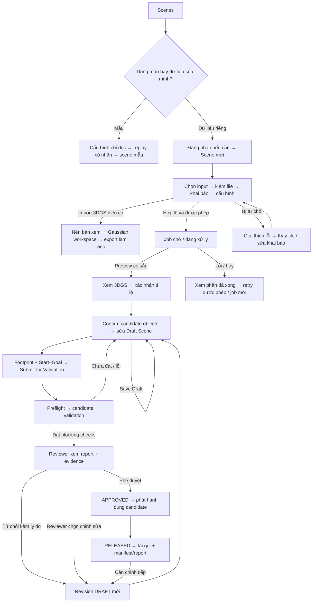

# Real2Sim Studio — UX từ dữ liệu khảo sát đến scene được duyệt

**Ngày:** 30/09/2026. **Vai trò tài liệu:** đầu vào UX cho prototype đầu tiên trong OpenDesign. **Phạm vi:** tạo project/scene → nhập dữ liệu → theo dõi xử lý → xác nhận và chỉnh scene → validation → review → xuất kết quả. Đây là đặc tả trải nghiệm, không thay thế [PRD][prd], contract hoặc acceptance của sản phẩm.

**Nguồn thiết kế đã chốt:** dashboard tại `AI20K/private/UI-UX/next-shadcn-admin-dashboard`, hai ảnh người dùng cung cấp và palette Real2Sim. Người dùng đã cho phép tự đề xuất UX, bỏ yêu cầu Mobbin sau khi MCP báo cần gói trả phí. Không có ảnh, flow hay reference Mobbin nào được trả về; tài liệu không viện dẫn nghiên cứu Mobbin hoặc hiệu quả usability đã được đo.

**Cập nhật 30/09/2026 — chuyển sang đặc tả triển khai.** Tech Lead (Quân) giao audit tài liệu, chốt các câu hỏi mở và **implement** UX này trong `frontend/` dùng dashboard donor làm nền. Các quyết định mới gắn nhãn **DECISION (Tech Lead uỷ quyền, 30/09/2026)**; phần hiện trạng mới ở §2.2a; câu hỏi mở đã chốt ở §11; kế hoạch triển khai ở §13. Những gì trước đây là "prototype minh họa" nay áp dụng quy tắc của app thật (§11.2 D-05): không hiển thị dữ liệu minh họa như kết quả.

**Cập nhật 08/10/2026 — role và ownership:** Các mô tả dưới đây từ 30/09–02/10 về hai role và invite-only signup đã lỗi thời. Theo owner decision, role hiện tại gồm Guest/Editor/Reviewer; Guest có shared read và quyền sửa resource mình sở hữu, còn Editor/Reviewer giữ cross-user intervention. Public Guest signup vẫn đóng cho tới khi rollout acceptance xong. PRD v1.18, [ADR 0021](decisions/0021-guest-identity-and-ownership.md) và [AUD-21](plans/active/2026-10-07-codegraph-audit/tasks/AUD-21-guest-signup-and-ownership.md) là cập nhật hiện hành.

Quy ước đọc:

- **REQUIREMENT:** ràng buộc trong PRD/contract hoặc chỉ dẫn trực tiếp của người dùng.
- **VERIFIED — source / image:** quan sát trực tiếp từ source hoặc ảnh; không đồng nghĩa chức năng đã được kiểm thử trên browser.
- **PROPOSAL:** quyết định UX đề xuất cho prototype này; không tự thay đổi product policy.
- **UNKNOWN:** thiếu evidence hoặc cần owner quyết định. Không điền giá trị giả để khép kín flow.
- **DECISION:** quyết định product/UX đã chốt và có ngày; khi owner đổi policy cũ thì cập nhật PRD/spec/contract liên quan thay vì giữ mô tả lỗi thời.

## 1. Purpose

Tạo một hành trình liên tục để kỹ sư mô phỏng biết **scene đang ở đâu, đã đủ điều kiện gì, ai cần làm gì tiếp theo và kết quả nào có thể tin dùng**. Người dùng đi từ video kho đến scene có tỉ lệ mét, chỉnh được object/collider, được kiểm tra và được con người duyệt trước khi phát hành cho Isaac Sim.

Vấn đề UX chính là khoảng cách giữa Studio hiện tại và quy trình đầy đủ: bản xem 3DGS xuất hiện sớm, nhưng sự sẵn sàng của preview dễ bị hiểu thành scene đã sẵn sàng mô phỏng. Việc xuất một file từ editor cũng dễ bị hiểu thành phát hành scene đã duyệt. Trải nghiệm đích cần làm rõ các bước này và giữ người dùng trong cùng ngữ cảnh scene. Cơ sở: [PRD §1.1–1.2, §6][prd], [Studio hiện tại][r-scene], [review/release hiện tại][r-review].

## 2. Existing Product Context

### 2.1 Người dùng, quyền và thuật ngữ

| Người dùng | Công việc trong hành trình | Ràng buộc |
| --- | --- | --- |
| Visitor chưa đăng nhập | Xem/thử video mẫu và scene đã xử lý | Không upload/chạy job; mẫu không lưu thành scene của nhóm |
| Guest | Dùng workflow Editor trên resource mình tạo; xem workspace chung | Signup không cần invite, nhập email/tên/mật khẩu; 3 job create/manual Retry được chấp nhận mỗi ngày Việt Nam; objectify không trừ quota |
| Editor | Tạo scene, theo dõi job, xác nhận tỉ lệ, chỉnh scene, gửi validation | Giữ quyền can thiệp cross-user; không phê duyệt phát hành |
| Reviewer | Xem bằng chứng, duyệt/từ chối, phát hành; quản lý tài khoản nhóm | Role cao nhất; can thiệp cross-user, purge; sửa scene tạo revision và validation lại |

**REQUIREMENT hiện hành:** account roles cố định là Guest < Editor < Reviewer; Visitor chưa đăng nhập không phải role. Public Guest signup không cần invite nhưng đang sau rollout flag; email verification được hoãn. Invite vẫn cấp Editor/Reviewer và không cho payload tự chọn role. “Engineer” trong ảnh mô tả nghề nghiệp, không tạo role tùy biến. Nguồn: [PRD v1.18 §3.4][prd], [ADR 0021](decisions/0021-guest-identity-and-ownership.md).

| Thuật ngữ | Nghĩa người dùng cần hiểu |
| --- | --- |
| Project / scene | Project giữ ngữ cảnh dữ liệu và các lần xử lý; UI mặc định hiện gọi đơn vị làm việc là “Scene” |
| Job / lần xử lý | Một lượt thực hiện pipeline; có thể đang chờ, chạy, lỗi hoặc bị hủy |
| Preview 3DGS | Bản xem sớm; có thể chưa có đơn vị mét, object độc lập hay collider |
| Candidate object | Vật thể do hệ thống đề xuất, cần người dùng xác nhận/sửa |
| Draft / revision | Bản scene làm việc có thể chỉnh; mỗi revision có danh tính riêng |
| Candidate package | Gói scene bất biến gửi đi validation; khác candidate object |
| Validation | Kết quả các phép kiểm trên một candidate cụ thể |
| Review | Quyết định của con người sau khi xem bằng chứng |
| Release | Bản phát hành của đúng candidate đã validation và được duyệt |

### 2.2 Journey và screen inventory hiện tại

**VERIFIED — source, tại checkout `feat/studio-integration`, HEAD `6868686` khi khảo sát.** Không chạy browser/GPU để xác nhận runtime trong đợt nghiên cứu này.

| Surface hiện có | Entry / nội dung / hành vi quan sát được | Giới hạn cần giữ rõ |
| --- | --- | --- |
| `/` — Scenes | Video mẫu, scene của nhóm, creator/role, trạng thái, CTA “Scene mới”; Guest chỉ thấy mutation control khi server capability cho phép | Không có dashboard KPI vận hành hay cây project nhiều tầng; capability UI không thay API ownership guard |
| `/new` | Trang chọn cách bắt đầu, dẫn tới ba trang riêng (**owner yêu cầu 02/10/2026**; link cũ `/new?source=…` tự chuyển) | Không có form ở trang này |
| `/new/import-video` | Upload hoặc dùng video đã tải; đặt tên scene; khai báo quyền/dữ liệu; thông số xử lý. **Ô LiDAR tuỳ chọn** (ADR 0009): trang giải thích ba luồng và dữ liệu từng luồng cần — (A) chỉ video: tỉ lệ mét là ước lượng hoặc số đo tay; (B) video + gói LiDAR đã đăng ký; (C) video + gói scan thô. Gói B/C bắt buộc có quỹ đạo, calibration camera ↔ LiDAR và thời điểm frame; thiếu thì từ chối kèm hướng dẫn. Có bộ mẫu TorWIC cho cả B và C, ghi rõ quỹ đạo mẫu là quỹ đạo chuẩn của dataset. Sau khi tải lên hiện loại nhận diện được (số điểm, hoặc số scan + số pose) và luồng sẽ chạy | Video tạo project + job reconstruction; luồng B/C thêm bước nhận LiDAR và căn chỉnh. Ở luồng B/C bước tỉ lệ mét **không chọn điểm**: hiện tỉ lệ, sai số căn chỉnh, số frame khớp và một nút xác nhận |
| `/new/import-scene` | Upload hoặc dùng file PLY/ZIP 3DGS đã tải; đặt tên | Tạo scene import, không chạy job GPU |
| `/imports/[importId]` | Theo dõi nén PLY/ZIP thành bản xem SOG; READY mở workspace, FAILED hiện lỗi | Chỉ xem/chỉnh Gaussian, chưa xác nhận tỉ lệ/collision. ZIP được nhận diện có COLMAP cũng chưa đi tiếp đường metric trong UI import này |
| `/scenes/[jobId]` | Timeline, chờ worker, thời gian chạy, hủy/thử lại; mở workspace khi preview xuất hiện | Có preview không chứng minh toàn bộ pipeline đã hoàn thành |
| Xác nhận tỉ lệ | Chọn A/B, C/D và ba điểm sàn; xem trước rồi xác nhận | C/D kiểm độc lập; đổi điểm/số đo làm preview cũ mất hiệu lực |
| Workspace 3DGS | Editor nhúng; chỉ dẫn File → Export PLY/SOG; fallback chỉ xem | Edit Gaussian cục bộ chưa tương đương lưu SceneObject revision |
| `/new/try-demo`, `/new/try-demo?sample=…`, `/samples/[sampleId]/scene` | Cấu hình mẫu chỉ đọc; phát lại tiến trình đã ghi; có bỏ qua để mở scene | Không phải job GPU mới, không dùng thời gian replay làm ETA |
| `/login`, `/register`, `/team` | Đăng nhập; Guest signup bằng email/tên/mật khẩu sau feature flag; invite cấp Editor/Reviewer; Reviewer quản lý nhóm | Email verification deferred; không có form tự chọn role hoặc SSO; signup flag mặc định đóng |
| `/projects/…`, `/jobs/…/{viewer,validation,review,release}` | UI legacy có project/job, viewer và báo cáo — **đã xoá 02/10/2026** (D-10) | URL cũ chuyển hướng về `/overview`; phần validation/duyệt/phát hành nằm ở tab `Kiểm tra & duyệt` và `Kết quả` của scene |

Nguồn: [ScenesHome][r-home], [NewSceneFlow][r-new], [inputKinds][r-input], [ImportScenePage][r-import], [ScenePage][r-scene], [MetricConfirmView][r-metric], [SampleFlow][r-sample], [EditorFrame][r-editor], [StudioHeader][r-header], [route visibility][r-routes].

Current-state flow:

```text
Scenes → Scene mới → upload/chọn file → khai báo + cấu hình → tạo scene/job
       → chờ/xử lý → preview 3DGS → xác nhận tỉ lệ khi được yêu cầu
       → xem/chỉnh Gaussian trong editor → export file PLY/SOG

Visitor → chọn video mẫu → xem cấu hình chỉ đọc → replay hoặc bỏ qua → scene mẫu
Guest account → upload/chạy job → chỉ sửa resource sở hữu; có thể đọc workspace chung

File 3DGS đã upload → Mở scene 3DGS → nén bản xem → workspace chỉ xem/chỉnh
                   → export bản làm việc; chưa có đường metric/collision/release
```

**Cập nhật 02/10/2026:** validation/duyệt/phát hành nằm trong scene của Studio: tab `Kiểm tra & duyệt` (gói mô phỏng + preflight, báo cáo validation chi tiết, quyết định của Reviewer) và tab `Kết quả` (bản phát hành kèm nguồn kết quả). UI legacy và các màn review/release chỉ đọc của nó đã xoá (D-10); endpoint ghi của hợp đồng P0 (`review/{action}`, `release`) vẫn trả 501 thay vì tạo approval/release giả. Báo cáo có nhãn phân biệt kết quả không có bằng chứng Isaac thật. Nguồn: [ReviewPanel][r-review], [ResultsTab][r-release], [product routes][r-api], [ValidationReportCard][r-validation].

### 2.2a Hiện trạng cập nhật sau HEAD `6868686` (VERIFIED — source + chạy thật, 30/09/2026)

Các capability dưới đây đã có trên `feat/studio-integration` (chưa merge `develop`); bảng §2.2 mô tả thời điểm khảo sát trước đó.

| Capability mới | Hiện trạng | Giới hạn |
| --- | --- | --- |
| Stage `ST-OBJECT-EXTRACT` sau collision | SAMPro3D + SAM2 tạo SceneObject CANDIDATE (SceneIR rev-001); fallback hình học khi thiếu runtime | Ứng viên sai (kệ/xà) do 3DGS preview kém — không thêm luật lọc (owner, ADR 0006) |
| Xác nhận vật thể (S08) | Tab `Vật thể`: 3DGS màu + hộp màu theo trạng thái, confirm/ignore/ẩn, thêm vật cản hộp; bấm hộp trong 3D để chọn, bấm danh sách thì camera bay tới | Mỗi thao tác publish ngay một revision SceneIR (không có nút "Lưu nháp" riêng) |
| Gói mô phỏng (một phần S09/S12) | `Tạo gói mô phỏng`: khoét vật khỏi mesh môi trường, collider hộp, preflight 6 luật, CandidatePackage + zip `scene.usda` tải về; gói khoá theo revision | **Chưa chạy Isaac** (SIM-06+), chưa có Start–Goal/footprint, chưa review/release (API 501) |
| Duyệt & phát hành (S10–S12, PRODUCT-10/11) | Panel `Kiểm tra & duyệt`: trạng thái suy từ artifact theo gói; Reviewer đã đăng nhập duyệt (chấp nhận từng cảnh báo kèm thông điệp/bằng chứng, xác nhận) hoặc từ chối kèm lý do; duyệt xong tự niêm phong `ReleaseManifest`, tải zip phát hành. Thẻ `Báo cáo validation` (02/10/2026): từng check, Start–Goal, bằng chứng, `Nguồn kết quả` (revision, checksum gói/báo cáo); quyết định và bản phát hành có checksum để truy vết | Chưa có `ValidationReport` Isaac thật nên luồng chỉ đi hết với báo cáo tổng hợp trong môi trường thử; báo cáo không có bằng chứng Isaac thật mang cảnh báo nhưng **chưa bị chặn duyệt** (cần owner quyết); khi chưa có báo cáo hiện lý do chặn |
| Kết quả từng bước (ADR 0005) | Frame, quỹ đạo camera, 3DGS Brush, 3DGS hệ mét, collision mesh phủ lên 3DGS; bật/tắt lớp | Chưa có LOD cho scene rất lớn |
| So sánh 3 hướng đo tỉ lệ | RGB-only (mock, không số), anchor người dùng, LiDAR demo | RGB-only chỉ mô tả, chưa có số đo thật |
| Scenes / workspace | Thẻ có ảnh xem trước (JPEG 480 px); workspace dùng thanh tab Editor 3DGS · Kết quả từng bước · Vật thể · So sánh 3 hướng | Vẫn theo theme beige cũ, chưa theo palette/donor |
| Benchmark | `recon_visual_quality` (PSNR/SSIM/LPIPS), `metric_click_error` (`e` ≈ 15,6 cm lần 1, chưa khoá) | Số đo nội bộ, không phải acceptance |

### 2.3 Ranh giới sản phẩm phải bảo toàn

1. Có hai điểm HITL: xác nhận/chỉnh scene trước validation; Reviewer duyệt sau validation. `Save Draft`, `Submit for Validation`, `Approve`, `Release` có ý nghĩa khác nhau. [PRD §6, FR-10/11][prd].
2. Job `SUCCEEDED` không đồng nghĩa scene `APPROVED` hoặc `RELEASED`. Edit sau validation tạo draft mới; kết quả/approval cũ không áp dụng cho revision mới. [Contract §9][contract].
3. Video camera di chuyển là đường chính tới release. Import PLY/ZIP có quyết định riêng; PLY trần không được vẽ thành đường đầy đủ tới SceneObject/Isaac khi thiếu dữ liệu cần thiết. LiDAR đi kèm video theo [ADR 0009](decisions/0009-user-lidar-input-and-routing.md) (owner 02/10/2026, thay câu cũ "không suy thành tính năng upload LiDAR phổ quát"): người dùng nộp một gói LiDAR gồm quỹ đạo, calibration, thời điểm frame và hoặc đám mây đã đăng ký, hoặc scan thô; không có job chỉ-LiDAR. [ADR 0004][adr4].
4. 3DGS Visual, Geometry mesh, Point Cloud và Collider là các view có nghĩa khác nhau. Thiếu Visual phải có thông báo; mesh/point cloud không được gắn nhãn 3DGS. [PRD FR-00][prd].
5. Báo cáo kiểm tra là cơ sở kết luận; video replay hỗ trợ quan sát. Lỗi capture media phải hiển thị riêng, không đổi kết quả physics đã quan sát. Primary Demo vẫn cần evidence thật theo acceptance. [PRD FR-11][prd].
6. Quyền sử dụng dữ liệu không thay thế ẩn danh. Cơ chế tự khai trong [ADR 0002][adr2] còn **Proposed**; prototype không biến checkbox thành nhãn “QA đã xác minh”. [PRD NFR-05][prd].

### 2.4 Nguồn UI được xem và phạm vi tin cậy

- **U1 — ảnh landing dài** (`codex-clipboard-a6bdf025-9122-428f-a68e-e04525c2cff2.png`): đã xem. Hero bên trái, chuỗi biến đổi dữ liệu bên phải; các nhóm Reconstruct / Structure & Edit / Validate; mock browser studio; report cạnh replay. Logo doanh nghiệp, thời gian, metric và claim trên ảnh là nội dung minh họa chưa được xác minh.
- **U2 — ảnh ghép Studio / Login / Validation** (`codex-clipboard-fcdb5c0c-cffe-4fe9-99d3-eee30d93a870.png`): đã xem. Viewport lớn ở giữa, sidebar trái, toolbar theo mode, inspector phải, dải object phía dưới; breadcrumb/revision/CTA phía trên; report và replay đặt cạnh nhau. Ảnh tĩnh không chứng minh save, undo, role, selection hay approval thực sự hoạt động.
- **D — dashboard donor:** đọc source navigation, shell, file manager, task list, infrastructure, auth và các trang quản lý; xem [ảnh dashboard dark có sẵn][d-image]. Đây là template với nhiều dữ liệu/hành động mẫu; không phải evidence usability của Real2Sim. Ví dụ form login chỉ hiển thị dữ liệu submit trong toast, không thực hiện đăng nhập. [Donor login form][d-login-form].
- Source UI Real2Sim hiện dùng beige/cam cho Studio và nền tối cho legacy. Palette người dùng cung cấp là định hướng cho prototype mới; không mô tả nó như theme đã áp dụng trong repo. [Current styles][r-styles].

Tài liệu mô tả đủ nội dung quan sát từ U1/U2 để downstream agent không phụ thuộc vào đường dẫn ảnh tạm hoặc ảnh Mobbin chưa tồn tại.

## 3. Target User Experience

Người dùng mở ứng dụng để tiếp tục một scene hoặc tạo scene mới. Trong suốt hành trình, họ thấy tên scene, revision đang xem, tình trạng xử lý và việc tiếp theo cần làm. Những bước đòi hỏi quyết định của con người có lời giải thích và CTA cụ thể; các bước tự động có trạng thái và cách quay lại sau.

**PROPOSAL — trục trải nghiệm:** “Dữ liệu → Dựng scene → Chuẩn bị scene → Kiểm tra → Duyệt & xuất”. Đây là các chặng giúp định hướng, không tạo thêm lifecycle status. Stage kỹ thuật vẫn xem được khi cần chẩn đoán.

- **Clarity:** gọi đúng kết quả: “Có bản xem 3DGS”, “Chờ xác nhận tỉ lệ”, “Đạt kiểm tra — chờ duyệt”, “Đã phát hành”. Tránh một badge “Sẵn sàng” cho mọi tình huống.
- **Confidence:** mỗi kết luận gắn với revision và nguồn evidence; có nơi xem chi tiết mà không buộc đọc mã/checksum ở đầu màn hình.
- **Effort:** cấu hình thường dùng hiện trước; phần thông số chi tiết mở khi cần. Không bắt tạo project rỗng rồi nhập lại tên khi tạo scene.
- **Progression:** một CTA chính theo trạng thái và quyền. Reviewer đến đúng scene cần duyệt; Editor thấy việc cần sửa.
- **Feedback:** báo rõ đang tải file, máy chủ đang kiểm file, đang chờ worker, đang chạy hay đang chờ người dùng.
- **Recovery:** lỗi kèm bước bị ảnh hưởng, dữ liệu còn giữ được, hành động khả dụng; kết quả cũ vẫn xem được khi lần cập nhật mới lỗi.

### 3.1 IA đề xuất cho prototype

**DECISION (user, 01/10/2026 — trang đầu và cửa vào app; thay phần route của hai
quyết định bên dưới):** landing là **trang đầu tiên khi mở domain**, ở `/`, ngoài
AppShell. Trang chính của ứng dụng là **Tổng quan** ở `/overview`. Các CTA
`Open Studio` của landing dẫn vào app **qua màn đăng nhập** (`/login?next=/overview`;
màn đăng nhập có lối đăng ký Guest, đăng ký Editor/Reviewer bằng mã mời và thử
video mẫu cho Visitor).
Người đã đăng nhập bấm CTA thì được chuyển thẳng tới Tổng quan; deployment không
bật đăng nhập (chế độ local, không có tài khoản) cũng được chuyển thẳng. Sau đăng
nhập/đăng ký không có đích cụ thể thì về `/overview`, không về landing. `/landing`
cũ chuyển hướng về `/`; route legacy chuyển hướng về `/overview`. Khách vẫn mở
trực tiếp được các trang công khai của app (video mẫu, bản Tổng quan cho khách)
theo ADR 0003 §3; backend vẫn kiểm quyền trên từng route.

**DECISION (user, 01/10/2026 — landing page Stitch; route đã thay bởi quyết định
trên):** tích hợp landing page user cung cấp, ngoài AppShell (ban đầu tại
`/landing`, nay tại `/`). Giữ bố cục/SVG của export và dùng Next.js/Tailwind hiện
có; các CTA `Open Studio` dẫn vào app (ban đầu tới `/`, nay qua đăng nhập tới
`/overview`). Landing là trang giới thiệu với scene/metric/trạng thái minh họa
được ghi nhãn, không phải report backend hoặc bằng chứng validation. Scope này
thay giới hạn proposal trước đây không tạo landing; không thêm
pricing/billing/analytics.

**DECISION (user, 01/10/2026; route đã thay bởi quyết định đầu mục này):** trang
chính của app là **Tổng quan** (ban đầu ở `/`, nay ở `/overview`): giới thiệu Studio,
tóm tắt hành trình, loại đầu vào và tổng hợp công việc từ API hiện có. Thư viện
scene có route riêng `/scenes`. Global sidebar: `Tổng quan` · `Scenes` · `Jobs` ·
`Nhóm` (Reviewer). Nút `Scene mới` nằm trong trang `/scenes`, không lặp ở sidebar
hoặc global header. Video mẫu vẫn là khu vực trong Scenes/Scene mới. Hồ sơ và
đăng xuất ở footer/sidebar account menu. Tổng quan không hiển thị số liệu giả,
không tạo API/state backend mới và không biến preview thành kết quả validation.

**Trong một scene:** breadcrumb `Scenes › <Tên scene>` và các vùng `Tiến trình` · `Studio` · `Validation & Review` · `Kết quả`. Chưa có dữ liệu cho vùng nào thì giải thích điều kiện mở vùng đó, không dẫn tới trang trắng. “Objects” là panel của Studio; “Simulation Replay” thuộc báo cáo; dữ liệu nguồn thuộc scene. Không tạo các trang toàn cục Scene Editor, Objects, Simulation, Datasets hoặc Releases chỉ vì chúng xuất hiện trong U2.

**DECISION (user, 01/10/2026 — Inspect từng giai đoạn):** Tiến trình hiển thị
8 giai đoạn Studio. Chọn một giai đoạn đã hoàn tất để xem tóm tắt và mở trang
Inspect trong ngữ cảnh job: `/scenes/[jobId]/stages/[stageId]`. Một shell Inspect
dùng chung, nội dung khác nhau cho từng stage: (1) đầu vào/kiểm tra, (2) privacy,
(3) frame, (4) camera, (5) Gaussian, (6) hệ mét, (7) collision, (8) vật thể.
Đây là workspace dạng màn xem 3DGS: viewport lớn là nội dung chính; metadata
và artifact trong panel phụ thu gọn. Stage 5–8 dùng viewport/công cụ Studio hiện có; Gaussian edit chỉ export file,
object edit tạo revision backend. Artifact đã publish không bị editor ghi đè.
Link trực tiếp cũng kiểm progress; stage chưa xong không hiện như có kết quả.
Công cụ đo ở Studio vẫn mở lúc chờ xác nhận. User chốt Inspect 6 cũng chỉ mở
sau khi hoàn tất; kết quả xác nhận đã publish chỉ đọc, không xác nhận lại.
Thiếu lớp xem/API phải giải thích rõ, chỉ đọc metadata/download đúng allow-list,
không tạo report/số đo/kết quả giả để lấp trang.

**DECISION (user, 01/10/2026 — cải thiện UX tiếp theo):** S05 chỉ giữ timeline,
thời gian, lỗi và lịch sử attempt; viewer lớn mở tại route stage. So sánh các
phương án hệ mét đặt trong workspace stage 6. CTA bước tiếp theo đối chiếu
published state/revision; không suy ra thiếu gói khi request đọc gói bị lỗi.
Trang `/account` hiện thông tin `/auth/me` chỉ đọc và đăng xuất; chế độ local
không bịa profile. Backend profile/password không thuộc đợt frontend này.

“Tạo project” được đáp ứng trong thao tác `Scene mới`: nhập tên một lần và đi thẳng vào chọn dữ liệu. Kết quả của luồng video là project scene được tạo cùng job đầu tiên; màn tiếp nhận cần xác nhận tên project và lần xử lý, giữ danh tính project trong phần chi tiết của Scenes/Jobs. Không bỏ ngữ cảnh project, cũng không bổ sung phân cấp organization → workspace → project → nhiều scene khi chưa có nhu cầu được chốt. [Current creation flow][r-new], [project + job được tạo][r-create]. Import 3DGS riêng không được trình bày như đã tạo job reconstruction.

### 3.2 Giữ, đổi hay bỏ phần nào của dashboard base

Đây là quyết định **chọn mẫu UI**, không phải kế hoạch copy component hoặc thay kiến trúc. Không chuyển route donor thành contract URL mới.

| Trang / phần donor | Quyết định | Đích trong Real2Sim và cách xử lý |
| --- | --- | --- |
| Dashboard shell: sidebar, header, content area | **ADAPT** | Giữ sidebar thu gọn và khung nội dung; header đổi thành breadcrumb, trạng thái và CTA theo ngữ cảnh; Studio ưu tiên viewport rộng |
| Default dashboard | **ADAPT** | Thành Scenes hub: scene gần đây, chờ thao tác, chờ duyệt. Video mẫu chỉ còn ở `/new/try-demo` (owner 02/10/2026: bỏ khối “Thử với video mẫu” khỏi Scenes vì trùng). Bỏ doanh thu, khách hàng, growth chart và số liệu mẫu |
| File Manager | **ADAPT** | Dùng grid/list và thumbnail cho Scenes; dùng danh sách file để chọn input đã tải và xem kết quả. Bỏ folder tùy ý, share link công khai, star/trash nếu chưa có product behavior |
| Tasks | **ADAPT** | Thành Jobs: tên scene, stage, trạng thái, lần chạy, cập nhật gần nhất; lọc theo trạng thái. Không cho kéo đổi job status hay tạo task công việc |
| Infrastructure | **ADAPT có chọn lọc** | Lấy phân nhóm trạng thái và thông tin chi tiết cho trang Tiến trình. Không tạo trang quản trị GPU/server, deploy hoặc billing |
| Users | **ADAPT** | Thành Nhóm: thành viên, role, hoạt động, hạn mức và mã mời theo khả năng Real2Sim hiện có |
| Roles | **REJECT trang riêng** | Ba role cố định Guest/Editor/Reviewer; giải thích quyền trong Nhóm. Không có role builder hay permission matrix tùy biến |
| Auth v2 login/register | **ADAPT** | Một layout đăng nhập và Guest signup không invite (feature flag), cùng invite signup Editor/Reviewer. Bỏ Google/SSO, chọn role tùy ý, promise “remember 30 days” và toast dữ liệu form |
| Auth v1 | **REJECT bản song song** | Không để người dùng lựa chọn hai phiên bản giao diện cùng chức năng |
| Profile | **REJECT trang đầy đủ** | Chỉ giữ thông tin tài khoản và đăng xuất trong menu; không thêm social profile, activity feed hay sửa hồ sơ chưa được yêu cầu |
| Unauthorized / not-found | **ADAPT** | Màn không đủ quyền/không tìm thấy có đường về Scenes hoặc đăng nhập, giữ ngữ cảnh phù hợp |
| CRM, Finance, Analytics, Productivity, E-commerce, Academy, Logistics, Patient Monitoring | **REJECT** | Domain/dashboard không phục vụ hành trình dựng và duyệt scene; không tái dùng số liệu hay biểu đồ để lấp trang |
| Chat, Mail (cả độc lập và dưới dashboard), Calendar, Kanban, Invoice | **REJECT** | Không thêm cộng tác realtime, email, lịch, task board hoặc thanh toán |
| Legacy donor: Default/CRM/Finance/Analytics v1; Coming soon | **REJECT** | Không giữ menu phiên bản cũ hoặc link chết |
| Trang ngoài dashboard của donor | **REJECT nội dung template** | Không lấy trang marketing của dashboard donor. User đã giao riêng export Stitch làm landing ngày 01/10/2026, nay là trang đầu `/` (§3.1) |
| Theme/layout playground, GitHub menu, support card, account switcher mẫu | **REJECT khỏi UX sản phẩm** | Dùng palette đã cho, một hệ navigation; hiện tài khoản thật, không đổi user bằng dữ liệu demo |

Nguồn donor: [navigation][d-nav], [shell][d-shell], [default][d-default], [file manager][d-files], [tasks][d-tasks], [infrastructure][d-infra], [users][d-users], [roles][d-roles], [auth v2][d-auth]. Donor mang [MIT License][d-license]; đây là ghi nhận nguồn, chưa thực hiện reuse code.

### 3.3 Nhóm component và vai trò UX

| Nhóm UI sẵn có trong donor | Giữ / điều chỉnh ở đâu | Điều không được suy diễn từ template |
| --- | --- | --- |
| Sidebar, breadcrumb, tabs, sheet | Navigation global, scene context; menu thu gọn khi hẹp | Mỗi tab không tự tạo một loại dữ liệu/role mới |
| Card, table, search/filter, grid/list | Scenes, Jobs, input đã upload, evidence, Nhóm | Filter chỉ trên danh sách có thật; chưa có global full-text search hoặc batch processing |
| Field, input, select, checkbox, radio, slider | Cấu hình, attestation, khoảng cách, thuộc tính object/collider | Giá trị/quyền/giới hạn theo sản phẩm; không copy validation hay defaults của donor |
| Resizable, scroll-area, toggle-group | Phân vùng viewport–object list–inspector; chọn representation và tool mode | Không bật mọi lớp nặng cùng lúc hoặc làm mất dấu mode hiện tại |
| Dialog/alert-dialog, tooltip | Hủy job, xóa object, rời edit chưa lưu; giải thích nút disabled | Tooltip không thay label/lý do quan trọng; toast không thay confirmation |
| Badge, alert, progress, skeleton, empty, spinner, toast | Trạng thái và phản hồi cục bộ | Không dùng loading vô hạn để che lỗi; toast “đã lưu” chỉ khi save được xác nhận |
| Chart | Chỉ dùng khi có số liệu báo cáo có nguồn | Không dựng chart xu hướng, phần trăm tiến độ hay quality score giả |

Đã kiểm tra các nhóm này tồn tại trong [thư mục UI donor][d-ui]. Tính đúng của keyboard/focus/responsive cần được kiểm tra ở prototype, chưa được coi là có sẵn chỉ vì tên component.

## 4. User Journey



Đây là **journey đích theo PRD**. Prototype phải có nhánh minh họa cho phần chưa nối runtime; không quảng bá các nhánh đó như capability hiện tại. Preview có thể xem trong khi job chưa xong; user không bị đẩy khỏi nơi đang đọc khi artifact mới xuất hiện.

Hai nhánh tải kết quả khác nhau:

- **Export bản làm việc:** PLY/SOG từ editor hiện có; ghi rõ chưa phải release được duyệt. Việc lưu candidate nội bộ trước approval được PRD cho phép; nút tải candidate cho người dùng chỉ là đề xuất có điều kiện quyền/capability, không phải yêu cầu P0 tự suy thêm.
- **Tải bản phát hành:** gói OpenUSD từ đúng candidate đã validation trong Isaac Sim và được duyệt, kèm release manifest, checksum và evidence tương ứng. Tải lại không chạy reconstruction/validation hoặc tạo release mới.

**Nhánh RGB + Registered/Fused LiDAR — REQUIREMENT có điều kiện dữ liệu:** theo [PRD §4.2][prd], ít nhất một scene/khu vực cần có bằng chứng LiDAR thực sự đóng góp vào geometry/collider hoặc validation. Với bộ dữ liệu đã chuẩn bị của cùng scene/traversal, S05 thể hiện kiểm định dạng/đơn vị/hệ tọa độ → geometry từ LiDAR → căn chỉnh với RGB → kết quả sử dụng phía sau. S06 cho xem nguồn geometry, trạng thái căn chỉnh và overlay khi có artifact. S10/S12 có bằng chứng phần geometry/collider nào đã sử dụng LiDAR, cùng nguồn và danh tính artifact; không chỉ hiện badge “đã upload LiDAR”. Thiếu/sai scene hoặc chưa có kết quả căn chỉnh thì hiển thị chưa đủ evidence, không tự ghép hoặc kết luận contribution đạt. Nhánh này không bắt buộc full review/release parity với đường RGB chính và không tạo luồng LiDAR-only P0. LiDAR dùng để hỗ trợ số đo demo ở S07 không tự chứng minh geometry contribution.

## 5. Flow Specification

### Flow F1 — Thử bằng mẫu, vào ứng dụng và trở lại công việc

**Trigger:** mở Scenes hoặc đường dẫn một scene.

**Steps:** (1) Hiện scene liên quan theo quyền và khu vực video mẫu. (2) Visitor chọn mẫu, xem thông tin nguồn/cấu hình chỉ đọc. (3) Xem replay hoặc bỏ qua để mở kết quả. (4) Dùng dữ liệu riêng thì đăng nhập hoặc tạo Guest account không cần invite; invited signup vẫn cấp Editor/Reviewer. Guest chỉ thao tác resource sở hữu, còn scene khác giữ shared-read.

**Decision points:** Visitor/Guest/Editor/Reviewer; dùng mẫu/dữ liệu riêng; scene cần hành động/scene chỉ xem theo server capability.

**Exit conditions:** workspace mẫu, scene đang làm hoặc form tạo scene. **Failure / recovery:** không tìm thấy mẫu/scene có lời giải thích và về danh sách; đăng nhập lỗi giữ email, không đổi role; hết phiên yêu cầu đăng nhập lại trước thao tác có quyền. **Basis:** REQUIREMENT về quyền; PROPOSAL về bố trí entry. [PRD §3.4][prd], [SampleFlow][r-sample].

### Flow F2 — Tạo scene từ input

**Trigger:** `Scene mới`.

**Steps:** (1) Chọn file mới hoặc input đã tải. (2) Theo dõi upload → kiểm file; xem loại nhận diện, tên, dung lượng. (3) Đặt tên scene, hoàn tất khai báo dữ liệu, xem cấu hình mặc định và ước lượng nếu có. (4) Đọc summary input/cấu hình/cảnh báo. (5) Bấm `Bắt đầu xử lý` một lần và chuyển sang job đã được tạo.

**Decision points:** video hay 3DGS import; khả năng xử lý loại đó đã sẵn sàng chưa; khai báo/quality/privacy/resource có chặn không. Nút bị khóa đi kèm lý do cụ thể. Không diễn giải “upload xong” thành “được phép xử lý”.

**Exit conditions:** job được tiếp nhận, hoặc người dùng quay lại chọn input. **Failure / recovery:** file sai → chọn lại; mạng lỗi → thử lại upload và giữ phần form còn hợp lệ; submit lỗi giữ dữ liệu nhập và kiểm tra xem job đã tồn tại trước khi tạo lại. Rời khi đang upload cần giải thích upload có thể ngừng; không hứa resume upload khi chưa có bằng chứng. **Basis:** REQUIREMENT + VERIFIED source; cách gom summary là PROPOSAL. [NewSceneFlow][r-new], [UploadDropzone][r-upload], [ADR 0004][adr4].

### Flow F3 — Theo dõi, hủy, thử lại và quay lại job

**Trigger:** job vừa tạo, chọn scene đang chạy hoặc một dòng trong Jobs.

**Steps:** (1) Hiện trạng thái tổng, stage hiện tại, lần chạy, cập nhật gần nhất. (2) Stage có kết quả cho phép mở bản xem; stage chưa có ghi rõ. (3) Khi cần metric/object confirmation, đưa CTA hành động lên đầu. (4) Người dùng có thể về danh sách và mở lại job.

**Decision points:** queued/running/chờ người dùng/failed/cancelled; retry có được policy cho phép không; artifact hiện có xem được không.

**Exit conditions:** chuyển sang bước tương tác, kết thúc job hoặc xác nhận hủy. **Failure / recovery:** mất kết nối chỉ báo trạng thái chưa cập nhật, không tự đổi job sang FAILED; khi nối lại tải tình trạng hiện tại. Hủy job cần xác nhận, giữ màn “đang gửi yêu cầu” cho tới kết quả; retry hiển thị lần chạy mới và lịch sử lỗi. Nút retry không mặc nhiên bật cho mọi lỗi. **Basis:** [PRD FR-03/§6.3][prd], [timeline hiện có][r-timeline], [ADR 0005][adr5]; giữ timeline khi mở preview là PROPOSAL.

### Flow F4 — Xác nhận tỉ lệ mét

**Trigger:** preview có sẵn và scene đang chờ xác nhận.

**Steps:** (1) Giải thích đơn vị chưa xác nhận. (2) Chọn A/B trên vật biết kích thước, C/D trên vật khác và ba điểm sàn; từng bước có nhắc vị trí cần chọn tiếp. (3) Nhập khoảng cách thực A–B và C–D; dataset demo có LiDAR thì hiển thị số đo chỉ đọc và nguồn rõ ràng. (4) `Xem trước` → xem tỉ lệ, sàn và kết quả kiểm C/D. (5) `Xác nhận tỉ lệ này` khi kiểm đạt.

**Decision points:** chọn điểm hay điều khiển camera; số đo người dùng hay số đo hỗ trợ demo; kết quả hợp lệ hay cần chọn lại.

**Exit conditions:** xác nhận thành công rồi trở về scene/tiến trình; đóng panel khi chưa xác nhận giữ scene chưa có metric hợp lệ. **Failure / recovery:** có Undo/Redo điểm; đổi điểm/số đo làm kết quả xem trước hết hiệu lực; lỗi chọn/render/đo ghi gần thao tác; không tự điền số đo thật. Không đưa sai số click tạm thành độ chính xác được bảo đảm. **Basis:** [MetricConfirmView][r-metric], [REC-06 — owner decision về C/D][rec06], [ADR 0004 §6][adr4].

### Flow F5 — Xác nhận object và chuẩn bị Draft Scene

**Trigger:** đã có candidate objects hoặc mở draft cần sửa.

**Steps:** (1) Xem candidate đang chọn trong viewport và danh sách. (2) Đổi tên/xác nhận/bỏ qua; merge, tạo object bị thiếu hoặc reassign vùng theo correction P0. (3) Sau phân rã, xem SceneObject với Visual/Geometry/Collider liên quan. (4) Di chuyển/xoay, thêm primitive/asset được hỗ trợ, chỉnh collider hoặc xóa object. (5) Mỗi thao tác được lưu thành revision mới và header báo trạng thái lưu rõ ràng (**DECISION Q5:** không có nút `Lưu nháp` riêng).

**Decision points:** candidate chưa xác nhận hay SceneObject; chọn nhiều để merge hay một để sửa; thay đổi là Gaussian cục bộ hay revision của scene; thiếu collider/representation có chặn bước sau không.

**Exit conditions:** draft đã lưu hoặc đi sang cấu hình validation. **Failure / recovery:** xóa có xác nhận nêu object/lớp bị ảnh hưởng; save lỗi giữ nội dung và báo chưa lưu; revision đã thay đổi bởi lượt khác cần tải bản mới trước khi ghi. Rời edit chưa lưu phải có lựa chọn phù hợp loại edit; không dùng “Save Draft” giả cho editor chỉ export cục bộ. **Basis:** [PRD FR-07/08/09/10][prd]; cấu trúc panel là PROPOSAL từ U2.

### Flow F6 — Gửi validation và đọc kết quả

**Trigger:** Editor, hoặc Reviewer với quyền Editor theo ADR 0003, chọn `Gửi kiểm tra` trên DRAFT hiện tại đã lưu. Reviewer chỉnh một revision đang review phải tạo draft mới trước; thao tác này không bỏ qua preflight/validation.

**Steps:** (1) Xem revision đã lưu, metric/collider readiness. (2) Chọn/nhập footprint và các cặp Start–Goal theo cấu hình được cung cấp. (3) Xác nhận revision sẽ gửi. (4) Theo dõi preflight → `CANDIDATE_READY` → tạo gói candidate bất biến → `VALIDATING`. (5) Mở report, các check, kết quả đường đi và replay/ảnh/log có sẵn; danh tính candidate đã kiểm được giữ xuyên suốt.

**Decision points:** preflight chặn; validation lỗi; check bắt buộc chưa đạt; evidence thiếu; tất cả blocking check đạt và đủ điều kiện review. `BLOCKED` của một đường đi là kết quả cần đọc theo kịch bản/expected result, không tự suy mọi đường bị chặn đều là job lỗi.

**Exit conditions:** sửa draft mới; hoặc `READY_FOR_REVIEW`. **Failure / recovery:** click check lỗi để xem đối tượng/khu vực liên quan nếu evidence xác định được; nếu không có liên kết thì hiển thị lý do và ID có ích. Media không tải được có thử lại; lỗi media không đổi verdict report. Không dùng tổng “5/5” cố định cho mọi run. **Basis:** [PRD §6, FR-11/12][prd], [Contract §9][contract]; bố trí evidence cạnh report là PROPOSAL từ U1/U2.

### Flow F7 — Duyệt, từ chối và sửa lại

**Trigger:** Reviewer mở scene `READY_FOR_REVIEW`; Editor mở cùng trang chỉ xem.

**Steps:** (1) Kiểm tra scene/revision/candidate và report tương ứng. (2) Xem check bắt buộc, cảnh báo, replay/ảnh/log và thông tin nguồn/tỉ lệ. (3) Ghi nhận từng warning được chấp nhận, kèm nội dung/evidence của warning đó; không dùng một checkbox chấp nhận mọi cảnh báo. (4) `Phê duyệt để phát hành` hoặc `Yêu cầu sửa`. (5) Khi từ chối, nhập lý do cụ thể; khi duyệt, xem summary quyết định và xác nhận việc hệ thống sẽ phát hành đúng candidate này.

**Decision points:** người dùng có quyền không; đang xem đúng revision không; bằng chứng còn hiệu lực không; tự duyệt hay duyệt công việc người khác. Run dùng cho benchmark/acceptance cần evaluation evidence tương ứng theo contract, không dùng cùng một checklist rút gọn cho mọi run.

**Nhánh Reviewer chỉnh sửa:** chọn `Chỉnh sửa thành bản nháp mới` → DRAFT mới ở S06 → lưu nháp → gửi validation lại → quay về READY_FOR_REVIEW. Report/quyết định cũ chỉ còn thuộc revision cũ. UI phân biệt hành động chỉnh sửa với quyết định duyệt; tự duyệt revision mới có nhãn theo policy.

**Exit conditions:** `APPROVED` rồi hệ thống tiếp tục phát hành, hoặc `REJECTED` cùng lý do. **Failure / recovery:** không báo đã duyệt nếu thao tác lỗi; giữ lý do đã nhập. Nếu scene/revision đổi trong lúc xem, vô hiệu hóa hành động cũ, yêu cầu nạp đúng candidate. Sửa scene bị từ chối tạo DRAFT mới, giữ quyết định cũ trong lịch sử, rồi validation lại. **Basis:** REQUIREMENT [PRD §3.4, §6.2, FR-10/11][prd], [Contract §3.10.1–3.11][contract]; dialog và vị trí thao tác là PROPOSAL.

### Flow F8 — Export làm việc và phát hành

**Trigger:** mở `Kết quả` hoặc lệnh export trong editor.

**Steps:** (1) Nhận diện loại kết quả: bản làm việc, candidate nội bộ hay release. (2) Bản làm việc hiển thị định dạng thực sự có và giới hạn sử dụng. (3) Sau approval, hệ thống thực hiện phát hành; UI hiển thị `Đã duyệt — đang phát hành`. (4) Chỉ sau khi phát hành thành công mới hiển thị release, revision, người duyệt, thời điểm và gói tải/evidence. (5) Tải hoặc tải lại. Không thêm một lượt phê duyệt của con người giữa APPROVED và RELEASED.

**Decision points:** loại artifact; quyền; approval đúng candidate; gói đã tồn tại hay đang được chuẩn bị.

**Exit conditions:** file tải về hoặc release đã được tạo. **Failure / recovery:** sealing lỗi giữ “đã duyệt, chưa phát hành”; Reviewer có thể `Thử lại phát hành` nếu trạng thái còn hợp lệ, không tạo approval mới. Tải lỗi không hủy approval/release; cho xin lại thao tác tải. Sửa sau release tạo draft mới. Không gom nút download PLY với thao tác release. **Basis:** [PRD FR-10/11/13][prd], [ReleasePanel][r-release]; presentation của từng bước và retry là PROPOSAL, không thay lifecycle.

### Flow F9 — Guest signup, mã mời và quyền nhóm

**Trigger:** Reviewer mở `Nhóm`; người có invite mở đăng ký Editor/Reviewer; người dùng mới chọn đăng ký Guest.

**Steps:** (1) Guest nhập email, tên hiển thị và password; không cần invite. Xác thực email được hoãn. (2) Invite flow vẫn gắn role Editor/Reviewer cho mã, người nhận không tự chọn role. (3) Reviewer quản lý trạng thái, role và hạn mức trong danh sách thành viên. (4) Guest xem quota 3/3 và reset 00:00 giờ Việt Nam; chỉ job create và manual Retry được chấp nhận mới tính lượt; objectify không trừ quota.

**Decision points:** signup flag có mở không; email/password hợp lệ; mã mời hợp lệ nếu đăng ký Editor/Reviewer; quyền Reviewer; thay đổi có được phép với chính tài khoản đang dùng không.

**Exit conditions:** tạo Guest account, tạo account qua invite, hoặc cập nhật thành viên thành công. **Failure / recovery:** signup Guest khi flag đóng hiện hướng dẫn liên hệ nhóm; mã invite sai/hết hiệu lực có hướng dẫn xin mã mới; 403 giữ thông báo và đường về Scenes; không tự tăng quyền. Tài liệu không mở rộng sang quản trị nhiều tổ chức. **Basis:** [ADR 0021](decisions/0021-guest-identity-and-ownership.md), [AuthForms][r-auth], [TeamPage][r-team].

### Flow F10 — Mở file 3DGS đã có

**Trigger:** chọn upload được nhận diện là PLY 3DGS hoặc ZIP ở S03; hoặc mở scene import trong Scenes.

**Steps:** (1) Xem loại file, đặt tên và đọc giới hạn chỉ xem/chỉnh. (2) Chọn `Mở scene 3DGS`. (3) Theo dõi nén bản xem tại S14. (4) Khi READY, mở S06 với nhãn `Scene import · chỉ xem/chỉnh sửa`. (5) Export bản làm việc bằng editor khi thiết bị hỗ trợ.

**Decision points:** định dạng hợp lệ; nén đang chạy/thành công/lỗi; khả năng editor hoặc chỉ xem của browser. ZIP có camera được nhận diện vẫn đi theo khả năng import hiện tại, không tự mở metric/collision theo target ADR.

**Exit conditions:** workspace import hoặc về chọn file. **Failure / recovery:** tạo import lỗi giữ lựa chọn/tên; PACKAGING dùng trạng thái không bịa %; FAILED nêu lỗi và cho quay lại nguồn. Không hứa retry/resume import nếu chức năng đó chưa có. **Basis:** VERIFIED [ImportScenePage][r-import], [NewSceneFlow][r-new], [import source][r-import-api]; hướng dẫn phục hồi là PROPOSAL.

## 6. Screen & State Inventory

S01–S14 là mã **màn hình UX**, không phải task ID. Một số là tab/panel trong scene, không phải trang global. Các flow target chưa triển khai cần trạng thái “minh họa prototype” trong bản demo và chú thích handoff; không giả vờ đang đọc kết quả thật.

### S01 — Scenes hub

- **Purpose / entry:** thư viện `/scenes`, đi từ Tổng quan hoặc sidebar; tiếp tục công việc hoặc thử mẫu.
- **Required information:** tên/thumbnail scene, project context cho luồng video, trạng thái theo nghĩa người dùng, cập nhật gần nhất, hành động tiếp theo; mẫu và import chỉ xem/chỉnh có nhãn riêng.
- **Primary action:** `Scene mới`; trên mỗi scene là `Tiếp tục`, `Xác nhận tỉ lệ`, `Xem kết quả` hoặc `Review` đúng trạng thái/quyền.
- **Secondary actions:** tìm theo tên, lọc trạng thái, chuyển grid/list; xem mẫu; đăng nhập.
- **States:** loading, chưa có scene, không có kết quả lọc, lỗi tải danh sách, khách, thành viên; scene đang chạy/chờ thao tác/lỗi/chờ duyệt/đã phát hành.
- **Exit / transition:** S03, S05/S06/S11/S12; đăng nhập S02. Giữ filter/view khi quay lại. Count chỉ lấy từ dữ liệu thực, không dùng KPI giả.

### S02 — Đăng nhập / nhận mã mời

- **Purpose / entry:** mở luồng có quyền hoặc link mời; dùng một visual layout nhất quán.
- **Required information:** email, mật khẩu; đăng ký Guest thêm tên hiển thị, không cần invite; đăng ký Editor/Reviewer thêm mã mời; giải thích Visitor vẫn thử mẫu được.
- **Primary action:** `Đăng nhập`, `Tạo tài khoản Guest` hoặc `Tạo tài khoản bằng mã mời`.
- **Secondary actions:** chuyển giữa login và hai signup mode, quay lại video mẫu; không có role tùy chọn hoặc SSO.
- **States:** nhập, validation field, đang gửi, sai thông tin/mã mời, tài khoản không hoạt động, thành công; không hiển thị mật khẩu trong phản hồi.
- **Exit / transition:** trở lại entry hợp lệ đã yêu cầu, mặc định là Tổng quan `/overview` (§3.1); người đã có phiên — hoặc deployment không bật đăng nhập — không thấy form mà được chuyển thẳng tới đích. Illustration phụ không đẩy form/feedback xuống dưới màn hình.

### S03 — Scene mới: nguồn và thiết lập

- **Purpose / entry:** `Scene mới`; gom tạo project/scene và input thành một flow.
- **Required information:** bước `Nguồn dữ liệu` rồi `Thiết lập & bắt đầu`; input nhận diện, tên scene, khai báo, cấu hình, giới hạn và cảnh báo.
- **Primary action:** bước đầu `Dùng file này`; bước sau `Bắt đầu xử lý`.
- **Secondary actions:** tải/chọn file khác, dùng file đã tải, thử mẫu, mở cấu hình chi tiết, trở lại bước trước.
- **States:** empty/dropzone, uploading có %, verifying, file hợp lệ, không hỗ trợ/sai nội dung, video sẵn sàng tạo job, 3DGS chỉ mở import, attestation thiếu, resource blocking, submit/import pending/error. Sample dùng cấu hình read-only.
- **Exit / transition:** S05 khi đã tạo project và job; S14 cho import; sample replay rồi S06; hủy tạo về S01. Không mất tên/khai báo khi mở/đóng thông số nâng cao.

**Biến thể mẫu:** thay form khai báo bằng nguồn mẫu, video và cấu hình chỉ đọc; CTA `Xem quá trình dựng mẫu`. Khi sample không tải được, thử lại hoặc chọn mẫu khác; không hiển thị form upload lỗi. Sau xác nhận chuyển sang biến thể replay tại S05.

**DECISION (user, 02/10/2026):** preset `Maximum` dùng phần tài nguyên còn trống
ở snapshot worker gần nhất, kèm thời điểm đo; đây là ước lượng, không giữ chỗ tài
nguyên cho job. Worker đo lại trên máy thực thi khi đến lượt. Nếu tạm thời thiếu
tài nguyên, vẫn cho job vào hàng đợi với nguyên cấu hình đã chọn; cấu hình vượt
tổng năng lực máy đã biết vẫn bị chặn.

**Làm rõ (owner yêu cầu sửa sau audit, 02/10/2026):** "snapshot" dùng cho `Maximum`
là lần đo gần nhất **lúc máy xử lý rảnh** (worker không chạy job, không worker nào
khác giữ chỗ), không phải phần trống tức thời: khi máy đang chạy job khác, phần
trống đã bị chính job đó chiếm và `Maximum` không được hạ theo. UI ghi thời điểm
của lần đo lúc rảnh; máy chưa có lần đo đó thì nói rõ là ước lượng theo tổng năng
lực. Tổng năng lực bị chặn gồm cả tổng dung lượng ổ của máy xử lý.

### S04 — Jobs

- **Purpose / entry:** mục Jobs trong sidebar; theo dõi các lần xử lý của nhóm, không phải bảng quản lý task.
- **Required information:** scene/project, lần chạy, trạng thái, stage, người chạy (D-18), thời điểm bắt đầu, thời gian máy xử lý (D-19); dữ liệu nguồn nếu có. Không trộn trạng thái import PACKAGING vào job reconstruction.
- **Primary action:** `Mở tiến trình` trên dòng job cần xem.
- **Secondary actions:** tìm scene, lọc trạng thái, mở scene; retry/cancel đi qua chi tiết và điều kiện tương ứng.
- **States:** loading, chưa có job, lọc không có kết quả, lỗi tải, trạng thái cũ do mất kết nối.
- **Exit / transition:** S05 hoặc scene tương ứng. Không có chỉnh priority, batch-run, drag-to-complete hay job scheduler trong prototype.

### S05 — Tiến trình của scene

- **Purpose / entry:** sau tạo job hoặc từ S01/S04; giữ ngữ cảnh một scene.
- **Required information:** project/scene đã được tạo, trạng thái tổng, stage, attempt, elapsed/update time; timeline và lịch sử attempt; link mở view kết quả của stage hoàn tất; cảnh báo/lỗi. Với nhánh LiDAR đã chuẩn bị, workspace stage hiển thị nguồn dữ liệu, cùng scene/traversal và bước căn chỉnh/geometry contribution theo §4.
- **Primary action:** theo trạng thái: chờ tự động; `Xác nhận tỉ lệ`; `Xác nhận object`; `Mở Studio`; `Thử lại` nếu được phép.
- **Secondary actions:** hủy có confirmation; xem input, chi tiết lỗi/log; trở về Scenes.
- **States:** queued, running, waiting-for-user, succeeded, failed, cancelled; pending cancel/retry; mất kết nối; stage chưa có artifact/artifact không đọc được.
- **Exit / transition:** S07/S08/S06; job mới hoặc retry vẫn giữ được lịch sử. Preview xuất hiện bằng thông báo/CTA, không thay toàn bộ màn hình bất ngờ.

**Biến thể replay mẫu:** giữ nhãn `Kết quả đã xử lý sẵn — đang phát lại`; có trạng thái loading, replay đang chạy, đã tới cuối, thiếu dữ liệu/lỗi. CTA `Bỏ qua và mở scene` trong lúc replay, `Mở scene mẫu` khi xong. Không có cancel/retry GPU; thiếu scene mẫu thì khóa mở và giải thích. Thời gian trong replay được ghi là thời lượng đã ghi của mẫu.

**DECISION (user, 02/10/2026):** khi thiếu tài nguyên lúc dispatch, job giữ nguyên
cấu hình/checksum, chờ trong durable queue và tự chạy tiếp khi worker đo đủ tài
nguyên. UI tiếp tục polling, hiện lý do chờ và thanh tiến trình có animation
indeterminate; không tăng phần trăm xử lý hoặc đánh dấu stage đang chạy khi worker
chưa bắt đầu. Người dùng vẫn có thể hủy job đang chờ.

Khi chờ tài nguyên, UI hiện lần đo gần nhất của máy xử lý: thiếu tài nguyên nào,
cần khoảng bao nhiêu, đang có bao nhiêu, và một trong bốn lý do — job khác đang
dùng (tự hết), chương trình khác trên máy đang chiếm, cấu hình vượt tổng năng lực
máy này (sẽ không tự chạy ở đây), hoặc máy chưa đo được. Không lý do nào tự đổi
cấu hình hay tự đánh dấu job lỗi; người dùng quyết định chờ hay huỷ. Số "cần" là
ước lượng theo cấu hình, không trình bày như phép đo.

Video mẫu ở bước upload dùng đủ 8 stage của pipeline Studio hiện tại. Bundle cũ
chỉ replay các stage có kết quả đã ghi; stage còn thiếu hiện chưa có kết quả, kể
cả khi chọn `Bỏ qua và mở scene`. Không suy kết quả tỉ lệ mét, collision hoặc vật
thể từ việc bundle đã có bản xem 3DGS.

### S06 — Studio workspace

- **Purpose / entry:** đã có preview hoặc draft; inspect/chỉnh scene trong một viewport trung tâm.
- **Required information:** tên scene, revision, metric status, edit/save status; representation đang xem; object đang chọn; thuộc tính/đơn vị và cảnh báo liên quan.
- **Primary action:** `Xác nhận tỉ lệ` khi chưa đủ metric; thay đổi SceneObject lưu theo từng thao tác (Q5); `Tạo gói mô phỏng` khi vật đã xác nhận (Q2, D-09). Bản Gaussian cục bộ dùng `Xuất bản làm việc`.
- **Secondary actions:** orbit/pan/zoom, chọn, move/rotate, đổi view, bật collider khi hỗ trợ; danh sách object, add/delete được phép; mở tiến trình/kết quả.
- **States:** đang nạp, preview chưa metric, chỉ xem, không chọn object, đang chọn/edit, chưa lưu/đang lưu/đã lưu/lưu lỗi, thiếu representation, lỗi render, revision cũ. Mode không hỗ trợ phải có lý do.
- **Exit / transition:** S07/S08/S09 hoặc S12. Rời khi chưa lưu có lời nhắc đúng loại edit; không biến export local thành save trên hệ thống.

### S07 — Panel xác nhận tỉ lệ

- **Purpose / entry:** scene chờ metric confirmation; viewport vẫn là vùng chính.
- **Required information:** thứ tự bảy điểm, nguồn khoảng cách, đơn vị mét, tiến độ chọn, kết quả xem trước và C/D. Khi có đề xuất tự động hoặc job có gói LiDAR: xem D-20.
- **Primary action:** `Xem trước`, rồi `Xác nhận tỉ lệ này` khi đủ điều kiện.
- **Secondary actions:** chuyển chọn điểm/điều khiển camera, undo/redo, đóng panel; hỗ trợ demo có nhãn rõ khi được cung cấp.
- **States:** chưa đủ điểm, đang đo, thiếu/sai số đo, preview hợp lệ, kiểm không đạt, preview hết hiệu lực, đang xác nhận, lỗi, confirmed.
- **Exit / transition:** về S06/S05; đóng chưa xác nhận không đánh dấu hoàn tất. Không hiển thị con số độ chính xác mẫu như cam kết.

### S08 — Panel xác nhận candidate objects

- **Purpose / entry:** pipeline có candidates; hoàn tất bước chuẩn bị object trước decomposition/edit.
- **Required information:** candidate đang chọn, vùng/lớp liên quan, trạng thái `UNREVIEWED / CONFIRMED / IGNORED / NEEDS_CORRECTION`, phần còn cần xử lý.
- **Primary action:** `Xác nhận` candidate; khi đủ điều kiện, `Tiếp tục chuẩn bị scene`.
- **Secondary actions:** rename, ignore, merge, create missing, reassign đúng phạm vi P0.
- **States:** loading, có candidates, không có candidate, selected/multi-selected, cần correction, mutation pending/error, confirmation complete.
- **Exit / transition:** decomposition/progress rồi S06. Empty state dẫn tới correction được hỗ trợ, không tự kết luận scene không có vật cản. Không thêm AI confidence giả hay arbitrary split.

### S09 — Thiết lập và gửi validation

- **Purpose / entry:** draft đã chuẩn bị; mở trong context scene trước khi gửi.
- **Required information:** revision, metric/collider readiness, robot footprint, Start–Goal, blocker và các thay đổi chưa lưu.
- **Primary action:** `Gửi kiểm tra revision này` khi đã lưu và đủ điều kiện.
- **Secondary actions:** quay về sửa scene; chỉnh footprint/Start–Goal; xem tóm tắt.
- **States:** dữ liệu chưa đủ, blocker, ready, đang gửi, lỗi gửi, đã tiếp nhận. Không tự điền robot/kích thước không có nguồn.
- **Exit / transition:** S10; nếu cần sửa về S06. Save Draft đơn thuần không chuyển tới đây hoặc tự khởi chạy Isaac.

### S10 — Validation report & evidence

- **Purpose / entry:** run đã được tiếp nhận hoặc mở kết quả cũ của scene.
- **Required information:** revision/candidate/run đang xem, preflight/validation status, check bắt buộc và warning, Start–Goal `CLEAR/BLOCKED/ERROR`, report, replay/ảnh/log, thời điểm. Nhóm check gồm khả năng tải scene, robot spawn, floor collider và collider bắt buộc. Có phần `Nguồn kết quả` mở rộng để đối chiếu revision, candidate checksum, report checksum và evidence cùng run. Metric reconstruction nếu có nằm trong nhóm riêng với nguồn/đơn vị; PSNR/SSIM/LPIPS không được dùng để suy ra physics pass.
- **Primary action:** đang chạy thì theo dõi; có lỗi thì `Về scene để sửa`; đủ điều kiện thì `Mở review` (Reviewer) hoặc hiển thị chờ Reviewer.
- **Secondary actions:** mở từng check, phát replay, xem ảnh/log, đổi sang run lịch sử nếu có, tải evidence được phép.
- **States:** preflight running/blocked; `CANDIDATE_READY` và đang tạo gói; tạo candidate lỗi; `VALIDATING`/validation error; report sẵn sàng; evidence thiếu/lỗi; fixture/minh họa; candidate/report không khớp; report không còn áp dụng cho revision hiện tại. “Đang tạo gói” là nhãn tiến trình, không thêm lifecycle enum.
- **Exit / transition:** S06 tạo draft mới, hoặc S11. Màu xanh của report không tự tạo badge APPROVED.

### S11 — Review decision

- **Purpose / entry:** vùng review của S10; Reviewer quyết định trên candidate đủ điều kiện.
- **Required information:** candidate/revision, report, các cảnh báo và evidence, actor/role, self-review khi applicable; lý do quyết định cũ nếu đang xem lịch sử. Giữ phần `Nguồn kết quả` của S10 và trạng thái đối chiếu; thiếu/sai candidate hoặc report làm khóa quyết định. Warning được chấp nhận hiển thị từng mục có evidence; blocking failure không có lựa chọn “bỏ qua để duyệt”.
- **Primary action:** `Phê duyệt để phát hành` sau confirmation; `Yêu cầu sửa` là lựa chọn đối ứng rõ ràng.
- **Secondary actions:** nhập lý do, đọc evidence, quay về kiểm scene, `Chỉnh sửa thành bản nháp mới` theo quyền, hủy dialog.
- **States:** chỉ đọc cho Editor; chưa đủ điều kiện; ready; rejection thiếu lý do; submitting; lỗi; approved; rejected; stale candidate.
- **Exit / transition:** approved → S12 theo dõi phát hành tự động; rejected → draft mới ở S06; chưa quyết định → giữ report. Không cho tự đổi role tại màn này.

### S12 — Kết quả, export & release

- **Purpose / entry:** tab Kết quả; phân biệt kết quả làm việc và bản phát hành.
- **Required information:** loại gói, định dạng, revision, đã/chưa được duyệt, người duyệt, release time, nguồn evidence. Release P0 là gói OpenUSD của candidate đã kiểm tra, có manifest; phần chi tiết bắt buộc có danh tính/checksum candidate, report và release để truy vết. Bản export Gaussian PLY/SOG cục bộ không được giả lập các thông tin này.
- **Primary action:** `Xuất bản làm việc` cho editor local; sau approval thì theo dõi phát hành; `Thử lại phát hành` cho Reviewer khi có lỗi và được phép; `Tải gói scene` khi RELEASED.
- **Secondary actions:** tải report/manifest/evidence có thật; xem review; quay lại Studio; bắt đầu chỉnh revision mới.
- **States:** chưa có kết quả; bản làm việc chưa duyệt; approved chưa release; đang phát hành; phát hành lỗi; released; download pending/error.
- **Exit / transition:** nhận file, trở lại scene hoặc S01. Candidate nội bộ có thể được lưu trước approval; chỉ hiện nút tải candidate khi sản phẩm cung cấp quyền/capability đó (PROPOSAL có điều kiện). Chỉ gói được seal mới mang nhãn release.

### S13 — Nhóm

- **Purpose / entry:** mục Nhóm của Reviewer; hỗ trợ việc cấp quyền cho hành trình chính.
- **Required information:** tên/email, ba role cố định, trạng thái tài khoản, hạn mức Guest khi áp dụng, mã mời vừa tạo và điều kiện của mã.
- **Primary action:** `Tạo mã mời`.
- **Secondary actions:** đổi role, chỉnh hạn mức/trạng thái trong phạm vi thao tác hiện có; copy mã vừa tạo.
- **States:** loading, chỉ có thành viên đầu tiên, không đủ quyền, tạo/cập nhật pending, lỗi, thành công; tự thay đổi không được phép thì khóa và giải thích.
- **Exit / transition:** quay về Scenes. Không thêm team/org switcher, custom role, thanh toán hay báo cáo nhân sự từ donor.

**Trạng thái chung:** 401 dẫn tới đăng nhập đúng ngữ cảnh; 403 giải thích quyền; 404 nêu scene không còn truy cập được và về Scenes; dữ liệu tải lỗi có retry. Không dùng màn unauthorized để kết luận một job đã hỏng.

### S14 — Import 3DGS: chuẩn bị bản xem

- **Purpose / entry:** từ `Mở scene 3DGS` hoặc scene import trong S01; theo dõi nén để mở workspace.
- **Required information:** tên, loại input, trạng thái nén và giới hạn chỉ xem/chỉnh; không hứa metric/collision/release.
- **Primary action:** khi READY, mở workspace import S06; khi đang nén, theo dõi trạng thái.
- **Secondary actions:** về Scenes; khi thất bại quay lại chọn input phù hợp.
- **States:** loading, PACKAGING, READY, FAILED, không tìm thấy, lỗi tải trạng thái, không render được khi mở viewer.
- **Exit / transition:** S06 với nhãn import hoặc S03/S01. Không có replay giả, hủy GPU hay retry job reconstruction trên màn này.

## 7. Interaction Requirements

### 7.1 Navigation và sự liên tục

- **PROPOSAL:** giữ tên scene/revision và CTA theo trạng thái trong header. Thu sidebar khi vào Studio để viewport đủ rộng; người dùng có thể mở lại.
- Mở report/log/inspector không làm mất vị trí đang xem trong scene. Quay lại danh sách giữ tìm kiếm/filter. Stage mới hoàn tất không tự chuyển tab đang đọc.
- Global Jobs đi vào cùng scene context; không tạo hai trang chi tiết job với hai bộ trạng thái khác nhau.
- Chỉ cung cấp search theo nội dung được hiển thị. Command search của donor là menu điều hướng; không mô tả như tìm mọi artifact/object trên hệ thống.

### 7.2 Canvas, selection và modes

- Theo U2, toolbar trên viewport cho mode xem/chọn/move/rotate; representation control tách khỏi tool mode. `Scale` toàn object trong ảnh không được tự thêm vào P0; metric calibration và kích thước collider có luồng riêng.
- Object đang chọn được nhận diện đồng thời ở viewport, object list và inspector. Border/outline/label bổ trợ màu; không dùng Gold selection để khiến người dùng tưởng mọi object chọn đều là collider.
- Object list là tree/list chính. Thumbnail strip của U2 chỉ là tùy chọn xem nhanh có thể thu gọn; không chiếm một dải cố định lớn khi scene có nhiều vật thể.
- Inspector ưu tiên tên/trạng thái, vị trí và góc xoay, collider; metadata mở sau. Đơn vị và đối tượng tác động phải rõ. Không nhập số bằng slider đơn độc khi cần chính xác.
- Khi đang nhập form, phím điều khiển canvas không tác động scene. Có đường chọn object bằng danh sách nếu chọn trong viewport khó; mode chọn điểm metric phải phân biệt với mode camera.
- Chỉ bật các view đã có dữ liệu. Tôn trọng giới hạn xem theo stage của [ADR 0005][adr5]; ảnh nhiều lớp là tham khảo bố cục. Tổ hợp Visual/collider của scene cuối vẫn theo khả năng/contract được cung cấp, không suy từ ảnh rằng mọi lớp đều nạp cùng lúc được.

### 7.3 Save, interruptions và confirmation

- Không hiện “Saved 2 min ago” theo U2 nếu không có lần lưu được xác nhận. Với Gaussian cục bộ, giải thích edit thuộc phiên editor và cần export file.
- Với SceneObject draft: `Chưa lưu → Đang lưu → Đã lưu` hoặc `Lưu lỗi`; trạng thái revision và report cũ phải được cập nhật phù hợp. Không hứa autosave/undo mọi lệnh khi chưa được hỗ trợ.
- Rời job đang chạy là navigation bình thường; hủy job là hành động riêng có confirmation. Rời upload chưa xong hoặc edit chưa lưu phải nêu hậu quả thật.
- Xóa object và phê duyệt để phát hành cần xác nhận đối tượng/revision và hậu quả; không dùng confirmation cho đổi tab, chọn object hay mở chi tiết. Sau confirmation approval, hệ thống tiếp tục phát hành; UI theo dõi hai trạng thái, không yêu cầu thêm một approval gate.
- Validation, review và release bị lỗi không xóa phần việc đã hoàn tất trước đó. Tải lại file khác với chạy lại pipeline.

### 7.4 Feedback, density và accessibility

- Lỗi gắn với field/stage; banner dành cho vấn đề toàn scene. Toast chỉ là xác nhận bổ sung. CTA disabled có lý do và bước khắc phục ngay cạnh.
- Upload có % khi đo được; processing không có % đáng tin thì hiện stage + elapsed + last update. ETA nếu có phải mang nhãn ước lượng và nguồn dữ liệu, không chạy countdown giả.
- Tab order, focus rõ, label cho icon, mở/đóng dialog trả focus và thao tác bằng keyboard là yêu cầu prototype. Trạng thái luôn có chữ/icon bên cạnh màu.
- Desktop là phạm vi thao tác 3D chính. Ở màn hẹp, chuyển sidebar/inspector thành vùng mở riêng; ưu tiên xem trạng thái/report. Không hứa editor touch đầy đủ. Nếu 3D không chạy, hiện lý do; chỉ có ảnh/video fallback khi artifact đó thực sự tồn tại.

### 7.5 Palette và ngữ nghĩa hình ảnh

> **Cập nhật 30/09/2026:** owner đã bỏ palette dưới đây cho Studio và dùng lại beige + cam (xem D-04). Bảng giữ lại làm lịch sử.

**REQUIREMENT — palette do người dùng cung cấp**, áp dụng cho prototype; đây là brief màu, không phải hệ design token/CSS:

| Màu | Vai trò |
| --- | --- |
| Deep Navy `#07111F` | Nền chính |
| Deep Slate `#111C2E` | Card, sidebar, vùng thông tin |
| Jade Green `#18C5A3` | CTA chính và điểm nhấn tương tác |
| Electric Cyan `#38BDF8` | Geometry/data highlight |
| Metallic Gold `#D8AD55` | Physics/collider/accent |
| Mist White `#F6F8FB` | Nội dung chính/nền sáng khi cần |
| Steel Gray `#94A3B8` | Nội dung phụ |
| Success `#22C55E`, Warning `#F59E0B`, Error `#EF4444` | Kết quả/trạng thái có label đi kèm |

Giữ nền và panel như U2, CTA Jade có thứ bậc; Cyan/Gold giúp phân biệt nội dung 3D. Gold của collider không đồng nghĩa warning; Jade của CTA không đồng nghĩa validation pass. Màu chữ trên nút phải được kiểm tra tương phản khi dựng prototype. Không tự thêm brand/logo đối tác, màu theme mới hoặc marketing metric.

## 8. UX Patterns & Research Findings

Research ở đây là **đọc source + phân tích ảnh được cung cấp**. Lý do một pattern có thể giúp người dùng là suy luận thiết kế, chưa phải kết quả usability study. ADOPT/ADAPT/INSPIRATION/REJECT chỉ là quyết định sử dụng reference cho prototype.

### P1 — Shell ổn định, nội dung theo scene

**Finding — VERIFIED:** donor có sidebar thu gọn/header/content area; U2 đặt breadcrumb và revision phía trên viewport. **Decision: ADAPT.** Dùng shell donor cho quản lý scene/job; giảm chrome trong Studio, scene-local tabs giữ ngữ cảnh. **Lý do — INFERENCE:** giảm nhu cầu ghi nhớ scene/revision khi đi giữa inspect và review. **Evidence:** [donor shell][d-shell], [ảnh donor đã xem][d-image], U2, [Studio workspace hiện tại][r-workspace].

### P2 — Danh sách có hành động tiếp theo

**Finding — VERIFIED:** Real2Sim scene cards có trạng thái; donor File Manager có grid/list, Tasks có danh sách lọc. **Decision: ADAPT.** Scenes ưu tiên bản xem và hành động tiếp tục; Jobs dùng bảng stage/status. **Lý do — INFERENCE:** hai cách đọc phục vụ nhận diện scene và chẩn đoán xử lý. **Evidence:** [ScenesHome][r-home], [File Manager][d-files], [Tasks][d-tasks]. Không lấy demo filter/button chưa nối dữ liệu làm bằng chứng chức năng đã hoàn tất.

### P3 — Setup ít bước, chi tiết mở khi cần

**Finding — VERIFIED:** NewSceneFlow tách upload/chọn file; form có attestation và ProcessingSettings khá nhiều tham số. **Decision: ADAPT.** Hai chặng tương tác “Nguồn dữ liệu” và “Thiết lập & bắt đầu”; summary trước xử lý, advanced settings có thể mở thêm. **Lý do — INFERENCE:** giảm việc người mới phải hiểu mọi tham số trước job đầu tiên. **Evidence:** [NewSceneFlow][r-new], [ProcessingSettings][r-settings]. Đây là đề xuất của tài liệu, không được quy cho Mobbin.
*Cập nhật 03/10/2026 (Smart Cloud Routing):* Khi tài nguyên VRAM ước tính vượt quá khả năng của GPU cục bộ (nguy cơ crash 95%), thay vì khóa cứng nút bấm hoặc ép người dùng tự động hạ chất lượng mô hình, giao diện hiển thị thẻ đề xuất định tuyến thông minh: cho phép người dùng bấm chuyển quyền xử lý sang máy ảo Colab GPU (Tesla T4 15GB) đã kết nối sẵn để giữ nguyên chất lượng 3DGS cao nhất.

### P4 — Phân biệt đang chạy với chờ người dùng

**Finding — VERIFIED:** timeline có trạng thái waiting-for-user và thanh indeterminate; metric confirmation cần một hành động rõ. **Decision: ADOPT ngữ nghĩa, ADAPT trình bày.** Hiện “Cần bạn xác nhận tỉ lệ” với CTA và giữ tiến trình có thể mở lại. **Lý do — INFERENCE:** tránh người dùng chờ một bước không tự kết thúc. **Evidence:** [PipelineTimeline][r-timeline], [sceneStatus][r-status], [ADR 0005][adr5].

### P5 — Viewport, danh sách object và inspector liên kết

**Finding — VERIFIED IMAGE:** U2 cho viewport phần lớn diện tích, selected object có outline/gizmo, tên và thuộc tính bên phải, thumbnails dưới. **Decision: ADAPT.** Giữ ba vùng và sự nhất quán selection; list/tree chính, thumbnails phụ; dùng mode đúng capability của Real2Sim. **Lý do — INFERENCE:** hỗ trợ chuyển từ “đây là vật nào” sang “thay đổi gì” mà không rời cảnh. **Evidence:** U2; [PRD FR-00/07/08/09][prd], [legacy viewer][r-viewer]. Không coi ảnh là proof cho gizmo/scale/autosave hiện tại.

### P6 — Evidence cạnh verdict, quyết định người duyệt riêng

**Finding — VERIFIED IMAGE:** U1/U2 đặt report cạnh replay; U2 còn có badge APPROVED và nút “Approve & Release”. **Decision: ADAPT bố cục và CTA; REJECT việc đồng nhất check pass, approval và release.** Dùng một confirmation `Phê duyệt để phát hành`, rồi thể hiện riêng APPROVED/đang phát hành/RELEASED. Khi đã có approval, không còn mời bấm approve lại như trong ảnh. **Lý do — INFERENCE:** giúp so sánh bằng chứng và xử lý lỗi ở đúng bước mà không thêm human gate. **Evidence:** U1/U2, [PRD FR-10/11][prd], [Contract §9][contract].

### P7 — Đăng nhập có ngữ cảnh, quyền có nguồn

**Finding — VERIFIED:** U2 có role selector và Google SSO; donor auth v2 có form + panel branding + Google button; Real2Sim dùng mã mời. **Decision: ADAPT layout; REJECT role selector/SSO tự thêm.** Hiện form gọn, đường thử mẫu và mã mời; role do tài khoản quyết định. **Lý do — INFERENCE:** tránh hiểu rằng người dùng được tự chọn quyền duyệt. **Evidence:** U2, [auth v2][d-auth], [Real2Sim auth][r-auth], [PRD §3.4][prd].

### P8 — Giới thiệu bằng chuỗi biến đổi dữ liệu

**Finding — VERIFIED IMAGE:** U1 minh họa dữ liệu đầu vào → tái dựng → có cấu trúc → kiểm tra. **Decision: INSPIRATION.** Dùng giới thiệu ngắn ở khu vực mẫu và stage-result preview. **REJECT:** logo khách hàng, benchmark, claim “centimeter-accurate”, tốc độ hay tỷ lệ thành công không có evidence. **Lý do — INFERENCE:** giải thích được giá trị bằng kết quả nhìn thấy, không tạo kỳ vọng ngoài acceptance. **Evidence:** U1; [PRD §2.2 và Claims Boundary][prd].

## 9. Visual / Interaction Reference Board

U1/U2 là ảnh người dùng, đã được mô tả tại §2.4; không có canonical Mobbin URL. Các link dưới dẫn tới file source/ảnh donor đã có thật. Không cần ảnh tạm để hiểu yêu cầu.

| Màn/state của chúng ta | Reference | Cần quan sát | Usage / điều chỉnh |
| --- | --- | --- | --- |
| S01 Scenes | [Donor dark screenshot][d-image], [File Manager grid/list][d-files], [Scenes hiện tại][r-home] | Navigation, thumbnail, thứ bậc title/action, chuyển kiểu danh sách | ADAPT; thay KPI thương mại bằng scene/action thực |
| S02 Login/invite | U2 phần B; [Auth v2 layout][d-auth-layout], [Real2Sim AuthForms][r-auth] | Form tập trung, brand phụ, lỗi dưới field | ADAPT; bỏ chọn role, SSO và đăng ký mở |
| S03 Input/setup | [Dropzone][r-upload], [NewSceneFlow][r-new], [donor Field][d-field] | Upload/verifying khác nhau; form có group/label/error | ADAPT; summary + progressive disclosure |
| S04 Jobs | [Tasks][d-tasks] | Table density, tìm kiếm/lọc, badge | ADAPT; job status không chỉnh bằng tay |
| S05 Progress | [PipelineTimeline][r-timeline], [Infrastructure groups][d-infra] | Thứ tự stage, current state, nhóm chi tiết | ADAPT; stage result và hành động chờ người dùng |
| S06 Studio | U2 phần editor; U1 Browser Studio; [donor shell][d-shell] | Viewport trung tâm, toolbar trên, inspector phải, breadcrumb | ADAPT; giảm sidebar, không sao chép mọi menu/field |
| S07 Metric | [MetricConfirmView][r-metric], U2 inspector | Viewport cạnh hướng dẫn/field; action sau preview | ADAPT; bảy điểm và C/D theo nguồn hiện tại |
| S08 Candidate objects | U2 object strip; [PRD FR-07][prd] | Selection thumbnail/name nhất quán | ADAPT; thêm trạng thái confirmation theo PRD, không thêm confidence giả |
| S09 Validation setup | U2 header Submit for Validation; [PRD §6][prd] | CTA có ngữ cảnh revision | ADAPT; summary footprint/Start–Goal và readiness trước gửi |
| S10 Report/evidence | U1 Simulation Validation; U2 phần C; [Validation hiện tại][r-validation] | Report cạnh replay/evidence list, drill-down check | ADAPT; không dùng 5/5 hoặc PASS minh họa như fact |
| S11 Review | U2 phần C; [ReviewLifecycle][r-review] | Action và lý do gần evidence | ADAPT; role/readiness/stale state và rejection reason |
| S12 Kết quả | [ReleasePanel][r-release], [File Manager list][d-files] | Danh tính gói, trạng thái, download | ADAPT; phân biệt export làm việc/candidate/release |
| S13 Nhóm | [Users][d-users], [TeamPage][r-team] | Member row, role, trạng thái, thao tác có giới hạn | ADAPT; Guest/Editor/Reviewer, invite cho Editor/Reviewer, không custom-role builder |
| S14 Import 3DGS | [ImportScenePage][r-import], [File Manager][d-files] | Tên nguồn, chờ nén, lỗi, mở kết quả | ADAPT; không biến import thành reconstruction job |
| Empty/error/dialog | [Donor UI library][d-ui], [Real2Sim states][r-states] | Nội dung lỗi, hành động phục hồi, modal focus | ADAPT; nội dung theo đúng tình huống, cần QA tương tác |

## 10. Product Decisions

Các quyết định dưới đây đủ cụ thể để dựng prototype. Cột **Loại** phân biệt constraint với lựa chọn UX của tài liệu; PROPOSAL không tự trở thành contract production.

| Quyết định | Loại / cơ sở |
| --- | --- |
| Dùng dashboard donor làm base shell/components và U2 làm hướng bố cục workspace; palette do người dùng cung cấp | REQUIREMENT từ user |
| Giữ tên Scenes; gom tạo project/scene vào một flow, không thêm bước tạo container rỗng | PROPOSAL từ hiện trạng |
| Global navigation chỉ Scenes, Jobs và Nhóm theo quyền; phần khác gắn context scene | PROPOSAL |
| Giữ preview, metric, validation, approval và release thành những mức sẵn sàng khác nhau | REQUIREMENT từ PRD/contract |
| Hai bước setup tương tác; giữ khai báo và summary trước khi xử lý | PROPOSAL, không nới gate |
| Mẫu có nhãn, replay có skip; không tốn GPU mới và không thay cho live acceptance | REQUIREMENT + VERIFIED source |
| Timeline vẫn có thể xem sau khi preview xuất hiện; kết quả mới không cưỡng ép đổi màn | PROPOSAL |
| Không thêm Scale toàn object, Duplicate, SSO, role selector, share công khai hoặc cộng tác realtime chỉ từ ảnh/template | Giới hạn scope theo PRD và capability hiện có |
| Object list/tree và inspector liên kết; thumbnail strip thu gọn được | PROPOSAL |
| Save Draft và Submit for Validation tách; edit validated revision mất hiệu lực kết quả cũ | REQUIREMENT |
| Report/replay cùng ngữ cảnh candidate; approval hiển thị riêng với kết quả validation | REQUIREMENT + PROPOSAL bố cục |
| Một confirmation phê duyệt rồi hệ thống phát hành; UI tách rõ APPROVED/đang phát hành/RELEASED và lỗi phát hành | REQUIREMENT lifecycle, PROPOSAL presentation |
| Local PLY/SOG export được gắn nhãn bản làm việc; release chỉ từ đúng candidate đã được phê duyệt; tải candidate nội bộ không tự trở thành tính năng bắt buộc | VERIFIED source + PROPOSAL nhãn; REQUIREMENT release |
| Landing từ export Stitch được user giao riêng, là trang đầu `/`; CTA vào app qua đăng nhập (§3.1); không thêm analytics dashboard | REQUIREMENT mới từ user + giới hạn scope |

**Kịch bản handoff bắt buộc cho design agent:** một đường RGB chính; một sample replay; một input bị chặn; một job lỗi/retry; một lần metric check không đạt rồi sửa; một edit chưa lưu; một validation fail; một report thiếu media; một rejection → revision mới; một approval → release lỗi rồi phục hồi; một lần mở bằng Editor không có quyền duyệt. Đây là kịch bản prototype, không phải claim kết quả runtime.

## 11. Assumptions & Open Questions

### Confirmed

- User đã xác nhận nghiên cứu toàn bộ journey; đã cho phép bỏ Mobbin; đã chỉ định donor, ảnh và palette.
- Roles, metric gate, hai HITL, revision invalidation và exact-candidate release có authority trong [PRD][prd]/[contract][contract].
- Default Studio/legacy, nhánh import chỉ xem/chỉnh, video tạo project/job reconstruction, editor chỉ export, metric bảy điểm và review/release bị khóa đã được kiểm tra từ source. Các file được đọc là evidence về implementation, không phải chứng nhận E2E.
- U1/U2 và ảnh donor đã được xem trực tiếp. Mọi hiệu quả UX suy từ chúng chưa có user test.

### Evidence-backed recommendation

Được hỗ trợ bởi source/ảnh nội bộ, **không phải Mobbin research**: shell thu gọn; viewport–list–inspector; report cạnh replay; phân biệt waiting-for-user; grid/list cho Scenes và bảng cho Jobs. Thực hiện trong prototype để kiểm tra hiểu biết của người dùng, thời gian tìm hành động tiếp theo và khả năng phục hồi lỗi; chưa đặt metric target định lượng.

### Assumption

- Prototype tập trung desktop, nội dung tiếng Việt với thuật ngữ chuyên môn quen dùng; không thêm trang chọn ngôn ngữ.
- “Scenes” vẫn là nhãn điều hướng phù hợp dù PRD dùng project; user không cần quản lý nhiều scene trong một project trong vòng prototype này.
- Có thể tổng hợp Jobs từ các lần xử lý được phép xem; đây là đề xuất IA, không xác nhận đã có trang/API tổng hợp hoàn chỉnh.
- Khi dựng prototype, những màn PRD yêu cầu nhưng runtime chưa có sẽ dùng nội dung minh họa được gắn nhãn; metric/evidence thật chỉ được dùng khi có nguồn.

### 11.1 Câu hỏi mở — đã chốt (DECISION, Tech Lead uỷ quyền, 30/09/2026)

Mỗi quyết định chỉ chốt cách **UI thể hiện**; không đổi PRD, contract, ADR hay gate. Chỗ nào policy vẫn thuộc owner khác thì ghi rõ.

| # | Vấn đề | Quyết định | Lý do / ranh giới |
| --- | --- | --- | --- |
| Q1 | Privacy tự khai so với QA verification | UI giữ nguyên khai báo tự khai với nhãn **"Tự khai — chưa qua QA"** trên scene và job; không có badge "đã xác minh". Nhánh bị chặn (khai báo thiếu, privacy mode không cho phép) hiển thị lý do và khoá `Bắt đầu xử lý` | Policy chạy remote vẫn theo [ADR 0002][adr2] (Proposed) và [PRD NFR-05][prd]; PO + QA chốt policy, UI không nới gate |
| Q2 | SceneObject → Isaac → review/release trong Studio | Hiện **thật** các bước đã có: xác nhận vật (S08), tạo gói mô phỏng + preflight (S09 phần gói), tải gói (S12 phần candidate). Isaac validation, review và release hiển thị trạng thái **"Chưa khả dụng"** kèm lý do ("cần máy RTX / API chưa triển khai") và điều kiện mở; không dựng report, verdict hay approval minh họa | App thật không được hiển thị kết quả không có nguồn (D-05). Mở lại khi SIM-06 và PRODUCT-10/11 có runtime |
| Q3 | Import PLY/ZIP tới đâu | Giữ **chỉ xem/chỉnh** (quyết định gói 5, [ADR 0004 §3][adr4]); nhãn `Scene import · chỉ xem/chỉnh sửa`; không hiện CTA metric/collision/release cho import. ZIP có COLMAP cũng theo nhánh này cho tới khi có ADR khác | Video là happy path duy nhất tới gói mô phỏng |
| Q4 | Calibration error/tolerance | UI chỉ đọc **kết quả hệ thống trả về** (ngưỡng C–D, độ lệch, đạt/không) của lần xem trước; không in con số độ chính xác cố định trong copy. `e` khoá sau khi đo lại trên preset chất lượng mới (REC-06) | `e` lần 1 ≈ 15,6 cm, chưa khoá |
| Q5 | Save của Gaussian editor và SceneObject draft | Hai mô hình tách hẳn. **SceneObject:** mỗi thao tác (xác nhận, loại, ẩn, thêm vật cản, sửa transform) ghi ngay một revision; header hiện `rev-00N · đã lưu` sau khi backend trả revision mới, `Đang lưu…` trong lúc chờ, `Lưu lỗi` kèm thử lại. **Không có nút "Lưu nháp"** vì API không có draft chưa lưu. **Editor Gaussian (SuperSplat):** chỉ `Xuất bản làm việc (PLY/SOG)`, nhãn "chỉ trong phiên editor, không lưu vào scene" | Theo behavior API hiện có ([`src/api/product/scene.py`][r-api], `SceneEditor.publish_next`); sửa F5/S06 "Lưu nháp" thành "lưu theo từng thao tác" |
| Q6 | LOD, overlay, thiết bị yếu | Baseline WebGL2; kiểm capability trước khi tạo viewer; không chạy được thì hiện lý do và đường về danh sách. Overlay chỉ bật lớp có artifact. LOD/streaming **để sau** (follow-up), không hiện tuỳ chọn LOD khi chưa có | Chưa có browser acceptance cho LOD |
| Q7 | Thời gian lưu dữ liệu và hạn mức | Chỉ hiện **hạn mức job/ngày** của tài khoản (`daily_job_quota`, có trong API) ở menu tài khoản và trang Nhóm; không hiện thời gian lưu trữ, dung lượng hay giá | Chưa có policy retention |

### 11.2 Câu hỏi phát sinh khi triển khai — đã chốt (DECISION, 30/09/2026)

| # | Vấn đề | Quyết định | Lý do / ranh giới |
| --- | --- | --- | --- |
| D-01 | Dùng donor thế nào | **Mang phần UI của donor vào `frontend/` hiện có**, không thay thế repo: copy `src/components/ui/*` cần dùng (shadcn/radix), shell sidebar + header, auth v2 layout, bảng (Tasks) và grid/list (File Manager) làm mẫu; giữ nguyên `lib/api`, contracts, viewer PlayCanvas/three, test và route Studio. Không copy trang domain bị REJECT ở §3.2 | Hai stack trùng (Next 16.3.6, React 19, Tailwind v4, lucide 1.48 — VERIFIED `package.json`); thay repo sẽ mất viewer, contracts và 137 test đang xanh |
| D-02 | Công cụ dev | Giữ **ESLint + Vitest + tsc** của repo; không chuyển sang Biome/Husky của donor. Code copy từ donor được format lại theo ESLint của repo | AGENTS.md: dùng scripts có thật trong `frontend/package.json`; tránh hai bộ lint |
| D-03 | Dependency mới | Chỉ thêm thứ component cần: `radix-ui`, `sonner`, `@tanstack/react-table` (Jobs), `next-themes` chỉ nếu bật light mode. **Không** thêm `zustand` (state bền vững thuộc backend — AGENTS §8), không thêm chart khi chưa có số liệu thật. Ghi nguồn donor (MIT) + thư viện vào `THIRD_PARTY_NOTICES.md` (phần Frontend) | Kiểm license trước khi thêm (tất cả MIT); ít dependency nhất |
| D-04 | Theme | **Sửa 30/09/2026 (owner):** dùng lại theme sáng **beige + cam** (paper `#f5efe6`, ink `#2b2520`, CTA ember `#c2551f`/`#e8743b`, viewport 3D nâu than `#1f1b17`), một theme; token shadcn lấy cùng giá trị. Palette tối §7.5 (Deep Navy/Jade) đã thử ở P1 và bị owner bỏ vì không đẹp. Không có theme switcher/preset playground | Owner đánh giá trực quan sau khi xem bản tối; viewport vẫn nền tối nên 3DGS đọc tốt |
| D-05 | Dữ liệu minh họa trong app thật | **Cấm** hiển thị số liệu, verdict, report, replay hay approval minh họa như kết quả. Màn chưa có runtime dùng trạng thái `Chưa khả dụng` + lý do + điều kiện mở. Kịch bản handoff §10 dùng cho test/QA với fixture có nhãn, không cho người dùng | Ranh giới §2.3, AGENTS §1.5 |
| D-06 | Jobs (S04) lấy dữ liệu từ đâu | Giai đoạn đầu dựng từ `GET /api/v1/scenes` (scene + job mới nhất) và `GET /jobs/{id}/progress`; không thêm API tổng hợp mới cho tới khi cần lọc/phân trang phía server | Tránh đổi contract backend chỉ vì UI |
| D-07 | Vị trí các tính năng hiện có trong IA scene | Tab trong scene: **Tiến trình** (timeline, attempt, lỗi, mở view từng giai đoạn; so sánh hệ mét ở workspace stage 6), **Studio** (viewport 3DGS hệ mét / editor Gaussian; panel Tỉ lệ mét S07, panel Vật thể S08, inspector), **Kiểm tra & duyệt** (gói mô phỏng + preflight; report/duyệt chỉ hiện khi backend có bằng chứng), **Kết quả** (xuất bản làm việc, gói candidate, release theo đúng revision/checksum) | Khớp IA §3.1 và quyết định 01/10; không tạo trang global mới |
| D-08 | Studio dùng viewer nào | Mặc định **viewer hệ mét PlayCanvas** (3DGS + lớp collision/hộp) khi scene đã có metric; trước metric dùng viewer preview SfM. Editor SuperSplat (iframe) là chế độ `Chỉnh Gaussian` riêng trong Studio, có nhãn export-only | Hai loại edit khác nghĩa (Q5); viewer hệ mét là nơi thao tác SceneObject |
| D-09 | S09 Start–Goal / footprint | **Chưa làm** cho tới khi SIM-06 có path validation; S09 hiện chỉ "Tạo gói mô phỏng" + preflight thật. Footprint mặc định OTTO (0,461/0,308 m) chỉ hiện khi validation dùng nó | Không tự điền robot/kích thước không có nguồn (§S09) |
| D-10 | UI legacy (`/projects`, `/jobs/...`) | **Sửa 02/10/2026 (owner):** đưa phần validation / duyệt / phát hành vào UI mới (thẻ `Báo cáo validation`, `Nguồn kết quả` ở tab `Kiểm tra & duyệt` và `Kết quả`) rồi **xoá hẳn** các trang cũ và toàn bộ code chỉ UI cũ dùng: route group `(legacy)`, `features/{scene,review,jobs}`, `components/ui`, các panel cũ trong `features/viewer`, cờ `LEGACY_UI`. URL cũ vẫn chuyển hướng về `/overview`. Engine 3D dùng chung trong `features/viewer` giữ nguyên | Trước 02/10: giữ sau cờ `LEGACY_UI=1`. Owner quyết xoá sau khi UI mới có đủ phần duyệt/phát hành/validation; lấy lại code cũ từ git khi cần. Endpoint backend của hợp đồng P0 không xoá trong đợt này |
| D-11 | Ngôn ngữ, responsive | Tiếng Việt, thuật ngữ kỹ thuật giữ nguyên (3DGS, collider, revision); desktop là mục tiêu thao tác 3D; màn hẹp chỉ đảm bảo xem trạng thái/báo cáo, sidebar thành sheet | Theo §7.4 |
| D-12 | Tên nhãn trạng thái scene | Một bảng nhãn duy nhất suy từ JobManifest + progress + SceneIR, dùng chung cho Scenes, Jobs, header: `Đang chờ worker` · `Đang chạy · <stage>` · `Cần xác nhận tỉ lệ` · `Đang dựng collision` · `Cần xác nhận vật thể` (có ứng viên chưa xử lý) · `Sẵn sàng tạo gói` · `Đã có gói mô phỏng` · `Lỗi · <stage>` · `Đã huỷ`. Không có nhãn "Sẵn sàng" chung | §3 Clarity; tránh nhầm preview với sẵn sàng mô phỏng |
| D-13 | Kiểu chữ và nét kẻ theo landing | **Owner quyết 01/10/2026:** app dùng bộ chữ của landing — **Plus Jakarta Sans** cho chữ giao diện, **IBM Plex Mono** cho nhãn kỹ thuật (utility `label-tech`: mono, chữ hoa, 12px) và giá trị kỹ thuật (ID, revision, số liệu); tiêu đề đậm (`font-extrabold`/`font-bold` + `tracking-tight`), nút `font-semibold`. Palette giữ D-04 (trùng landing); viền đổi sang mực ấm pha loãng của landing (`line` 0,16 · `line-strong` 0,36 · `line-dark` cho nền tối) và viền không khai báo màu của component donor mặc định theo `--border`; bôi chọn chữ, thanh cuộn và tên sản phẩm ("Real2Sim" + nhãn mono "Studio") theo landing. Font nạp một lần ở root layout bằng `next/font` với subset `vietnamese` | Owner muốn app cùng bộ nhận diện với landing; landing không đổi. UI legacy (D-10) giữ palette tối riêng, chỉ nhận font chung. Nhãn kỹ thuật trung tính dùng `ink-muted` (5,43:1 trên paper) vì `ink-subtle` (3,47:1) không đạt AA ở cỡ chữ nhỏ; overline màu `ember-strong` giữ như landing dù chỉ 3,98:1 trên paper — đổi màu này cần owner quyết. **Bổ sung 02/10/2026 (owner: app chưa dùng chữ như landing):** lớp “kỹ thuật” của landing áp cho cả app ở mức nền — nhãn trường `dt` và tiêu đề cột `th` là mono 11px chữ hoa; giá trị `dd`, `code`, `time` và utility `value-tech` (thời lượng, dung lượng, ngày giờ, toạ độ) là mono chữ số đều cột; `Badge` theo thẻ nhãn của landing (mono 11px, chữ hoa, bo góc nhỏ thay cho viên thuốc); nhãn nhóm của sidebar và menu là mono chữ hoa; số thứ tự bước là mono. Chữ thường, tiêu đề và nút vẫn là Plus Jakarta Sans |
| D-14 | Theme sáng/tối | **Owner quyết 01/10/2026 (thay câu "không có theme switcher" của D-04):** Studio có nút đổi theme ở header và trang đăng nhập. Theme sáng là bản hiện tại và là mặc định; theme tối dùng nâu than ấm lấy từ khung viewport của landing (nền `#1b1714`, thẻ `#25201c`, chữ `#f5efe6`), màu nhấn/trạng thái dùng bản sáng hơn, nút chính giữ cam đậm. Lựa chọn lưu ở localStorage của trình duyệt (`r2s-theme`), không lưu ở backend và không theo cài đặt hệ điều hành. Token Studio thành biến CSS ở `:root`/`.dark` trong `globals.css` | Sở thích hiển thị là state tạm của trình duyệt (AGENTS §8). Palette tối Deep Navy/Jade ở §7.5 vẫn bị bỏ; bản tối mới cùng tông với theme sáng. Landing và UI legacy không đổi theo theme. Tương phản chữ nhỏ trên nền tối ≥ 5:1 (đo bằng công thức WCAG) |
| D-15 | Thùng rác scene | Owner yêu cầu 02/10/2026: xoá scene/import từ Scenes vào **Thùng rác** (`/trash`) sau xác nhận; khôi phục đúng trạng thái; xoá hẳn mọi file không hoàn tác và luôn hỏi xác nhận. Scene đang chạy hoặc đã phát hành không gỡ được. Retention 7 ngày (`PRODUCT_TRASH_RETENTION_DAYS`, 0 = tắt). Owner decision 08/10/2026: Guest chỉ gỡ/khôi phục resource mình sở hữu; Editor và Reviewer giữ khả năng cross-user như hiện tại; purge chỉ Reviewer. UI đọc typed per-entry capabilities, nhưng API guard vẫn là authority. | `features/studio/trash/`, `src/api/studio/trash.py`, `orchestration/projects/deletion.py` |
| D-16 | Bảng đánh giá scene | **Owner yêu cầu 02/10/2026:** mỗi scene có bảng chỉ số **tự kiểm** theo từng bước (video đầu vào, vị trí camera, 3DGS, tỉ lệ mét, hình học & va chạm, tách vật thể, hệ thống), đo từ chính artifact của scene nên có cho mọi dữ liệu người dùng. Hiện ở hai nơi: panel “Thông tin đầu ra” của màn xem từng bước (chỉ số của bước đó) và thẻ “Bảng đánh giá” ở tab Kiểm tra & duyệt (tổng hợp, tải báo cáo `.md` / dữ liệu `.json`). Mỗi chỉ số kèm một câu nêu ý nghĩa. Nhãn Đạt / Cần xem / Không đạt **chỉ** gán khi ngưỡng đã có trong cấu hình hoặc tài liệu (tỉ lệ ảnh COLMAP đăng ký, sai lệch đoạn kiểm C–D theo REC-06, giá trị hỏng trong file 3DGS, cảnh báo kiểm video); chỉ số chưa đo ghi “Chưa đo” kèm lý do, không điền số ước lượng (D-05). Chỉ số so với ground truth (pose, hình học, PSNR trên ảnh giữ lại) thuộc benchmark dataset ở `eval/`, chưa nối vào bảng này | `features/studio/evaluation/`, `src/api/studio/evaluation.py`, `orchestration/evaluation/`, `reconstruction/quality.py` |
| D-17 | Bảng màu Gruvbox | **Owner yêu cầu 02/10/2026:** giữ nguyên bảng màu hiện tại (be + cam) và thêm lựa chọn bảng màu **Gruvbox**; mỗi bảng có bản sáng và bản tối, nên có bốn biến thể. Chọn ở menu “Chọn giao diện” (header và trang đăng nhập), cạnh nút sáng/tối của D-14; lưu ở localStorage (`r2s-palette`), class `theme-gruvbox` trên `<html>`. **Mọi** màu của UI đi qua biến trong `globals.css` — kể cả landing (trước đây viết cứng mã màu), lớp phủ 3D (khung vật, lưới va chạm), bóng, lớp phủ sau dialog và giao diện của trình xem 3D nhúng (ghi đè biến `--sse-*`). Vai trò màu giữ nguyên, chỉ đổi giá trị. **Owner yêu cầu làm lại 02/10/2026 theo hai repo tham chiếu** (`gruvbox` của morhetz và `gruvbox-material` của sainnhe): mọi giá trị lấy nguyên từ bảng tham chiếu, không tự pha — nền/viền/nền nhạt của trạng thái theo gruvbox-material nền “medium” (trang = bg0, sidebar = bg_dim, thẻ = bg1, vùng lõm = bg4 sáng / bg3 tối, menu/popover = bg3 với mục đang trỏ bg5, viền = bg5 sáng / statusline3 tối, nền trạng thái = bg_visual_green/yellow/red); chữ và màu nhấn theo gruvbox gốc (lựa chọn `foreground = original`: bản sáng nhóm “faded”, bản tối nhóm “bright”): nhấn = orange, hình học = blue, đạt = green, cảnh báo/collider = yellow, lỗi = red. Ngoại lệ duy nhất là nền cam nhạt (orange pha 16–20% vào bg0) vì bảng tham chiếu không có sẵn. Điểm đo trong khung 3D cũng theo bảng màu (`--studio-marker-*`). Giữ màu gốc nên vài cặp chữ màu trên nền nhạt chỉ đạt 3–4:1 (vd. badge cảnh báo bản sáng); chữ thường và chữ trên nút vẫn đạt mức test. Landing luôn dùng bản **sáng** của bảng đang chọn (như D-14: landing không theo chế độ tối). Font giữ nguyên (D-13); đặt thêm ở `<body>` và ở trình xem 3D nhúng (trước đó dùng Arial) để mọi thứ cùng một bộ chữ | `lib/theme.ts`, `features/shell/PaletteMenu.tsx`, `app/globals.css`, `features/landing/`. Test `tests/palette.test.tsx` kiểm tương phản WCAG của cả bốn biến thể (chữ chính ≥ 7:1, chữ phụ và chữ trên nút ≥ 4,5:1), Gruvbox định nghĩa đủ mọi biến, và không còn mã màu viết cứng trong `src/`. Test cũng kiểm mọi giá trị của hai khối Gruvbox thuộc bảng tham chiếu. Ngoài phạm vi: SuperSplat editor nhúng (iframe build riêng) và viewer Rerun giữ giao diện của chúng |
| D-18 | Ai làm gì trong nhóm dùng chung | **Owner yêu cầu 02/10/2026:** Studio vẫn là không gian chung của nhóm (ADR 0003, không tách dữ liệu theo người), nhưng phải hiện **người tải từng file**, **người tạo scene/tiến trình** và **người duyệt scene**. Danh sách file ở `/new/import-video` và `/new/import-scene` ghi "tải lên bởi …"; thẻ scene ở S01 ghi "tạo bởi …" và "chạy bởi …" khi người chạy lại gần nhất khác người tạo; S04 có cột "Người chạy"; S05 ghi người tạo scene; S11/S12 hiện tên người duyệt thay cho id. Không có thông tin (bản ghi cũ, deployment không bật đăng nhập) thì để trống, không điền tên giả | `UploadRecord.uploaded_by`, `ProjectRecord.created_by` (id + tên lúc thao tác); người chạy job lấy từ nhật ký `gpu.run`; tên người duyệt tra từ `ApprovalRecord.reviewer_id` (contract không đổi). Test: `tests/test_api/test_studio_routes.py`, `tests/test_api/test_review_routes.py`, `frontend/tests/studio-overview.test.tsx` |
| D-19 | Thời gian xử lý và hàng đợi | **Owner yêu cầu 02/10/2026:** cột thời gian ở S04 là **"Thời gian xử lý"** = tổng thời gian máy chạy các bước đã xong (từ số đo từng bước), **không** gồm lúc xếp hàng và lúc chờ người dùng; job chưa có số đo ghi "Chưa đo". S05 khi job chờ: hiện vị trí trong hàng đợi (xoay vòng theo người gửi), thời gian chờ ước tính từ các lượt chạy đã đo (chưa có số đo thì nói rõ, không điền số), và chi tiết tài nguyên đang thiếu | `SceneSummary.processing_seconds`, `JobProgress.queue`, `JobProgress.resource_wait`; `features/studio/scene/{QueueStatus,ResourceWaitDetail}.tsx` |
| D-20 | Đề xuất tỉ lệ mét tự động và luồng LiDAR ở S07 | **Owner chốt 02/10/2026:** job chỉ có video — khi worker có MoGe-2, S07 điền sẵn A, B, C, D, ba điểm sàn và khoảng cách **ước lượng** (nhãn rõ là ước lượng, kèm độ bất định), người dùng xem rồi xác nhận hoặc nhập số đo thật (ADR 0001). Job có gói LiDAR ([ADR 0009](decisions/0009-user-lidar-input-and-routing.md)) — **không chọn điểm**: S07 hiện tỉ lệ, sai số căn chỉnh, số frame khớp và một nút xác nhận; S05 có thêm bước "Nhận dữ liệu LiDAR" | Đề xuất MoGe-2 và bước LiDAR trên timeline đã có; màn xác nhận của job LiDAR **chưa làm** ([plan](plans/active/2026-10-02-lidar-video-flow.md), L6) |
| D-21 | Chọn giao diện | **Owner yêu cầu 02/10/2026:** menu "Chọn giao diện" chỉ còn chọn bảng màu; sáng/tối do nút riêng bên cạnh (không lặp lại trong menu) | `features/shell/PaletteMenu.tsx`, `ThemeToggle.tsx` |
| D-22 | Bản demo | **Owner yêu cầu 03/10/2026:** scene demo vẫn chỉnh sửa/tương tác được nhưng khôi phục được về trạng thái ban đầu của bản demo — không phải chạy lại tiến trình xử lý. Reviewer "Đặt làm bản demo" (lấy revision hiện tại làm mốc) / "Bỏ đánh dấu"; ai sửa được scene đều bấm "Khôi phục bản demo" → revision SceneIR mới mang nội dung của mốc (lịch sử chỉ tiến; duyệt/phát hành theo revision nên bắt đầu lại từ chưa duyệt). Huy hiệu "Bản demo" ở header và thẻ Scenes. Scene mẫu ở "Thử mẫu" (chỉnh trong phiên editor) có nút "Khôi phục bản gốc" nạp lại file gốc | `features/studio/scene/DemoControls.tsx`, `SceneWorkspace.tsx`, `src/services/orchestration/scene/demo.py`, `src/api/studio/demo.py` |

Không có quyết định architecture/schema/acceptance nào được sửa để đóng các câu hỏi này; các DECISION chỉ chốt cách UI thể hiện và cách triển khai frontend.

### Quality gate của tài liệu

- Có hiện trạng, journey đích, flow, màn/state, branching/recovery và quyền; có mapping toàn bộ nhóm page donor cần giữ/bỏ.
- Proposal, source observation và requirement được gắn nhãn; các điểm thiếu authority còn hiển thị.
- Mobbin links/image inspection **không áp dụng sau scope change của user**; không có reference giả. Reference thay thế là source và ảnh đã xem.
- Bản gốc không có code/CSS/API spec; từ 30/09/2026 phần triển khai theo §13, vẫn không có API/database spec mới. Chưa đánh giá usability; browser QA thực hiện theo từng pha §13.
- Design agent có thể dựng prototype từ S01–S14 và bộ kịch bản ở §10; quyền tự chọn bố cục chi tiết không bao gồm thay các gate, role hoặc ý nghĩa export/release.

## 12. Non-goals

- ~~Implement UI, copy donor code~~ — **đã đổi 30/09/2026:** implement UI trong `frontend/` và copy có chọn lọc code UI donor (MIT, ghi nguồn) nay **trong phạm vi** (§13). Vẫn ngoài phạm vi: sửa backend/schema/contract chỉ để phục vụ UI, đổi production architecture, sửa task/authority documents.
- Tạo `DESIGN.md`, dựng prototype riêng trong OpenDesign hoặc dùng Impeccable — thay bằng implement trực tiếp trong app (§13).
- Tạo generic PRD, pricing, billing, CRM, project-management suite hay hệ thống analytics mới. Landing từ export Stitch đã được user yêu cầu riêng (§3.1).
- Thêm custom role, SSO, chia sẻ công khai, nhiều tổ chức, cộng tác realtime hoặc workflow approval mới. Ba roles cố định Guest/Editor/Reviewer và Guest signup không invite (sau rollout gates) là product scope đã chốt, không thuộc nhóm non-goals này.
- Thiết kế thuật toán reconstruction/physics, tự đặt ngưỡng đánh giá, dùng hình minh họa làm benchmark hoặc cam kết an toàn robot thật.
- Bắt buộc hỗ trợ mọi import/thiết bị, editor mobile đầy đủ, AI auto-scale hay segmentation nâng cao ngoài P0.
- Xây design-token system đầy đủ hoặc theme playground; chỉ có bộ token palette §7.5 (D-04). Không dùng toàn bộ chức năng trong ảnh/template như product requirements.

## 13. Kế hoạch triển khai (DECISION, 30/09/2026)

Làm theo từng pha nhỏ, mỗi pha commit riêng và phải xanh `tsc` + `eslint` + `vitest` + browser QA ảnh chụp các màn liên quan trước khi sang pha sau. Không đổi API backend trừ khi pha ghi rõ. Mọi màn dùng chung bảng nhãn trạng thái D-12.

| Pha | Nội dung | Màn | Bằng chứng xong |
| --- | --- | --- | --- |
| P1 — Nền | Thêm dependency D-03; copy các component `ui/*` cần dùng từ donor; token palette D-04 trong `globals.css`; AppShell (sidebar thu gọn: Scenes · Jobs · Nhóm, footer tài khoản + hạn mức Q7; header breadcrumb + CTA theo ngữ cảnh); trang 401/403/404 | Shell, lỗi chung | Build + test xanh; ảnh chụp shell desktop/hẹp; notice MIT donor |
| P2 — Danh sách | S01 Scenes (grid/list, thumbnail, nhãn D-12, lọc/tìm theo dữ liệu có thật, video mẫu, import), S04 Jobs (bảng tanstack từ D-06), S13 Nhóm, S02 đăng nhập/mã mời trên auth v2 layout | S01, S02, S04, S13 | Ảnh chụp từng màn với dữ liệu thật; test render/lọc |
| P3 — Tạo scene | S03 hai bước (Nguồn dữ liệu → Thiết lập & bắt đầu), summary, thông số nâng cao thu gọn, nhãn tự khai Q1; S14 import | S03, S14 | Upload thật một video và một PLY qua UI; test form |
| P4 — Ngữ cảnh scene | Layout scene với tab D-07; S05 Tiến trình (timeline, kết quả từng bước, so sánh 3 hướng); CTA theo trạng thái; header revision + trạng thái lưu Q5 | S05 | Ảnh chụp job đang chạy, chờ metric, lỗi/thử lại |
| P5 — Studio | Viewport trung tâm + danh sách vật + inspector (U2); panel Tỉ lệ mét S07, panel Vật thể S08; chế độ `Chỉnh Gaussian` (SuperSplat, export-only) D-08; toolbar chọn/đổi lớp | S06, S07, S08 | QA trên job thật: xác nhận tỉ lệ, xác nhận vật, bay tới vật, bật/tắt lớp |
| P6 — Kiểm tra & kết quả | S09 (tạo gói + preflight), S10–S11 trạng thái "Chưa khả dụng" Q2, S12 (xuất bản làm việc, tải gói mô phỏng; release "Chưa khả dụng") | S09–S12 | Tạo gói thật trên job có vật xác nhận; tải zip |
| P7 — Dọn | Gỡ component/route Studio cũ đã thay thế; legacy theo D-10 (chỉ xoá khi owner đồng ý) | — | Không còn import tới component cũ; test xanh |

Thứ tự ưu tiên nếu thiếu thời gian: P1 → P2 → P4 → P5 → P3 → P6 → P7 (các màn người dùng nhìn thấy nhiều nhất trước).

### 13.1 Tình trạng (30/09/2026, `feat/studio-integration`, PR #16)

| Pha | Tình trạng | Bằng chứng |
| --- | --- | --- |
| P1–P2 | Xong | tsc/eslint/vitest xanh; ảnh chụp shell, Scenes, Jobs, đăng nhập, Nhóm trên dữ liệu thật |
| P3 | Xong phần UI | Chưa ghi nhận lần upload thật một video và một PLY qua UI mới sau refactor |
| P4 | Xong | Màn scene 4 tab (`features/studio/scene/`), revision + trạng thái lưu Q5, 409 → tải bản mới |
| P5 | Xong | QA `job-123dfd4868d8`: xác nhận vật, đổi tên, bay tới vật, bật/tắt lớp; xác nhận tỉ lệ dùng lại màn cũ |
| P6 | Xong | Tạo gói thật qua UI → rev-008, preflight PASS 6/6, zip 1,1 MB tải được; Isaac/duyệt "Chưa khả dụng" |
| P7 | Hoãn | Owner giữ component chưa dùng để mở rộng; legacy theo D-10 |

Sau P6: palette đổi lại beige/cam (D-04 sửa), tách `ScenePage` theo tab, tab tải theo nhu cầu (JS ban
đầu màn scene 1982 → 770 KB), giữ Studio sống khi đổi tab, animation chỉ transform/opacity.

### 13.2 Studio v2 theo pipeline v2 (ADR 0007)

[ADR 0007](decisions/0007-object-centric-hybrid-usd-pipeline.md) đổi Studio thành editor
**scene theo vật**. S06/S08 mở rộng: mỗi vật một khối Gaussian riêng; gizmo dịch/xoay/co giãn;
ẩn/xoá hiện nền đã vá (vùng vá suy đoán có nhãn); thêm vật từ thư viện asset Isaac hoặc hình khối;
đổi nhãn (gợi ý, người dùng xác nhận) và khối lượng/vật liệu; hoàn tác; đo khoảng cách. S09 xuất
USD lai. Thiết kế chi tiết màn làm ở pha C của [plan pipeline v2](plans/active/2026-09-30-pipeline-v2.md).

### 13.3 Increment UX được user giao implement (01/10/2026)

- Success toast chỉ sau mutation được API xác nhận; autosave dùng trạng thái revision.
  Lỗi field cạnh input, lỗi request tại panel có đường phục hồi; lời giải thích dài
  trong HelpDetails. Không toast từ polling hoặc khẳng định download đã hoàn tất.
- Tab/mode scene, view stage 6, bước/nguồn wizard và tìm/lọc/view/sort/page của
  danh sách nằm trong URL. Đổi tab giữ Studio đã mount; đổi mode/rời Gaussian
  dirty cần xác nhận. UNKNOWN từ iframe cũng cần xác nhận, không coi như sạch.
- Draft form trong sessionStorage của tab, tách theo actor và loại input; chỉ
  field allow-list, không File/password/token. Đối chiếu upload/schema processing
  khi phục hồi; đổi video reset consent, logout xoá draft. Điểm đo tạm trong phiên
  scene tách theo job/attempt/artifact; không trở thành state backend.
- Scenes phân trang 12, Jobs 20 ở frontend trên danh sách API hiện có. Bộ lọc
  trạng thái áp dụng video jobs; import và mẫu là các nhóm có chức năng riêng.
- Account chỉ đọc; đăng nhập/đăng ký giữ `next` nội bộ tới đúng bước đang làm.
  Mẫu đi thẳng nhánh sample, có nhãn kết quả đã xử lý sẵn và không tạo job.
- ADAPT donor File Manager (toolbar/grid/list/pagination), Tasks (bảng status),
  Profile (summary chỉ đọc), auth v2 (field/layout). REJECT search/theme/account
  switcher giả, billing/CRM/analytics và backend profile chưa có API.

Implementation và evidence ghi trong [execution plan](plans/active/2026-10-01-studio-ux-restructure.md).
Browser visual QA và real worker/GPU/roles vẫn là cổng riêng; static/fixture proof
không thay thế các cổng đó. Increment này không thay scope Studio v2 của Claude.

<!-- Nguồn repository có đường dẫn thật; đường dẫn donor chỉ phục vụ tra cứu reference, không phải ownership mới. -->
<!-- 02/10/2026: nguồn của UI legacy (ReviewLifecycle, ReleasePanel, trang validation, ViewerPanel, states) đã xoá theo D-10;
     các nhãn r-review, r-release, r-validation, r-viewer, r-states trỏ sang phần thay thế trong Studio. Bản gốc: git trước commit xoá. -->
[prd]: PRD.md
[contract]: execution/TEAM_EXECUTION_CONTRACT.md
[adr2]: decisions/0002-studio-mvp-video-to-3dgs.md
[adr3]: decisions/0003-cloud-architecture-roles-and-browser-budget.md
[adr4]: decisions/0004-input-kinds-and-routing.md
[adr5]: decisions/0005-stage-results-viewer.md
[rec06]: execution/tracks/ex_rec/tasks/REC-06.md
[r-home]: ../frontend/src/features/studio/ScenesHome.tsx
[r-new]: ../frontend/src/features/studio/NewSceneFlow.tsx
[r-input]: ../frontend/src/features/studio/inputKinds.ts
[r-import]: ../frontend/src/features/studio/ImportScenePage.tsx
[r-import-api]: ../src/api/studio/imports.py
[r-create]: ../src/api/studio/scenes.py
[r-upload]: ../frontend/src/features/studio/UploadDropzone.tsx
[r-settings]: ../frontend/src/features/studio/ProcessingSettings.tsx
[r-scene]: ../frontend/src/features/studio/ScenePage.tsx
[r-metric]: ../frontend/src/features/studio/MetricConfirmView.tsx
[r-sample]: ../frontend/src/features/studio/SampleFlow.tsx
[r-editor]: ../frontend/src/features/studio/EditorFrame.tsx
[r-header]: ../frontend/src/features/studio/StudioHeader.tsx
[r-workspace]: ../frontend/src/features/studio/SceneWorkspace.tsx
[r-timeline]: ../frontend/src/features/studio/PipelineTimeline.tsx
[r-status]: ../frontend/src/features/studio/sceneStatus.ts
[r-viewer]: ../frontend/src/features/viewer/PlayCanvasScene.tsx
[r-auth]: ../frontend/src/features/studio/auth/AuthForms.tsx
[r-team]: ../frontend/src/features/studio/auth/TeamPage.tsx
[r-review]: ../frontend/src/features/studio/ReviewPanel.tsx
[r-release]: ../frontend/src/features/studio/scene/ResultsTab.tsx
[r-validation]: ../frontend/src/features/studio/ValidationReportCard.tsx
[r-api]: ../src/api/product/scene.py
[r-routes]: ../frontend/next.config.ts
[r-styles]: ../frontend/src/app/globals.css
[r-states]: ../frontend/src/components/studio/feedback.tsx
[d-image]: /home/lqaq/PROJECT/AI20K/private/UI-UX/next-shadcn-admin-dashboard/media/default/default-dark.webp
[d-nav]: /home/lqaq/PROJECT/AI20K/private/UI-UX/next-shadcn-admin-dashboard/src/navigation/sidebar/sidebar-items.ts
[d-shell]: </home/lqaq/PROJECT/AI20K/private/UI-UX/next-shadcn-admin-dashboard/src/app/(main)/dashboard/layout.tsx>
[d-default]: </home/lqaq/PROJECT/AI20K/private/UI-UX/next-shadcn-admin-dashboard/src/app/(main)/dashboard/default/page.tsx>
[d-files]: </home/lqaq/PROJECT/AI20K/private/UI-UX/next-shadcn-admin-dashboard/src/app/(main)/dashboard/file-manager/page.tsx>
[d-tasks]: </home/lqaq/PROJECT/AI20K/private/UI-UX/next-shadcn-admin-dashboard/src/app/(main)/dashboard/tasks/page.tsx>
[d-infra]: </home/lqaq/PROJECT/AI20K/private/UI-UX/next-shadcn-admin-dashboard/src/app/(main)/dashboard/infrastructure/page.tsx>
[d-users]: </home/lqaq/PROJECT/AI20K/private/UI-UX/next-shadcn-admin-dashboard/src/app/(main)/dashboard/users/page.tsx>
[d-roles]: </home/lqaq/PROJECT/AI20K/private/UI-UX/next-shadcn-admin-dashboard/src/app/(main)/dashboard/roles/page.tsx>
[d-auth]: </home/lqaq/PROJECT/AI20K/private/UI-UX/next-shadcn-admin-dashboard/src/app/(main)/auth/v2/login/page.tsx>
[d-auth-layout]: </home/lqaq/PROJECT/AI20K/private/UI-UX/next-shadcn-admin-dashboard/src/app/(main)/auth/v2/layout.tsx>
[d-login-form]: </home/lqaq/PROJECT/AI20K/private/UI-UX/next-shadcn-admin-dashboard/src/app/(main)/auth/_components/login-form.tsx>
[d-field]: /home/lqaq/PROJECT/AI20K/private/UI-UX/next-shadcn-admin-dashboard/src/components/ui/field.tsx
[d-ui]: /home/lqaq/PROJECT/AI20K/private/UI-UX/next-shadcn-admin-dashboard/src/components/ui/
[d-license]: /home/lqaq/PROJECT/AI20K/private/UI-UX/next-shadcn-admin-dashboard/LICENSE
