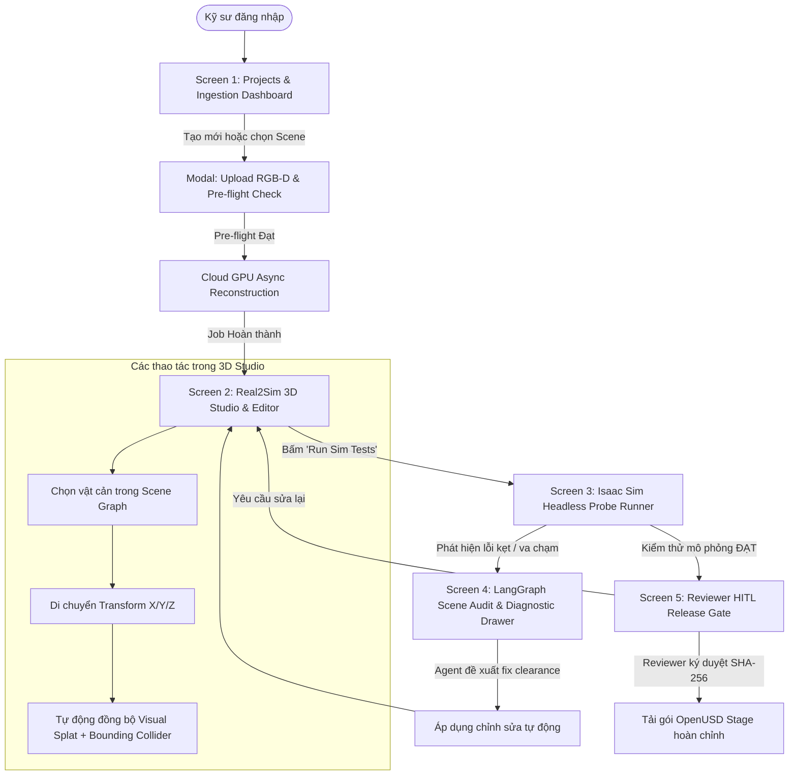

# Wireframe & UI Flow: RAV-01 Real2Sim Workspace

**Mã đề tài:** RAV-01 (Robot & Xe Tự Hành — VinFast)  
**Tài liệu liên quan:** [`BRIEF.md`](file:///d:/AI/P-087/docs/BRIEF.md), [`PRD.md`](file:///d:/AI/P-087/docs/PRD.md)  
**Tương tác mẫu:** Xem bản tương tác trực tiếp tại artifact [`real2sim_wireframe.html`](file:///C:/Users/zx121/.gemini/antigravity/brain/1f20d953-2746-4a07-ab33-5ee867a0d9b6/real2sim_wireframe.html)

---

## 1. Bản Đồ Luồng Giao Diện Tổng Thể (Global UI Flow)

Sơ đồ trạng thái người dùng di chuyển qua 5 màn hình chính trong hệ thống:



---

## 2. Chi Tiết Thiết Kế Từng Màn Hình (Screen Wireframe Specifications)

### Screen 1: Dashboard Dự Án & Tiền Kiểm Tra Dữ Liệu (Ingestion Pre-flight)

* **Mục đích:** Quản lý danh sách các khu vực khảo sát (Warehouse sites), trạng thái phiên bản, và bộ kiểm tra điều kiện dữ liệu đầu vào.
* **Bố cục Wireframe:**
  ```text
  +-----------------------------------------------------------------------------------------+
  | [Logo Real2Sim]  Dự Án: Warehouse Zone A   |  User: Alex (Simulation Eng)  | [Status: GPU Ready] |
  +-----------------------------------------------------------------------------------------+
  |  +---------------------------+   +----------------------------------------------------+  |
  |  | Danh sách Scenes          |   | Chi tiết Scene đã chọn: "Zone A - Corner 01"        |  |
  |  |---------------------------|   |----------------------------------------------------|  |
  |  | [*] Zone A - Corner 01    |   | Trạng thái: v1.1 (Draft) | Tạo lúc: 19/09 09:30   |  |
  |  | [ ] Zone B - Loading Bay  |   | Dữ liệu: 120 ảnh RGB-D (TUM format)                |  |
  |  | [ ] Synthetic Warehouse   |   |                                                    |  |
  |  |                           |   | [ Pre-flight Check Status: PASSED (3/3) ]          |  |
  |  | [+ Tạo Scene Khảo Sát Mới] |   |   (✓) Số lượng ảnh: 120 / 50 (Đạt)                 |  |
  |  +---------------------------+   |   (✓) Camera Intrinsics: Có đầy đủ                 |  |
  |                                  |   (✓) Metric Scale Reference: Xác nhận (Tag 0.15m) |  |
  |                                  |                                                    |  |
  |                                  | [ Mở Trong 3D Studio ]    [ Xem Báo Cáo Tiền Kiểm ]|  |
  |                                  +----------------------------------------------------+  |
  +-----------------------------------------------------------------------------------------+
  ```

---

### Screen 2: Real2Sim 3D Studio & Cây Đối Tượng (The 3D Workspace)

* **Mục đích:** Không gian làm việc cốt lõi với trình xem 3D WebGL (Three.js), hiển thị đồng thời cả hình ảnh trực quan (Gaussian Splats) và khung va chạm vật lý (Bounding Colliders), cho phép chỉnh sửa vị trí vật thể.
* **Bố cục Wireframe:**
  ```text
  +-----------------------------------------------------------------------------------------+
  | [← Dashboard]  Scene: Zone A - Corner 01  [v1.1 Draft]       [Audit Agent: 1 Issue] [Run Sim] |
  +-------------------------------------+---------------------------------------------------+
  | SCENE GRAPH HIERARCHY               | 3D VIEWPORT (Three.js WebGL / Gaussian Splat)     |
  |-------------------------------------|                                                   |
  | [Filter: All / Static / Obstacles]  |   [Layers: (✓) Visual Splat  (✓) Collision Box]   |
  |                                     |                                                   |
  | ▼ Environment                       |         +-----------------------+                 |
  |   ├─ Floor Plane (Static Mesh)      |         |  [Wall Back]          |                 |
  |   └─ Wall North (Static Mesh)       |         |                       |                 |
  | ▼ Dynamic Obstacles                 |         |      [Pallet_001]     |                 |
  |   ├─ [👁] Pallet_001 (Box Collider) |         |     (Gaussian Image)  |                 |
  |   │    Position: (1.5, 0.0, 2.1)    |         |     [Wireframe Box]   |                 |
  |   ├─ [👁] Carton_Box_02             |         |            ▲          |                 |
  |   └─ [ ] Unobserved_Zone_A (Hidden) |         |            │ Transform|                 |
  |                                     |         |       ◄────┼────► Gizmo                 |
  |-------------------------------------|         |            ▼          |                 |
  | OBJECT INSPECTOR                    |         |  [Floor Grid (0.5m)]  |                 |
  |-------------------------------------|         +-----------------------+                 |
  | ID: Pallet_001                      |                                                   |
  | Dimensions: 1.20m x 0.80m x 0.90m   | Camera: Orbit | Zoom: 1.2x | FPS: 48              |
  | Pos: X: [ 1.50 ] Y: [ 0.00 ] Z: [2.10]                                                  |
  | Collision Type: [ Oriented Box (OBB) ]                                                  |
  | [ Áp Dụng Thay Đổi ] [ Xóa Vật Thể ]| [ Thông Báo: Đã đồng bộ di chuyển Visual + Box ]  |
  +-------------------------------------+---------------------------------------------------+
  ```

---

### Screen 3 & 4: Kiểm Thử Headless Isaac Sim & Bảng Chẩn Đoán LangGraph Agent

* **Mục đích:** Kích hoạt bài kiểm tra va chạm trên GPU Cloud và hiển thị bảng phân tích thông minh của AI Agent với các đề xuất sửa chữa 1-click.
* **Bố cục Wireframe:**
  ```text
  +-----------------------------------------------------------------------------------------+
  | BÀI KIỂM THỬ MÔ PHỎNG (Headless Isaac Sim)          | LANGGRAPH SCENE AUDIT AGENT        |
  +-----------------------------------------------------+-----------------------------------+
  | Kết Quả Tuyến Đường Nav2: [ FAILED - OBSTACLE BLOCKED]| [ Trạng thái: Chẩn đoán hoàn tất ] |
  |                                                     |                                   |
  | Sơ đồ mặt bằng 2D (Top-down Occupancy):             | 🤖 Diagnostic Agent:              |
  |                                                     | "Tôi phát hiện tuyến đường từ     |
  |   [Start: A]                                        | Waypoint #02 sang #03 bị chặn     |
  |       │                                             | do chướng ngại vật Pallet_001     |
  |       ▼                                             | nằm quá sát tường phía Bắc."       |
  |   [WP #02] ───X───► [WP #03] ───► [Goal: B]         |                                   |
  |               ▲ Va chạm tại (1.8m, 1.2m)            | Phân tích dữ liệu:                |
  |                                                     | - Khoảng cách lối đi: 0.65 m      |
  | Thông số kiểm thử:                                  | - Footprint robot: 0.60 m         |
  | • Robot mẫu: TurtleBot3 / AMR Cargo 100             | - Biên an toàn tiêu chuẩn: 0.30 m |
  | • Dung sai lối đi tối thiểu quy định: 0.90 m        | => Thiếu hụt dung sai: -0.25 m    |
  | • Collision Probes: 19/20 Passed (1 vi phạm)        |                                   |
  |                                                     | Đề xuất khắc phục (Remediation):  |
  | [ Xem Chi Tiết Log File Isaac Sim ]                 | [ Gợi ý: Dịch chuyển Pallet_001   |
  |                                                     |          sang trục X +0.35 m ]    |
  |                                                     |                                   |
  |                                                     | [ ✓ Áp Dụng Đề Xuất Này ] [ Bỏ Qua] |
  +-----------------------------------------------------+-----------------------------------+
  ```

---

### Screen 5: Cổng Phê Duyệt Của Reviewer (HITL Release Gate)

* **Mục đích:** Cổng kiểm soát cuối cùng dành cho Tech Lead / Reviewer đối soát dữ liệu và ký duyệt xuất file USD.
* **Bố cục Wireframe:**
  ```text
  +-----------------------------------------------------------------------------------------+
  | THẨM ĐỊNH & PHÊ DUYỆT BẢN PHÁT HÀNH (HUMAN-IN-THE-LOOP RELEASE GATE)                    |
  +-----------------------------------------------------------------------------------------+
  | Scene: Zone A - Corner 01 | Phiên bản đề xuất: Release Candidate v1.0                    |
  | Kỹ sư thực hiện: Alex (Simulation Engineer)                                             |
  |                                                                                         |
  | 1. BẢNG KIỂM TRA CHỈ SỐ KỸ THUẬT                                                        |
  |    • PSNR (Độ trung thực ảnh giữ lại): 27.4 dB    [ ĐẠT - Chuẩn >= 25.0 dB ]            |
  |    • SSIM (Độ tương đồng cấu trúc):    0.88       [ ĐẠT - Chuẩn >= 0.85 ]               |
  |    • Chamfer Distance (Sai số hình học): 0.038 m   [ ĐẠT - Chuẩn <= 0.05 m ]             |
  |    • Simulation Navigation Pass Rate:  100% (20/20)[ ĐẠT ]                              |
  |                                                                                         |
  | 2. ĐỐI SOÁT VÙNG MÙ QUAN SÁT (UNOBSERVED AREAS)                                         |
  |    [!] Cảnh báo: Vùng sau kệ hàng phía Tây thiếu quan sát camera (Đã đánh dấu cấm robot)|
  |                                                                                         |
  | 3. XÁC NHẬN CỦA TECH LEAD / REVIEWER                                                    |
  |    Ghi chú duyệt: [ Đã kiểm tra dung sai lối đi và mô phỏng chạy thông thoáng. Duyệt! ] |
  |                                                                                         |
  | [ TỪ CHỐI / TRẢ LẠI SỬA ]                  [ PHÊ DUYỆT & KÝ PHÁT HÀNH (SEAL RELEASE) ]  |
  |                                                                                         |
  | Gói xuất bản sau khi ký:                                                                |
  |   • File: warehouse_zone_a_v1.0.usd (Đã nhúng Physics Collision API)                    |
  |   • SHA-256 Checksum: 8f4a21...e39b                                                     |
  |   • [ Tải Gói USD Stage (.zip) ]    [ Tải Báo Cáo Kiểm Định (.pdf) ]                     |
  +-----------------------------------------------------------------------------------------+
  ```

---

## 3. Bản Mẫu Tương Tác Trực Tiếp (Interactive Prototype)

Một bản mẫu tương tác trực tiếp bằng HTML & Tailwind CSS đã được tạo tại thư mục artifact:  
🔗 **[`real2sim_wireframe.html`](file:///C:/Users/zx121/.gemini/antigravity/brain/1f20d953-2746-4a07-ab33-5ee867a0d9b6/real2sim_wireframe.html)**  

Người dùng có thể chuyển đổi giữa các tab:
1. **Projects Dashboard**: Danh sách và tiền kiểm tra dữ liệu.
2. **3D Real2Sim Studio**: Xem không gian 3D, thanh công cụ layer và cây Scene Graph.
3. **Simulation & Agent Diagnostics**: Chạy bài thử Nav2 và tương tác với LangGraph Agent.
4. **Reviewer Release Gate**: Bảng kiểm tra chỉ số và nút ký duyệt.

