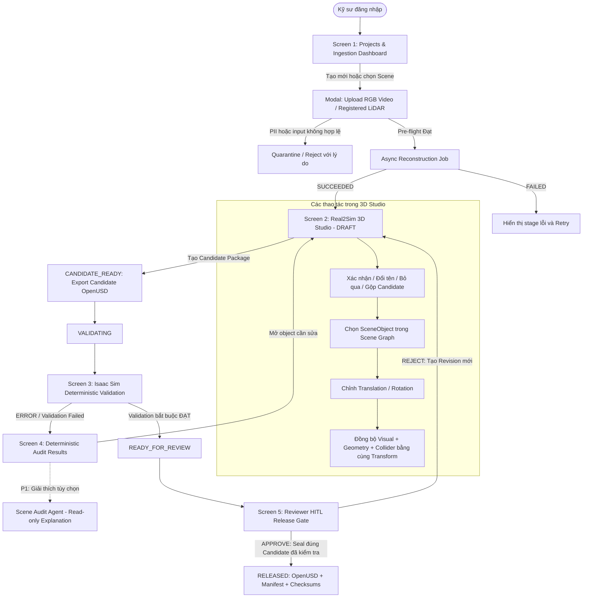

# Wireframe & UI Flow: RAV-01 Real2Sim Studio

**Mã đề tài:** RAV-01 (Robot & Xe Tự Hành — VinFast)  
**Tài liệu liên quan:** [`BRIEF.md`](./BRIEF.md), [`PRD.md`](./PRD.md)

**Phiên bản PRD đối chiếu:** v1.6

**Trạng thái prototype:** Chưa có artifact HTML được lưu trong repository; wireframe trong tài liệu này là nguồn mô tả UI hiện tại.

---

## 1. Bản Đồ Luồng Giao Diện Tổng Thể (Global UI Flow)

Sơ đồ trạng thái người dùng di chuyển qua 5 màn hình chính trong hệ thống:



---

## 2. Chi Tiết Thiết Kế Từng Màn Hình (Screen Wireframe Specifications)

### Screen 1: Dashboard Dự Án & Tiền Kiểm Tra Dữ Liệu (Ingestion Pre-flight)

* **Mục đích:** Quản lý danh sách khu vực khảo sát, scene version, reconstruction job và điều kiện đầu vào của video RGB/registered LiDAR.
* **Bố cục Wireframe:**
  ```text
  +------------------------------------------------------------------------------------------------+
  | [Real2Sim Studio]  Project: Warehouse Zone A  | User: Alex [Editor] | Worker: AVAILABLE        |
  +------------------------------------------------------------------------------------------------+
  | +----------------------------+  +-------------------------------------------------------------+ |
  | | SCENES / REVISIONS         |  | SCENE: Zone A - Corner 01                                  | |
  | |----------------------------|  |-------------------------------------------------------------| |
  | | [*] v1.1  DRAFT            |  | Input contract                                             | |
  | | [ ] v1.0  RELEASED         |  | • Moving-camera RGB video: zone_a_walkthrough.mp4          | |
  | | [ ] Synthetic Warehouse    |  | • Registered LiDAR (.ply/.pcd): Optional / Not provided    | |
  | |                            |  |                                                             | |
  | | [+ Tạo Scene Mới]          |  | Pre-flight                                                 | |
  | +----------------------------+  | [MEASURE] Decode / camera motion / overlap / parallax       | |
  |                                 | [MEASURE] Coverage / motion blur / registration health      | |
  | JOB                            | [PASS]    Privacy: no untreated faces or license plates      | |
  | QUEUED → RUNNING → SUCCEEDED  | [PENDING] Metric scale reference                             | |
  | hoặc FAILED / CANCELLED       |                                                             | |
  | [Xem stage log] [Retry]       | [Chạy Pre-flight] [Bắt đầu Reconstruction] [Xem Báo cáo]     | |
  |                                 +-------------------------------------------------------------+ |
  +------------------------------------------------------------------------------------------------+
  ```

Input có khuôn mặt/biển số chưa ẩn danh hoặc không đáp ứng input contract phải được quarantine/reject với lý do và hướng xử lý. Raw sequential LiDAR scans không được hiển thị như input được hỗ trợ.

---

### Screen 2: Real2Sim 3D Studio & Cây Đối Tượng (The 3D Workspace)

* **Mục đích:** Web-based 3D Studio cho phép orbit/pan/zoom, xem riêng Visual–Geometry–Collider, xử lý candidate object và chỉnh `SceneObject` bằng một canonical transform dùng chung.
* **Bố cục Wireframe:**
  ```text
  +------------------------------------------------------------------------------------------------+
  | [← Dashboard] Scene: Zone A - Corner 01 [v1.1 DRAFT] [Audit: 1 Issue] [Tạo Candidate & Validate]|
  +------------------------------------------+-----------------------------------------------------+
  | SCENE GRAPH / CANDIDATES                 | BROWSER 3D VIEWER                                   |
  |------------------------------------------|-----------------------------------------------------|
  | [All / Unreviewed / Confirmed / Ignored] | [Layers: ✓ Visual  ✓ Geometry  ✓ Collider]           |
  |                                          | [Camera: Orbit | Pan | Zoom]                         |
  | ▼ Environment                            |                                                     |
  |   ├─ Floor (CONFIRMED, Static)           |        Visual appearance                            |
  |   └─ Wall_North (CONFIRMED, Static)      |        + geometry surface                           |
  | ▼ Candidate Objects                      |        + collider overlay                            |
  |   ├─ Object_001 [UNREVIEWED]             |                 ▲                                   |
  |   ├─ Pallet_001 [CONFIRMED]              |            ◄────┼────► Transform Gizmo               |
  |   ├─ Object_003 [NEEDS_CORRECTION]       |                 ▼                                   |
  |   └─ Object_004 [IGNORED]                |                                                     |
  |------------------------------------------|-----------------------------------------------------|
  | OBJECT INSPECTOR                         | METRIC SCALE                                        |
  |------------------------------------------| [Chọn 2 điểm] [Nhập khoảng cách thật] [Xác nhận]     |
  | ID: Object_001                           |                                                     |
  | Name: [________________]                 | VIEWER STATUS                                       |
  | Status: [UNREVIEWED ▼]                   | Render performance: MEASURE                         |
  | Position / Rotation: [canonical T]       | Unobserved areas: [Show/Hide]                       |
  | Collider: [AABB / OBB / Hull / Mesh ▼]   |                                                     |
  | [Xác nhận] [Đổi tên] [Bỏ qua] [Gộp]      |                                                     |
  | [Tạo correction] [Áp dụng Transform]     | [Đã đồng bộ Visual + Geometry + Collider]           |
  +------------------------------------------+-----------------------------------------------------+
  ```

Candidate tự động dùng ID trung tính cho đến khi con người xác nhận. Nút xóa chỉ áp dụng cho object do người dùng thêm; object nằm trong reconstruction dùng luồng bỏ qua, ẩn hoặc correction thay vì claim xóa và phục hồi nền hoàn hảo.

---

### Screen 3 & 4: Candidate Validation & Bảng Kết Quả Deterministic Audit

* **Mục đích:** Xuất candidate OpenUSD, chạy các kiểm tra có tính quyết định trong Isaac Sim trước review và chỉ dùng Scene Audit Agent ở P1 để giải thích kết quả mà không tự sửa hoặc tự approve.
* **Bố cục Wireframe:**
  ```text
  +------------------------------------------------------------------------------------------------+
  | CANDIDATE VALIDATION — v1.1                         | DETERMINISTIC AUDIT RESULTS             |
  +-----------------------------------------------------+------------------------------------------+
  | Package: scene_candidate.usd                        | [PASS/FAIL] Metric scale confirmed      |
  | Candidate checksum: <sha256>                        | [PASS/FAIL] Required colliders present  |
  | State: CANDIDATE_READY → VALIDATING                 | [PASS/FAIL] Transform invariant         |
  |                                                     | [PASS/FAIL] Robot spawn valid           |
  | Isaac Sim                                           | [PASS/FAIL] Required artifacts present  |
  | • Load status: PASS / FAIL / ERROR                  | [PASS/FAIL] Candidates reviewed         |
  | • Floor collider: PASS / FAIL                       |                                          |
  | • Spawn check: PASS / FAIL                          | ISSUE DETAIL                             |
  |                                                     | Object: Pallet_001                       |
  | START–GOAL PATH RESULTS                             | Rule: PATH_BLOCKED                       |
  | A → B: CLEAR / BLOCKED / ERROR                      | Evidence: collider/path result           |
  | C → D: CLEAR / BLOCKED / ERROR                      | [Mở Object trong Studio]                 |
  | ... theo evaluation set đã khóa                     |                                          |
  |                                                     | P1 — AGENT EXPLANATION                   |
  | [Xem Isaac Log] [Xem Manifest] [Chạy lại]           | Giải thích read-only, không tự áp dụng   |
  +-----------------------------------------------------+------------------------------------------+
  ```

MVP không claim triển khai đầy đủ ROS2/Nav2. Mọi threshold hiển thị trong screen này phải lấy từ evaluation configuration đã khóa; wireframe không ghi cứng số liệu minh họa thành acceptance requirement.

---

### Screen 5: Cổng Phê Duyệt Của Reviewer (HITL Release Gate)

* **Mục đích:** Reviewer đối soát đúng candidate package đã được validation; approval chỉ đóng dấu candidate này thành bản phát hành chính thức, không chạy lại hoặc thay đổi nội dung package.
* **Bố cục Wireframe:**
  ```text
  +------------------------------------------------------------------------------------------------+
  | READY_FOR_REVIEW — HUMAN-IN-THE-LOOP RELEASE GATE                                      |
  +------------------------------------------------------------------------------------------------+
  | Scene: Zone A - Corner 01 | Candidate Revision: v1.1 | Editor: Alex                    |
  | Candidate: scene_candidate.usd | SHA-256: <candidate checksum>                           |
  | Validation environment: <pinned Isaac Sim / hardware / config>                          |
  |                                                                                                |
  | 1. TIER A — METRIC BẮT BUỘC PHẢI BÁO CÁO                                               |
  |    PSNR: <value/status> | SSIM: <value/status> | LPIPS: <value/status>                   |
  |    Chamfer: <value/status/reference> | Runtime: <value> | Render: <value>               |
  |                                                                                                |
  | 2. TIER B — REAL2SIM CORRECTNESS                                                        |
  |    Metric scale: PASS/FAIL | Isaac load: PASS/FAIL | Collision: PASS/FAIL                |
  |    Start–Goal paths: CLEAR/BLOCKED/ERROR | E2E: PASS/FAIL                               |
  |                                                                                                |
  | 3. CẢNH BÁO VÀ CLAIM BOUNDARY                                                           |
  |    Unobserved areas: <list> | Accepted warnings: <list/reason>                          |
  |                                                                                                |
  | 4. REVIEW DECISION                                                                       |
  |    Ghi chú bắt buộc khi Reject: [_______________________________________________]        |
  |    [REJECT — Tạo revision DRAFT mới]                 [APPROVE & SEAL EXACT CANDIDATE]   |
  |                                                                                                |
  | Sau approval: warehouse_zone_a_v1.0.usd + manifest.json + validation report + checksums  |
  +------------------------------------------------------------------------------------------------+
  ```

Nếu Reviewer chỉnh scene, thay đổi phải tạo revision mới ở trạng thái `DRAFT`; candidate checksum và validation cũ mất hiệu lực. Strict four-eyes authorization không phải yêu cầu MVP, nhưng mọi hành động edit/review phải được ghi riêng trong audit log.

---

## 3. Bản Mẫu Tương Tác Trực Tiếp (Interactive Prototype)

Artifact `real2sim_wireframe.html` được nhắc trong bản tài liệu cũ không tồn tại trong repository hiện tại. Khi tạo lại prototype, file phải được lưu trong repository và liên kết bằng đường dẫn tương đối; không dùng đường dẫn tuyệt đối từ máy cá nhân hoặc thư mục tạm của công cụ AI.

Prototype cập nhật cần cho phép chuyển đổi giữa các tab:
1. **Projects Dashboard**: Danh sách và tiền kiểm tra dữ liệu.
2. **3D Real2Sim Studio**: Browser Viewer, candidate workflow, các layer Visual/Geometry/Collider và Scene Graph.
3. **Candidate Validation & Audit**: Export candidate, chạy deterministic Isaac Sim checks và xem kết quả; Agent explanation chỉ là P1.
4. **Reviewer Release Gate**: Đối soát candidate đã validation, reject revision hoặc approve và seal release.
