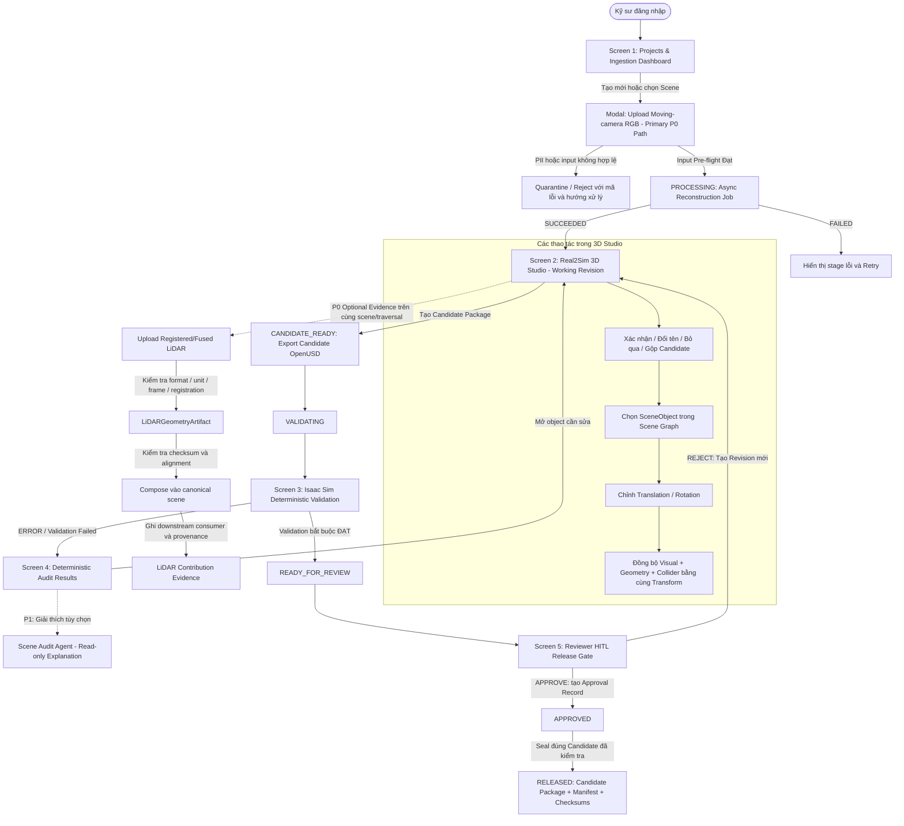

# Wireframe & UI Flow: RAV-01 Real2Sim Studio

**Mã đề tài:** RAV-01 (Robot & Xe Tự Hành — VinFast)  
**Tài liệu liên quan:** [`BRIEF.md`](./BRIEF.md), [`PRD.md`](./PRD.md)

**Phiên bản PRD đối chiếu:** v1.9

**Document Role:** Mô tả hành vi UI và luồng tương tác; không định nghĩa lại product scope hoặc acceptance.

**Scope:** Web App cho Primary RGB Product Path P0, P0 LiDAR Contribution Evidence và Reviewer Release Gate.

**Upstream Constraints:** [`PRD.md`](./PRD.md) quyết định P0/P1 và acceptance; [`DATASET_PLAYBOOK.md`](./DATASET_PLAYBOOK.md) quyết định dataset preparation, leakage control và evaluation protocol.

**Trạng thái prototype:** Chưa có artifact HTML được lưu trong repository; wireframe trong tài liệu này là nguồn mô tả UI hiện tại.

---

## 1. Bản Đồ Luồng Giao Diện Tổng Thể (Global UI Flow)

Sơ đồ trạng thái người dùng di chuyển qua 5 màn hình chính trong hệ thống:



---

## 2. Chi Tiết Thiết Kế Từng Màn Hình (Screen Wireframe Specifications)

### Screen 1: Dashboard Dự Án & Tiền Kiểm Tra Dữ Liệu (Ingestion Pre-flight)

* **Mục đích:** Quản lý danh sách khu vực khảo sát, scene version, reconstruction job và điều kiện đầu vào. Moving-camera RGB là input của full P0 release path; registered/fused LiDAR chỉ tham gia P0 dưới dạng evidence run gắn với RGB artifacts của cùng scene/traversal. Full LiDAR-only product configuration thuộc P1.
* **Bố cục Wireframe:**
  ```text
  +------------------------------------------------------------------------------------------------+
  | [Real2Sim Studio]  Project: Warehouse Zone A  | User: Alex [Editor] | Worker: AVAILABLE        |
  +------------------------------------------------------------------------------------------------+
  | +----------------------------+  +-------------------------------------------------------------+ |
  | | SCENES / REVISIONS         |  | SCENE: Zone A - Corner 01                                  | |
  | |----------------------------|  |-------------------------------------------------------------| |
  | | [*] v1.1  DRAFT            |  | Input contract                                             | |
  | | [ ] v1.0  RELEASED         |  | • Moving-camera RGB video: zone_a_walkthrough.mp4          | |
  | | [ ] Example Scene [MOCK]   |  | • P0 evidence: Registered LiDAR .ply/.pcd, SAME scene      | |
  | |                            |  | • Size / checksum / received_at / source-rights             | |
  | | [+ Tạo Scene Mới]          |  | • LiDAR unit / frame / registration declaration            | |
  | +----------------------------+  |                                                             | |
  | JOB ID: job_01                | Input Pre-flight                                            | |
  | Stage: CAMERA_POSE  42%       | [MEASURE] Decode / motion / overlap / blur / coverage       | |
  | Updated: <timestamp>          | [STATUS]  Privacy evidence / anonymization status           | |
  | QUEUED → RUNNING → SUCCEEDED | [STATUS]  LiDAR readable / non-empty / unit / frame          | |
  | hoặc FAILED / CANCELLED      | [Chạy Input Pre-flight] [Bắt đầu RGB Reconstruction]         | |
  | [Xem stage log] [Retry]      | [Tạo LiDAR Evidence Run] [Xem Báo cáo]                       | |
  |                                 +-------------------------------------------------------------+ |
  +------------------------------------------------------------------------------------------------+
  ```

Input có khuôn mặt/biển số chưa ẩn danh, không rõ quyền sử dụng hoặc không đáp ứng input contract phải được quarantine/reject với mã lỗi, lý do và hướng xử lý. Privacy chỉ được hiển thị `VERIFIED_ANONYMIZED` khi toàn bộ selected frames đã được kiểm tra hoặc input là approved anonymized copy; sampled screening chỉ được ghi `PRELIMINARY_SCREENED`, không được hiển thị như bằng chứng hoàn tất.

Raw sequential LiDAR scans không được hiển thị như input được hỗ trợ. Phần mở rộng `.ply`/`.pcd` không đủ để xác nhận input hợp lệ: người dùng phải khai báo unit, coordinate frame, registration/fusion status và same-scene/traversal association. Evidence run phải hiển thị checksum của RGB artifacts được reuse, alignment transform và downstream consumer; nó không tạo ra một full P0 LiDAR-only release path.

Job card phải hiển thị Job ID, stage, progress, lần cập nhật gần nhất, trạng thái, vị trí artifact và lỗi theo stage. Retry phải giữ input gốc, không ghi đè release cũ và nói rõ retry từ safe checkpoint hay tạo run mới.

---

### Screen 2: Real2Sim 3D Studio & Cây Đối Tượng (The 3D Workspace)

* **Mục đích:** Web-based 3D Studio cho phép orbit/pan/zoom, xem riêng Visual–Geometry–Collider, xử lý candidate object và chỉnh `SceneObject` bằng một canonical transform dùng chung.
* **Bố cục Wireframe:**
  ```text
  +------------------------------------------------------------------------------------------------+
  | [← Dashboard] Scene: Zone A - Corner 01 [v1.1 DRAFT] [Audit: 1 Issue] [Tạo Candidate & Validate]|
  +------------------------------------------+-----------------------------------------------------+
  | SCENE GRAPH / CANDIDATES                 | BROWSER 3D VIEWER                                   |
  |------------------------------------------|-----------------------------------------------------|
  | [All / Unreviewed / Confirmed / Ignored] | [Layers: ✓ Visual  ✓ Geometry  ✓ Collider]           |
  |                                          | [Camera: Orbit | Pan | Zoom]                         |
  | ▼ Environment                            |                                                     |
  |   ├─ Floor (CONFIRMED, Static)           |        Visual appearance                            |
  |   └─ Wall_North (CONFIRMED, Static)      |        + geometry surface                           |
  | ▼ Candidate Objects                      |        + collider overlay                            |
  |   ├─ Object_001 [UNREVIEWED]             |                 ▲                                   |
  |   ├─ Pallet_001 [CONFIRMED]              |            ◄────┼────► Transform Gizmo               |
  |   ├─ Object_003 [NEEDS_CORRECTION]       |                 ▼                                   |
  |   └─ Object_004 [IGNORED]                |                                                     |
  |------------------------------------------|-----------------------------------------------------|
  | OBJECT INSPECTOR                         | METRIC SCALE / ALIGNMENT                            |
  |------------------------------------------| RGB: [Chọn 2 điểm] [Nhập khoảng cách thật] [Xác nhận]|
  | ID: Object_001                           |                                                     |
  | Name: [________________]                 | VIEWER STATUS                                       |
  | Status: [UNREVIEWED ▼]                   | Render performance: MEASURE                         |
  | Position / Rotation: [canonical T]       | Unobserved areas: [Show/Hide]                       |
  | Collider: [AABB / OBB / Hull / Mesh ▼]   | LiDAR: [Xác nhận native metric] [Xem alignment]     |
  | Collider size / transform: [__________]  |                                                     |
  | [Xác nhận] [Đổi tên] [Bỏ qua] [Gộp]      | AMR VALIDATION SETUP                                |
  | [Tạo object bị thiếu] [Reassign vùng chọn]| Footprint: [____] Start–Goal: [Thêm / Chọn bộ khóa] |
  | [Thêm primitive/asset] [Ẩn/Hiện] [Xóa]   | LIDAR EVIDENCE                                      |
  | [Áp dụng Transform]                      | Same-scene/checksum/alignment/downstream: [Xem]     |
  |                                          | [Đã đồng bộ Visual + Geometry + Collider]           |
  +------------------------------------------+-----------------------------------------------------+
  ```

Candidate tự động dùng ID trung tính cho đến khi con người xác nhận. P0 Minimal Correction phải có ba thao tác rõ ràng: `Merge`, `Create Missing Object` và `Reassign` mask/geometry selection/region; không dùng một nút `Tạo correction` chung mà không mô tả hành vi.

Nút xóa áp dụng cho object do người dùng thêm và reconstructed `SceneObject` đã được xác nhận. Khi xóa reconstructed object, revision mới phải loại object khỏi Scene IR, Geometry và Collider không còn tham gia collision/path validation, còn Visual segment được hide/remove khi đã tách riêng. UI phải cảnh báo rằng background phía sau có thể không được phục hồi photorealistic hoàn chỉnh; giới hạn này không làm thao tác Delete thất bại.

Trước khi tạo candidate package, người dùng phải chọn robot footprint và các cặp Start–Goal. UI phải phân biệt evaluation set đã khóa với cặp thử nghiệm ad hoc và lưu chúng vào revision/validation configuration.

---

### Screen 3 & 4: Candidate Validation & Bảng Kết Quả Deterministic Audit

* **Mục đích:** Xuất candidate OpenUSD, chạy các kiểm tra có tính quyết định trong Isaac Sim trước review và chỉ dùng Scene Audit Agent ở P1 để giải thích kết quả mà không tự sửa hoặc tự approve.
* **Bố cục Wireframe:**
  ```text
  +------------------------------------------------------------------------------------------------+
  | CANDIDATE VALIDATION — v1.1                         | DETERMINISTIC AUDIT RESULTS             |
  +-----------------------------------------------------+------------------------------------------+
  | Candidate package: <artifact list / manifest>       | [PASS/FAIL] Metric scale confirmed      |
  | Candidate package checksum: <sha256>                | [PASS/FAIL] Required colliders present  |
  | State: CANDIDATE_READY → VALIDATING                 | [PASS/FAIL] Transform invariant         |
  |                                                     | [PASS/FAIL] Robot spawn valid           |
  | Isaac Sim                                           | [PASS/FAIL] Object inside scene bounds  |
  | • Load status: PASS / FAIL / ERROR                  | [PASS/FAIL] Candidates reviewed         |
  | • Floor collider: PASS / FAIL                       |                                          |
  | • Spawn check: PASS / FAIL                          | [PASS/FAIL] Required artifacts present  |
  | • Logs/report reference: <artifact>                 | ISSUE DETAIL                             |
  |                                                     | Object: Pallet_001                       |
  | START–GOAL PATH RESULTS                             | Rule: PATH_BLOCKED                       |
  | Footprint/config checksum: <sha256>                 | Severity / remediation: <detail>         |
  | A → B: CLEAR / BLOCKED / ERROR                      | Evidence: collider/path result           |
  | C → D: CLEAR / BLOCKED / ERROR                      | [Mở Object trong Studio]                 |
  | ... theo evaluation set đã khóa                     |                                          |
  |                                                     | P1 — AGENT EXPLANATION                   |
  | [Xem Isaac Log] [Xem Manifest] [Chạy lại]           | Giải thích read-only, không tự áp dụng   |
  +-----------------------------------------------------+------------------------------------------+
  ```

MVP không claim triển khai đầy đủ ROS2/Nav2. Mọi threshold hiển thị trong screen này phải lấy từ validation/evaluation configuration đã khóa; wireframe không ghi cứng số liệu minh họa thành acceptance requirement. Audit rule phải lưu Rule ID, config version, affected object, evidence, severity và remediation.

Product validation và quantitative evaluation là hai report khác nhau:

- Product validation dùng Candidate Package để kiểm tra Isaac load, scale, collider, spawn và path.
- Evaluation chỉ đọc prediction artifacts sau khi pipeline hoàn tất rồi mới kết hợp với `evaluation_only` references.
- PSNR/SSIM/LPIPS chỉ có giá trị khi dùng held-out views; Chamfer chỉ có giá trị khi có independent reference geometry.
- Khi không có protocol/reference phù hợp, UI phải hiển thị `N/A — no valid evaluation reference`, không chuyển thành `FAIL` và không tự đưa ground truth vào product input.

---

### Screen 5: Cổng Phê Duyệt Của Reviewer (HITL Release Gate)

* **Mục đích:** Reviewer đối soát đúng candidate package đã được validation; approval chỉ đóng dấu candidate này thành bản phát hành chính thức, không chạy lại hoặc thay đổi nội dung package.
* **Bố cục Wireframe:**
  ```text
  +------------------------------------------------------------------------------------------------+
  | READY_FOR_REVIEW — HUMAN-IN-THE-LOOP RELEASE GATE                                      |
  +------------------------------------------------------------------------------------------------+
  | Scene: Zone A - Corner 01 | Revision: v1.1 | Editor: <id> | Reviewer: <id>             |
  | Candidate Package: <artifact list> | SHA-256: <candidate package checksum>               |
  | Validation environment: <pinned Isaac Sim / hardware / config>                          |
  |                                                                                                |
  | 1. EXACT CANDIDATE EVIDENCE                                                           |
  |    [Xem Input + checksums] [Mở Visual/Geometry/Collider] [Manifest] [Validation Report]|
  |    Candidate provenance: auto / corrected / ignored / user-added                      |
  |                                                                                                |
  | 2. PRODUCT VALIDATION — RELEASE GATES                                                   |
  |    Metric scale: PASS/FAIL | Isaac load: PASS/FAIL | Collision: PASS/FAIL                |
  |    Start–Goal paths: CLEAR/BLOCKED/ERROR | E2E: PASS/FAIL                               |
  |                                                                                                |
  | 3. EVALUATION REPORT — LOCKED SET ONLY                                                  |
  |    PSNR/SSIM/LPIPS: <value/status/held-out split or N/A>                                |
  |    Chamfer: <value/status/independent reference or N/A> | Runtime/Render: <value>       |
  |                                                                                                |
  | 4. CẢNH BÁO VÀ CLAIM BOUNDARY                                                           |
  |    Unobserved areas: <list> | Accepted warnings: <list/reason>                          |
  |                                                                                                |
  | 5. REVIEW DECISION                                                                       |
  |    Ghi chú bắt buộc khi Reject: [_______________________________________________]        |
  |    [REJECT — Tạo revision DRAFT mới]                 [APPROVE EXACT CANDIDATE]          |
  |                                                                                                |
  | Sau approval: APPROVED → seal Candidate Package + ReleaseManifest + reports/checksums    |
  +------------------------------------------------------------------------------------------------+
  ```

Nút Approve chỉ được bật cho role Reviewer khi Candidate Package checksum khớp Validation Report và mọi validation bắt buộc đã đạt. Approval tạo `ApprovalRecord` và trạng thái `APPROVED`; sau đó hệ thống mới seal đúng Candidate Package đó thành `RELEASED`, không regenerate hoặc thay đổi package.

Nếu Reviewer chỉnh scene, thay đổi phải tạo revision mới ở trạng thái `DRAFT`; Candidate Package checksum và validation cũ mất hiệu lực. Strict four-eyes authorization không phải yêu cầu MVP, nhưng mọi hành động edit/review phải được ghi riêng trong audit log. Reviewer phải mở được exact input/checksum, Visual, Geometry, Collider, candidate provenance, manifest, cảnh báo và validation evidence trước khi quyết định.

---

## 3. Bản Mẫu Tương Tác Trực Tiếp (Interactive Prototype)

Artifact `real2sim_wireframe.html` được nhắc trong bản tài liệu cũ không tồn tại trong repository hiện tại. Khi tạo lại prototype, file phải được lưu trong repository và liên kết bằng đường dẫn tương đối; không dùng đường dẫn tuyệt đối từ máy cá nhân hoặc thư mục tạm của công cụ AI.

Prototype cập nhật cần biểu diễn đủ 5 logical screens; Screen 3 và Screen 4 có thể nằm chung một tab nếu vẫn tách rõ validation execution và deterministic audit results. Các tab tối thiểu:

1. **Projects Dashboard**: Danh sách và tiền kiểm tra dữ liệu.
2. **3D Real2Sim Studio**: Browser Viewer, P0 Minimal Correction, Add/Hide/Delete, collider editing, metric/alignment, AMR test setup và Scene Graph.
3. **Candidate Validation & Audit**: Build immutable Candidate Package, chạy deterministic Isaac Sim checks, xem audit/evidence và tách product validation khỏi evaluation report; Agent explanation chỉ là P1.
4. **Reviewer Release Gate**: Đối soát exact candidate đã validation, xem đủ evidence, reject revision hoặc tạo Approval Record rồi seal release.
