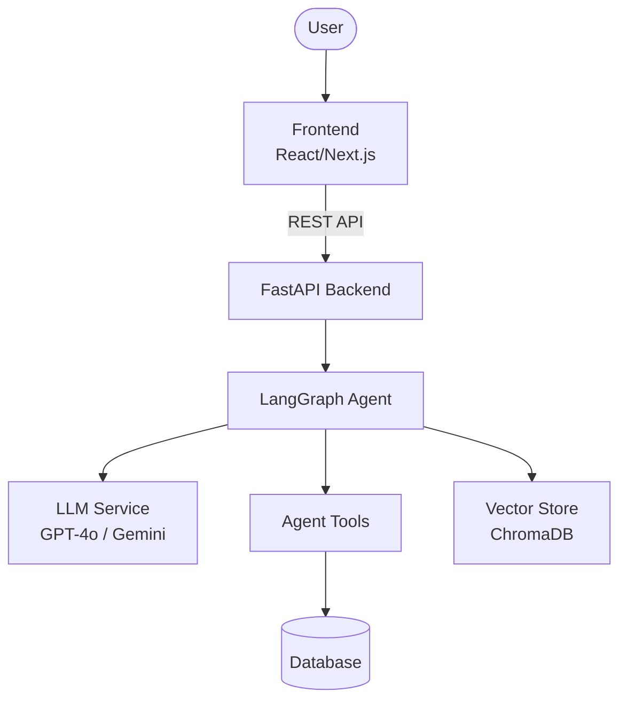
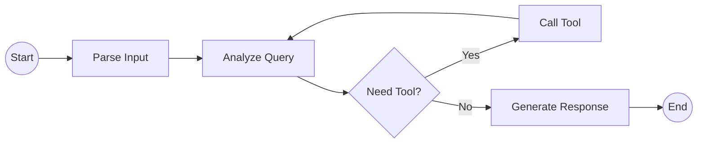
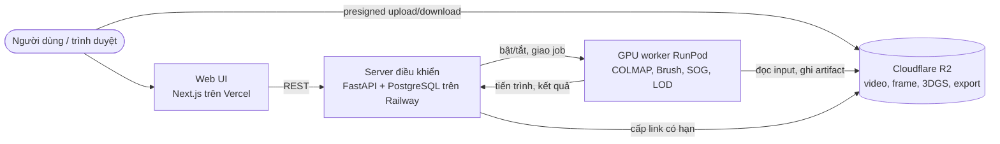

# Architecture Diagram

> **Ghi chú Real2Sim (2026-09-29):** các sơ đồ phía dưới là mẫu của ban tổ chức
> (chat agent LangGraph), giữ nguyên theo quy tắc additive-only. Kiến trúc thật của
> Real2Sim nằm ở [`ARCHITECTURE.md`](../ARCHITECTURE.md) và mục "Real2Sim Studio" cuối file.

## System Overview

## Agent Flow

## Component Details

| Component | Technology | Purpose |
|-----------|-----------|---------|
| Frontend | React/Next.js | User interface |
| Backend | FastAPI | API server |
| Agent | LangGraph | AI agent orchestration |
| LLM | OpenAI/Gemini | Language model |
| Database | PostgreSQL/SQLite | Data persistence |
| Vector Store | ChromaDB | RAG / embeddings |

## Real2Sim Studio — triển khai đã chốt (ADR 0003)

Hiện trạng chạy thật vẫn là một máy (`scripts/gpu/run_stack.sh`); sơ đồ trên là
đích triển khai theo [plan Cloud Studio](plans/active/2026-09-29-cloud-studio.md).

