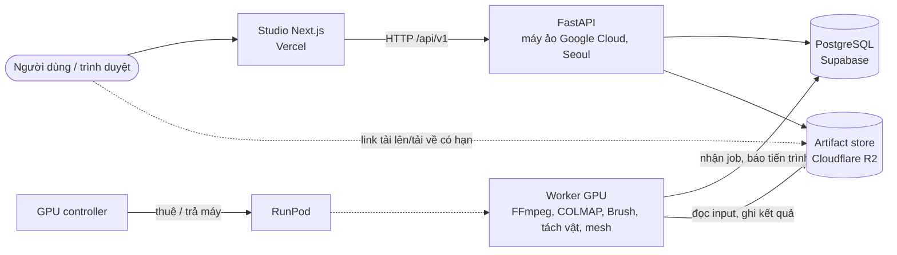

# Sơ đồ kiến trúc

Bản tóm tắt bằng hình cho hồ sơ nộp bài. Giải thích đầy đủ từng thành phần, ranh giới và cách lưu dữ liệu nằm ở [ARCHITECTURE](ARCHITECTURE.md); luồng xử lý từng bước nằm ở [PIPELINE](PIPELINE.md).

## Hệ thống đang chạy

## Thành phần

| Thành phần | Công nghệ | Việc |
| --- | --- | --- |
| Studio | Next.js, React, TypeScript, PlayCanvas/SuperSplat | Tải video, xem và chỉnh scene 3D, duyệt vật, theo dõi tiến trình |
| API | Python 3.12, FastAPI | Tài khoản và quyền, project, job, revision scene, đóng gói, duyệt và phát hành |
| Database | PostgreSQL (Supabase); SQLite khi chạy một máy | Metadata, hàng đợi job, con trỏ revision hiện hành |
| Artifact store | Cloudflare R2; thư mục cục bộ khi chạy một máy | Video, frame, Gaussian, mesh, gói OpenUSD, báo cáo, mỗi file có checksum |
| Worker GPU | Docker image GPU trên RunPod | Dựng cảnh, tách vật, tạo hình khối và collider |
| GPU controller | Python, RunPod API | Thuê máy khi có job, trả máy khi rảnh, giới hạn chi phí |
| Kiểm định | NVIDIA Isaac Sim, OpenUSD | Nạp và chạy gói mô phỏng; cần máy có Isaac, image cloud hiện chưa có |
