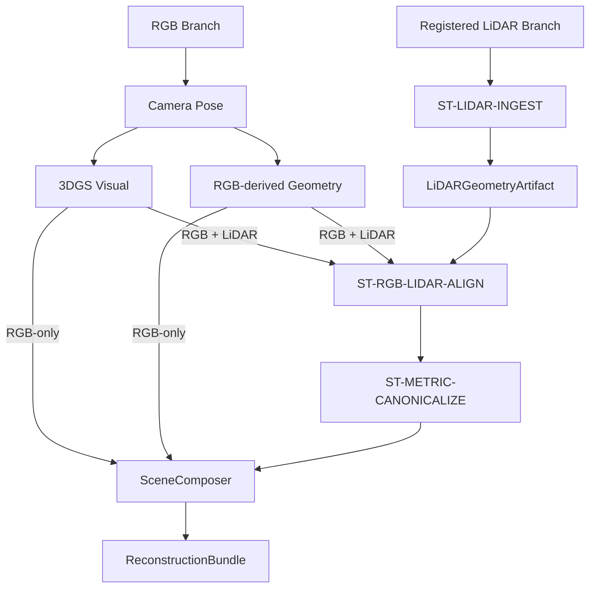
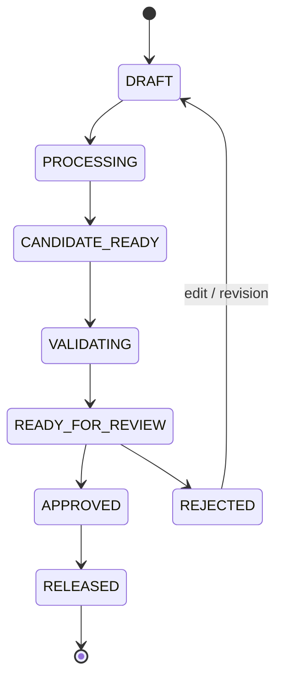

## BASELINE WORKFLOW & REPOSITORY INTEGRATION GUIDE

## Real2Sim Studio — Warehouse / Indoor AMR MVP → NVIDIA Isaac Sim

> **CẢNH BÁO QUAN TRỌNG VỀ DỮ LIỆU ĐẦU VÀO:** Xem chi tiết tiền xử lý dataset offline tại [`DATASET_PLAYBOOK.md`](../DATASET_PLAYBOOK.md). Tiền xử lý offline không được phép ăn lẹm vào Product Input Contract. (Ví dụ: Việc nạp chuỗi `.pcd` thô rồi gộp ra file `.ply` là việc làm offline, phần mềm sản phẩm chỉ bắt đầu nhận từ file `.ply` đã gộp).

**Tài liệu dành cho:** Coding Agent / Tech Lead / Integration Engineer
**Document Role:** Technical implementation baseline.
**Scope:** Stage workflow, adapter/tool baseline, artifact boundary và repository-integration strategy cho P0.
**Upstream Constraints:** Tool/repository choices phải thực hiện product contract; không được dùng implementation convenience để thay đổi PRD scope/acceptance.
**Status:** Foundation Baseline v1.0 — synced with normative Contract.
**Related Documents:** [PRD](../PRD.md), [BRIEF](../BRIEF.md), [DATASET_PLAYBOOK](../DATASET_PLAYBOOK.md), [WIREFRAME](../WIREFRAME_AND_UI_FLOW.md), [TEAM_EXECUTION_CONTRACT](./TEAM_EXECUTION_CONTRACT.md), [TEAM_EXECUTION_PLAN](./TEAM_EXECUTION_PLAN.md), [TRACK_IMPLEMENTATION_GUIDE](./TRACK_IMPLEMENTATION_GUIDE.md).
**Artifact Contract Authority:** [`TEAM_EXECUTION_CONTRACT.md`](./TEAM_EXECUTION_CONTRACT.md) là normative source cho schema, required/optional fields, version và producer/consumer. Các schema trong tài liệu này chỉ là projection minh họa và không được tạo contract cạnh tranh.
**Mục đích:** Baseline kỹ thuật để xây dựng workflow tổng hợp, khép kín, có thể chạy end-to-end của Real2Sim Studio
**Ngày audit repo gần nhất:** 2026-09-21
**Phạm vi MVP P0:** moving-camera RGB → full reconstructed/editable scene → candidate OpenUSD → Isaac Sim validation → human approval → sealed release.
**LiDAR trong P0:** registered/fused LiDAR là reusable geometry branch cho RGB + Registered LiDAR Contribution Evidence; mixed run không phải full release vertical slice thứ hai.
**P1:** Full standalone LiDAR-only product configuration.
**Hướng kiến trúc dài hạn:** Universal Real2Sim Core với DomainAdapter và SimulatorAdapter; MVP hiện tại chỉ khóa Warehouse / Indoor AMR + Isaac Sim.

**Foundation runtime status:** target là cloud NVIDIA GPU + Isaac Sim. GPU model,
VRAM, NVIDIA driver, CUDA runtime, IsaacLab, OpenUSD, COLMAP, Brush, OpenMVS và
SAM2 versions đều `UNVERIFIED/TBD` cho tới khi machine thật được provision; exact
values phải được ghi vào `RuntimeManifest`, không được suy đoán.

---

# Chương 1: Nguyên lý Thiết kế và Kiến trúc Tổng thể

Chương này định hình bức tranh toàn cảnh của hệ thống: từ mục tiêu cốt lõi, những nguyên tắc thiết kế bất di bất dịch, cho đến sơ đồ kiến trúc (Architecture) của toàn bộ đường ống (Pipeline) chạy từ dữ liệu đầu vào cho tới bản build cuối cùng.

## 1.1 Mục tiêu của Tài liệu và Hệ thống

Tài liệu này đóng vai trò như một **technical implementation baseline** để xây dựng Baseline tổng hợp, khép kín, có thể chạy End-to-End cho dự án Real2Sim Studio (Tập trung vào Warehouse / Indoor AMR trước, sau này mở rộng qua DomainAdapter).

Tài liệu này **KHÔNG PHẢI LÀ PRD**. PRD mô tả *hệ thống phải làm được gì*, còn tài liệu này mô tả *Baseline kỹ thuật sẽ được lắp ghép như thế nào để hệ thống chạy được*. Nó trả lời 4 câu hỏi cốt lõi:
1. Baseline của project phải chạy theo workflow nào từ Input tới Output?
2. Ở mỗi bước, vấn đề kỹ thuật thực sự cần giải quyết là gì?
3. Mỗi bước nên dùng công cụ/repository (kho lưu trữ mã nguồn) nào?
4. Coding Agent cần đọc phần nào của từng repo để tái sử dụng mà không kéo toàn bộ research repo vào chung một Dependency Graph lộn xộn.

## 1.2 Nguyên tắc Thiết kế (Design Principles)

**CÁC QUY TẮC BẮT BUỘC (Invariants):**
- **Artifact Contract (Cực kỳ quan trọng):** Kiến trúc phải dựa trên sự giao tiếp qua các file kết quả (Artifact). Tuyệt đối không thiết kế theo kiểu: clone 8 research repos -> pip install tất cả -> hy vọng chúng chạy chung. (Bởi vì các repo research có version CUDA, PyTorch, format checkpoint và License hoàn toàn khác nhau).
- Giữ Visual (Hình ảnh), Geometry (Hình học) và Physics (Vật lý) thành 3 lớp biểu diễn (Representation) tách biệt hoàn toàn.
- **Global Reconstruction ≠ Editable Scene:** Output trực tiếp từ Brush/OpenMVS có thể là một reconstruction toàn cục, nhưng đó chỉ là source representation. Scene dùng cho editing phải được tổ chức thành `Environment` và các `SceneObject` độc lập.
- **Reconstruct globally, decompose structurally:** Baseline MVP không train lại một reconstruction riêng cho từng object ngay từ đầu. Hệ thống ưu tiên dựng global Visual/Geometry ổn định trước, sau đó dùng multi-view object identity để phân rã chúng thành các object-level representation có thể chỉnh sửa.
- Phải duy trì một Canonical Coordinate System (Hệ trục tọa độ chuẩn) thống nhất và Metric scale (Tỷ lệ thực tế) trước khi xuất file vật lý.
- Phải có Human-in-the-Loop (Sự xác nhận của con người) và Failure gate (Cổng báo lỗi) rõ ràng trước khi Release.
- Mỗi heavy stage phải có thể chạy độc lập như một Worker/Container riêng.

## 1.3 Kiến trúc Baseline Tổng thể

Sơ đồ dưới đây mô tả đường đi của dữ liệu từ thế giới thực vào Simulator. Chúng tôi cung cấp 2 phiên bản sơ đồ:
- **Sơ đồ 1 (Theo Công cụ):** Chỉ định đích danh tên các Repository (như COLMAP, Brush, OpenMVS) dành cho kỹ sư cài đặt.
- **Sơ đồ 2 (Theo Dòng chảy Dữ liệu):** Giải thích rõ hành động xử lý và luồng dữ liệu Input/Output để người đọc (kể cả non-tech) dễ hình dung nghiệp vụ.

*(Lưu ý tối quan trọng: File USD được sinh ra TRƯỚC BƯỚC FINAL APPROVAL để chạy giả lập kiểm tra. Nếu được Approve, hệ thống chỉ việc "Seal" đúng cái file đã test đó mang đi Release, tuyệt đối không tạo ra một file USD mới sau khi đã Approve).*

Ba khái niệm sau không được đồng nhất:

```text
Input configuration ≠ Processing branch ≠ Product workflow
```

RGB và Registered LiDAR đi qua hai reusable modality branches. Các branch tạo artifact độc lập rồi được `SceneComposer` composition theo input configuration; không được triển khai thành ba pipeline copy-paste cho RGB-only, RGB+LiDAR và LiDAR-only.

### Sơ đồ 1: Sơ đồ theo Tên Công cụ (Tool-based Architecture)

```mermaid
flowchart TD
    RW[REAL WORLD]

    RGB[RGB Moving-Camera Video]
    LiDAR[Registered LiDAR]

    RW --> RGB
    RW --> LiDAR

    RGB_Val[Input Validation]
    LiDAR_Val[LiDAR Validation]

    RGB --> RGB_Val
    LiDAR --> LiDAR_Val

    Privacy[Privacy Gate]
    RGB_Val --> Privacy

    Frame[Frame Extraction]
    LiDAR_Ingest[ST-LIDAR-INGEST<br>Validate / Filter / Normalize]

    Privacy -->|PASS| Frame
    Privacy -->|QUARANTINE| Reject[Reject Pipeline]
    LiDAR_Val --> LiDAR_Ingest

    LiDAR_Artifact[LiDARGeometryArtifact]
    LiDAR_Ingest --> LiDAR_Artifact

    COLMAP[COLMAP SfM]
    Frame --> COLMAP

    COLMAP_Poses[Camera Poses from COLMAP]
    COLMAP --> COLMAP_Poses

    Visual[Visual Branch: Brush 3DGS]
    Geo_RGB[RGB Geometry Branch: OpenMVS]

    COLMAP --> Visual
    COLMAP --> Geo_RGB

    GS_PLY[3DGS PLY]
    RGB_Mesh[RGB Mesh]

    Visual --> GS_PLY
    Geo_RGB --> RGB_Mesh

    Align[ST-RGB-LIDAR-ALIGN<br>Conditional: RGB AND LiDAR]
    RGB_Mesh -->|RGB + LiDAR only| Align
    GS_PLY -->|RGB + LiDAR only| Align
    COLMAP_Poses -->|RGB + LiDAR only| Align
    LiDAR_Artifact --> Align

    Metric[ST-METRIC-CANONICALIZE]
    RGB_Mesh -->|RGB-only scale calibration| Metric
    Align -->|aligned mixed artifacts| Metric

    Composer[SceneComposer<br>configuration-aware]
    GS_PLY -->|RGB-only| Composer
    COLMAP_Poses -->|RGB-only| Composer
    Metric --> Composer

    ReconBundle[ReconstructionBundle]
    Composer --> ReconBundle

    RGB_Frames[RGB Frames]
    Geo_Final[Canonical Geometry]
    Cam_Poses[Canonical Camera Poses]

    Frame --> RGB_Frames

    ReconBundle -->|Primary RGB Product Workflow| Geo_Final
    ReconBundle -->|Primary RGB Product Workflow| Cam_Poses

    EvidenceConsumer[Selected Downstream Consumer<br>Scene Geometry / Collider / Validation]
    EvidenceProof[P0 LiDAR Contribution Evidence<br>Provenance Report]
    ReconBundle -->|P0 LiDAR Evidence branch| EvidenceConsumer
    EvidenceConsumer --> EvidenceProof

    SAM2[SAM2 Object Masks]
    RGB_Frames --> SAM2

    Assoc[Multi-view 2D to 3D Association]
    SAM2 --> Assoc
    Geo_Final --> Assoc
    Cam_Poses --> Assoc

    Cand_ID[Candidate Object Identities]
    Assoc --> Cand_ID

    Human_Obj[Human Object Confirmation<br>Confirm / Rename / Ignore / Merge / Create / Reassign]
    Cand_ID --> Human_Obj

    Decomposer[Scene Decomposer]
    Human_Obj --> Decomposer

    Draft_Scene_IR[Draft Scene IR]
    Decomposer --> Draft_Scene_IR

    Env[Environment / Background<br>collider optional]
    Edit_Obj[Independent SceneObjects<br>collider optional]

    Draft_Scene_IR --> Env
    Draft_Scene_IR --> Edit_Obj

    Collider[Collider Proxy Generation<br>ST-COLLIDER]
    Env --> Collider
    Edit_Obj --> Collider

    Physics_Scene[Physics-enriched Scene IR]
    Collider --> Physics_Scene

    Edit_Scene[Scene Editing<br>ST-EDIT]
    Physics_Scene --> Edit_Scene

    Edited_Scene[Edited Scene IR revision]
    Edit_Scene --> Edited_Scene

    Preflight[Static / Deterministic Preflight<br>ST-PREFLIGHT]
    Edited_Scene --> Preflight

    Rules[Warehouse Domain Rules]
    Preflight --> Rules

    Scene_IR[CANDIDATE_READY Scene IR]
    Rules --> Scene_IR

    Adapter[IsaacSim / USD Adapter]
    Scene_IR --> Adapter

    USD[Candidate OpenUSD Package]
    Adapter --> USD

    Isaac[NVIDIA Isaac Sim]
    USD --> Isaac

    Col_Test[Collision Test]
    Path_Test[Path Feasibility]

    Isaac --> Col_Test
    Isaac --> Path_Test

    Report[Validation Report]
    Col_Test --> Report
    Path_Test --> Report

    Review_Ready[READY_FOR_REVIEW]
    Report --> Review_Ready

    Human_Review[Human Final Review Gate]
    Review_Ready --> Human_Review

    Approved[APPROVED]
    Rejected[REJECTED]

    Human_Review --> Approved
    Human_Review --> Rejected

    Draft[edit -> new DRAFT revision]
    Rejected --> Draft

    Seal[Seal/promote exact tested artifact]
    Approved --> Seal

    Released[RELEASED]
    Seal --> Released
```



### Sơ đồ 2: Sơ đồ theo Dòng chảy Dữ liệu và Hành động (Data-flow Architecture)

```mermaid
flowchart TD
    %% INPUTS
    RW[Thế giới thực]

    RGB(Video RGB)
    LiDAR(Mây điểm LiDAR)

    RW --> RGB
    RW --> LiDAR

    %% PRE-PROCESSING
    RGB_Val[Kiểm định Video]
    LiDAR_Val[Kiểm định LiDAR]

    RGB --> RGB_Val
    LiDAR --> LiDAR_Val

    Privacy[Kiểm tra Bảo mật - Privacy Gate]
    RGB_Val --> Privacy

    Frame[Trích xuất Khung hình ảnh]
    LiDAR_Ingest[Nhập / Kiểm tra / Lọc LiDAR]

    Privacy -->|PASS| Frame
    Privacy -->|QUARANTINE| Reject[Từ chối Pipeline]
    LiDAR_Val --> LiDAR_Ingest

    LiDAR_Artifact(LiDARGeometryArtifact)
    LiDAR_Ingest --> LiDAR_Artifact

    %% 3D RECONSTRUCTION
    Pose[Ước lượng Tọa độ Camera & Nội suy mây điểm thưa]
    Frame -->|Tập ảnh rời| Pose

    Cam_Pose_Src(Tọa độ Camera thô)
    Pose --> Cam_Pose_Src

    Visual[Dựng hình ảnh trực quan 3D]
    Geo_RGB[Dựng lưới hình học 3D]

    Pose -->|Tọa độ Camera| Visual
    Pose -->|Tọa độ Camera| Geo_RGB

    GS_PLY(Dữ liệu điểm màu 3D - PLY)
    RGB_Mesh(Lưới đa giác 3D - Mesh)

    Visual --> GS_PLY
    Geo_RGB --> RGB_Mesh

    Align[Gióng hàng RGB-LiDAR<br>chỉ khi cả hai modality có mặt]
    RGB_Mesh -->|RGB + LiDAR| Align
    GS_PLY -->|RGB + LiDAR| Align
    Cam_Pose_Src -->|RGB + LiDAR| Align
    LiDAR_Artifact --> Align

    Metric[Chuẩn hóa Metric sau Alignment]
    RGB_Mesh -->|RGB-only: scale calibration| Metric
    Align -->|Mixed artifacts đã aligned| Metric

    Composer[Scene Composer theo Configuration]
    GS_PLY -->|RGB-only| Composer
    Cam_Pose_Src -->|RGB-only| Composer
    Metric --> Composer

    ReconBundle[ReconstructionBundle]
    Composer --> ReconBundle

    %% OBJECT EXTRACTION
    RGB_Frames(Tập ảnh rời)
    Geo_Final(Hình học chuẩn)
    Cam_Poses(Tọa độ Camera chuẩn)

    Frame --> RGB_Frames

    ReconBundle -->|Luồng Product RGB chính| Geo_Final
    ReconBundle -->|Luồng Product RGB chính| Cam_Poses

    EvidenceConsumer[Consumer được chọn<br>Scene Geometry / Collider / Validation]
    EvidenceProof[Bằng chứng đóng góp LiDAR P0<br>Báo cáo Provenance]
    ReconBundle -->|Nhánh bằng chứng LiDAR P0| EvidenceConsumer
    EvidenceConsumer --> EvidenceProof

    Seg2D[Nhận diện & Phân vùng Vật thể 2D]
    RGB_Frames --> Seg2D

    Assoc[Nội suy Vật thể từ 2D lên 3D]
    Seg2D -->|Mask 2D| Assoc
    Geo_Final -->|Dữ liệu 3D| Assoc
    Cam_Poses -->|Tọa độ Camera| Assoc

    Cand_ID(Danh tính Vật thể Ứng viên)
    Assoc --> Cand_ID

    %% HUMAN CONFIRMATION
    Human_Confirm[Người dùng Xác nhận Vật thể]
    Cand_ID --> Human_Confirm

    Decomposer[Phân rã Bối cảnh - Scene Decomposer]
    Human_Confirm --> Decomposer

    Draft_Scene_IR(Bản nháp Scene IR)
    Decomposer --> Draft_Scene_IR

    Env(Lớp Môi trường / Nền)
    Edit_Obj(Các Vật thể 3D Độc lập)
    Draft_Scene_IR --> Env
    Draft_Scene_IR --> Edit_Obj

    Collider[ST-COLLIDER<br>Tạo Hộp va chạm Vật lý]
    Env --> Collider
    Edit_Obj --> Collider

    Physics_Scene(Physics-enriched Scene IR<br>Hình ảnh + Lưới + Va chạm)
    Collider --> Physics_Scene

    Edit_Scene[ST-EDIT<br>Người dùng Chỉnh sửa Không gian]
    Physics_Scene --> Edit_Scene

    Edited_Scene(Bản Scene IR đã chỉnh sửa)
    Edit_Scene --> Edited_Scene

    %% VALIDATION & SIMULATION
    Preflight[ST-PREFLIGHT<br>Kiểm tra lỗi logic trước khi giả lập]
    Edited_Scene --> Preflight

    Rules[Áp dụng Luật Kho bãi]
    Preflight --> Rules

    Scene_IR(CANDIDATE_READY Scene IR)
    Rules --> Scene_IR

    Adapter[Dịch sang định dạng Giả lập]
    Scene_IR --> Adapter

    USD(Gói dữ liệu Giả lập OpenUSD)
    Adapter --> USD

    Isaac[Chạy Phần mềm Giả lập Vật lý]
    USD --> Isaac

    Col_Test[Kiểm tra Xuyên tường / Lọt sàn]
    Path_Test[Kiểm tra Khả năng Di chuyển của Robot]

    Isaac --> Col_Test
    Isaac --> Path_Test

    Report(Báo cáo Giả lập & Tìm đường)
    Col_Test --> Report
    Path_Test --> Report

    Review_Ready(Bản nháp chờ Duyệt)
    Report --> Review_Ready

    Human_Review[Sếp / Reviewer Chốt Duyệt]
    Review_Ready --> Human_Review

    Approved(ĐÃ DUYỆT)
    Rejected(TỪ CHỐI)

    Human_Review --> Approved
    Human_Review --> Rejected

    Draft[Chỉnh sửa lại thành Bản nháp mới]
    Rejected --> Draft

    Seal[Đóng gói nguyên bản file đã test]
    Approved --> Seal

    Released(BẢN PHÁT HÀNH CUỐI CÙNG)
    Seal --> Released
```



Trong hai sơ đồ trên, Object/Edit/Validation/Review/Release downstream là full workflow của Primary RGB Product Path. RGB + Registered LiDAR evidence run có thể dừng sau selected downstream consumer và provenance evidence khi AC-04 đã được chứng minh; nó không mặc định đi qua full RGB downstream.


## 1.4 Product Configurations và Reusable Modality Branches

Baseline MVP không triển khai ba pipeline độc lập. Hệ thống có hai reusable modality branches, sau đó `SceneComposer` composition các artifact theo configuration:



### Primary RGB Product Path — P0 full release vertical slice

```mermaid
flowchart LR
    A[RGB Video] --> B[Frames] --> C[COLMAP] --> D[Global Visual + Global Geometry] --> E[Metric / Canonical] --> F[Object Extraction] --> G[Multi-view Association] --> H[Human Confirmation] --> I[Scene Decomposition] --> J[Draft Scene IR] --> K[ST-COLLIDER] --> L[ST-EDIT] --> M[Candidate OpenUSD] --> N[Isaac] --> O[Review / Release]
```



Đây là full P0 product workflow và release path bắt buộc duy nhất.

### RGB + Registered LiDAR Integration Configuration — P0 LiDAR Contribution Evidence

P0 không yêu cầu mixed configuration trở thành một full vertical slice thứ hai. Evidence run có thể reuse immutable/checksummed RGB Visual, camera pose và RGB-derived Geometry artifacts từ Primary RGB Product Path, nhưng các artifact đó bắt buộc phải thuộc cùng scene/traversal với Registered LiDAR và truy vết được qua manifest.

```text
Existing/checksummed RGB artifacts của cùng scene/traversal
        +
Registered/Fused LiDAR
        ↓
ST-LIDAR-INGEST
        ↓
LiDARGeometryArtifact
        ↓
ST-RGB-LIDAR-ALIGN
        ↓
ST-METRIC-CANONICALIZE / SceneComposer
        ↓
actual downstream consumption
        ↓
artifact + transform + consumer provenance
```

Minimum P0 evidence phải chứng minh artifact có nguồn LiDAR được dùng trong ít nhất một scene geometry, collider hoặc simulator validation. Evidence này không yêu cầu full object correction, editing, review hoặc release parity và không yêu cầu chạy lại toàn bộ RGB reconstruction.

### Registered LiDAR Branch Contract

RGB + LiDAR và LiDAR-only không có hai LiDAR processing implementations khác nhau. Mọi registered/fused LiDAR đi qua cùng reusable branch:

```text
Registered/Fused LiDAR
    → validate format / unit / coordinate metadata
    → filter / crop / optional downsample
    → LiDAR-derived validated geometry trong declared coordinate frame
    → LiDARGeometryArtifact
```

`declared_transform_to_canonical` nếu tồn tại chỉ là transform được khai báo hoặc cung cấp cùng input. Nó không tự động có nghĩa transform đã được integration stage xác nhận.

`LiDARGeometryArtifact` là immutable sau khi được tạo và checksummed. `ST-RGB-LIDAR-ALIGN` không sửa artifact này; stage đó tạo confirmed alignment transform/record riêng và `SceneComposer` tham chiếu cả geometry artifact lẫn confirmed alignment record khi tạo unified scene.

Projection minh họa; normative schema: [`TEAM_EXECUTION_CONTRACT.md`](./TEAM_EXECUTION_CONTRACT.md) mục 3.5.

```text
LiDARGeometryArtifact
├── artifact_uri
├── artifact_checksum
├── source_modality: registered_lidar
├── source_input_checksum
├── geometry_format
├── coordinate_system
├── source_frame
├── declared_transform_to_canonical?   # optional input metadata only
├── preprocessing_provenance
│   ├── dependencies[]  # role, origin, source_checksum; generic provider lineage
│   ├── ground_truth_assisted
│   └── details
└── producer_stage: ST-LIDAR-INGEST
```

TorWIC-specific `traj_gt.txt` chỉ được map ở offline adapter: khi dùng GT poses,
dependency canonical có `role: pose`, `origin: ground_truth`, source checksum và
`ground_truth_assisted: true`. Registered LiDAR từ estimated/external poses hoặc
đầu vào đã registered không phải khai báo trajectory GT. Sensor-depth metadata
`uint16` PNG/`0.001` của TorWIC cũng chỉ là adapter value; shared `DepthFrameSet`
nhận producer-declared dtype/format và scale dương.

Consumer của artifact phụ thuộc configuration:

- RGB + Registered LiDAR: artifact đi qua `ST-RGB-LIDAR-ALIGN`, `ST-METRIC-CANONICALIZE` và `SceneComposer` cùng RGB artifacts;
- full LiDAR-only product configuration P1: cùng artifact được dùng mà không có RGB Visual branch.

Không tạo processor riêng cho RGB+LiDAR và LiDAR-only.

### Conditional RGB–LiDAR Alignment

`ST-RGB-LIDAR-ALIGN` là conditional composition stage, không nằm bên trong LiDAR processor:

```text
RGB present AND Registered LiDAR present
    → run ST-RGB-LIDAR-ALIGN

otherwise
    → skip ST-RGB-LIDAR-ALIGN
```

Với mixed configuration, thứ tự bắt buộc là `ST-LIDAR-INGEST` → `LiDARGeometryArtifact` → `ST-RGB-LIDAR-ALIGN` → `ST-METRIC-CANONICALIZE` / `SceneComposer` → downstream consumer. Không được gọi scene là unified/metric-ready trước khi transform giữa hai modality đã được xác nhận.

### Full LiDAR-only Product Configuration — P1

Full geometry-first workflow từ Registered LiDAR mà không có RGB Visual Representation thuộc P1. P0 không yêu cầu geometry-only viewer, editor, Object Pipeline, review hoặc release workflow.

### Optional Geometry-only Decoupling Smoke Test

Test này là `SHOULD`, non-blocking và không nằm trong Definition of Done hoặc P0 acceptance. Mục đích duy nhất là phát hiện hidden dependency của Geometry/Physics pipeline vào RGB:

```text
Input:
    rgb = absent
    registered_lidar = present

Expected when implemented:
    ST-LIDAR-INGEST succeeds
    LiDARGeometryArtifact exists
    Scene IR accepts Visual Representation as absent
    collider generation does not require RGB
    geometry-only USD can be built/loaded if supported by the current implementation
```

Test này kiểm tra architectural decoupling, không được dùng để claim một P0 LiDAR-only product capability. Việc test chưa được implement hoặc chưa đạt không làm MVP P0 thất bại.

# Chương 2: Tiêu chuẩn Đầu vào (Input Contract) và Tiền xử lý (Pre-processing)

Trước khi đưa dữ liệu vào các hệ thống AI hạng nặng để dựng hình 3D, chúng ta phải có một "Hợp đồng Đầu vào" (Input Contract) rõ ràng và một bước tiền xử lý (Pre-processing) chuẩn xác. Nếu làm sai ở đây, toàn bộ pipeline phía sau sẽ sụp đổ.

## 2.1 Tiêu chuẩn Đầu vào (Input Contract)

Dự án MVP hiện tại đưa ra ranh giới rất rõ để tránh bị phình to quy mô (Scope Creep):
- **Đối với RGB:** Hệ thống nhận đầu vào là Video `.mp4` hoặc `.mov`. Video bắt buộc phải có sự dịch chuyển camera (có độ đè lắp overlap và parallax), cảnh tĩnh và không bị nhòe (motion blur) quá nặng.
- **Đối với LiDAR:** Hệ thống chỉ nhận các cụm mây điểm (Point Cloud) dạng `.ply` hoặc `.pcd` **đã được gộp sẵn (Registered/Fused)** và nằm chung một hệ tọa độ.
- **Những thứ KHÔNG nằm trong scope MVP:** Không bắt hệ thống tự chạy LiDAR SLAM từ đầu, không tự làm đồng bộ cảm biến tự động, không xử lý IMU/GPS fusion.

Foundation P0 traversal là TorWIC-SLAM `Aisle_CW`; `Aisle_CCW` là traversal
bổ sung/backup. REC-01B đã báo cáo kiểm tra sensor geometry/timestamps trên
`Aisle_CW` (xem `DATASET_PLAYBOOK.md`), nhưng Primary Demo frame range vẫn `TBD`.
EX-REC phải kiểm exact extracted structure trong REC-01 trước khi viết
normalization/prefusion; không suy từ layout mẫu. `groundtruth_map.ply` chỉ nằm
trong evaluation-only boundary. Synthetic Foundation fixtures không chứng minh
real reconstruction, Brush hay Isaac acceptance.

- **Privacy Gate:** Bắt buộc kiểm tra khuôn mặt người hoặc biển số xe theo PRD và phát hành `PrivacyValidationReport`. `PRELIMINARY_SCREENED` chỉ là sàng lọc mẫu, không đủ cho lưu trữ lâu dài, public hoặc demo. Chỉ `VERIFIED_ANONYMIZED` — toàn bộ selected frames đã được kiểm tra hoặc input là approved anonymized copy — mới được đi tiếp vào các luồng đó. Nếu còn PII chưa xử lý, đặt `QUARANTINED` và dừng pipeline. P0 không bắt buộc AI model tự động làm mờ; input flag/simple detector chỉ hỗ trợ screening, không tự tạo trạng thái verified.

`EX-PRODUCT` thu source-rights attestation và hiển thị privacy state; `EX-REC` chạy `ST-PRIVACY-GATE`; QA/Validation Lead chấp nhận `VERIFIED_ANONYMIZED` trước public/demo use.

## 2.2 Xử lý Video RGB (`ST-INPUT-VALIDATE`, `ST-PRIVACY-GATE`, `ST-FRAME-EXTRACT`)

**1. Kiểm định trước khi chạy (RGB Pre-flight Validation):**
- **Vấn đề:** Không phải video nào cũng dựng được không gian 3D. Nếu video quá tối, camera đứng yên một chỗ, hoặc có quá nhiều vật thể di chuyển, hệ thống SfM/3DGS sẽ tốn hàng giờ chạy trên GPU rồi mới báo lỗi.
- **Giải pháp:** Viết script Python dùng `FFprobe`, `FFmpeg`, `OpenCV` để kiểm tra độ phân giải, FPS, độ nhòe (blur heuristic) và cảnh báo ngay lập tức trước khi chạy pipeline nặng.

**2. Trích xuất Khung hình (Frame Extraction):**
- **Vấn đề:** Các thuật toán 3D cần ảnh rời (Multi-view images), không nhận trực tiếp luồng video nén. Việc trích xuất phải đều đặn (không quá thưa, không quá dày).
- **Giải pháp:** Dùng `FFmpeg` để cắt frame (Ví dụ: `video.mp4 -> frame_001.png`).
- **Repository tham khảo:** Đọc file `video_to_gsplat.sh` trong kho lưu trữ `Nannigalaxy/video-3d-reconstruction-gsplat` để xem cách họ viết script gọi FFmpeg và dọn dẹp frame cũ. *Tuyệt đối không cần bê nguyên repo này vào, chỉ cần chuyển (port) logic của họ sang script Python `VideoPreprocessor` của hệ thống.*
- **Task ownership:** `REC-02` dừng ở input validation/privacy; `REC-02A` sở hữu
  `ST-FRAME-EXTRACT` và publish normalized frame artifact cho `REC-03`.

## 2.3 Registered LiDAR Ingestion và Conditional Alignment

**1. Nhập và Lọc Registered LiDAR (`ST-LIDAR-INGEST`):**
- **Vấn đề:** Point cloud đã registered/fused có kích thước thực tế nhưng vẫn có thể chứa điểm nhiễu (outliers), vùng thừa hoặc metadata về unit/coordinate chưa hợp lệ. Point cloud này chưa phải Scene IR hoặc collider.
- **Giải pháp:** Dùng thư viện `Open3D` để đọc file `.ply/.pcd`, kiểm tra unit và coordinate metadata, loại bỏ nhiễu, crop vùng thừa, optional downsample và ước lượng pháp tuyến nếu cần.
- **Output:** `LiDARGeometryArtifact` theo contract tại mục 1.4. `ST-LIDAR-INGEST` không chạy RGB alignment và không phụ thuộc RGB artifacts.

**2. Gióng hàng RGB và LiDAR (`ST-RGB-LIDAR-ALIGN`):**
- **Vấn đề:** Cấu trúc 3D dựng từ ảnh (RGB) và cấu trúc 3D quét bằng LiDAR thường nằm ở hai hệ trục tọa độ khác nhau. Ví dụ: Tọa độ cái pallet trên ảnh là `(1, 0, 0)` nhưng trên LiDAR lại là `(8, 3, 1)`.
- **Giải pháp:** Cần tính toán một ma trận chuyển đổi (Transform Matrix: `T_lidar_to_scene`) để mang LiDAR đặt chồng khít lên không gian RGB (Canonical Scene Space). Sử dụng Open3D và NumPy để xử lý.
  - Stage này chỉ chạy khi `RGB present && Registered LiDAR present`; các configuration khác phải skip.
  - RGB artifacts và LiDAR input bắt buộc thuộc cùng scene/traversal, có immutable checksums và manifest truy vết được.
  - Sau khi transform được xác nhận, hệ thống mới chạy `ST-METRIC-CANONICALIZE` / `SceneComposer` để tạo unified metric scene.
  - **Quy định ranh giới MVP:**
    - **P0:** Bắt buộc input đã aligned hoặc có sẵn ma trận transform, nếu không phải báo lỗi từ chối.
    - **P1:** Cung cấp UI gióng hàng thủ công hoặc bán tự động (Semi-auto ICP).
    - **P2 (Ngoài MVP):** Thuật toán tự động tìm điểm chung (Auto calibration).

# Chương 3: Lõi Tái tạo 3D (3D Reconstruction Core: Pose, Visual & Geometry)

Đây là "trái tim" của hệ thống AI, nơi các bức ảnh rời rạc được biến thành không gian 3D. Trong dự án này, chúng ta duy trì quy tắc tách biệt rõ ràng giữa **Visual** (nhìn đẹp mắt) và **Geometry** (khung hình học để va chạm). Cả hai luồng này hoạt động song song và đều dùng chung một hệ tọa độ đầu vào từ COLMAP.

## 3.1 Ước lượng Tọa độ Camera (Structure-from-Motion — `ST-CAMERA-POSE`)

- **Vấn đề:** Để dựng được 3D, hệ thống phải biết chính xác vị trí và góc nghiêng của camera ở từng khung ảnh (Camera pose). Nếu pose sai, toàn bộ các bước 3DGS, bọc mesh, hay nhận diện vật thể phía sau đều sẽ sai lệch.
- **Công cụ chính (Baseline):** Phần mềm **COLMAP**.
- **Luồng dữ liệu:** `Frames -> Feature extraction -> Feature matching -> SfM mapper -> Camera poses & Sparse point cloud`.
- **Repository tham khảo:** Đọc file `colmap_undistorted_sfm_export.sh` trong repo `Nannigalaxy/video-3d-reconstruction-gsplat` để xem script bọc quanh COLMAP.
- **Lưu ý chết người:** COLMAP có thể sinh ra nhiều model (ví dụ `sparse/0`, `sparse/1`). Đừng mặc định luôn lấy `0`, phải viết code để chọn model nào chứa nhiều ảnh được nội suy thành công (registered) nhất.

## 3.2 Dựng hình ảnh trực quan (Visual Reconstruction — `ST-VISUAL-RECON`)

- **Vấn đề:** Lưới đa giác (Mesh) đơn thuần không thể hiện được màu sắc, độ bóng và ánh sáng thật của môi trường. Chúng ta cần lớp Visual Layer để xem bằng mắt và render ra video demo thuyết phục.
- **Công cụ chính (Primary Baseline):** **ArthurBrussee/brush** (Viết bằng Rust).
  - Tại sao chọn Brush? Vì nó rất linh hoạt (có C FFI, WASM/WebGPU render) và cơ chế CLI chạy rất gọn (gọi lệnh `brush-cli` qua subprocess thay vì import lằng nhằng).
  - Nó ăn trực tiếp dữ liệu từ COLMAP và nhả ra file `.ply` chuẩn 3D Gaussian Splatting (3DGS).
- **Phương án dự phòng 1:** **Nerfstudio (Splatfacto)**. Dùng làm baseline đối chứng nếu Brush bị lỗi tương thích.
- **Phương án dự phòng 2 (Low-level):** **gsplat**. Nếu sau này team cần chọc sâu vào code để tính toán 2D mask ánh xạ ngược vào Gaussian ID (phục vụ tách vật thể cực mạnh).

## 3.3 Dựng Khung Hình học (Geometry Reconstruction — `ST-RGB-GEOMETRY`)

- **Vấn đề:** Mây điểm Gaussian (3DGS) dù đẹp nhưng nó là các đám mây mờ ảo, không có bề mặt cứng. Simulator (Isaac) cần bề mặt cứng để rô-bốt không đi xuyên qua tường hay kệ hàng. Do đó tuyệt đối không được lấy tọa độ trung tâm (Gaussian centers) làm Collider.
- **Công cụ chính (Primary Baseline):** **cdcseacave/openMVS**.
  - **Lưu ý bản quyền (License):** Nó dùng giấy phép AGPL-3.0, nên chỉ được bọc trong container hoặc gọi qua file thực thi (executable) riêng, tuyệt đối không copy mã nguồn của nó vào core project.
  - **Lợi ích:** OpenMVS và Brush hoạt động độc lập, không bị trói buộc (coupling) vào nhau. Cả hai cùng đọc chung data từ COLMAP.
  - **Luồng dữ liệu:** `COLMAP -> DensifyPointCloud -> ReconstructMesh -> RefineMesh -> RGB Mesh`.
- **Phương án dự phòng:** **Anttwo/SuGaR**. Repo này rất hay vì nó ép Gaussian bám chặt vào bề mặt (surface-aligned) để sinh ra Mesh. Tuy nhiên, nó bị trói vào Graphdeco 3DGS cũ và dính rào cản bản quyền thương mại (Non-commercial research) nên chỉ dùng để tham khảo kiến trúc.

# Chương 4: Trích xuất Vật thể và Biểu diễn Không gian (Object Association & Scene IR)

Khâu tái tạo 3D (Chương 3) chỉ tạo ra các mảng màu và lưới đa giác vô tri. Chương này có nhiệm vụ "thổi hồn" ngữ nghĩa (Semantics) vào không gian đó, cắt nó ra thành các vật thể (Objects) có thể thao tác được, và quy chuẩn hóa toàn bộ dữ liệu trước khi xuất xưởng.

## 4.1 Quy chuẩn Hệ tọa độ và Tỷ lệ thực (Coordinate & Metric Scale — `ST-METRIC-CANONICALIZE`)

- **Vấn đề Tọa độ (Coordinate System):** Các lớp Visual, Geometry và Collider rất dễ bị lệch trục (Y-up vs Z-up) hoặc ngược chiều (Handedness).
  - **Luật thiết kế (Baseline Rule):** Bắt buộc định nghĩa một `SceneCoordinateSystem` duy nhất (Ví dụ: Z-up, Right-handed, Unit=Meter). Tuyệt đối không rải logic convert tọa độ ngẫu nhiên khắp codebase. Mọi module phải tự convert dữ liệu về hệ chuẩn này ngay tại cửa ngõ (boundary).
- **Vấn đề Tỷ lệ (Metric Scale):** Ảnh RGB không chứa thông tin kích thước thật. Simulator vật lý thì bắt buộc cần đơn vị mét.
  - **Giải pháp:** Với mixed RGB + Registered LiDAR, metric scale lấy từ native metric unit của `LiDARGeometryArtifact` sau khi alignment transform đã được xác nhận. Tuyệt đối không dùng `evaluation_only/groundtruth_map.ply` làm hidden product input. Nếu luồng chỉ có RGB, cung cấp UI cho User chấm 2 điểm A-B, nhập khoảng cách thực tế (Ví dụ: 2.40 m), từ đó hệ thống sẽ tự scale toàn bộ Camera poses, Gaussian, Mesh và Collider. (Dùng custom Python/NumPy, không cần tool ngoài).

Với mixed RGB + LiDAR, normalization cục bộ tại boundary chỉ chuẩn hóa metadata/axis/unit của từng artifact; nó không đồng nghĩa scene đã unified. Thứ tự scene-level là `ST-RGB-LIDAR-ALIGN` trước, sau đó mới `ST-METRIC-CANONICALIZE` và `SceneComposer` xác nhận unified metric scene.

## 4.2 Cắt Mask 2D và Nội suy 3D (2D Masks & Multi-view Association — `ST-OBJECT-EXTRACT`, `ST-OBJECT-ASSOC`)

Đây là khâu hóc búa nhất của toàn bộ Object Pipeline:
- **Bước 1 (Cắt mask 2D):** Dùng siêu model **SAM2** (của Facebook) để tự động cắt các vật thể trên từng frame ảnh. Phải lưu kèm Metadata (frame_id, mask_id, bbox, confidence), không được lưu mỗi cái ảnh mask rời rạc.
- **Bước 2 (Gom 2D thành 3D):** SAM2 không biết cái thùng hàng ở frame 20 và frame 80 có phải là một không. Ta cần viết một module `MultiViewObjectAssociator` kết hợp Camera Poses + Mesh để "bỏ phiếu" (vote) góc nhìn và nội suy các mask 2D đó thành một vật thể 3D duy nhất.
- **Tại sao tự code mà không xài tool có sẵn?** Có rất nhiều repo đỉnh cao như *Gaussian Grouping*, *ObjectGS*, *SAGA* đang giải quyết bài toán 2D->3D này. Tuy nhiên, chúng thường yêu cầu "độ chế" (fork) lại bộ render của gsplat, rất dễ gây xung đột với Brush. Do đó, định hướng là **đọc code của chúng để học thuật toán (Identity Encoding, 3D Spatial Consistency)**, nhưng việc kết nối thực tế sẽ do Team tự code bằng logic gán nhãn lên mây điểm và Mesh.

`ST-OBJECT-EXTRACT` consume RGB frames/visual evidence và có thể chạy song song với geometry canonicalization; nó không phụ thuộc `SceneComposer`. `ST-OBJECT-ASSOC` mới là điểm hội tụ của 2D masks/proposals với canonical camera poses và canonical geometry để tạo Candidate Object Identities.

## 4.3 Liên kết Vật lý và Universal Scene IR

Trong Primary RGB Product Path, mỗi vật thể (Candidate Object) sau khi nội suy có hai phần liên kết: phần hiển thị (Visual subset) và phần hình học để xử lý geometry/va chạm (Geometry subset). Technical schema cho phép Visual vắng mặt để mở đường cho P1 LiDAR-only configuration và Optional Geometry-only Decoupling Smoke Test; optionality này không tạo thêm P0 UI, editing hoặc release requirement.
- **Gán nhãn Hình học:** Dùng Python/Open3D map cái Object_ID vào các đỉnh (vertices) hoặc mặt (faces) của lưới Mesh.
- **Đóng gói Universal Scene Representation (Scene IR):** Để Frontend UI, Core AI và Simulator Isaac không phải loay hoay đọc format file của nhau, toàn bộ cấu trúc phải được bọc trong một chuẩn JSON gọi là `Scene IR`.

**Sơ đồ cấu trúc Scene IR minh họa (Dùng Pydantic/FastAPI):** Normative schema và required/optional fields nằm tại [`TEAM_EXECUTION_CONTRACT.md`](./TEAM_EXECUTION_CONTRACT.md) mục 3.6.
```text
Scene
├── schema_version
├── scene_id
├── scene_revision
├── coordinate_system
├── metric_scale
│
├── environment
│   ├── visual_ref?                  # optional cho geometry-first configuration
│   ├── geometry_ref
│   └── collider_ref?                # optional trước ST-COLLIDER
│
├── objects[]
│   └── SceneObject
│       ├── id
│       ├── name
│       ├── state
│       ├── origin: reconstructed | user_added
│       ├── active
│       ├── local_frame
│       ├── transform
│       ├── visual_ref?              # optional; không mở rộng P0 product scope
│       ├── geometry_ref
│       ├── asset_ref?
│       ├── primitive_dimensions_xyz_m?
│       ├── collider?: ColliderSpec  # optional trước ST-COLLIDER
│       └── provenance
└── provenance
```
Trong geometry-first configuration, `geometry_ref` là bắt buộc dù `visual_ref` có thể vắng mặt.
Object IDs unique trong mỗi revision; collider transform chỉ là offset local
parented vào `SceneObject.local_frame`. `user_added` cần asset ref hoặc primitive
dimensions dương/hữu hạn, không dùng collider dimensions thay thế.

`agents[]` không thuộc P0 core. `review_state` nằm trong workflow/revision record,
không nằm trong canonical SceneIR và không được làm thay đổi SceneIR checksum.

*Lưu ý: Đây chính là tài sản trí tuệ (Core Intellectual Contribution) lớn nhất của dự án, tuyệt đối không outsource cấu trúc này cho bất kỳ research repo nào.*

# Chương 5: Trải nghiệm Người dùng, Chỉnh sửa và Luân chuyển Job (Web HITL & Orchestration)

Chương này tập trung vào khía cạnh Software Engineering: Cách con người tương tác với dữ liệu 3D, cách các tác vụ (Job) nặng được luân chuyển, và cách quản lý vòng đời của một Scene.

## 5.1 Giao diện Web Studio và Tương tác Người dùng

- **Trách nhiệm của Web UI:** Web Studio (Next.js, Three.js, FastAPI) là nơi user upload video, xem tiến độ, render real 3DGS `VisualArtifact` của Primary RGB Scene và chuyển sang các view Geometry mesh, Point Cloud, Collider/SceneObject transforms để inspect và chỉnh scene. Các view kỹ thuật này không phải fallback của 3DGS.
- **Canonical placement:** EX-PRODUCT sở hữu cả backend và frontend. FastAPI routes nằm ở `src/api/`, job/artifact/review/release logic nằm ở `src/services/orchestration/`, còn toàn bộ Next.js/TypeScript Web Studio nằm ở root `frontend/` theo [`ARCHITECTURE.md`](../../ARCHITECTURE.md). Frontend chỉ gọi backend qua typed API contract; không tạo business-state source of truth cạnh tranh trong Next.js hoặc local React state.
- **Renderer scope:** P0 dùng Three.js + WebGL/WebGL2 baseline cho các view kỹ thuật và phải qualification một Gaussian renderer để render output Brush thực. WebGPU có thể là backend thay thế, không phải requirement P0. Viewer phải resolve checksum/coordinate metadata từ `VisualArtifact`, hiển thị lỗi rõ khi thiếu/không tương thích và cleanup GPU resources. Synthetic fixture hoặc PLY point cloud load bằng `PLYLoader` không chứng minh browser đã render 3DGS.
### Human Object Confirmation
Human Object Confirmation — P0

- Confirm
- Rename
- Ignore
- Merge
- Create Missing Object
- Reassign selected mask / geometry region

P1:
- arbitrary split
- interactive re-segmentation

### Reconstructed SceneObject
- Rename
- Move
- Rotate
- Hide / Show
- Delete
- Collider adjustment

### Added Asset
- Add
- Move
- Rotate
- Primitive dimensions hoặc asset-specific size parameters
- Hide / Show
- Delete

P0 không dùng generic `Scale` cho Added Asset cho tới khi propagation sang Visual, Geometry và Collider được định nghĩa và kiểm thử.

## 5.2 Đồng bộ Tọa độ khi Chỉnh sửa (Transform Synchronization — `ST-EDIT`)

- **Vấn đề:** Khi user xoay cái `Pallet A` trên giao diện, vật thể đó thực chất có 3 bản sao: Mây điểm (Visual), Lưới (Geometry), Hộp va chạm (Collider). Nếu lưu tọa độ rời rạc, chúng sẽ bị lệch nhau khi chạy giả lập.
- **Nguyên tắc cốt lõi (Rule):** Chỉ lưu `SceneObject.transform` với semantics `parent_from_local`, quaternion `xyzw`, angle `radian`: `p_parent = T_parent_from_local * p_local`. Object trực tiếp dưới world dùng `T_world_from_object`. Khi Web thao tác transform, frontend gửi edit command/API → backend cập nhật SceneIR revision → frontend render lại canonical state. COLMAP, Three.js, OpenUSD và Isaac convert convention tại adapter boundary; UI/Isaac không có transform truth riêng.

## 5.3 Luân chuyển Tác vụ và Artifact Contract
(`INF-JOB-ORCHESTRATION`, `INF-ARTIFACT-CONTRACT`)

- **Vấn đề:** Các thuật toán AI chạy mất hàng giờ đồng hồ, không thể gói gọn trong một HTTP Request.
- **Giải pháp:** Dùng FastAPI kết hợp với Worker/Queue. Phát trạng thái (Progress) về client qua WebSocket hoặc SSE.
- **Artifact Contract ở cấp stage:** durable cross-stage, cross-worker và cross-track handoff phải publish artifact có logical URI/checksum. Internal computation trong cùng process có thể dùng RAM bình thường; không bắt buộc ghi đĩa giữa mọi function.

P0 mapping:

```text
ARTIFACT_ROOT=<deployment-configured-absolute-path>
artifact://jobs/<job_id>/<artifact-path>
```

Development có thể dùng `./data/artifacts/`. Contract không lưu absolute local
path. `ArtifactResolver` + `FilesystemArtifactStore` chịu trách nhiệm safe resolve,
existence/schema validation, SHA-256, atomic publish và immutable destination.
Quy tắc byte checksum, canonical content checksum và package checksum là
normative ở `TEAM_EXECUTION_CONTRACT.md` mục 3.1.1; không suy luận từ tên field
hoặc hash pretty-printed JSON fixture. SIM/PRODUCT phải so cùng exact candidate
identity trước review/release.

*(Ví dụ cấu trúc thư mục gốc của một Scene)*
```text
scene_001/
├── input/
├── frames/
├── colmap/
├── reconstruction/
│   ├── global_visual/
│   └── global_geometry/
├── decomposition/
│   ├── masks/
│   ├── associations/
│   └── object_map.json
├── environment/
│   ├── visual/
│   ├── geometry/
│   └── collider/
├── objects/
│   └── object_x/
│       ├── visual/
│       ├── geometry/
│       ├── collider/
│       └── metadata.json
├── scene_ir/
├── usd/
└── release/
```

### 5.3.1 End-to-End Provenance Contract

Provenance phải hoạt động cho cả hai loại source:

```text
A. Dataset-backed input
DatasetManifest
        ↓
InputManifest

B. User-uploaded input
Uploaded Files
        ↓
InputManifest

Sau đó cả hai dùng chung chain:

InputManifest
        ↓
PrivacyValidationReport
        ↓
JobManifest
        ↓
PreflightReport
        ↓
CandidatePackage
        ↓
ValidationReport / EvaluationReport?
        ↓
ApprovalRecord
        ↓
ReleaseManifest
```

Projection provenance dưới đây phải tuân normative schema tại [`TEAM_EXECUTION_CONTRACT.md`](./TEAM_EXECUTION_CONTRACT.md) Chương 3; nó không định nghĩa required/optional fields độc lập.

```text
InputManifest
├── schema_version
├── source_type: dataset | upload
├── received_at
├── files[]
│   ├── original_name
│   ├── media_type
│   ├── size_bytes
│   ├── checksum
│   └── artifact_uri
├── input_configuration
│   ├── rgb_present
│   ├── depth_present?
│   ├── registered_lidar_present
│   └── declared_same_scene?
├── lidar_metadata?
│   ├── unit
│   ├── coordinate_frame
│   └── registration_status
├── source_rights_attestation
├── dataset_manifest_checksum?       # optional
├── preparation_provenance?          # optional
└── input_manifest_checksum

# lidar_metadata iff registered_lidar_present; depth encoding metadata belongs
# to ReconstructionBundle.depth_frame_set, not InputManifest.

JobManifest
├── schema_version
├── job_id
├── project_id
├── scene_revision
├── status
├── input_manifest_checksum
├── config_checksum
├── runtime_manifest_checksum
├── seed?                            # nếu backend hỗ trợ
├── started_at
├── completed_at?
├── current_stage
├── stage_artifacts[]
    ├── stage_id
    ├── status
    ├── artifact_type
    ├── artifact_uri
    ├── artifact_checksum
    ├── started_at
    ├── completed_at?
    └── error?
        ├── error_code
        ├── stage_id
        ├── human_message
        └── retryable
└── job_manifest_checksum

PreflightReport
├── schema_version
├── scene_revision
├── scene_ir_checksum
├── ruleset_version
├── rules[]
│   ├── rule_id
│   ├── severity
│   ├── result: PASS | FAIL | ERROR
│   ├── affected_object_ids[]
│   ├── evidence_refs[]
│   └── remediation
├── blocking_result
└── report_checksum

CandidateManifest
├── schema_version
├── candidate_id
├── scene_revision
├── scene_ir_checksum
├── job_manifest_checksum
├── coordinate_system  # shared canonical CoordinateSystem
├── object_transforms[]
├── asset_refs[]
├── collider_refs[]
├── artifact_checksums[]
└── build_config_checksum

ValidationReport
├── schema_version
├── candidate_checksum
├── validator_version
├── environment_versions
├── checks[]
│   ├── check_id
│   ├── result: PASS | FAIL | ERROR
│   ├── evidence_refs[]
│   └── message?
├── path_results[]
│   ├── pair_id
│   ├── result: CLEAR | BLOCKED | ERROR
│   ├── evidence_refs[]
│   └── message?
├── overall_result
└── report_checksum

EvaluationReport
├── schema_version
├── subject_type: reconstruction | scene_revision | candidate_package
├── subject_id
├── subject_checksum
├── evaluation_protocol_id
├── split_manifest_checksum?
├── references_used[]
├── preprocessing_dependencies[]
├── metrics[]
├── path_comparisons[]               # evaluator-only expected comparison
└── report_checksum

ApprovalRecord
├── schema_version
├── candidate_checksum
├── validation_report_checksum
├── reviewer_id
├── decision: APPROVE | REJECT
├── reason?
├── decided_at
├── accepted_warning_ids[]
└── record_checksum

ReleaseManifest
├── schema_version
├── run_type: ORDINARY | LOCKED_MVP_ACCEPTANCE | BENCHMARK
├── project_id
├── scene_version
├── input_manifest_checksum
├── job_manifest_checksum
├── candidate_checksum
├── preflight_report_checksum
├── validation_report_checksum
├── evaluation_report_checksum?   # required for locked acceptance/benchmark
├── processing_config_checksum
├── software_versions
├── artifact_inventory[]
├── review_state: APPROVED
├── approval_record
│   ├── reviewer_id
│   ├── approved_at
│   ├── accepted_warning_ids[]
│   └── record_checksum
├── release_timestamp
└── release_manifest_checksum
```

`EV-VISUAL`/`EV-POSE`/`EV-GEOMETRY` bind vào reconstruction artifact; `EV-OBJECT` bind vào scene revision; `EV-PATH` bind vào candidate package đã validation. Không được dùng `candidate_checksum` thay cho identity của mọi loại evaluation.

`DatasetManifest` không được bắt buộc cho user-upload jobs. `InputManifest` mới là entry point chung cho mọi job.

## 5.4 Object Removal & Background Completion

### Level 1 — P0: Logical / Simulation deletion
```text
Delete SceneObject
        ↓
Active Scene IR: object không còn trong active objects[]
Audit/version history: giữ tombstone/deletion event để track provenance
        ↓
Geometry removed from active scene
        ↓
Collider removed
        ↓
Candidate USD invalidated
        ↓
new DRAFT revision
```

### Level 2 — P0 khi decomposition có representation
```text
Object_ID
├── Gaussian subset
├── Mesh subset
└── Collider

Delete
↓
do not compose/render/export these subsets
```

### Level 3 — P1 / Stretch: Background completion
```text
Deleted region
      ↓
Is background observed in other video frames?
      │
   ┌──┴──┐
  YES    NO
   │      │
   ↓      ↓
reuse    completion backend
real     / inpainting
evidence
```
Với moving-camera video, hệ thống phải ưu tiên sử dụng background đã thực sự xuất hiện trong các view khác trước khi dùng generative inpainting.

### Kiến trúc BackgroundCompletionBackend
```text
BackgroundCompletionBackend
├── NoCompletionBackend
├── ObservedViewCompletionBackend
├── PlanarCompletionBackend
├── GaussianInpaintingBackend
└── LearnedGeometryCompletionBackend
```
Policy: Visual completion cho phép dùng generative methods. Geometry completion ưu tiên observed/deterministic geometry. Physics KHÔNG ĐƯỢC tin tưởng mù quáng vào generative geometry nếu chưa được human xác nhận.

## 5.5 Vòng đời và Phê duyệt (Approval State Machine — `ST-REVIEW`, `ST-RELEASE`)

Quy trình quản lý phiên bản (Versioning) của dự án phải cực kỳ nghiêm ngặt:

- **HITL #1 — Scene correction:** Editor dùng Web Studio để
  confirm/ignore/merge/create/reassign candidate object trước Scene Decomposition;
  sau khi EX-SCENE tạo Draft SceneIR, Editor chỉnh transform, thêm hoặc xóa
  obstacle, kiểm tra Geometry/Collider. `Save Draft` persist revision qua backend;
  `Submit for Validation` ghi nhận revision được gửi, kích hoạt collider/physics
  enrichment thành SceneIR revision cùng schema và preflight. Candidate manifest
  bind chính xác `scene_revision` và `scene_ir_checksum` của physics-enriched
  revision được build.
- **HITL #2 — Final review:** chỉ sau khi EX-SIM đã build candidate, Isaac Sim
  validation và các blocking checks applicable `PASS`, Product mới đặt
  `READY_FOR_REVIEW`. Reviewer xem scene, report, replay, screenshots, logs và
  warnings (kể cả capture failure) rồi `APPROVE` hoặc `REJECT` kèm lý do.
  Không dùng `CANDIDATE` như một review state mới; state chính thức là
  `CANDIDATE_READY`.
- **Invariant sống còn:** File giả lập (Candidate OpenUSD) phải được sinh ra và chạy test *trước* khi Human Review. Nếu con người duyệt (APPROVED), hệ thống chỉ việc "đóng mộc" (Seal) đúng cái file USD + Checksum đó thành bản RELEASED. **Tuyệt đối không được chạy lại script sinh file USD sau khi đã duyệt.**
- Nhánh `REJECTED` bắt buộc lưu rejection reason, không được chuyển thẳng sang `RELEASED`, và chỉ quay lại `DRAFT` qua một revision mới.
- Nếu bản RELEASED bị user lôi ra edit lại, hệ thống phải tự động tạo version mới (`v1.1`) và quay về trạng thái `DRAFT`.

# Chương 6: Tích hợp Vật lý và Giả lập (Physics, Validation & Isaac Sim)

Dữ liệu hình học sau khi được gán nhãn vật thể (ở Chương 4) vẫn chưa thể đưa vào Isaac Sim ngay. Nó cần được bọc hộp va chạm (Collider), kiểm tra tính hợp lệ tĩnh (Audit), chuyển đổi định dạng sang USD, và cuối cùng là chạy test mô phỏng động.

## 6.1 Tạo Hộp Va chạm (Collider Proxy Generation — `ST-COLLIDER`)

- **Vấn đề:** Lưới hình học (Mesh) được quét bằng 3D có thể chứa hàng triệu hình tam giác. Nếu ném thẳng lưới này vào phần mềm mô phỏng vật lý, máy tính sẽ treo vì chi phí tính toán va chạm quá lớn.
- **Lưu ý Đầu vào:** Collider Generation nhận cả Environment Geometry (sàn, tường) và SceneObject Geometry (các vật thể độc lập) để bọc lưới cho toàn bộ không gian.
- **Giải pháp (Baseline Policy):** Bắt buộc phải tạo các hộp va chạm giả (Proxy) bọc bên ngoài:
  - **Sàn / Tường:** Dùng một mặt phẳng (Plane) hoặc lưới tĩnh đơn giản (Simplified mesh).
  - **Thùng hàng / Pallet:** Bọc bằng Hộp chữ nhật (OBB / Box).
  - **Vật thể phức tạp (Robot, máy móc):** Dùng lưới bọc lồi (Convex Hull).
- **Công cụ:** Dùng thư viện Python `Open3D` hoặc `Trimesh` (Không cần dùng tool AI phức tạp ở đây).

## 6.2 Kiểm tra Tiền giả lập và Luật Kho bãi (Static Audit & Warehouse Rules — `ST-PREFLIGHT`)

Trước khi kích hoạt Isaac Sim (một phần mềm rất nặng), hệ thống phải chạy các bài test tĩnh (Static Preflight) trực tiếp trên file Scene IR:

Output phải tuân `PreflightReport` normative schema tại [`TEAM_EXECUTION_CONTRACT.md`](./TEAM_EXECUTION_CONTRACT.md) mục 3.7.1.
- **Kiểm tra logic cơ bản:** Có vật thể nào quên bọc hộp va chạm không? Tỷ lệ mét có bị lỗi không? Tọa độ có văng ra khỏi map không?
- **Luật Kho bãi (Warehouse Domain Rules):** Sàn nhà có thực sự tồn tại không? Vị trí đẻ robot (Spawn point) có lỡ bị kẹt trong bức tường không? Lối đi có đủ rộng cho AMR không?
- **Cảnh báo về LLM (AI Chatbot):** Nếu dự án có nhúng AI Agent (LLM) vào luồng này, nó CHỈ ĐƯỢC PHÉP làm nhiệm vụ giải thích báo cáo lỗi cho người dùng. **Tuyệt đối không cho phép LLM tự động sửa tọa độ scene hoặc tự bấm "Approve" (duyệt) bỏ qua bước kiểm tra.**

## 6.3 Candidate OpenUSD Build & Isaac Sim Validation
(`ST-CANDIDATE-BUILD`, `ST-ISAAC-VALIDATE`)

- **Cầu nối OpenUSD:** Hệ thống phải dịch file `Scene IR` (.json) sang định dạng thư mục `OpenUSD` (.usd) - đây là ngôn ngữ mẹ đẻ của NVIDIA Isaac Sim. Bản build thử nghiệm này được gọi là **Candidate OpenUSD**.
- **IsaacValidationWorker:** Đưa file Candidate USD vào Isaac. Tại đây, hệ thống sẽ tự động chạy:
  - load scene
  - validate metric scale/unit compatibility
  - robot spawn test
  - floor collision test
  - required collider test
  - penetration/collision test
  - Start–Goal path feasibility
- **Output & Artifact Contract:** Candidate package và Validation Report phải ràng buộc chặt chẽ bằng checksum theo chuẩn PRD và normative schema tại [`TEAM_EXECUTION_CONTRACT.md`](./TEAM_EXECUTION_CONTRACT.md) mục 3.8–3.9:
```text
CandidatePackage
├── candidate_manifest.json
├── entrypoint_usd
├── assets[]
├── geometry[]
├── colliders[]
└── candidate_checksum

isaac_validation_report.json
└── candidate_checksum: <exact tested candidate>
```

Worker publish report và review media/logs như các artifact của validation run,
không thêm chúng vào immutable CandidatePackage sau khi tính checksum. Các
`checks[]`/`path_results[]` trong report trỏ tới replay, screenshots hoặc logs
liên quan bằng `evidence_refs[]`; artifact resolver kiểm tra refs/checksums trước
khi Web App hiển thị. `ValidationReport` là nguồn kết quả machine-readable;
replay/screenshot giúp reviewer quan sát, còn logs giúp truy lỗi. Không dùng
video hoặc screenshot để thay PASS/FAIL hay `CLEAR | BLOCKED | ERROR` trong report.

Đường capture chính là API native của Omniverse Kit
[`omni.kit.capture.viewport`](https://docs.omniverse.nvidia.com/kit/docs/omni.kit.capture.viewport/1.8.3/USAGE_PYTHON.html)
với output `.mp4`; tài liệu NVIDIA yêu cầu extension `omni.videoencoding` cho
MP4. Đây là capability tham khảo, **chưa phải bằng chứng** extension/camera/
encoder hoạt động trong phiên bản Isaac, GPU và headless configuration mà team
khóa. SIM-01 smoke vài giây trên minimal USD, xác nhận MP4 đọc được và ghi
extension/runtime versions. SIM-06 dùng native capture cho real candidate.
Chỉ khi native capture không hoạt động trong runtime đó mới thử Isaac frame
capture → FFmpeg → MP4. Không mặc định thêm FFmpeg vào runtime/dependency graph.

Capture hoặc publish replay lỗi không được sửa observed checks/path results hay
`ValidationReport.overall_result`; báo riêng tình trạng evidence ở worker/artifact
publication và Web review, không phát minh field mới trong report. Run ordinary
vẫn theo blocking validation/review rules applicable; Primary Demo phải có replay
và screenshots resolvable trước khi claim acceptance end-to-end. Chỉ coi media
capture là blocker P0 khi cả native và fallback đều không khả thi trong locked
runtime; fixture/local implementation vẫn được tiếp tục độc lập.

```text
CandidatePackage (immutable)
├── candidate_manifest.json  # scene_revision + scene_ir_checksum
├── entrypoint_usd           # tên file vật lý do package khai báo
├── assets/ geometry/ colliders/
└── candidate_checksum

Validation run artifacts (separate published refs)
├── ValidationReport          # candidate_checksum + checks/path evidence_refs[]
├── replay MP4                 # tên file vật lý không phải identity của artifact
├── screenshots
└── logs
```

## 6.4 Reconstruction & Geometry Evaluation
(`EV-VISUAL`, `EV-GEOMETRY`, `EV-POSE`, `EV-OBJECT`, `EV-PATH`)

EvaluationRunner là subsystem riêng với IsaacValidationWorker.

EvaluationRunner được phép đọc:
- prediction artifacts;
- held-out RGB;
- evaluation-only geometry;
- trajectory references;
- manual annotations khi protocol cho phép.

Metrics:
- PSNR
- SSIM
- LPIPS
- Chamfer Distance
- Geometry Precision / Recall / F1
- ATE / RPE
- Scale Error / Distance RMSE

IsaacValidationWorker không được truy cập evaluation-only ground truth trừ khi một test contract riêng đã khai báo rõ điều đó. Output của phần này là `evaluation_report.json`.

## 6.5 Review Evidence Bundle

Human Reviewer (Con người) sẽ đọc các thông tin tổng hợp trên Web Studio để quyết định bấm Duyệt (Approve) hay Từ chối (Reject). Review UI sẽ aggregate các báo cáo thành một Bundle:

```text
Review Evidence Bundle
├── Candidate Package
├── Isaac Validation Report
├── Preflight Report
├── Simulation replay + screenshots + logs  # validation-run evidence refs
└── Evaluation Report?       # optional / benchmark-dependent
```

Web review view phải resolve đúng candidate/report checksum rồi hiển thị scene
3D, validation summary, replay, screenshots, logs và cảnh báo khi evidence thiếu.
PRODUCT-04 nên smoke sớm với MP4 fixture qua `artifact://` → resolver → FastAPI
(`video/mp4`) → browser playback; Range request có thể bổ sung khi playback thực
cần, không phải điều kiện để bắt đầu smoke. Nếu reviewer reject, giữ
candidate/report cũ bất biến; Editor tạo SceneIR revision mới, build
candidate mới và validation lại. Nếu approve, `ApprovalRecord` bind đúng
`candidate_checksum` + `validation_report_checksum` theo contract mục 3.10.1;
release seal cùng candidate đó, không rebuild. `EvaluationReport` chỉ bắt buộc
cho locked acceptance/benchmark theo contract; ordinary release không cần
independent ground truth.

Sau khi nhấn Approve, hệ thống phải tạo `ApprovalRecord`, rồi sinh bản ghi niêm phong theo normative schema tại [`TEAM_EXECUTION_CONTRACT.md`](./TEAM_EXECUTION_CONTRACT.md) mục 3.10.1–3.11:
```text
release_manifest.json
├── schema_version
├── run_type: ORDINARY | LOCKED_MVP_ACCEPTANCE | BENCHMARK
├── project_id
├── scene_version
├── input_manifest_checksum
├── job_manifest_checksum
├── candidate_checksum
├── preflight_report_checksum
├── validation_report_checksum
├── evaluation_report_checksum?   # required for locked acceptance/benchmark
├── processing_config_checksum
├── software_versions
├── artifact_inventory[]
├── review_state: APPROVED
├── approval_record
│   ├── reviewer_id
│   ├── approved_at
│   ├── accepted_warning_ids[]
│   └── record_checksum
├── release_timestamp
└── release_manifest_checksum
```

**Quy tắc bắt buộc:**
- `ValidationReport` = mandatory cho mọi release.
- `EvaluationReport` = mandatory khi `run_type` là `LOCKED_MVP_ACCEPTANCE` hoặc
  `BENCHMARK`; optional cho `ORDINARY` user-upload release nếu không có Ground Truth.

# Chương 7: Phân loại Kho lưu trữ, Quy tắc Tích hợp và Roadmap Triển khai

Đây là chương tổng kết toàn bộ "đồ nghề" (Repositories Github) và các quy tắc sống còn dành cho Kỹ sư (hoặc AI Coding Agent) trước khi bắt tay vào gõ dòng code đầu tiên.

## 7.1 Phân loại Kho lưu trữ (Repository Audit)

Tuyệt đối không nhồi nhét tất cả các repo vào chung một dự án. Bảng Repo Map dưới đây chính là 'Kim chỉ nam' cho toàn bộ dự án:

| Repository | Vai trò | Mức ưu tiên | Cách sử dụng |
|---|---|---|---|
| `colmap/colmap` | SfM / Camera Pose | Core | CLI / executable backend |
| `Nannigalaxy/video-3d-reconstruction-gsplat` | Video → FFmpeg → COLMAP orchestration | Core reference | Adapt logic/scripts |
| `ArthurBrussee/brush` | 3DGS visual reconstruction | Core | CLI/container backend |
| `cdcseacave/openMVS` | RGB dense geometry + mesh | Core | Executable/container backend |
| `facebookresearch/sam2` | Automatic masks + video propagation | Core | Python model worker |
| `isl-org/Open3D` | LiDAR, alignment, geometry utilities | Core | Python/C++ library |
| `mikedh/trimesh` | Mesh/collider utilities | Core utility | Python library |
| `PixarAnimationStudios/OpenUSD` | USD scene model | Core simulator layer | Python/C++ API |
| `isaac-sim/IsaacLab` | Isaac integration/physics | Core | Simulator worker |
| `lkeab/gaussian-grouping` | Object-aware Gaussian grouping + post-hoc removal + optional visual inpainting | Research reference | Audit identity encoding, Gaussian subset decomposition, post-hoc removal |
| `RuijieZhu94/ObjectGS` | Object-aware GS + object mesh | Research candidate | Alternative backend |
| `Jumpat/SegAnyGAussians` | SAM→3D Gaussian segmentation | Research candidate | Read/adapt concepts |
| `Anttwo/SuGaR` | 3DGS→mesh hybrid representation | Alternative geometry | Reference/experimental |
| `nerfstudio-project/nerfstudio` | Splatfacto visual pipeline | Alternative visual | Fallback backend |
| `nerfstudio-project/gsplat` | Low-level Gaussian rasterization | Future/custom | Library/backend |
| `zst1406217/VR-Robo` | 3DGS visual ↔ Isaac Lab system bridge | **Tier-0 system reference** | Audit renderer/simulator boundary before rebuilding |
| `BigCiLeng/R2G` | Object-centric Real2Sim artifact pipeline | **Tier-0 system reference** | Audit per-object Gaussian/point-cloud/mesh/label contracts |
| `discoverse-dev/DISCOVERSE` + `DISCOVERSE-Real2Sim` | System-level visual/physical composition + transform patterns | System reference | Audit scene composition, transform propagation và simulator-boundary patterns |
| `discoverse-dev/gs-real2sim` | Clean-background + independent-object decomposition | Architecture reference | Reference architecture only; không coi là P0 drop-in backend |
| `PointsCoder/OpenReal2Sim` | Background pixel/point/mesh completion + simulator-oriented Real2Sim | Research / architecture reference | Audit background completion và reconstruction→simulation patterns |
| `InternRobotics/Re3Sim` | Real2Sim + OpenMVS + Isaac reference | **Tier-0 system reference** | Reconstruction→Isaac implementation audit |
| [`Kiranism/next-shadcn-dashboard-starter`](https://github.com/Kiranism/next-shadcn-dashboard-starter) | EX-PRODUCT Web shell, table/form/query-state patterns | P0 selective `ADAPT` reference | Adapt sidebar/layout, list/detail, loading/error and form patterns into `frontend/`; do not import Clerk, organizations, billing, Next.js business API routes or starter state model |
| [`arhamkhnz/next-shadcn-admin-dashboard`](https://github.com/arhamkhnz/next-shadcn-admin-dashboard) | Alternative dashboard layout/UX | `REFERENCE` | Inspect responsive navigation, layouts and theme patterns; not a second app base |
| [`shadcndashboard/next-shadcn-dashboard`](https://github.com/shadcndashboard/next-shadcn-dashboard) | Form/table/file-dropzone examples | `REFERENCE` | Inspect upload UI patterns only; validate files and rights via Real2Sim/FastAPI contracts |
| [`three.js`](https://threejs.org/docs/) + [official examples](https://threejs.org/examples/) | EX-PRODUCT browser scene primitives | P0 library/reference | Camera controls, picking, loaders, layers, transform controls; SceneIR mapping stays project-owned |
| [`pmndrs/react-three-fiber`](https://github.com/pmndrs/react-three-fiber) | Optional React/Three.js integration | Candidate library | Consider only after frontend scaffold/version compatibility check; not a separate scene truth |
| [`sparkjsdev/spark`](https://github.com/sparkjsdev/spark) | Browser Gaussian-splat renderer candidate | P0 qualification candidate | Inspect Three.js/WebGL2 integration; adopt only after real Brush output compatibility, coordinate, checksum and browser proof |
| [`sparkjsdev/spark-react-nextjs`](https://github.com/sparkjsdev/spark-react-nextjs) | Spark + Next.js/React Three Fiber example | `REFERENCE` | Inspect client-only module setup and renderer lifecycle; do not clone as Real2Sim product |
| [`potree/potree`](https://github.com/potree/potree) | Large point-cloud LOD/streaming patterns | `REFERENCE` | Consult if point-cloud scale requires LOD; not P0 dependency or 3DGS renderer |

EX-PRODUCT không clone nguyên dashboard starter vào repository. Các repo Web ở trên
chỉ cung cấp generic UI/graphics patterns; FastAPI, SceneIR, artifact lineage,
authorization, review và release vẫn theo Real2Sim contracts. Khi copy/adapt
code phải kiểm tra license của đúng revision và giữ attribution/notice cần thiết.

### 7.1.1 Nhật ký Deep Audit & Phân loại Code Donors (Đang tiến hành)

Để tối ưu hóa việc tái sử dụng mã nguồn và tránh tự code lại các phần phức tạp, dự án đang thực hiện quy trình Deep Audit chi tiết cho 7 repositories chủ chốt (xem thư mục lưu trữ tại [`docs/execution/audits/`](./audits/)).

Bảng phân loại chính thức tại §7.1 sẽ được cập nhật toàn diện sau khi hoàn tất cả 7 repo. Tiến độ hiện tại:

1. [**Audit #1 — `PointsCoder/OpenReal2Sim`**](./audits/01_openreal2sim.md) ✅:
   - **Định vị mới**: **Tier-0 Code Donor cho `EX-SIM`** (thay vì chỉ là research reference).
   - **Module trích xuất chính**: `usd_conversion.py` (`MeshConverter`, `UsdPhysics`, `RigidBodyPropertiesCfg`, CCD, convex decomposition) cho `SIM-05`; `scenario_collision_optimization.py` cho `SIM-02`; Docker IsaacLab runtime isolation cho `SIM-06`.
   - **Guardrails**: Bắt buộc enforce headless mode (gốc ép `headless=False`), cấm nhận `scene.pkl` làm data contract, phải calibrate lại PhysX params cho kho bãi.
2. [**Audit #2 — `BigCiLeng/R2G`**](./audits/02_r2g.md) ✅:
   - **Định vị mới**: **Tier-0 Algorithm Donor cho `EX-SCENE`** (SAMPro3D association).
   - **Module trích xuất chính**: SAMPro3D (`perform_3dsegmentation`, 3D→2D projection, multi-view score voting, DBSCAN spatial cleanup, `prompt_consolidation`) cho `SCENE-03`; per-object point cloud export và OBB extraction (`get_aabb.py`) cho `SCENE-06`; Assist-GS là P1 fallback visual backend.
   - **Guardrails**: Bắt buộc chuẩn hóa theo `CoordinateSystem` của Real2Sim Studio (không lấy hardcode `R_edit`, depth shift), không dùng R2G directory layout làm SceneIR, cấm dùng script GPT-4 upload ảnh `sm.ms` hoặc tự gán physics.
3. [**Audit #3 — `zst1406217/VR-Robo`**](./audits/03_vr_robo.md) ✅:
   - **Định vị mới**: **Tier-0 Integration Donor cho `EX-SIM`** (IsaacLab scene/robot runtime, simulation stepping loop, video replay fallback; Visual ↔ Physics process separation).
   - **Module trích xuất chính**: `vrrobo_isaaclab` scene loading (`UsdFileCfg`), robot runtime & stepping loop cho `SIM-01`/`SIM-06`; Gym `RecordVideo` fallback cho `SIM-06 replay`; tách biệt process giữa visual renderer và physics simulator.
   - **Guardrails**: Cấm dùng RPyC + pickle raw TCP IPC (lỗ hổng bảo mật); cấm copy code renderer Inria (non-commercial license); không lấy RL/PPO training stack; phải map camera/transforms qua canonical `CoordinateSystem`.
4. [**Audit #4 — `playcanvas/supersplat`**](./audits/04_supersplat.md) & [**Audit #4a — `playcanvas/splat-transform`**](./audits/04a_splat_transform.md) ✅:
   - **Định vị mới**:
     - `playcanvas/supersplat`: **Tier-0 Code Donor cho `EX-PRODUCT` Visual Editor & 3D Viewer (`PRODUCT-06`)** và Interaction Machinery (`PRODUCT-07`).
     - `playcanvas/splat-transform`: **Tier-0 Core Utility Candidate** xuyên suốt `EX-REC` (Brush PLY validation `readFileInfo()`, stats `fillRatio`, Morton reorder), `EX-PRODUCT` (SOG / Streamed LOD) và `EX-SIM` (fallback voxel collision mesh `SIM-02`).
   - **Module trích xuất chính**: WebGPU projected splat renderer (tương thích Brush metadata), multi-layer Splats (map 1:1 sang SceneObjects), transform gizmos (Move, Rotate), camera orbit/fly, selection tools (brush, lasso, volume), Undo/Redo (`EditHistory`), streaming LOD, voxelization + Marching Cubes.
   - **Guardrails**: Cần chạy qualification spike `PRODUCT-06Q` về WebGPU trước khi đổi baseline; chuẩn hóa hệ trục PLY 180° tại adapter boundary; Master PLY là canonical immutable artifact, SOG chỉ là delivery derivative; collision từ 3DGS chỉ là fallback đối chứng, không thay OpenMVS.
5. [**Audit #5 — `discoverse-dev/DISCOVERSE` & `discoverse-dev/DISCOVERSE-Real2Sim`**](./audits/05_discoverse.md) ✅:
   - **Định vị mới**:
     - `DISCOVERSE`: **Tier-0 Integration Reference** cho Visual ↔ Physics synchronization; **Secondary Utility Donor** cho CoACD collider preprocessing (`SIM-02`); **Tier-0 P1 Code Donor** cho remote GS rendering & hardware NVENC H.264 video streaming.
     - `DISCOVERSE-Real2Sim`: **P1 Asset Generation Reference** (Mesh → synthetic views → Mesh-seeded 3DGS, Lighting alignment qua DiffusionLight). Không phải primary warehouse reconstruction.
   - **Module trích xuất chính**:
     - `envs/simulator.py` & `gs_model_dict` pattern: binding giữa physical body name và visual 3DGS asset, update GS transforms từ physics step.
     - `scripts/mesh2mjcf.py` CoACD portion (`coacd` + `trimesh`): convex decomposition pipeline (`CoACDColliderBackend`) cho `SIM-02`.
     - `gaussian_web_renderer/` (`client.py`, `server.py`, `encoder_gpu.py` PyNvCodec/NVENC, `encoder_cpu.py` PyAV): transport layer ZeroMQ + H.264 video stream cho P1 live viewport.
     - `DiffusionLight/` (MIT): HDR illumination estimation cho P1 added assets.
   - **Guardrails**:
     - ❌ **Không lấy MJCF generation hay physics defaults**: MuJoCo XML không dùng trong Isaac; cấm lấy default `mass = 0.001 kg` của script gốc.
     - ❌ **Remote video stream chỉ là P1 preview**: Luồng H.264 lược bỏ depth, tuyệt đối không dùng làm validation truth thay cho Isaac `ValidationReport`.
     - ❌ **License restrictions**: Root repo `DISCOVERSE-Real2Sim` thiếu license file; submodule `LitMesh2GS` mang Inria non-commercial license cấm dùng thương mại; cấm copy trực tiếp vào core commercializable codebase.
6. **Audit #6 — `lkeab/gaussian-grouping`**: ⏳ (Kế hoạch — NEXT).
7. **Audit #7 — `InternRobotics/Re3Sim`**: ⏳ (Kế hoạch).


## 7.2 Quy tắc Tích hợp cho Lập trình viên / AI Agent (Integration Rules)

1. **Ranh giới Tiến trình (Process Boundary):**
   - COLMAP, Brush, OpenMVS phải chạy ở các Process riêng biệt hoặc Docker riêng.
   - Giao tiếp với Core Python Server thông qua hệ thống File trung gian (Artifacts) và Command-line Arguments.
2. **Quy tắc sao chép code (Code Reuse):**
   - Chỉ được copy code thuật toán nhỏ (math, utils) nếu License cho phép (MIT, Apache).
   - Nếu file to và dính bản quyền lây nhiễm (GPL/AGPL), buộc phải dùng cơ chế Subprocess.

## 7.3 Roadmap Triển khai (Implementation Order)

Implementation Order dưới đây là **data dependency order cho real artifacts**, không phải thứ tự bắt buộc các thành viên phải chờ nhau khi phát triển.

Để tối ưu hóa làm việc song song cho team 4 người:
- **EX-REC**: develop nhánh Reconstruction cho ra real ReconstructionBundle.
- **EX-SCENE**: develop bằng fixture ReconstructionBundle.
- **EX-SIM**: develop bằng fixture SceneIR.
- **EX-PRODUCT (Web/Platform)**: develop bằng mock SceneIR / ValidationReport.

Sau đó Integration #1 mới thay fixture bằng real artifact.

- **Phase 0 (System Audit):** Đọc các hệ thống Tier-0 (VR-Robo, R2G...) để chốt giải pháp ghép nối cuối cùng.
- **Phase A (Reconstruction):** Code luồng `Video -> COLMAP -> Brush -> OpenMVS` chạy mượt mà ra file.
- **Phase B (Metric):** Chốt được hệ tọa độ và tỷ lệ mét (có hoặc không có LiDAR) để xuất ra `ReconstructionBundle`.
- **Phase C (Object Identity & Scene Decomposition):** SAM2 → Multi-view association → Human confirmation → SceneDecomposer → Draft SceneIR.
- **Phase D (Physics & Scene IR Revisions):** ST-COLLIDER → Physics-enriched SceneIR → ST-EDIT → Preflight.
- **Phase E (Simulator):** Dịch `.json` sang `.usd`, chạy CandidatePackage và validation report trên Isaac Sim.
- **Phase F (Web HITL & Orchestration):** Review / Release. **API Contract và Minimal Viewer Shell phải được code song song từ sớm** cùng các Phase Core để tránh trễ hạn P0 Release Blocker. Không được đợi chạy xong toàn bộ CLI mới làm Web.
