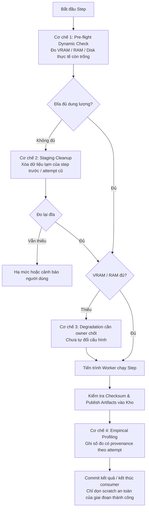

# Execution Plan: Hệ thống tự quản lý tài nguyên & Dọn dẹp dữ liệu tạm pipeline (Self-Adaptive Resource Management & Worker Staging Cleanup)

## Status
Active / IN_PROGRESS — user đã giao implementation và commit từng nhóm nhỏ ngày 02/10/2026; không push.
- **Tech Lead / người yêu cầu:** Quân (EX-REC)
- **Canonical ownership:** `EX-PRODUCT` (Cường) sở hữu orchestration; không chuyển ownership sang EX-REC.
- **Implementer:** Codex Agent
- **Audit:** Claude Code (sẽ audit lại sau khi Codex hoàn thành)
- **Branch:** `feat/pipeline-v2` — user yêu cầu làm trên branch hiện tại; không đổi branch.
- **Authorization hiện tại:** sửa kế hoạch, triển khai phần đủ authority trên branch hiện tại, commit từng file/nhóm nhỏ theo convention; **không push**.
- **Execution record:** dùng chính file này; không tạo task ID hoặc plan song song, không đổi Goal/I/O/DoD của task có sẵn.
- **Harness & Authority:** [AGENTS.md](../../../AGENTS.md), [WORKFLOW.md](../../WORKFLOW.md), [ARCHITECTURE.md](../../../ARCHITECTURE.md), [PRD](../../PRD.md) FR-03, [Contract](../../execution/TEAM_EXECUTION_CONTRACT.md) §3.3.2, [Integration](../../execution/INTEGRATION_PLAYBOOK.md) §5.3, [Track Guide](../../execution/TRACK_IMPLEMENTATION_GUIDE.md) PRODUCT-03/08/09, [EX-PRODUCT TRACK](../../execution/tracks/ex_product/TRACK.md), [PRODUCT-03](../../execution/tracks/ex_product/tasks/PRODUCT-03.md), [PRODUCT-08](../../execution/tracks/ex_product/tasks/PRODUCT-08.md).

## Context / Baseline đã inspect (VERIFIED, 02/10/2026)

- Repository root: `/home/lqaq/PROJECT/AI20K/P-087`; branch `feat/pipeline-v2`; trước lần edit chỉ file kế hoạch này đang untracked.
- `processing/capability.py`: `probe()` đo tổng VRAM/RAM và đĩa trống; `CAPABILITY_TTL` là 15 phút. `jobs/worker_cli.py`: heartbeat mỗi **300 giây**, không phải 15 phút.
- `jobs/runner.py`: preview/video tạo `<worker_root>/<job_id>/attempt-<uuid>`; finalize tạo `finalize-<uuid>`. Preview gọi REC với `<job_id>/resume` dùng chung giữa các attempt. Không có helper cleanup tại boundary này.
- `_execute_preview()` sync artifact lên kho, verify receipt rồi `record_preview()`. Preview thành công vẫn để job `RUNNING`, chờ xác nhận metric; không được dùng riêng `job.status == SUCCEEDED` làm điều kiện cleanup preview.
- Finalize nằm trong `run_finalize_job()`, **không có `_execute_finalize()`**. Nó verify REC result, thực hiện scene extraction rồi `record_finalize()`; chỉ dọn sau các consumer này.
- Log hiện có là `<tool>.stderr.log`, `<tool>.stdout.json`, `preview.progress.jsonl`, `finalize.progress.jsonl` cùng request JSON; chưa thấy `attempt.log` trong runner. Log và response có ích cho chẩn đoán, không chỉ binary mới cần phân loại.
- `src/models/contracts/manifests.py`: `JobManifest` và `StageArtifact` **không có `metadata`**. Không thêm field hoặc ghi metadata vào shared manifest chỉ từ yêu cầu trong bản kế hoạch cũ.
- `orchestration/benchmark.py` đã có typed `PipelineRuntimeBenchmark` được publish bất biến, ghi stage duration từ journal, cấu hình và machine capability; chưa có peak usage. Inspect/reuse convention này trước khi thiết kế telemetry mới; không sửa artifact benchmark đã publish.
- `processing/resources.py` hiện dùng heuristic từ `ResourceModel`. Thu thập telemetry không tự chứng minh estimator đã học hay được hiệu chỉnh.
- Dependency/check owners: `requirements.lock.txt` (Pydantic 2.13.5, pydantic-settings 2.15.0), `requirements-dev.lock.txt` (pytest 9.1.1, Ruff 0.16.8), `ruff.toml`, `Makefile`. `.venv/bin/pytest --version` trả `pytest 9.1.1`; chưa chạy suite. Không có root `pyproject.toml`. `make check` có format mutating.
- `test_processing_config.py` đã có capability persistence/TTL tests; **chưa có** `test_capability.py` và `test_worker_cleanup.py`. Tên test mới phía dưới là planned output.
- Các CLI/public consumer ports có trong source; chưa kiểm chứng GPU, real worker, remote storage hoặc browser runtime trong lần sửa kế hoạch này. Con số 2.8 GB là bối cảnh bàn giao, chưa đo lại.
- **Session log đã đọc:** session Claude Code `5a8f03e5-924a-4342-acd6-f06d052049ee`, user/assistant ngày 02/10/2026 04:22–04:28 UTC. Nội dung xác nhận giữ scratch tới hết giai đoạn là hướng bàn giao; degradation và evaluation split chưa có quyết định cuối. Chỉ dùng log để làm rõ intent, không dùng thay authority repository. Giữ nguyên transcript phụ lục.

## Scope / Task Capsule

- **Outcome triển khai dự kiến:** giảm scratch sau attempt thành công, giữ kết quả/log/retry an toàn; bổ sung phép đo và telemetry có provenance trước khi thay estimator hoặc chất lượng xử lý.
- **Inputs:** Settings, durable job revision, verified worker receipt/result, resolved artifact refs và phép đo trên đúng máy worker.
- **Outputs:** cleanup report/log và telemetry typed nội bộ theo job/attempt; job/artifact contracts và checksum giữ nguyên ở pha đầu. Telemetry nội bộ không phải shared execution lifecycle.
- **Owned paths dự kiến:** `src/config.py`, `src/services/orchestration/jobs/runner.py`, `src/services/orchestration/processing/`, `tests/test_orchestration/`; reuse benchmark khi phù hợp, chỉ sửa sau inspect consumer/schema của nó.
- **Do-not-modify:** shared contracts, REC/SCENE/SIM internals, frontend/API contracts, published artifacts, local artifact cache, thư mục resume dùng chung, dependency locks, task scope/status và authority documents. Mở boundary nào phải ghi quyết định/review trước.
- **Out of scope:** đổi frame sampling theo motion/FPS, đổi evaluation split (kể cả 1/8 ảnh), advanced scheduler/multi-tenant queue, cloud provisioning, tự sửa config đã bind checksum, dọn scene/trash hoặc published cache.
- **Dependencies:** PRODUCT lifecycle/CAS, resolver checksum, public REC receipts; phải re-read code/test/diff trước triển khai. Baseline source không thay thế runtime proof.
- **Proof required:** positive/negative cleanup, error/unknown probes, telemetry attribution và integration artifact vẫn đọc được sau cleanup; mức runtime/GPU/browser phải báo riêng.
- **Unknowns / gates:** degradation policy, telemetry shared schema, thu hồi scratch failed/cancelled và cleanup bên trong step/producer chưa có quyết định đủ rõ. Pha độc lập có thể triển khai khi user giao lệnh; không đánh dấu toàn bộ plan BLOCKED.
  User đang làm rõ admission UX: đo lại khi dispatch; nếu thiếu tài nguyên thì có thể hiện bảng config mới để user xác nhận. Đây là PROPOSAL chờ chốt, chưa thêm lifecycle/UI hoặc đổi config.

---

## 1. Outcome & Ranh giới bất biến (Guardrails & Data Boundaries)

### 1.1. Mục tiêu cốt lõi
1. **Chấm dứt việc hardcode hằng số**: Thay thế việc đo một lần rồi ghi cứng hệ số vào file cấu hình bằng một hệ thống **tự đo đạc, tự dọn dẹp và tự thích ứng** trong quá trình pipeline vận hành thực tế.
2. **Giảm lỗi do tràn tài nguyên**: Đo headroom, giảm staging tồn dư và ghi lỗi actionable khi thiếu VRAM/RAM/đĩa; không cam kết loại bỏ hoàn toàn OOM chỉ nhờ pre-flight hoặc sampling.
3. **Thích ứng đa phần cứng**: Tự co giãn theo năng lực máy thực tế (từ GPU máy local như Quadro T2000 4 GB tới GPU thuê trên cloud 24 GB+).

### 1.2. Ranh giới dữ liệu tuyệt đối (Data Contract Boundary)
Nhằm trả lời dứt khoát câu hỏi của Tech Lead: *"Xóa sớm có làm mất kết quả từng giai đoạn không?"*, toàn bộ dữ liệu trong pipeline được chia thành hai nhóm riêng biệt với quy tắc bảo toàn sau:

| Loại dữ liệu | Nơi lưu trữ | Nội dung | Chính sách vòng đời |
| :--- | :--- | :--- | :--- |
| **Published Artifacts** *(Bất biến)* | `settings.artifact_root`, qua `registry.runtime_resolver`; S3/R2 nếu được cấu hình | Các output có artifact URI/checksum đã publish của pipeline; dùng exact refs thực tế, không suy ra từ đuôi file. | **TUYỆT ĐỐI KHÔNG XÓA TRONG RESOURCE CLEANUP**, kể cả bản cache cục bộ. Lifecycle scene/trash do owner riêng quản lý. |
| **Worker Staging / Scratch** *(Dữ liệu tạm)* | `settings.product_worker_root` (`data/product_workers/<job_id>/attempt-.../`) | Frame video giải mã thô (trước khi lọc nét), database SQLite so khớp COLMAP (`database.db`), checkpoint trung gian của Brush (`chkpt_*.pt`), SAM2 workspace cache, mask nhị phân tạm thời. | **ĐƯỢC PHÉP DỌN DẸP**. Chỉ phục vụ nội bộ cho bước đó thực thi hoặc phục vụ retry nhanh khi có lỗi. Phải được dọn dẹp tự động để giải phóng đĩa. |

---

## 2. Thiết kế Kỹ thuật 4 Cơ chế Cốt lõi



### Cơ chế 1: Pre-flight Dynamic Check (Đo thực tế trước mỗi bước)
- **Vấn đề hiện tại:** `src/services/orchestration/processing/capability.py` đo tổng VRAM/RAM và đĩa trống; heartbeat mỗi 300 giây, TTL 15 phút. Chưa đo VRAM/RAM còn trống ngay trước dispatch.
- **Giải pháp:**
  - Bổ sung hàm đo tức thời `measure_live_headroom(worker_root: Path)`:
    - `vram_free_gb`: Lấy trực tiếp từ `nvidia-smi --query-gpu=memory.free --format=csv,noheader,nounits`.
    - `ram_available_gb`: Đọc trường `MemAvailable` từ `/proc/meminfo` (thay vì `MemFree` để tính cả buffer/cache có thể thu hồi).
    - `disk_free_gb`: `shutil.disk_usage(worker_root).free`.
  - Ngay trước khi kích hoạt subprocess chạy step nặng (COLMAP, Brush, SAM2), runner thực hiện kiểm tra ngưỡng khả dụng:
    - Đo trước mỗi subprocess do PRODUCT trực tiếp quản lý; các step nội bộ COLMAP/Brush/SAM2 cần producer hook riêng, không claim đã đo từng step chỉ nhờ runner.
    - Pha đầu chỉ ghi headroom; thiếu phép đo trả `None` kèm diagnostic, không coi là đủ tài nguyên.
    - Trigger low-disk 10 GiB là đề xuất cần đặt qua Settings trước pha 2. Không dùng số đo tức thời làm reservation GPU hoặc claim đã giải quyết concurrency.
    - Thiếu VRAM/RAM: policy dừng/chờ/hạ mức cần chốt trước khi enforce. Không tự đổi job config đã bind checksum.

### Cơ chế 2: Staging Cleanup (Dọn rác thư mục làm việc của Worker)
- **Vấn đề hiện tại:** Trong `src/services/orchestration/jobs/runner.py`, biến `workspace = settings.product_worker_root / job_id / attempt_id` được tạo ra nhưng không hề được dọn sau khi chạy xong. Từng để lại hơn 2.8 GB rác trong thư mục `workers/`.
- **Giải pháp & Chiến lược:**
  - **Chiến lược giữ - dọn (Retention Policy):**
    - *Bình thường:* Giữ scratch tới khi giai đoạn thành công, subprocess đã dừng/reap, artifact sync/verify và durable CAS commit xong. Preview dùng receipt thành công + verified preview, dù job còn `RUNNING`; finalize chờ scene consumer xong rồi commit job. Không dọn failed/cancelled/timeout/stale revision.
    - *Khẩn cấp:* Pha 2 chỉ thu hồi scratch đã có bằng chứng hoàn tất, không còn process/consumer đọc. Job terminal không tự chứng minh attempt cũ đã dừng. Dọn dữ liệu step đang chạy hoặc attempt failed/cancelled phải có owner/retry/lease rule trước.
  - **Bảo toàn log:** Giữ `*.log`, progress JSONL, request/response JSON và telemetry kể cả trong thư mục con. Không xóa nguyên workspace bằng `rmtree`; bỏ thư mục rỗng sau khi xóa scratch đã phân loại.
  - **Path safety:** Resolve root từ Settings; reject workspace là root/job root, symlink ancestor, nằm ngoài worker root hoặc overlap artifact root. Không follow symlink trong cây; không động tới sibling attempt hoặc `<job_id>/resume`. Cleanup idempotent; lỗi permission/I/O được log và không đổi success đã commit thành FAILED.
  - **Debug:** `PRODUCT_WORKER_KEEP_SCRATCH=True` bỏ qua cleanup; mặc định `False`. Không áp dụng lên artifact lifecycle.

### Cơ chế 3: Graceful Degradation (Tự hạ mức khi thiếu tài nguyên)
- **PROPOSAL / gate chưa chốt:** Khi đo thấy thiếu tài nguyên, hoặc khi tiến trình gặp lỗi OOM (CUDA Out Of Memory):
  - Worker tự động chuyển sang nấc cấu hình dự phòng thấp hơn:
    - *Brush 3DGS:* Giảm `brush.max_resolution` (ví dụ: 1920 $\rightarrow$ 1280), giảm `brush.max_splats` (ví dụ: 1.000.000 $\rightarrow$ 600.000).
    - *SAM2:* Giảm kích thước batch frame xử lý cùng lúc.
  - **Audit Trail:** Cần record bind cấu hình gốc/effective config checksum, step/attempt, reason và fallback. Manifests hiện không có `metadata`; producer + consumer phải review/version schema nếu thay shared contract. Chưa có quyết định này thì không implement tự hạ mức, không retry mọi nonzero exit như OOM.

### Cơ chế 4: Empirical Profiling (Tự học từ các lần chạy thực tế)
- **Mục tiêu dài hạn:** Hiệu chỉnh estimator bằng dữ liệu đo trên đúng worker/runtime. Không bỏ cold-start heuristic trước khi có dữ liệu và proof.
- **Giải pháp:**
  - Sau mỗi step hoàn thành, worker ghi nhận đỉnh sử dụng tài nguyên thực tế:
    - Peak VRAM đã cấp phát (qua CUDA memory query hoặc tracking subprocess).
    - Peak RAM và dung lượng đĩa tạm đã chiếm dụng.
    - Kèm theo thông số kích thước đầu vào: `num_frames`, `resolution`, `points3d_count`.
  - Pha đầu lưu typed JSONL tại workspace, giữ lại sau cleanup. Bind job/attempt/tool, config/runtime checksum, phương pháp đo, thời gian và số mẫu; phép đo không có trả `None`, không ghi số 0 giả.
  - Peak từ polling là **observed sampled peak**, không phải peak tuyệt đối. RAM phải theo process group; VRAM theo PID do NVIDIA báo, không lấy used VRAM toàn máy làm usage riêng của job. Disk là scratch occupancy, không phải peak disk toàn pipeline.
  - Runner quan sát CLI prepare/preview/finalize; chưa tách được peak từng step nội bộ và scene extraction chạy trong process runner. Ghi limitation này trong report.
  - Estimator học từ telemetry là pha 4 riêng, cần dữ liệu/runtime fingerprint, cơ chế lookup và holdout validation trước khi thay `resources.py`.

---

## 3. Kế hoạch triển khai cho Codex (Phased Implementation Roadmap)

### Pha 1: Cleanup an toàn và đo thực tế — ưu tiên số 1
*Mục tiêu:* Giải quyết ngay vấn đề đĩa bị phình to và trang bị công cụ đo lường thực tế.

1. **Nhiệm vụ 1.1: Tự động dọn dẹp thư mục tạm trong `runner.py`**
   - File: `src/services/orchestration/jobs/runner.py`
   - Bổ sung hàm helper `_cleanup_attempt_workspace(workspace: Path, keep_logs: bool = True)`.
   - Gọi sau verification + durable commit trong `_execute_preview` và `run_finalize_job`, sau khi consumer đã đọc xong. Bổ sung root guard, idempotency và bảo toàn log/resume; không cleanup trong `finally` vô điều kiện.
   - Thêm cờ môi trường `PRODUCT_WORKER_KEEP_SCRATCH` trong `src/config.py` (mặc định `False`; khi `True` sẽ giữ lại thư mục để debug).

2. **Nhiệm vụ 1.2: Bổ sung đo đạc tài nguyên thực tế tức thời**
   - File: `src/services/orchestration/processing/capability.py`
   - Viết hàm `measure_live_headroom(worker_root: Path) -> dict[str, float | None]`:
     - Đo `vram_free_gb`, `ram_available_gb`, `disk_free_gb`.
   - Timeout probe hữu hạn; xử lý command missing, timeout, malformed output, `/proc`/disk lỗi. Đơn vị GiB nhất quán. Đa GPU chưa xác định device chạy thật thì không claim headroom của đúng workload.

3. **Nhiệm vụ 1.3: Thu thập Telemetry đỉnh tài nguyên**
   - Collector typed nội bộ trong `processing/`, ghi sampled RAM/VRAM/scratch peak và duration theo CLI attempt; integrate `_run_tool` cả success/error/cancel/timeout. Telemetry failure không che worker failure và không đổi kết quả đã commit.
   - Không thêm `metadata` vào `StageArtifact`. Thử reuse benchmark convention nhưng không mở shared schema hoặc đổi benchmark protocol trong pha này.
   - Đo live trước mỗi CLI và lưu trong cùng record; chưa enforce resource policy.

### Pha 2: Tích hợp Pre-flight Check & Dọn dẹp khẩn cấp
**Gate:** có safe completion marker/lease và retention rule, threshold qua Settings; không scan-delete chỉ theo job terminal hoặc tuổi thư mục.
1. Đo trước từng heavy step qua producer/public hook đã review; runner-only measurement ghi rõ coverage CLI.
2. Cleanup khi dưới ngưỡng chỉ với attempt/step có proof đã kết thúc và không còn dependency; đo lại sau cleanup. Không đụng failed/cancelled/resume/cache nếu chưa có quyền thu hồi.
3. Nếu vẫn thiếu: structured error/dừng/chờ theo policy được chốt, bound timeout và cancellation. Không âm thầm launch rồi claim đã admission control.

### Pha 3: Cơ chế Tự hạ mức cấu hình (Degrade Policy)
**Gate:** user chốt cho phép tự hạ mức; owner review quality floor, retries và schema/version của effective config/audit record.
1. Định nghĩa bảng nấc fallback cho các thuật toán nặng trong `src/services/orchestration/processing/`.
2. Nhận diện OOM đúng lỗi/adapter, retry hữu hạn ở nấc đã duyệt; config mới không ghi đè provenance cũ. Unknown failure/timeout/cancel không được coi là OOM.

### Pha 4: Estimator học từ telemetry
**Gate:** đủ số đo có attribution và runtime fingerprint; owner chốt cold-start/fallback và validation protocol.
1. Persist telemetry cục bộ để lookup giữa job, không tạo competing job lifecycle; plan typed store/index và retention trước khi thêm DB migration.
2. Nhóm mẫu theo hardware/runtime/input/effective config; loại missing/failed/truncated mẫu khỏi training theo protocol.
3. Kiểm tra dự báo trên mẫu chưa dùng fit, báo uncertainty; máy/runtime mới giữ heuristic có nhãn, không bịa hệ số.
4. Chỉ nối vào `resources.py` sau proof compatibility của `evaluate()`/`maximum_for_machine()`; không claim bỏ toàn bộ hằng số từ pha 1.

---

## 4. Verification & Testing

Proof trước code:

- Cleanup positive: scratch mất sau preview/finalize thành công; artifacts vẫn resolve/checksum được, log/telemetry/resume còn. Negative: failed/cancelled/timeout/stale CAS/sync failure/consumer failure giữ scratch; keep flag và path/symlink/overlap guards; permission failure không đảo success.
- Probe: fake command/proc/disk để kiểm known/unknown/malformed/timeout, đa GPU; fixture proof không phải GPU acceptance.
- Telemetry: process-group attribution, sampled peak + duration, missing metric `None`, record cả failure/cancel/timeout và cleanup giữ record; collector lỗi không che lỗi job.
- Integration: dùng resolver/receipt + registry thật với tool fixture; verify published output sau cleanup. Real GPU/browser proof chỉ ghi nếu thật sự chạy.

Commands đã xác nhận hoặc planned sau khi thêm file test:

```bash
# 1. Chạy test suite của orchestration và processing config
.venv/bin/pytest tests/test_orchestration/test_processing_config.py tests/test_orchestration/test_capability.py tests/test_orchestration/test_job_lifecycle.py -q

# 2. Viết test mới kiểm chứng worker workspace được dọn dẹp sau attempt:
.venv/bin/pytest tests/test_orchestration/test_worker_cleanup.py -q

# 3. Kiểm tra toàn bộ tests không có regression
.venv/bin/pytest tests/test_orchestration/ -q

# 4. Planned test telemetry + integration regression hiện có
.venv/bin/pytest tests/test_orchestration/test_resource_telemetry.py tests/integration/test_upload_to_prepared_job.py tests/integration/test_studio_processing_job.py -q

# 5. Static checks có thật; không dùng make check vì nó format file
.venv/bin/ruff check src/ tests/
.venv/bin/ruff format --check src/ tests/
```

## Risks And Recovery

- Cleanup là thao tác xóa không hoàn tác được: chỉ xóa scratch attempt đã verified/commit, giữ source artifacts và resume. `KEEP_SCRATCH` giúp debug; không phục hồi scratch đã xóa.
- Sampling bỏ lỡ transient peak; subprocess chết nhanh có thể thiếu số đo. Không dùng số đo thiếu làm admission guarantee.
- Headroom không reserve tài nguyên; scope này không giải quyết nhiều worker tranh GPU.
- Telemetry có thể lỗi do hết đĩa: log cause đã redacted và giữ nguyên primary error/success. Không in private path/credential.
- Recovery: revert commit nhóm thay đổi tương ứng nếu cần; không reset history hoặc sửa published payload/checksum. Re-read plan/diff/status sau context switch.

## Progress

- [x] Đọc harness/workflow, inspect branch/source/test owners và session log liên quan.
- [x] Chỉnh branch, authority, data boundaries, roadmap và proof.
- [x] Pha 1.1 cleanup + focused proof (16 tests); commit code theo nhóm riêng.
- [ ] Pha 1.2 live headroom + focused proof + commit nhỏ.
- [ ] Pha 1.3 telemetry + runner integration + focused proof + commit nhỏ.
- [ ] Broader orchestration/integration/static checks; cập nhật kết quả và commit evidence.
- [ ] Pha 2–4: chỉ bắt đầu sau khi gate tương ứng đủ authority/dependency.

## Decisions

- 2026-10-02: user yêu cầu giữ branch `feat/pipeline-v2`, sửa kế hoạch rồi implement/commit theo nhóm nhỏ; không push.
- 2026-10-02: pha đầu giữ shared schema/config checksum, resume và artifact cache; telemetry nội bộ theo CLI attempt. Chưa duyệt degradation hoặc evaluation split; câu hỏi policy đã gửi trong session hiện tại, phần độc lập tiếp tục.
- 2026-10-02: phân biệt snapshot chọn preset trước upload với headroom lúc dispatch. User chưa đồng ý tự hạ cấu hình; đang cân nhắc bảng config xác nhận lại, không dùng elapsed time làm approval.

## Result / Recovery Checkpoint

- Current outcome: pha 1.1 code + fixture proof; pha 1.2/1.3 tiếp tục, UI/admission policy chờ quyết định.
- Changed: plan, `src/config.py`, `jobs/workspace.py`, `jobs/runner.py`, `tests/test_orchestration/test_worker_cleanup.py`.
- Validation: Ruff check focused exit 0; format chỉ intended files; `.venv/bin/pytest tests/test_orchestration/test_worker_cleanup.py -q` exit 0 — **16 passed**. Tests dùng fixture tool/consumer seam; resolver checksum kiểm thật trong temp filesystem. Broader suite/GPU/browser chưa chạy.
- Cleanup finalize: scene extraction failure (không có extra stage) giữ scratch dù REC job đã thành công, để còn diagnostics; không coi cleanup này là toàn bộ recovery/cache policy.
- Failed attempts: manual patch lần đầu không match context, không sửa file; đọc JSONL session gặp dòng không hợp lệ, retry parser bỏ qua malformed line. Không có runtime failure được suy thành success.
- Next executable step: commit plan + cleanup riêng; implement live probe/error tests rồi telemetry. Không push.

---

## Phụ lục: Bối cảnh thảo luận gốc (Handover Transcript)
*Trích xuất nguyên văn 11 lượt trao đổi then chốt giữa User (Tech Lead) và Claude Code trước khi session bị gián đoạn:*

#### Lượt 1: User (Quân / Tech Lead)
sao lại chỉ 3 ảnh 1 giây ít vậy, trong thực tế video người dùng input thường là video chất lượng cao quay bằng điện thoại, trải từ 25fps-60fps hoặc thậm chí 120fps thì sao ? phải lấy frame theo số fps thực tế và tính toán với cấu hình máy xử lý để ra được công thức cấu hình maximum chung để dảm bảo được chất lượng chứ ?

---

#### Lượt 2: Claude Code
Bạn đúng ở phần cốt lõi: con số "3 ảnh mỗi giây" đang là một giá trị cố định, không phụ thuộc video thật lẫn máy xử lý, và như vậy là chưa hợp lý. Nhưng tôi muốn làm rõ hai chỗ trước khi sửa, vì hướng "lấy frame theo fps thực tế" nếu hiểu là lấy càng nhiều càng tốt thì sẽ cho kết quả tệ hơn.

## Hiện tại hệ thống làm gì
- Số ảnh = thời lượng video × 3, tối đa 300 (preset "tối đa" là 6 và 1.200).
- Video được giải mã **toàn bộ** frame gốc, dù là 30 hay 120 fps. Sau đó chia thành các khoảng đều nhau và trong mỗi khoảng giữ lại **frame nét nhất**. Vậy video 60 fps không bị lãng phí: mỗi ảnh được chọn là ảnh nét nhất trong 20 frame, thay vì trong 3 frame như TorWIC 10 fps.
- Đã có sẵn phần kiểm với máy xử lý: hệ thống ước lượng VRAM, RAM và đĩa cần cho bộ thông số và chặn nếu vượt cấu hình worker. Nhưng nó chỉ chặn khi quá tải; nó không tự tính ra mức tối đa hợp lý.

## Vì sao không nên lấy theo fps của video
Thứ quyết định chất lượng dựng 3D không phải số ảnh mỗi giây, mà là **camera dịch được bao xa giữa hai ảnh liền nhau**:
- Hai ảnh quá gần nhau (60 fps, đi bộ chậm: cách nhau khoảng 2 cm) gần như trùng nhau. COLMAP không tính được độ sâu ổn định từ hai ảnh gần như trùng, lại tốn thêm thời gian so khớp. Với số bước train cố định, mỗi ảnh còn được học ít lần hơn.
- Hai ảnh quá xa nhau thì thiếu vùng chồng lấn, COLMAP không nối được.

Nên 120 fps không cho scene tốt hơn 30 fps nếu người quay đi cùng tốc độ; nó chỉ giúp chọn được frame nét hơn, và phần đó hệ thống đã tận dụng.

## Chỗ bạn đúng, và nên sửa thế nào
Mức lấy mẫu phải được **tính ra**, không phải đặt cứng. Tôi đề xuất một công thức hai vế, lấy vế nhỏ hơn:
1. **Theo chuyển động thật của video.** Bước kiểm video đã đo camera dịch bao nhiêu pixel giữa các frame. Từ đó tính khoảng cách frame sao cho hai ảnh liền nhau chồng lấn ở mức mục tiêu. Người đi nhanh thì tự lấy dày hơn, đi chậm thì thưa hơn, không phụ thuộc video là 25 hay 120 fps.
2. **Theo máy xử lý.** Dùng chính mô hình ước lượng VRAM/RAM/đĩa đang có, giải ngược ra số ảnh tối đa mà worker hiện tại chịu được, rồi lấy đó làm trần thay cho con số 300 cố định. Máy T2000 4 GB sẽ ra trần thấp, GPU thuê 24 GB ra trần cao.

Số bước train cũng nên tăng theo số ảnh, để mỗi ảnh vẫn được học đủ số lần.

---

#### Lượt 3: User (Quân / Tech Lead)
ok tôi đã hiểu các giải thích của bạn, vậy giờ hệ thống vẫn hợp lý hay cần điều chỉnh gì thêm không ? và hệ thống tính toán config cũng phải tính toán đến xử lý khi chạy toàn bộ pipeline luôn đó nhé , còn vấn đề nếu nhiều user cùng sử dụng web app vào thử nghiệm thì giải quyết sao nhỉ ?

---

#### Lượt 4: Claude Code
Hệ thống hiện tại chạy được nhưng có ba chỗ cần điều chỉnh, và đề xuất của tôi ở lượt trước chưa đủ: nó mới tính cho nửa đầu pipeline...

---

#### Lượt 5: User (Quân / Tech Lead)
"Đo trước, chốt công thức sau." nếu vậy là đang hardcode công thức theo cấu hình rồi mà nhỉ, ta phải code ra được một hệ thống tự quản lý tài nguyên thông minh, tự dọn rác dần để giải phóng tài nguyên cho bước kế ấy

---

#### Lượt 6: Claude Code
Bạn nói đúng, và tôi rút lại cách đặt vấn đề đó: đo một lần rồi chép hệ số vào file cấu hình vẫn là hardcode, chỉ là hardcode có căn cứ hơn. Đổi GPU, đổi phiên bản Brush hay SAM2 là hệ số sai ngay. Hướng đúng là để hệ thống tự đo và tự điều chỉnh trong lúc chạy.

Tôi vừa xem lại code để biết hiện có gì:
- Mỗi bước nặng chạy thành một tiến trình riêng, nên VRAM tự được trả lại khi bước đó kết thúc. Phần này đã ổn.
- Worker **không dọn thư mục làm việc** sau khi xong. Lần trước tôi phải xoá tay 2,8 GB trong `workers/`.
- Worker chỉ đo **tổng** VRAM/RAM/đĩa của máy, mỗi 5 phút, không đo phần **còn trống** tại thời điểm sắp chạy một bước.
- Không có xử lý khi hết bộ nhớ: bước nào hết VRAM thì job lỗi luôn, không tự hạ cấu hình để thử lại.

## Thiết kế tôi đề xuất: bốn cơ chế
**1. Đo trước mỗi bước, không phải một lần lúc tạo job.**
Ngay trước khi chạy một bước, worker đo VRAM, RAM và đĩa đang trống thật sự. Nếu không đủ cho bước đó thì dọn (cơ chế 2) rồi đo lại; vẫn không đủ thì hạ mức (cơ chế 3), thay vì chạy rồi sập giữa chừng.

**2. Dọn dần sau mỗi bước.**
Khi một bước đã publish xong artifact (đã kiểm checksum), worker xoá phần trung gian của bước đó: ảnh giải mã tạm, database COLMAP, checkpoint Brush cũ, workspace SAM2. Chỉ giữ thứ bước sau còn cần và thứ cần để chạy lại khi lỗi. Trên deployment có R2, bản cache cục bộ của artifact đã đẩy lên kho cũng xoá được khi đĩa sắp đầy.

**3. Tự hạ mức khi thiếu tài nguyên.**
Mỗi bước khai báo các "nấc" có thể hạ (ví dụ giảm độ phân giải train, giảm trần Gaussian, giảm số ảnh SAM2 xử lý cùng lúc). Khi đo thấy thiếu, hoặc khi bước lỗi vì hết bộ nhớ, worker chạy lại ở nấc thấp hơn. Mọi lần hạ mức được ghi vào bản ghi job, để scene không âm thầm kém chất lượng mà không ai biết.

**4. Tự học từ các lượt chạy.**
Sau mỗi bước, worker ghi mức dùng cao nhất của VRAM, RAM, đĩa cùng kích thước đầu vào (số ảnh, số Gaussian, độ phân giải). Bộ ước lượng lấy hệ số từ chính các bản ghi này trên chính máy đó, thay cho hằng số trong file. Máy mới chưa có dữ liệu thì dùng ước lượng dè dặt và dựa vào cơ chế 1 và 3 để không sập. Đây là phần thay cho "công thức": không có hệ số nào do người viết tay.

## Thứ tự làm
1. Cơ chế 4 (ghi mức dùng thật của từng bước) và cơ chế 2 (dọn sau mỗi bước): ít rủi ro, có ích ngay, và là nền cho hai cơ chế còn lại.
2. Cơ chế 1 (đo trước mỗi bước).
3. Cơ chế 3 (tự hạ mức), sau khi đã có số liệu để biết nấc nào đáng hạ.

---

#### Lượt 7: User (Quân / Tech Lead)
xóa sớm nghĩa là sau khi pieplien chạy xong sẽ không coi được kết quả từng giai đoạn à ?

---

#### Lượt 8: Claude Code
Không. Kết quả từng giai đoạn vẫn xem được đầy đủ sau khi pipeline chạy xong, dù dọn sớm hay dọn muộn.

Có hai loại dữ liệu khác nhau, và việc dọn chỉ đụng tới loại thứ hai:
- **Kết quả đã publish của mỗi bước:** ảnh frame đã chọn, vị trí camera, file 3DGS, mesh va chạm, scene vật thể. Đây là thứ màn xem từng bước và bảng đánh giá đọc. Chúng nằm trong kho artifact, bất biến, và không bao giờ bị dọn (chỉ mất khi bạn xoá hẳn scene trong Thùng rác).
- **Đồ làm việc tạm của worker:** database so khớp của COLMAP, checkpoint giữa chừng của Brush, ảnh giải mã tạm, mask SAM2 từng ảnh. Người dùng không xem những thứ này; chúng chỉ để bước đó chạy, và để chạy lại nhanh nếu lỗi giữa chừng.

"Xoá sớm" tôi nói là xoá loại thứ hai ngay khi bước đó xong, thay vì đợi cả giai đoạn xong. Cái giá duy nhất: nếu bước sau lỗi và phải chạy lại, bước trước có thể phải tính lại từ đầu vì đồ tạm của nó đã bị xoá.

---

#### Lượt 9: User (Quân / Tech Lead)
ok vậy giờ đã đủ thông tin kế hoạch chi tiết để cho bạn implement chưa ?

---

#### Lượt 10: Claude Code
Đủ để bắt đầu hai cơ chế đầu (ghi mức dùng thật của từng bước, và dọn đồ tạm), vì chúng không phụ thuộc quyết định nào còn treo. Hai việc còn lại vẫn cần bạn chốt trước khi tôi làm tới: có cho worker tự hạ mức khi thiếu tài nguyên không, và có để dành 1/8 ảnh để chấm PSNR/SSIM/LPIPS không. Với việc dọn, tôi theo phương án dè dặt: giữ đồ tạm tới khi cả giai đoạn xong, chỉ xoá sớm khi đĩa thiếu.

Tôi bắt đầu bằng việc đọc kỹ worker để biết chính xác từng bước chạy thế nào và để lại gì.

---

#### Lượt 11: User (Quân / Tech Lead)
kiểm tra xong thì ghi kế hoạch implement vào một file chi tiết rồi tôi nhờ agent khác làm sau đó bạn sẽ audit lại sau
