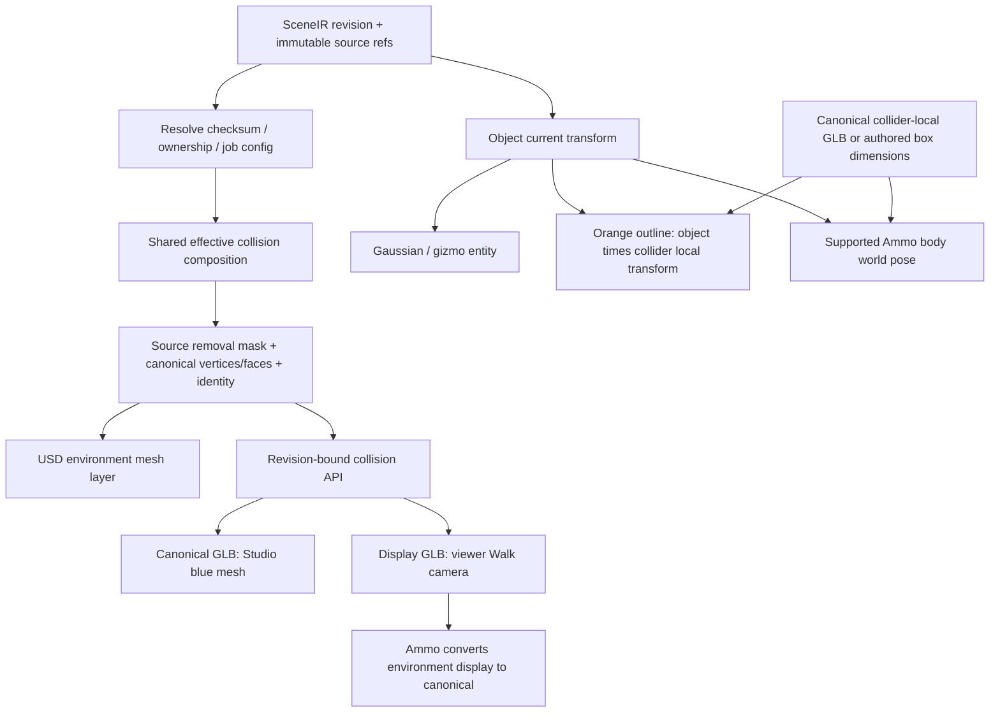

# PR-03 — Effective collision composition

Ngày: 2026-10-14. Branch: `codex/pr03-effective-collision`. Chỉ commit local; không push hoặc tạo GitHub PR.

## Kết quả và baseline

Triển khai shared composition cho Studio, Walk và USD. Preview môi trường dùng geometry đã carve theo source ownership; request gắn với SceneIR revision. Gaussian, gizmo và collider outline giữ object transform cùng child collider transform. Những collider browser chưa hỗ trợ được chặn rõ thay vì thay bằng một hình khác.

Baseline `b7ddadf9962afac0dba23be29776026e47af52e5` sạch, ở checkout gốc. PR-01 và PR-02 đã tích hợp; đã kiểm tra `fd79915f2be23fcf737ddbf46852b535b07d21ff` là ancestor của baseline. Không tạo worktree mới, không merge master, không sửa segmentation/CoACD producer/lifecycle. Không sửa dữ liệu job hoặc immutable artifacts; không khởi động server.

## Root causes xác minh tại baseline

1. USD `_carved_environment()` đã dùng ownership bất biến, nhưng Walk `dynamic_carve_boxes()` chỉ xét `physics.dynamic` và dùng hộp lấy từ lịch sử với margin khác. Đây là hai chính sách carve đang hoạt động khác nhau.
2. Studio `MetricSceneView` tải trực tiếp `environment.geometry_ref` cho mesh xanh; không dùng effective environment của USD.
3. `initialCollision` và `initialDynamic` giữ URL Walk cũ suốt phiên; Confirm/Delete/Restore không cập nhật collision. `PlayCanvasScene` đưa collision URL vào effect tạo viewer nên thay URL sẽ tải lại 3DGS.
4. `ObjectReviewView` bỏ qua Confirmed static trong danh sách physics. Loader gộp mọi part GLB thành một hull và thay collider bằng box khi HTTP lỗi. Các hình này không tương đương collider authored.
5. `SceneOverlay.setObjectPose()` và gizmo move gán object pose trực tiếp vào outline, làm mất child collider offset/rotation trong lúc thao tác hoặc chạy physics.
6. `SceneOverlay.loadCollision()` chưa giải phóng mesh cũ hay chặn load callback cũ đến trễ khi đổi URL.

Đường file physics thực tế tại HEAD là `src/services/orchestration/scene/physics.py`; đường `src/services/scene/physics.py` trong đề bài không tồn tại. Helper cũ còn cho compatibility/test, nhưng không còn production caller trong endpoint Walk.

## Composition cuối cùng

`src/services/scene/effective_collision.py::compose_effective_collision()` là nơi duy nhất quyết định source removal mask.

- Revalidate checksum source bytes, identity của từng owner và checksum/membership của sidecar.
- Exact ownership dùng source triangle indices. Legacy `source_obb` chỉ dùng immutable extraction transform; không dùng current object pose để carve.
- Pending/Ignored giữ source. Confirmed, kể cả inactive, và Deleted loại source region. Restore quay lại đúng disposition của trạng thái phục hồi.
- Duplicate không sở hữu source region. Merged secondary đi theo disposition của target, không carve theo current bounds của target.
- Exact claims ưu tiên so với OBB gần đúng. `remove_mask = carve_claim & ~keep_claim`. Tam giác vừa được giữ vừa được loại vẫn giữ; trả ambiguity count/object IDs.
- Reader membership vẫn reject overlap mặc định cho producer/remapping; composition riêng opts into shared claims để giữ và báo ambiguity. Checksum/bounds checks không bị bỏ qua.
- Missing/stale ownership, merge target không tồn tại hoặc merge cycle là blocker. Khi có region cần loại, owner bị thiếu ở region giữ cũng block để không xóa nhầm shared geometry.
- Identity gồm source checksum, triangle count, margin/algorithm và packed removal mask. Move/Rotate không đổi mask hoặc identity. Mesh bytes cache LRU 8 entries theo identity, output arrays và frame. Checksum và ownership vẫn được kiểm tra mỗi request.

Resolver/orchestration adapter ở `src/services/orchestration/scene/effective_collision.py` giữ nguyên kiểm tra selected LiDAR source và recovery từ checksum-bound extraction history của exporter cũ. Recovery không ghi SceneIR và không dùng edited pose để suy vùng nguồn. Margin được đọc từ cùng job simulation config cho cả USD và API.

## Data flow và frames



- Canonical: mét, Z-up, quaternion xyzw, rigid `parent_from_local`; không scale thêm.
- Source GLB được đọc theo trimesh thành canonical mesh, gồm scene node transforms; output effective GLB được bake thành identity-node geometry. USD và API dùng cùng arrays và triangle order/remapping.
- API `frame=canonical` dành cho overlay root đã xoay canonical→display. `frame=display` bake `(x,y,z) → (x,z,-y)` cho camera Walk. Ammo inverse display chỉ với environment mesh này.
- Object GLB ở canonical collider-local; apply `collider.local_transform` vào vertices đúng một lần; Ammo body dùng current object world pose. Outline compose cùng child transform cho cả gizmo drag và pose physics. Gaussian chỉ dùng object pose.
- Preview và physics lấy cùng collider URL/checksum qua `colliderShapeUrl()` và cùng draft nếu có. AABB/OBB có dimensions là authored box; không lấy mesh khác hoặc fallback HTTP để thay hình.

## Revision/API/viewer

Endpoint hiện hữu `/jobs/{job_id}/walk-collision/{filename}` nhận `scene_revision` và `frame`. Kiểm tra allow-list trước khi sử dụng source; URI/checksum phải trùng selected source của SceneIR. Revision cũ trả 409. Response có `X-Scene-Revision`, `X-Collision-Composition`, `X-Retained-Shared-Triangles`, ETag phân biệt frame và `Cache-Control: private, no-cache`.

Không có revision thì chỉ là reconstruction source preview, được đánh dấu `X-Scene-Revision: source-preview`. Legacy `dynamic` không được dùng để carve; nếu chỉ gửi dynamic mà thiếu revision, trả blocker. Object Review luôn gửi revision và selected collision source.

`MetricSceneView` bỏ initial collision/dynamic snapshots; preview và Walk URLs lấy revision hiện tại. Reconstruction content URL không đổi khi collision đổi. Camera collision load riêng với abort/stale-result protection. Overlay giải phóng environment entity/material/asset cũ và bỏ callback của generation cũ.

Upstream supersplat-viewer 1.35.2 chưa có public collision setter. `frontend/scripts/patch-viewer-collision.mjs`, chạy qua npm postinstall, bổ sung `ViewerHandle.setCollisionMesh()` và typings. Patch kiểm tra version và exact anchors, idempotent; thay camera/input/navigation collision và giải phóng debug overlay/listener cũ. Có MIT notice/license của upstream. Nâng version viewer phải revalidate patch. Dùng `npm ci` với install scripts; nếu cài với `--ignore-scripts`, phải chạy patch script trước typecheck/runtime.

Trong lúc thay collision hoặc gặp blocker, camera Walk bị khóa và nếu đang Walk thì chuyển sang Fly. Người dùng có thể bật lại Walk sau khi collision mới sẵn sàng. Physics bodies dựng khi vào Walk; Studio editor không chạy một thế giới rigid-body riêng. Object pose changes cập nhật specs và rebuild supported runtime theo pose mới; không chạy CoACD hoặc producer mesh.

## Verification thực tế

Từ repository root:

```bash
.venv/bin/pytest tests/test_scene tests/test_simulation \
  tests/test_orchestration/test_simulation_package.py \
  tests/test_orchestration/test_collision_source_invalidation.py \
  tests/test_api/test_scene_routes.py tests/test_api/test_scene_v2_routes.py -q
.venv/bin/ruff check src/ tests/
.venv/bin/ruff format --check src/ tests/
git diff --check
graphify update .
```

Backend: **391 passed**, không skip, 43.63s. Ruff check PASS; format check PASS **619 files**. Diff whitespace check PASS. Graphify AST update PASS; cảnh báo một số files không có symbols và community labels cũ; không chạy semantic/LLM labeling.

Từ `frontend/`:

```bash
npm test
npx tsc --noEmit
npx eslint src/features/viewer/PlayCanvasScene.tsx src/features/viewer/scene-overlay.ts \
  src/features/viewer/usePhysicsPlay.ts src/features/viewer/glb-mesh.ts \
  src/features/studio/MetricSceneView.tsx src/features/studio/ObjectReviewView.tsx \
  src/lib/api/endpoints.ts tests/collider-loading.test.ts tests/playcanvas-camera.test.tsx \
  tests/scene-physics.test.ts tests/scene-overlay-gizmo.test.ts \
  tests/metric-effective-collision.test.tsx tests/viewer-collision-patch.test.ts \
  scripts/patch-viewer-collision.mjs
```

Frontend full suite: **600 passed / 69 files**, 27.86s, exit 0. TypeScript PASS, scoped ESLint PASS. Có fixture 1×2×3, rotated/off-center child; ray probes dùng bản Ammo WASM thật trong `public/vendor/ammo`, không phải mock physics. Probe hit current collider center/bounds, không hit extraction pose. Gaussian/outline hierarchy, loader revision refresh và viewer lifecycle dùng graphics mocks; không phải browser nghiệm thu.

Fixture floor/wall/A/B exact ownership kiểm tra source mask, geometry của canonical Studio API / display Walk API / USD cùng identity; Pending/Ignore, Confirm, Move/Rotate, Delete/Restore, inactive, Duplicate/Merge, overlap, missing/stale/corrupt ownership và broken merge. Existing PR-02 correction/restore/conservation suites nằm trong run trên.

Patch được thử trên tarball pristine `@playcanvas/supersplat-viewer@1.35.2` từ npm: apply lần đầu PASS, lần hai idempotent PASS, `node --check` PASS. Test callback bridge đọc code installed đã patch, chạy camera/input/navigation updates và cleanup với graphics stubs; không mock lại callback implementation. Offline pack ban đầu FAIL ENOTCACHED; regular pack sau đó PASS. Không thay dependency versions.

Các run trung gian có FAIL đã sửa: fixture/import `io`, exporter private-helper compatibility import; assertion cũ giữ malformed merged ownership đã cập nhật theo blocker requirement; TS undefined helpers, React effect lint, loader error object ID, CJS resolution trong test ESM-only package. Lần chạy cuối là nguồn trạng thái PASS.

DevTools list_pages chỉ có `about:blank`, không có logged-in Studio session. **Browser thực UNVERIFIED. Isaac Sim UNVERIFIED.** Không dùng Node/Ammo hoặc local USD fixture làm bằng chứng nghiệm thu hai môi trường này.

## AC matrix

| AC | Trạng thái | Evidence / giới hạn |
|---|---|---|
| AC-01 | PASS | Fixture Confirm A chỉ loại source triangles A; endpoint và USD cùng mask. |
| AC-02 | UNVERIFIED | Automated Gaussian/outline child transforms và real Ammo world probe PASS; chưa thao tác scene thật trong browser. |
| AC-03 | UNVERIFIED | Supported real Ammo probe không hit object ở extraction pose; shared environment fixture PASS. Chưa nghiệm thu browser contact; static/multipart blocked. |
| AC-04 | PASS | Exact-ownership fixture giữ toàn bộ floor/wall/B geometry. Legacy OBB là xấp xỉ, không chứng minh ownership hoàn hảo trên mọi scene thật. |
| AC-05 | PASS | Một composition function, USD wrapper và revision API cùng output geometry; legacy dynamic helper không còn production caller. |
| AC-06 | PASS | Lifecycle tests + revision URL tests + stale request 409 + abort/generation tests; Move cache identity không đổi. |
| AC-07 | PASS | Canonical/frame/child tests và Ammo ray probes; multipart/node transforms unsupported bị reject. Browser GPU/runtime vẫn UNVERIFIED. |
| AC-08 | PASS | Backend, frontend, typecheck, scoped lint và Ruff checks; xem counts cuối. |
| AC-09 | PASS | Existing PR-02 representation/correction/restore/conservation regressions PASS; lifecycle semantics/producer không sửa. |

PASS ở đây bị giới hạn trong evidence đã chạy; không tuyên bố toàn bộ Definition of Done đã nghiệm thu browser hoặc Isaac.

## Giới hạn PR-04 và còn chưa kiểm chứng

- Confirmed active static object hiện có mặt trong input list nhưng toàn bộ Walk bị chặn rõ `BLOCKED BY PR-04`; không bỏ source collider rồi âm thầm bỏ qua collider riêng.
- CONVEX_DECOMPOSITION, SIMPLIFIED_MESH và GLB multipart không được nối thành một convex hull. Browser báo `BLOCKED BY PR-04`.
- Hull vượt 256 points bị chặn thay vì chạy subsampling rồi báo tương đương geometry. Static/multipart/large hull engine support không được viết trong PR-03.
- Missing/failing mesh artifact và unsupported GLB nodes/layout không chuyển thành box. Box preview khi shape đang tải/lỗi vẫn là bounds preview, không phải bằng chứng collider physics.
- Source OBB legacy còn là approximate ownership. Shared retained triangles có thể còn collision sliver; ambiguity được báo, không xóa nhầm để đạt no-ghost giả.
- Ammo giữ tối ưu environment neighborhood/ground plane sẵn có; world ray fixture không chứng minh contacts toàn scene hoặc mọi scene thực.
- Chưa benchmark collision composition trên source mesh lớn, GPU lifetime ở browser thật, authenticated Confirm→Move→Walk E2E hoặc Isaac contact. Cần review public API patch trước nâng dependency.

## File changes và local commits

Core: `src/services/scene/effective_collision.py`, `collision_ownership.py`; resolver/config adapter: `src/services/orchestration/scene/effective_collision.py`, `physics_collision.py`; consumers: `src/api/product/artifacts.py`, `src/services/orchestration/review/simulation_package.py`.

Frontend: `ObjectReviewView.tsx`, `MetricSceneView.tsx`, `PlayCanvasScene.tsx`, `scene-overlay.ts`, `usePhysicsPlay.ts`, `glb-mesh.ts`, `endpoints.ts`; install patch/package metadata/license; focused regression tests. `tests/test_scene/test_object_correction.py` cập nhật malformed-merge assertion, không sửa correction algorithm.

1. `dec253a8` — Shared composition + USD wrapper + lifecycle/ownership fixtures.
2. `0a4624c1` — Shared resolution + revision-bound Studio/Walk bytes + integration fixture.
3. `44abda80` — Browser refresh, child transforms, explicit unsupported handling + tests.
4. `124c3a75` — Missing/broken ownership blockers + legacy import compatibility.
5. `ad7d6961` — Installed callback bridge regression + upstream license notice.

Implementation HEAD `ad7d6961`; handoff được commit local tiếp theo. Final HEAD và working tree receipt nằm trong câu trả lời bàn giao. Origin PR-03 remote branch phải không tồn tại; remotes của baseline không được thay đổi. Không push hoặc tạo PR.

## Pre-flight (GUIDE.md Rule 13)

- codegraph: đọc `_carved_environment`, ownership reader/binder, source resolver/recovery, artifact route, physics helper, MetricSceneView, ObjectReviewView, PlayCanvasScene, SceneOverlay, collider transform utilities và ScenePhysics; graphify query trước sửa.
- impact: shared membership reader còn producer/remapping callers với strict overlap mặc định; USD builders/tests, artifact endpoint, ObjectReviewView/StageViewer→MetricSceneView→viewer/overlay/physics. Các PlayCanvasScene consumers không còn reload GS khi collision URL đổi.
- understand: UNVERIFIED tool gate — không có understand-anything explain/domain tool trong session; đã truy vết source trực tiếp SceneIR→Studio/Walk/USD và đọc GUIDE.md.
- minimal-code: rung 2 — tái sử dụng carve algorithm, source validation/history recovery và collider transform utilities. Không thêm producer/engine/lifecycle mới.
- checks: pytest 391 passed; full frontend 600 passed / 69 files; tsc clean; scoped ESLint clean; Ruff/format/diff clean; graphify AST update PASS.
- DevTools: UNVERIFIED — không có logged-in session; chỉ about:blank. Isaac runtime UNVERIFIED.
