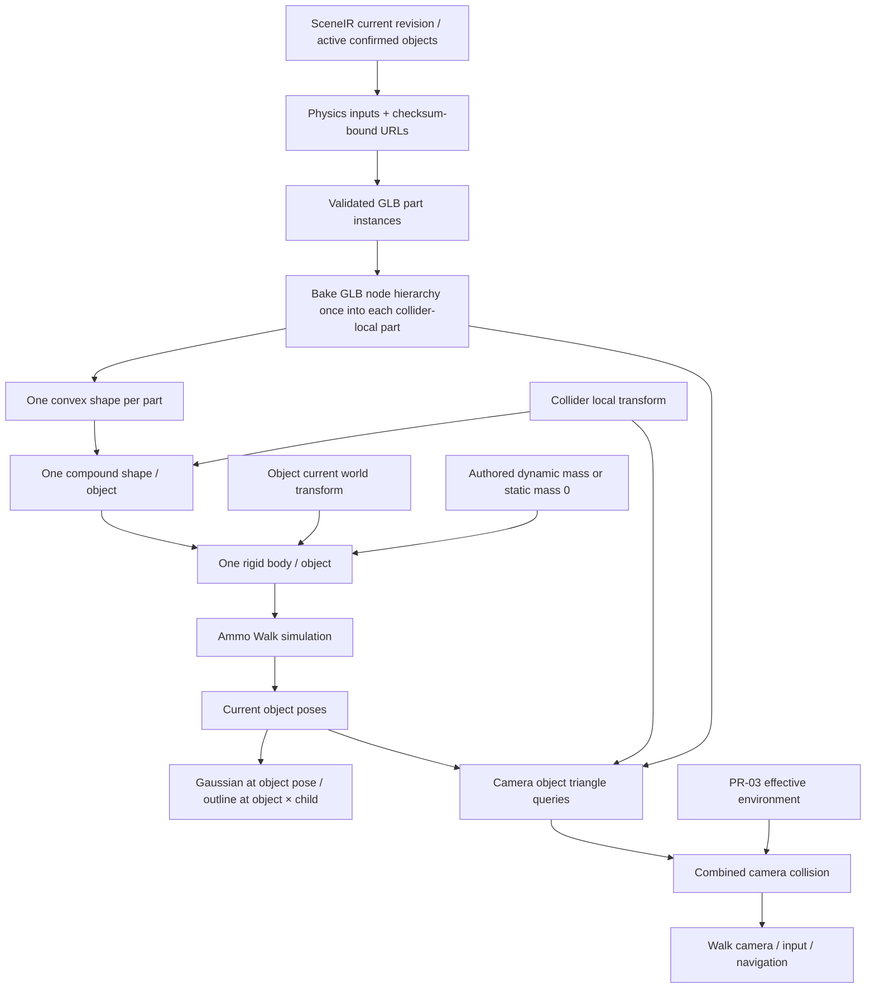

# PR-04 — Browser multipart/static physics

Ngày 2026-10-14. Branch `codex/pr04-browser-physics`. Chỉ commit local; không push hoặc tạo GitHub PR.

## Outcome và audit task

Task phù hợp với source tại baseline sạch `2609af7e14bb1d61488e8872525ba11ac874b6da`. Đã kiểm tra PR-01 `29f8791e` và PR-02 `fd79915f` là ancestors của PR-03; không tạo worktree, merge, rewrite hoặc sửa branch trước. Thực hiện tại checkout gốc.

Các điều chỉnh so với suggested implementation:

1. Chỉ tạo compound/static bodies không đủ để chặn Walk camera: camera dùng collision query của supersplat-viewer, còn Ammo character là proxy bám theo camera. PR này nối geometry object tại current pose vào camera queries, kết hợp với effective environment PR-03.
2. Ammo WASM hiện tại expose `btCompoundShape.addChildShape`, `getNumChildShapes` và `calculateLocalInertia`; không expose `compound.recalculateLocalAabb()`. Không gọi pseudocode API không tồn tại. Native bounds/raycast được kiểm tra sau addChildShape.
3. Node matrices/TRS được validate và bake một lần vào từng primitive instance trong canonical collider-local frame. Không áp node transform thêm lần nữa vào compound children. Đây cũng là hướng USD mesh loader hiện có: bake node graph rồi giữ từng part.
4. Loại vertices trùng đúng float32 với tolerance **0 m**. Không subsample hoặc bỏ vertex invalid. Invalid/degenerate/non-convex/open convex surfaces là blocker, để camera triangle surface và Ammo hull không âm thầm khác nhau.
5. Bỏ mass fallback 10 kg. `ObjectPhysics.dynamic=true` cần mass hữu hạn, dương. Thiếu physics giữ đường static như consumer/export hiện có; không đổi lifecycle hoặc tự suy mass/density.

## Root causes đã xác minh

- `ScenePhysics.addDynamic()` trước đây chỉ dựng một hull từ toàn bộ vertices và ép mass `max(mass,0.1)`; không có static object body hoặc multipart composition.
- Loader gộp GLB geometry và PR-03 chỉ đếm parts để block; node transforms chỉ được parser môi trường identity-only chấp nhận.
- 256 points là giới hạn sampling của ứng dụng; Ammo không có giới hạn 256 trong API được sử dụng. Native test đã dựng hull 1.024 unique points mà không giảm điểm.
- Walk camera chỉ dùng effective environment, nên static native body đơn thuần chưa chặn được camera.
- Teardown cũ destroy native objects trước khi remove bodies khỏi world.
- Preparation đã clear sau Delete có thể bị dùng lại khi Restore cùng identity; regression mới bắt được một native/mock world thừa trước khi sửa.
- Gizmo trong Walk có thể bị pose simulation ghi đè. Bắt đầu chỉnh gizmo chuyển về Fly và dừng native Walk world trước khi chỉnh pose.
- Compound/default hull margins từng làm AABB rộng thêm do cache được tính trước khi đặt margin. Hull margin được đặt trước addPoint; compound margin bằng 0 để không cộng thêm lần nữa.

Không xác minh hoặc sửa một lỗi source ownership riêng trên Room. Nếu mesh xanh còn triangle thuộc source sau Confirm, cần kiểm tra ownership/ambiguity của PR-03; PR-04 không mở rộng bounding-box carve.

## File/hàm và data flow

- `glb-mesh.ts`: `parseGlbCollider`, `colliderInstances`, `joinMeshParts` giữ từng primitive/node instance, bake nested affine node transforms, xử lý mirrored winding. Skin, animation, morph/compression/extensions, sparse/external buffers, cycle/multiple parents, singular/perspective/mixed matrix+TRS và unreachable nodes/meshes báo lỗi. `parseGlbMesh` cho environment vẫn strict identity-node như PR-01/03.
- `scene-physics.ts`: compound child builder, exact convex vertices, triangle/closed-convex validation, static/dynamic body admission, transform validation, allocation statistics, remove-before-destroy và constructor-failure cleanup. Không còn sampling helper/256 cap.
- `usePhysicsPlay.ts`: prepare checksum-bound collider URLs/geometry trước Walk; cache theo URL (gồm artifact checksum) và collider type, prune khi input đổi, clear khi không có object. Prepare không tạo native world. Enter Walk tạo world; Exit Walk remove/destroy toàn bộ native resources. Input activation/revision changes invalidate preparation trước khi Restore có thể dùng data cũ. Abort/stale response không tạo lại vật bị Delete.
- `camera-collision.ts`: `ObjectCameraCollision` dùng cùng parts/box dimensions và child/object transforms cho camera; `CombinedCollision` hợp environment và object ray/sphere/capsule queries. Giữ khoảng trống giữa parts. Static pose không đổi thì query mesh không rebuild; dynamic pose chỉ rebuild object BVH đã đổi, giữ environment BVH.
- `patch-viewer-collision.mjs` / `PlayCanvasScene.tsx`: mở rộng patch pinned 1.35.2 với `createMeshCollision`, typed `CollisionQuery`, `setCollisionProvider`; nối camera/input/navigation đến combined queries. Debug environment overlay vẫn là source effective environment. Có version/anchor guards, hỗ trợ nâng từ patch PR-03, idempotent và giữ MIT notice.
- `ObjectReviewView.tsx`: giữ filter Confirmed/active như PR-03, lấy authored mass hoặc null; static friction cho static, dynamic friction cho dynamic. Không đổi Hide/lifecycle.
- `MetricSceneView.tsx`: Walk chỉ bật khi collider preparation ready; truyền provider đến viewer, giữ cảnh báo cho input unsupported; dừng Walk khi bắt đầu gizmo edit. Không reload reconstruction scene khi collision/pose đổi.



Final part world geometry:

```text
T_world_from_object × T_object_from_collider × M_collider_from_GLTF_part × vertex
```

GLTF affine matrix is already baked into each part's vertices. Ammo compound child uses collider local translation/quaternion; body uses object world pose. Camera bakes collider/object transforms into the same triangles, then converts canonical `(x,y,z)` to display `(x,z,-y)`. Gaussian uses only object pose; outline already composes child transform via PR-03. No object GLB goes through inverse display conversion. No object scale or node transform is applied twice. Native environment neighborhood selection now uses actual collider vertices/bounds including child/node transforms, rather than only object origin.

## Collider support / unsupported combinations

| Type | Static | Dynamic |
|---|---|---|
| AABB/OBB | Authored btBoxShape child, mass 0 | Same shape, positive authored mass |
| CONVEX_HULL | Exactly one valid convex part | Exactly one valid convex part |
| CONVEX_DECOMPOSITION | Compound of every convex part | Same compound, one body, calculated local inertia |
| SIMPLIFIED_MESH | Valid triangle parts in btBvhTriangleMeshShape | Explicit unsupported blocker; no dynamic concave fallback |

CONVEX_HULL with multiple parts is a contract/layout blocker, not auto-promoted. Missing artifact, HTTP failure, invalid geometry/transform and unknown types block with object ID. No box fallback, hull merge or sampling. Contact margin is 0.01 m for box/convex/static triangle children; compound adds no extra margin. Broadphase bounds are conservative; ray/surface tests distinguish these from authored geometry dimensions.

Convex validation checks closed/manifold triangles and supporting face planes, with plane classification tolerance `span × 1e-5`. This does not reduce vertices. Multipart GLB with reused mesh nodes emits separate transformed instances. Arbitrary animation/skin or exotic layout is unsupported explicitly.

## Lifecycle / resource ownership

Pending/Ignore source stays under PR-03 policy; only active Confirmed objects enter this browser path. Viewport Hide changes visual entities only; input key/world/body unchanged. Simulation disable/Delete remove physics inputs and bodies; Restore rebuilds from current SceneIR pose, not extraction pose. Move/Rotate reuses parsed collider geometry, updates camera/current physics inputs, and does not invoke CoACD.

Prepared camera geometry exists outside Walk so static bodies can block the camera before entering. Native Ammo world exists only during Walk. Exit/reset restores visual and camera object poses to SceneIR. Scene/revision changes abort old loads and release old world. Cleanup removes every registered object/ground/environment/character body from world before reverse destruction of body, motion state, construction info, transforms, compound and child shapes. Constructor errors follow the same release path. Native world destruction is idempotent.

## Tests và executable evidence

Từ `frontend/`:

```bash
npm test -- --maxWorkers=2
npx tsc --noEmit
npx eslint src/features/viewer/glb-mesh.ts src/features/viewer/scene-physics.ts \
  src/features/viewer/usePhysicsPlay.ts src/features/viewer/camera-collision.ts \
  src/features/viewer/PlayCanvasScene.tsx src/features/studio/MetricSceneView.tsx \
  src/features/studio/ObjectReviewView.tsx scripts/patch-viewer-collision.mjs \
  tests/glb-collider-parts.test.ts tests/compound-physics.test.ts \
  tests/collider-loading.test.ts tests/object-camera-collision.test.ts \
  tests/viewer-collision-patch.test.ts tests/playcanvas-camera.test.tsx \
  tests/metric-effective-collision.test.tsx tests/scene-physics.test.ts \
  tests/camera-toolbar.test.tsx
```

Final frontend: **623 passed / 72 files**, `npm test -- --maxWorkers=2`, **78.80 s**, exit 0. TypeScript and scoped ESLint PASS, exit 0. Focused native tests use the exact `public/vendor/ammo/ammo.wasm.js/.wasm` served to browser. Camera ray/capsule tests use real MeshCollision from pinned viewer, not a mock triangle engine. Render/GPU/UI lifecycle tests still use mocks and are not browser acceptance.

Evidence includes:

- Two separated boxes: Ammo rays hit both and miss the gap; camera rays/capsules do the same.
- Static object does not fall/move under gravity or impulse; one body and two child shapes. Dynamic uses authored 12 kg, positive finite compound inertia, gravity, friction and restitution.
- Nonzero object rotation/translation, collider child rotation/translation and GLB nested node transform produce the same expected world hit/bounds in Ammo and display camera queries.
- 1×2×3 regression, frame inverse restricted to environment, invalid node/layout checks.
- More than 256 unique points retained; exact duplicate removal, degenerate/invalid convex checks.
- Prepare before Walk; Hide preserves body; Move rebuilds current pose with one collider artifact fetch; Exit/Delete/Restore release/recreate the expected worlds/listeners; stale async response cannot resurrect deleted object.
- Full existing ObjectReview/PR-02/PR-03 frontend suites, USD/ownership/backend regressions.

Từ repository root:

```bash
.venv/bin/pytest tests/test_scene tests/test_simulation \
  tests/test_orchestration/test_simulation_package.py \
  tests/test_orchestration/test_collision_source_invalidation.py \
  tests/test_api/test_scene_routes.py tests/test_api/test_scene_v2_routes.py -q
.venv/bin/ruff check src/ tests/
.venv/bin/ruff format --check src/ tests/
git diff --check
graphify update .
```

Backend **391 passed**, no skip, 53.03 s. No backend/producer/composition source was changed. Ruff check PASS; format check PASS **619 files**; diff check PASS. Graphify AST update PASS; some symbol/community-label warnings are expected; no semantic/LLM relabeling.

Patch installation was tested on pristine npm tarball 1.35.2: first apply PASS, second apply idempotent PASS, `node --check` PASS. Installed PR-03→PR-04 upgrade also PASS. Use normal npm install scripts or explicitly `npm run postinstall`; restart frontend after patching dependency code.

One default-parallel full run had 1 FAIL in unchanged `registration-panel.test.tsx` cancellation acknowledgement. Its isolated run passed 10/10; final full run with 2 workers passed all 623. No registration/LiDAR source was modified.

Intermediate PR-04 FAILs were fixed: native base-shape wrapper needed cast to btCompoundShape in tests, stale PR-03 blocker/hull assertions, new public controls fixture/types, hull AABB margin ordering, and an extra world created on Restore from stale prepared state. Final test results are the acceptance evidence.

## Memory/performance measurements

Latest focused native stress fixture: **55 cycles** (5 warmup + 50 measured), effective floor triangle mesh + one static multipart and one dynamic multipart, 30 steps/reset per cycle:

- **3,740 tracked native allocations / 3,740 releases / 0 live tracked objects** after cleanup.
- WASM heap capacity **16,777,216 → 16,777,216 bytes** after warmup/measured batch.
- 50 measured cycles: **131.15 ms** in the final full-suite run; timing varies with parallel test load.
- Failure teardown for invalid mass, coplanar geometry or NaN transform also leaves 0 tracked native allocations.

Camera fixture: 24 triangles/object, 299 changed poses plus initial query build; **300 object query builds**, **0 environment BVH rebuilds**, **13.03 ms** in the final full-suite run. Repeating identical pose creates no query build. Clearing removes object queries; retained environment still answers floor rays.

These are bounded Node fixture measurements. Tracker covers owned Ammo API objects, not every internal malloc or borrowed JS wrapper. Heap capacity is not live heap usage. No browser GPU/GC profiler, long Room session or worst-case large-part performance was measured; do not claim exhaustive leak freedom or production FPS.

## AC matrix

| AC | Status | Evidence / boundary |
|---|---|---|
| AC-01 | PASS | Parsed part instances remain separate children; native compound count/rays. |
| AC-02 | PASS | Gap MISS in native Ammo and real viewer camera queries. |
| AC-03 | PASS | Static mass-zero path, gravity/impulse invariant, native ray/camera collision. |
| AC-04 | PASS | One dynamic body, authored mass, finite positive calculated compound inertia. |
| AC-05 | PASS | Triple-transform native/camera world tests and existing Gaussian/outline hierarchy regressions; manual GPU scene UNVERIFIED. |
| AC-06 | PASS | Moved native/camera probe and lifecycle current-pose tests; PR-03 source ownership retained unchanged. |
| AC-07 | PASS | Admission/filter regressions, abort protection, Delete/Restore body/listener lifecycle tests. |
| AC-08 | PASS | Invalid/unsupported input blocked; no hull merge, sampling or HTTP box fallback. |
| AC-09 | PASS | Bounded native/camera resource counts above; exhaustive browser leak/GC acceptance UNVERIFIED. |
| AC-10 | PASS | Related PR-01/02/03 frontend + backend ownership/USD suites. |
| AC-11 | PASS | Final tests, typecheck, scoped lint, Ruff/diff checks. |
| AC-12 | UNVERIFIED | DevTools only about:blank; no logged-in Room session or Isaac runtime acceptance. |

PASS is scoped to executable evidence above. Definition of Done for real Room Walk and Isaac E2E is not claimed.

## UI review steps / remaining limits

Restart frontend on this branch after `npm run postinstall`, then reload the browser so it loads the new viewer API. No service was started/stopped by this task.

1. In Room, select a Pending table and Confirm it. Enable blue collision view to inspect PR-03 carving.
2. Move/Rotate the Confirmed table. Gaussian/outline should track; editing enters Fly. Re-enter Walk when preparation is ready.
3. Check collision at the new table surface and a passage between its parts; old source location should be clear only if PR-03 ownership carved it successfully.
4. Static should block but stay fixed. Dynamic with authored mass should react. Viewport Hide keeps physics; simulation disable/Delete removes physics. Restore should recreate once at the saved pose.
5. Repeat Walk/Exit and revisions, inspect console/network/GPU/memory in browser. Check supported type/error messages rather than treating any visible outline as physics proof.

The pre-existing native environment neighborhood radius of 6 m is retained, now around actual collider bounds. Large simulated excursions outside its initial neighborhood have not been qualified; camera environment queries continue to use the complete PR-03 mesh.

Remaining unsupported: dynamic SIMPLIFIED_MESH/concave triangle body, malformed/non-convex/open declared convex data, unsupported animation/skin/compression/layout. No ownership carve repair, geometry editor, segmentation/CoACD changes or USD changes in this PR. Real Room performance/contacts and Isaac remain UNVERIFIED.

## Local commits / Git receipt

- `761547d7` — GLB part instances/node transforms and parser tests.
- `237f77de` — Compound/static native shapes and teardown.
- `4a1f98be` — Camera union, metadata/lifecycle preparation, exact geometry validation.
- `2b039712` — Preparation invalidation and failure/repeated lifecycle metrics.
- `39175253` — Stop Walk before gizmo editing.
- `6e6d5191` — Include effective environment native resources in stress fixture.
- `1f85c11b` — Shared finite transform admission checks.
- `852b7a0d` — Actual collider bounds for native environment selection and aligned triangle contact margin.

Handoff gets the final local commit. Final HEAD/clean status/no-push receipt are recorded in the chat response. Branch PR-04 must not exist on origin. No master/previous branch changes, no push, no GitHub PR.

## Pre-flight (GUIDE.md Rule 13)

- codegraph: physics engine, GLB readers, hook, MetricSceneView/ObjectReviewView, viewer controls/overlay transforms, ObjectPhysics contract and USD mesh loading; callers for parser/engine/hook/overlay/viewer and fixture helpers.
- impact: ObjectReviewView→MetricSceneView→viewer/physics/camera; StageViewer and other PlayCanvasScene consumers keep environment path; tests/public controls fixture updated. Backend source unchanged.
- understand: UNVERIFIED tool gate — no understand-anything domain/explain tool available; direct contract/source/consumer tracing performed.
- minimal-code: reuse Ammo WASM, existing transform math, strict GLB accessors, viewer MeshCollision, PR-03 postinstall patch and effective environment policy. No producer/ownership algorithm added.
- checks: native/parser/hook/camera tests, full frontend, related backend, tsc/scoped eslint/Ruff/format/diff PASS; graphify AST update PASS.
- DevTools: UNVERIFIED — about:blank only, no logged-in Studio/Room. Isaac E2E UNVERIFIED.
