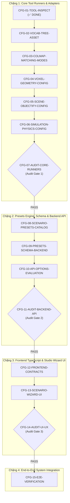

# Real2Sim Studio — Pipeline Configuration & Vocabulary Tree Upgrade

Scope clarification (user instruction, 2026-10-13): `FILES YOU MAY MODIFY` lists examples, not an exhaustive boundary. Inspect and change all files necessary for the requested behavior, and record additional paths in each task. Preserve unrelated work.

> **Mục tiêu:** Nâng cấp toàn diện hệ thống cấu hình pipeline Real2Sim Studio, giải phóng các tham số bị gán cứng (hardcode), hỗ trợ COLMAP Vocabulary Tree cho video quay 360°, mở rộng cấu hình Lưới va chạm Voxel, Tách vật thể CoACD, Mô phỏng OpenUSD, cung cấp bộ gợi ý Preset kịch bản tự động theo đặc thù dữ liệu đầu vào và nâng cấp Web Studio Scenario Wizard UI.

---

## Danh Mục 15 Tasks Theo Thứ Tự Thực Hiện Chuẩn

Hệ thống được chia thành 4 chặng phát triển rõ ràng với **3 Cổng kiểm toán trung gian (Intermediate Audit Gates)** xen kẽ để bảo đảm an toàn kiến trúc và ngăn ngừa triệt để lỗi hồi quy (regressions).

---

## Bảng Chi Tiết Toàn Bộ 15 Tasks

| STT | Mã Task | Trạng Thái | Mô Tả & Mục Tiêu | File Trọng Tâm |
| :---: | :--- | :---: | :--- | :--- |
| **01** | [`CFG-01-TOOL-INSPECT.md`](file:///home/lqaq/PROJECT/AI20K/P-087/tasks/CFG-01-TOOL-INSPECT.md) | ✅ **DONE** | Audit & kiểm tra codebase 8 chặng, điền `CONFIG_CATALOG.md` | `docs/execution/CONFIG_CATALOG.md` |
| **02** | [`CFG-02-VOCAB-TREE-ASSET.md`](file:///home/lqaq/PROJECT/AI20K/P-087/tasks/CFG-02-VOCAB-TREE-ASSET.md) | ✅ **DONE** | Script tải tự động `vocab_tree.bin` (~112 MB) & adapter helper | `scripts/assets/download_vocab_tree.py` |
| **03** | [`CFG-03-COLMAP-MATCHING-MODES.md`](file:///home/lqaq/PROJECT/AI20K/P-087/tasks/CFG-03-COLMAP-MATCHING-MODES.md) | ✅ **DONE** | Mở rộng 3 matching modes (`sequential`, `vocab_tree`, `exhaustive`) | `src/services/reconstruction/rgb/pose/camera_pose.py` `colmap_runtime.py` |
| **04** | [`CFG-04-VOXEL-GEOMETRY-CONFIG.md`](file:///home/lqaq/PROJECT/AI20K/P-087/tasks/CFG-04-VOXEL-GEOMETRY-CONFIG.md) | ✅ **DONE** | Mở rộng Voxel mesh (`smooth` / `faces`) & cờ `--voxel-floor-fill` | `src/services/reconstruction/rgb/geometry/voxel.py` |
| **05** | [`CFG-05-SCENE-OBJECTIFY-CONFIG.md`](file:///home/lqaq/PROJECT/AI20K/P-087/tasks/CFG-05-SCENE-OBJECTIFY-CONFIG.md) | ✅ **DONE** | Gỡ hardcode `_MAX_OBJECTS=60`, truyền config xuống CoACD/LaMa | `src/services/orchestration/scene/objectify.py` |
| **06** | [`CFG-06-SIMULATION-PHYSICS-CONFIG.md`](file:///home/lqaq/PROJECT/AI20K/P-087/tasks/CFG-06-SIMULATION-PHYSICS-CONFIG.md) | ✅ **DONE** | Cấu hình vật lý OpenUSD (`friction`, `restitution`, `ground_plane`) | `src/services/simulation/usd/builder.py` |
| **07** | [`CFG-07-AUDIT-CORE-RUNNERS.md`](file:///home/lqaq/PROJECT/AI20K/P-087/tasks/CFG-07-AUDIT-CORE-RUNNERS.md) | ✅ **PASS** | **Audit trung gian Chặng 1**: Rà soát lệnh CLI & chạy 100% test hồi quy | `tasks/reports/AUDIT_01_CORE_RUNNERS_REPORT.md` |
| **08** | [`CFG-08-SCENARIO-PRESETS-CATALOG.md`](file:///home/lqaq/PROJECT/AI20K/P-087/tasks/CFG-08-SCENARIO-PRESETS-CATALOG.md) | ✅ **DONE** | Xây dựng bộ máy suy luận gợi ý preset `recommender.py` | `src/services/orchestration/processing/recommender.py` |
| **09** | [`CFG-09-PRESETS-SCHEMA-BACKEND.md`](file:///home/lqaq/PROJECT/AI20K/P-087/tasks/CFG-09-PRESETS-SCHEMA-BACKEND.md) | ✅ DONE | Mở rộng schema backend (`models.py`, `config.py`, `dispatch.py`) | `src/services/orchestration/processing/models.py` `processing_presets_v1.json` |
| **10** | [`CFG-10-API-OPTIONS-EVALUATION.md`](file:///home/lqaq/PROJECT/AI20K/P-087/tasks/CFG-10-API-OPTIONS-EVALUATION.md) | ⏳ Ready | Cập nhật REST API `/processing/options` & thêm `POST /suggest` | `src/api/studio/processing.py` `src/api/studio/scenes.py` |
| **11** | [`CFG-11-AUDIT-BACKEND-API.md`](file:///home/lqaq/PROJECT/AI20K/P-087/tasks/CFG-11-AUDIT-BACKEND-API.md) | 🛡️ **GATE 2** | **Audit trung gian Chặng 2**: Kiểm thử ma trận 12 kịch bản API & Job dispatch | `tasks/reports/AUDIT_02_BACKEND_API_REPORT.md` |
| **12** | [`CFG-12-FRONTEND-CONTRACTS.md`](file:///home/lqaq/PROJECT/AI20K/P-087/tasks/CFG-12-FRONTEND-CONTRACTS.md) | ⏳ Ready | Đồng bộ TypeScript contracts (`studio.ts`) & API client | `frontend/src/lib/contracts/studio.ts` `frontend/src/lib/api/studio.ts` |
| **13** | [`CFG-13-SCENARIO-WIZARD-UI.md`](file:///home/lqaq/PROJECT/AI20K/P-087/tasks/CFG-13-SCENARIO-WIZARD-UI.md) | ⏳ Ready | Nâng cấp giao diện Web Studio: Scenario Wizard & Advanced Groups | `frontend/src/features/studio/ProcessingSettings.tsx` |
| **14** | [`CFG-14-AUDIT-UI-UX.md`](file:///home/lqaq/PROJECT/AI20K/P-087/tasks/CFG-14-AUDIT-UI-UX.md) | 🛡️ **GATE 3** | **Audit trung gian Chặng 3**: Kiểm tra UI/UX state, Readonly mode, `pnpm typecheck` | `tasks/reports/AUDIT_03_UI_UX_REPORT.md` |
| **15** | [`CFG-15-E2E-VERIFICATION.md`](file:///home/lqaq/PROJECT/AI20K/P-087/tasks/CFG-15-E2E-VERIFICATION.md) | ⏳ Ready | Nghiệm thu tích hợp toàn trình (E2E), production build & gate report | `tests/integration/test_config_pipeline_e2e.py` |

---

## Nguyên Tắc Thực Thi Bắt Buộc Đối Với AI Coding Agent

1. **Tuân thủ ranh giới sở hữu (Strict Ownership):** Chỉ chỉnh sửa các file nằm trong danh mục `OWNED FILES` và `FILES YOU MAY MODIFY` của từng task. Tuyệt đối không chỉnh sửa `FILES YOU MUST NOT MODIFY`.
2. **Không vượt rào (Audit Gate Enforcement):** Không được nhảy cóc qua các cổng kiểm toán (`CFG-07`, `CFG-11`, `CFG-14`). Phải đạt kết luận `PASS` tại cổng kiểm toán hiện tại thì mới được nhận task tiếp theo.
3. **Môi trường thực thi chuẩn (Executable Truth):**
   - Backend tests: dùng `.venv/bin/pytest <path> -v`.
   - Backend linting: dùng `ruff check <path>` và `ruff format --check <path>`.
   - Frontend tests: dùng `cd frontend && npx vitest run <path>`.
   - Frontend typecheck: dùng `cd frontend && pnpm typecheck`.
   - Frontend build: dùng `cd frontend && pnpm build`.
4. **Bằng chứng rõ ràng (Evidence-based):** Mọi task khi hoàn thành phải đính kèm terminal command log thực tế chứng minh đã chạy test pass 100%.
